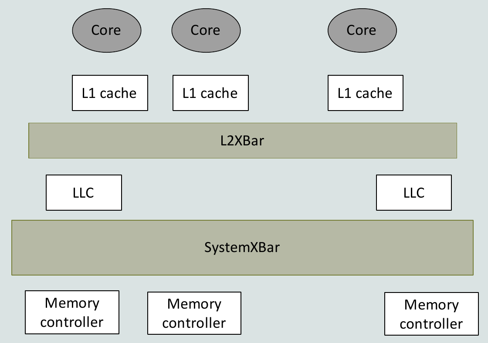

同一个矩阵，按行读取和按列读取会访问相同的元素。以整数求和为例，两种顺序可以得到相同的结果，处理器付出的代价却可能相差很大。要解释这个差异，需要先把程序的地址序列转换成数据在内存层次中的传输过程。

本节以读访问为主，用一个数组算出数据跨越了哪些缓存行。读者需要会进行十六进制运算，并了解数组元素在内存中连续存放的含义。

[[toc]]

## 一次加载从哪一级取得数据 {#locality-hierarchy}

处理器执行一条加载指令时，指令集架构规定使用哪个地址、得到的值怎样进入寄存器，以及什么条件下需要报告异常。微架构则决定怎样取得这个值。与核心很近的存储通常容量有限，远处的存储容量较大，但访问代价更高。高速缓存保存数据副本，让后续加载有机会在离核心更近的位置取数。

在图 1 中，先看一个 Core 及其下面的 L1。数据加载可以先查这一级，命中就能直接取到所需字节。没有找到时，请求可以经互连到达末级缓存（LLC），它是这套配置中离核心最远的缓存。若仍需去内存取数，请求再经系统互连到内存控制器。图中 L1 与 LLC 之间的 `L2XBar` 是互连的名字。不同配置可以在 L1 与末级缓存之间增加别的缓存层。

<figure class="lesson-figure" style="max-width: 600px">
<a href="/microarch/gem5-cache-hierarchy.png" aria-label="查看 gem5 缓存层次原图"></a>
<figcaption>图 1　gem5 Bootcamp 的缓存层次示例。从一个核心向下找 L1、末级缓存和内存控制器。</figcaption>
</figure>

| 缓存状态 | 程序得到的字节 | 一种可能的内部过程 |
| --- | --- | --- |
| 所需数据已位于 L1 数据缓存 | 原地址对应的值 | L1 找到副本并返回 |
| 所需数据未位于 L1，下一级有副本 | 相同的值 | L1 未命中，由下一级缓存提供数据 |
| 各级缓存都没有副本 | 相同的值 | 内存系统从更远处取得数据，再交给核心 |

一次 L1 未命中之后仍可能命中其他缓存。记录命中次数时，要写明在哪一级查找。本文只分析单级缓存的读访问，后面的数值题都假设每笔填充结束后再开始下一笔。

## 把字节地址换成缓存块 {#locality-block}

分析程序之前先确定缓存传输的单位。**缓存块**是按固定大小切分的一段地址空间，**缓存行**是在缓存里容纳这一块的存储位置。行的标记说明当前存的是哪一块，有效位说明这一份记录能否参与命中。在本节的模型中，每行放 64 字节。例题里的地址视为已经完成翻译的物理地址。

把字节地址除以 64，整数商是块号，余数是行内偏移。`0x1020` 的块号是 `0x40`，偏移是 `0x20`，对应的范围是 `0x1000` 到 `0x103f`。读 `0x1024` 时，块号没变，偏移变成 `0x24`。读 `0x1040` 时，块号从 `0x40` 变为 `0x41`，偏移回到 0。判断一次访问可能需要哪些块时，要把所有读取的字节都计入。若一次访问覆盖 `0x103e` 到 `0x1041`，它会触及两个块。

**时间局部性**说的是刚用过的数据有机会很快再用，例如循环反复读取同一个计数值。**空间局部性**说的是访问某个地址后，附近的不同地址也有机会被用到，例如顺序读数组。缓存按块保存数据，所以连续访问 `0x1020` 和 `0x1024`，会表现为在缓存行层面重复使用同一块。若两次之间该块仍有效，第二次可以直接用已有副本。

## 访问相同的数据，为什么取行次数不同 {#locality-order}

下面把相同的八次访问按两种顺序排列。设缓存开始为空，只能保存任意两条 64 字节的行。空间用满时，换掉最久没访问的行。这里关闭预取，只数需求引起的填充。A、B、C、D 四条行的起点分别为 `0x2000`、`0x2040`、`0x2080`、`0x20c0`。

| 顺序 | 实际访问 | 取行次数 |
| --- | --- | ---: |
| 用完一行再读下一行 | A A B B C C D D | 4 |
| 四行轮流读，读两轮 | A B C D A B C D | 8 |

第一种顺序进入每一行时填充一次，紧接着的访问复用刚取得的数据。第二种顺序里，第一次访问 D 后只剩 C 和 D。再次读取 A 时，A 已经被换掉。这个 A 又会换掉 C，随后 B 换掉 D。第二轮也需要四次填充。两组访问涉及的地址和次数完全相同，差别来自同一行再次被用到之前插入了多少其他访问。

若每对访问都读该行的同一个字，复用来自时间局部性。把每对改成分别读取行起点处的字和后面 4 字节处的字，取行次数仍是 4 和 8。现在程序读取的是不同地址，第一种顺序还能复用整行，体现的是空间局部性。硬件用缓存行记录数据，因此可以把这两种程序行为转成相同的取行结果。类似的推理可用于判断[矩阵的两种遍历顺序](./microarch-01d-cache-traversal.md)。

::: details 练习：把容量增到四行
同样轮流读 A B C D 两轮。若缓存可保存四条行，填充数变成多少？地址序列的局部性变了吗？

第一轮填充四次，第二轮全部命中。访问序列本身没有变化，变的是缓存能否把四行一直保留到下一轮。下一节会继续说明，即使总容量足够，位置受限时也可能出现替换。
:::

## 怎样从复用距离推出命中 {#locality-reuse}

前面两种顺序用到了相同的四条行，访问范围一样大。决定一条行有没有留到下次使用的，是两次使用之间还访问了多少条**不同的其他行**。在本节约定中，这个数量叫**复用距离**。第一次读某块时没有上一次访问，单独记作首次访问。

仍用刚才的 A、B、C、D，这次每个字节地址只读一次。表中每项是 4 字节加载，所有这些地址都按 4 字节对齐。

| 次序 | 字节地址 | 块 | 与上次使用之间的其他块 | 复用距离 |
| ---: | --- | --- | --- | ---: |
| 1 | `0x2000` | A | 首次访问 | — |
| 2 | `0x2040` | B | 首次访问 | — |
| 3 | `0x2044` | B | 无 | 0 |
| 4 | `0x2004` | A | B | 1 |
| 5 | `0x2080` | C | 首次访问 | — |
| 6 | `0x20c0` | D | 首次访问 | — |
| 7 | `0x2008` | A | C、D | 2 |
| 8 | `0x2048` | B | A、C、D | 3 |

第 4 次要特别看清楚。此前访问过 B 两次，但只需要在缓存里留一条 B，所以 A 的复用距离是 1。第 7 次读 A 时，C 和 D 都比它更晚被使用。若缓存只有两条行，两条位置都留给了更近的块，A 已被换出。容量为三条时，A 还可以留在第三个位置，本次命中。

这里采用全相联缓存，任意块都能放到任意可用行，替换策略为精确 LRU，也就是满时换掉最久未用的一行。把已经出现的块按从近到远排列，容量为 $C$ 行的缓存始终保存最前面的 $C$ 条，或在不足 $C$ 条时保存全部。一次复用的距离为 $d$，表示目标前面排着 $d$ 个不同的块。它只在 $d<C$ 时命中。因此四次首次访问一定未命中，距离等于或超过容量的复用也会未命中。用同一张表能算出容量为 1、2、3、4 行时未命中分别为 7、6、5、4 次。

下面的 Python 3 程序复算这张表。`recent` 记录所有已经出现的块，列表位置从最近使用的 0 开始。每次先读目标的旧位置，再把它移到最前面。`covered_blocks` 也可以计算后面整个数组覆盖的块号。

```python
def covered_blocks(start, byte_count, line_size):
    assert start >= 0 and byte_count > 0 and line_size > 0
    first = start // line_size
    last = (start + byte_count - 1) // line_size
    return range(first, last + 1)


def reuse_distances(blocks):
    recent = []
    for block in blocks:
        if block in recent:
            distance = recent.index(block)
            recent.pop(distance)
        else:
            distance = None
        recent.insert(0, block)
        yield distance


def miss_count(distances, capacity):
    return sum(distance is None or distance >= capacity for distance in distances)


addresses = (0x2000, 0x2040, 0x2044, 0x2004,
             0x2080, 0x20C0, 0x2008, 0x2048)
blocks = [addr // 64 for addr in addresses]  # 题中各次加载都在一块内
distances = list(reuse_distances(blocks))
counts = [miss_count(distances, capacity) for capacity in range(1, 5)]
assert distances == [None, None, 0, 1, None, None, 2, 3]
assert counts == [7, 6, 5, 4]
assert len(covered_blocks(0x1020, 160, 64)) == 3
assert len(covered_blocks(0x1030, 160, 64)) == 4
print("distance:", distances)
print("misses with 1 to 4 lines:", counts)
```

这条判据对应全相联、精确 LRU 的题设。遇到组相联缓存，只有竞争同一组的块才会占用这一组的路。若采用其他替换策略或启用预取，实际驻留还会受这些规则改变。[下一节的组内替换例题](./microarch-01b-cache-mapping.md#cache-replacement)会先找出三个地址为什么落入同一组，再判断哪一行被换出。

## 一次数组扫描会跨越几行 {#locality-scan}

一个数组有 40 个连续的 4 字节元素，首地址为 `0x1020`。数组共 160 字节，末地址为 `0x1020 + 160 - 1 = 0x10bf`。将首、尾地址分别向下对齐到 64 字节边界，得到 `0x1000`、`0x1080`，中间还有 `0x1040`。整个数组覆盖三行。若一开始三行都不在缓存中，且扫描期间没有预取和替换，顺序读取会引起三次行填充。

可以把该方法写成一般形式。设起始地址为 $a$，总字节数为 $n>0$，行长为 $B$ 字节。从 $a$ 到 $a+n-1$ 的地址连续，因此经过的块号也连续。首、末块号之差加一便是块数。

$$
N = \left\lfloor \frac{a+n-1}{B} \right\rfloor
  - \left\lfloor \frac{a}{B} \right\rfloor + 1
$$

将同一个数组移到 `0x1030`，只改变了首地址。末字节变为 `0x10cf`，数组覆盖四行。这个结果说明，数组的空间局部性仍然存在，**对齐**却会改变需要取得的行数。局部性和对齐分别解释“相邻访问能否复用一行”和“首尾怎样落在行边界上”。

若每次填充都带入 64 字节，两个地址布局在上述冷缓存题设下分别需要带入 192 和 256 字节。程序使用的数据仍是 160 字节。把首地址重新对齐可以减少覆盖的块数，缩短复用距离则可以帮助已经取回的块留到下一次使用。改动程序时，可以分别检查地址边界和访问顺序。

这里的两种扫描都会在同一行内多次访问。连续几次跨行的地址还可能呈现固定增量，[步长预取器](./microarch-02-prefetch.md#prefetch-observe)利用观察到的序列尝试在需求到来前把后面的行取来。分析时先弄清哪个缓存层看到了哪些地址，再判断能否预测下一行、数据能否及时返回。

::: details 练习：只读取每四个元素中的第一个

取首地址 `0x1020` 的原数组，依次读下标 0、4、8，直到 36。若缓存初始为空，且读取期间无替换和预取，需要填几条行？程序实际读取了多少字节？

这十次读取的起始地址每次增加 16 字节，从 `0x1020` 到 `0x10b0`。它们仍落在 `0x1000`、`0x1040`、`0x1080` 三块里。仍要填三行，共 192 字节，而程序使用了其中 40 字节。要减少填充次数，需要把要读的元素集中到更少的块里。
:::

## 参考文献

- [《深入理解计算机系统》作者的访问顺序实例](https://csapp.cs.cmu.edu/3e/perspective.html#memory-systems)
- [RISC-V 关于缓存块及块大小的定义](https://docs.riscv.org/reference/isa/unpriv/cmo.html)
- [Mattson 等，Evaluation Techniques for Storage Hierarchies，LRU 栈处理](https://doi.org/10.1147/sj.92.0078)
- [Marjan Fariborz，gem5 Bootcamp《Cache Systems》第 14 页](https://gem5bootcamp.github.io/gem5-bootcamp-env/assets/slides/using-gem5-04-gem5-caches-tutorial.pdf#page=14) · [CC BY 4.0 许可](https://github.com/gem5bootcamp/gem5-bootcamp-env/blob/51590ae00b0e451c9b6a8854addbb94128ab4cac/LICENSE) · 本文裁出原图并以灰度显示。

<nav class="article-nav" aria-label="系列文章导航">

[<span class="article-nav-text"><small>上一篇</small><strong>微架构安全入门</strong></span>](./microarch-00-intro.md){.article-nav-card .article-nav-prev rel=prev}

[<span class="article-nav-text"><small>下一篇</small><strong>缓存怎样查找和替换一行</strong></span>](./microarch-01b-cache-mapping.md){.article-nav-card .article-nav-next rel=next}

</nav>
