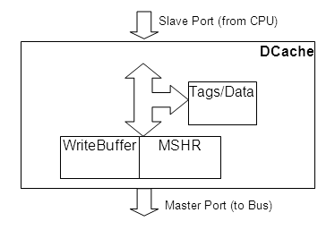
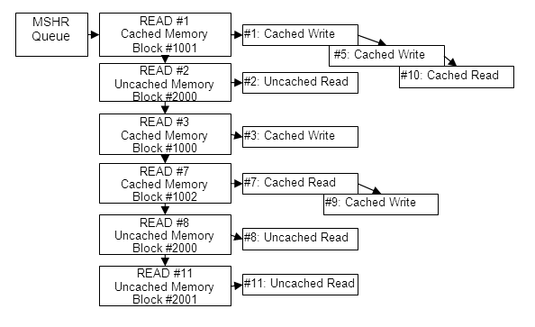

缓存查不到某个地址的数据，就要向下一级请求一整行。在数据回来之前，核心可能又要读这行的另一个位置，也可能要读取其他块。要允许这些访问重叠，缓存必须保存已经受理但尚未完成的请求，还要避免同一行被重复请求。

下面沿用[组相联缓存的查找过程](./microarch-01b-cache-mapping.md#cache-lookup)，重点看标记查找未能满足请求以后发生什么。实现对照采用 gem5 v24.1.0.3 的经典一致性缓存。所用地址、数据和周期由例题给定，适用于普通可缓存读，假设响应成功、按需填充，且返回的数据和读权限足以满足所有读等待者。

[[toc]]

## MSHR 位于缓存的哪条路径上 {#mshr-structure}

阻塞式缓存可以把一次未命中处理完再接收下一次访问。非阻塞缓存允许部分访问先完成，例如在等第一个块时，先返回另一个已经驻留的块，也可以让两个不同块的未命中同时在途。能重叠多少，要看缓存的查找端口和用于保留请求的资源。

图 1 中，上端通向核心，下端通向互连和下一级。**Tags/Data** 是平时查标记和取数据的阵列。**MSHR**（Miss Status Holding Register，未命中状态保持寄存器）所在的结构，为尚未完成的请求保存状态。**WriteBuffer** 是另一条下行路径，保存需要发往下一级的写数据，例如被移出的脏行。后面一课会跟踪[写回缓冲怎样留住脏行](./microarch-01e-cache-stores.md#write-back-buffer)。图沿用旧文档的端口称呼，以下按连接方向称为核心侧和下级侧。

<figure class="lesson-figure" style="max-width: 374px">
<a href="/microarch/gem5-classic-cache.png"></a>
<figcaption>图 1　gem5 经典数据缓存中的阵列、MSHR 和写缓冲。</figcaption>
</figure>

理解它们的分工，可以先问三个问题。

| 要判断什么 | 查哪一份状态 |
| --- | --- |
| 数据已经到了吗，当前能直接读吗 | 缓存阵列的标记、数据和有效、可读状态 |
| 这一块是不是已经在取 | MSHR 表项中的块地址和发包状态 |
| 数据回来后要回复哪些请求，各取哪些字节 | 该表项保存的原始请求列表 |

下一级的流量以块为单位，核心侧的返回仍以原始加载为单位。一个 MSHR 表项通常按一个块来跟踪，但一块中有多个加载等待数据时，每个加载都要保留自己的地址、大小和响应上下文。

## 一条 MSHR 表项保存什么 {#mshr-entry}

图 2 放大了 MSHR 队列与其中的等待者。以 `Cached Memory Block #1001` 为例，中间的大框是一个块的在途记录，向右串着的 `#1`、`#5`、`#10` 是原始请求。图中只保留原图的 MSHR 部分，请求类型和编号沿用原文档。下面只借用它的结构，用三个读请求看数据怎样返回。

<figure class="lesson-figure" style="max-width: 594px">
<a href="/microarch/gem5-mshr-queues.png"></a>
<figcaption>图 2　MSHR 的块表项及其等待请求。点击查看大图。</figcaption>
</figure>

在 gem5 这一版中，表项和等待者分别保存如下状态。这里的“可发”描述调度资格，“在服务中”描述本级已经把请求交给下一级，二者发生在不同的时刻。

| 字段 | 保存的内容 | 什么时候使用 |
| --- | --- | --- |
| `blkAddr`、`blkSize` | 对齐的块起点与块大小 | 判定新请求是否指向同一块，构造向下的整块请求 |
| `isSecure` | 请求所属的安全地址空间属性 | 这一实现同时比较块地址和该属性 |
| `readyTime`、`order` | 最早可调度时刻、用于协调请求顺序的编号 | 选择何时尝试发出以及怎样处理有顺序约束的请求 |
| `inService` | 下级侧是否已接受本轮请求 | 区分还在等发包与已经交给下一级 |
| `targets` | 可由当前阶段处理的请求 | 返回时从中选出本次响应能够满足的请求 |
| `deferredTargets` | 需要额外条件或后续一轮处理的请求 | 当前响应到达后重新判断，必要时继续请求 |
| 每个 `target` 的 `pkt` 和时间、来源等 | 原始请求包与等待者自身的信息 | 从原地址确定返回的字节范围，并为原请求准备响应 |

`readyTime` 到了，端口仍可能忙。gem5 在发送成功后才设置 `inService`。若下一级不接受这次发送，表项仍然持有等待者，等下级端口允许重试时再构造并发送请求。这样，上游已把加载交给本级和下级已接受本级请求可以相隔若干周期。

## 同一份返回数据怎样交给多条加载 {#mshr-trace}

行长为 64 字节。主例有 R1、R2、R3 三笔 4 字节加载。下表中的字节用于核对数据通路，假定小端。另设 H 读取已经在本级的块 C。H 只用来观察一次命中能否越过未完成的未命中。

| 加载 | 字节地址 | 对齐后的块地址 | 行内偏移 | 读到的四个字节 |
| --- | --- | --- | --- | --- |
| R1 | `0x1044` | A，`0x1040` | 4 至 7 | `04 05 06 07` |
| R2 | `0x1064` | A，`0x1040` | 36 至 39 | `24 25 26 27` |
| R3 | `0x10c8` | B，`0x10c0` | 8 至 11 | `48 49 4a 4b` |
| H | `0x110c` | C，`0x1100` | 12 至 15 | `8c 8d 8e 8f` |

R2 的地址比 R1 大 32 字节，两者仍落在同一个对齐区间内。两个请求都得到自己的四字节数据，所以只按块地址保留一个请求包仍不够。要合并的是对下一级的读事务，上行仍要分别回应 R1 和 R2。

假设 A、B 开始时都未缓存。这里有两项用于未命中的槽位，每项至少能保存两个等待者。各次填充在收到整行时立即完成，不计本级的响应排队。

| 周期 | 发生的事件 | 状态或数据怎样变化 |
| ---: | --- | --- |
| 10 | R1 读 `0x1044` | 查标记未命中，为 A 分配表项，记下 R1，本轮尚未发出 |
| 12 | 下一级接受 A 的读请求 | A 变为在服务中，等待者仍是 R1 |
| 15 | R2 读 `0x1064` | 标记仍未命中，查到 A 的 MSHR，将 R2 追加到当前等待者 |
| 16 | H 读 `0x110c` | C 已驻留且可读，直接返回 `0x8f8e8d8c` |
| 18 | R3 读 `0x10c8` | 为 B 分配另一项，下一级当拍接受 B 的读请求 |
| 60 | B 的整行回来 | 填入 B，取出偏移 8 至 11 回应 R3，释放 B 的表项 |
| 80 | A 的整行回来 | 填入 A，用偏移 4 至 7 和 36 至 39 分别回应 R1、R2，释放 A 的表项 |

R1、R2、R3 都发生了标记查找未命中，但只有两笔下行读事务。第 15 周期，R2 查到的是已有的 MSHR，仍要等到第 80 周期才能获得自己的数据。H 在未命中尚未完成时直接命中，称为 **hit under miss**。B 与 A 的缺失事务重叠，称为 **miss under miss**。R3 返回得比 R1 早，指令最终以何种顺序更新程序可见状态，还要看[执行与退休](./microarch-03-execution.md#ooo-retire)。

对照源码，`sendMSHRQueuePacket` 发出请求时会在包的发送上下文中保留 MSHR。收到响应时，`recvTimingResp` 取回这份上下文，在常规读填充路径更新缓存块，再让 `serviceMSHRTargets` 服务这次能满足的等待者。真实实现还可能计入首个数据与后续数据的时序、端口排队，不能从这个例题推出各等待者必定同拍收到响应。

## 表项满了，和单项的等待者满了有什么区别 {#mshr-limits}

把表项总数改成一项，R3 在第 18 周期找不到自己的块，也找不到可分配的项。在允许同块请求继续进入的教学模型中，R2 仍能合并，因为 A 已经有表项。若总数仍为两项，但 A 的等待者容量为一，R2 则会因为 A 的那一项没有空位被推迟。第一个条件限制在途块数，第二个条件限制一笔块事务能保留的原始请求数。

gem5 将这两种容量分别暴露为 `mshrs` 和 `tgts_per_mshr`。它的经典缓存还会在资源达到阻塞条件时，通过核心侧端口拒绝暂时无法接收的新请求，解除阻塞后再通知重试。此时连原本可命中的请求也可能受端口阻塞影响。不能仅从“有一个块已缓存”推断它在别的请求受阻时始终能通过。下方代码把容量约束放在表项和等待者上，便于分别把两个限制改一遍。

### 沿主例数一数槽位 {#mshr-capacity-trace}

先按主例使用两项 MSHR，每项最多容纳两个读等待者。表中列出事件处理之后的占用。已发往下一级的事务仍占着表项，直到响应服务完等待者。H 在 C 中命中，不需要另占 MSHR。

| 事件之后 | A 的表项 | B 的表项 | 已占表项／等待者 |
| --- | --- | --- | --- |
| 第 10 周期 R1 到达 | `[R1]`，尚未发出 | 空 | 1／1 |
| 第 12 周期 A 发出 | `[R1]`，在服务中 | 空 | 1／1 |
| 第 15 周期 R2 到达 | `[R1, R2]`，在服务中 | 空 | 1／2 |
| 第 18 周期 R3 到达 | `[R1, R2]`，在服务中 | `[R3]`，在服务中 | 2／3 |
| 第 60 周期 B 返回 | `[R1, R2]`，在服务中 | 空 | 1／2 |
| 第 80 周期 A 返回 | 空 | 空 | 0／0 |

第 15 周期新增的是 A 的一个等待者，表项数没有增加。第 18 周期新增的是另一块 B 的事务，表项数和等待者数各增加一。若现在有一笔对第三块 D 的读，在第 18 至 60 周期之间到达，两个表项都被占用，需要等待可接收的机会。第 60 周期 B 完成后，B 的槽位才可用于新事务。这个判断假设 D 的请求未被缓存或其他事务满足，且省略端口与仲裁的额外等待。

::: details 练习｜等待 A 的第三个请求

仍用两项表项和每项两个等待者。若对 A 的第三笔读在第 19 周期到达，能否放进 B 返回后空出的表项？

不能把 A 的请求分配给 B 的空槽当作另一笔 A 事务。在这个教学模型中，先查到 A 已有表项，而 A 的两个等待者位置已经用满。请求需要等待 A 的目标列表可以接收它，或等 A 返回后重新查找缓存。B 释放只改变表项总量，不增加 A 自己的等待者容量。
:::

还有一种无法马上合并的情况与空间无关。假设 R2 改成需要可写副本的存储，而 A 已经发出请求，预期只返回可读副本。这次响应能够满足 R1 的加载，却还不足以完成 R2 的存储。该版 gem5 会根据在途状态和当前响应能给出的权限判断是否把后到的请求放在 `deferredTargets`。如果回包实际已有所需权限，可以提升并处理这些等待者，否则还须继续请求。这里的可写状态来自缓存一致性，与页表决定程序能否写该地址是两个层面的检查。获取可写副本的过程见[缓存一致性一课](./microarch-01f-coherence.md#mesi-upgrade)。

### 读请求发出后，同一行又来了写请求 {#mshr-read-then-write}

沿用块 A 的时序，把第 15 周期的 R2 换成 W2。W2 向 `0x1064` 写入四个字节 `ef be ad de`。假设页面允许写入，缓存采用写分配，各队列都有空位。R1 在第 12 周期已经向下发出，它需要取到 `0x1044` 所在的整行。W2 地址虽然落在同一行，还需要一致性协议授予写权限。假设当前 MSHR 并不预期收到可写副本，且没有其他改变顺序的事务，gem5 的 `allocateTarget` 会先把 W2 放到 `deferredTargets`，R1 仍留在 `targets`。

回包前还不能确定这次读取实际获得的权限。第 80 周期收到整行后，填充逻辑根据响应更新缓存块状态。此后有两条路径。

<div role="region" tabindex="0" aria-label="首次回包权限怎样影响等待中的写请求" style="max-width:100%; overflow-x:auto">

| 第 80 周期的回包 | R1 如何完成 | W2 如何完成 | A 的下行事务数 |
| --- | --- | --- | ---: |
| 只给可读副本，另一缓存保留共享副本 | 从偏移 4 至 7 读取原数据 | MSHR 继续跟踪 W2，向下请求写权限。假定第 100 周期获得权限，再更新偏移 36 至 39 | 2 |
| 给可写副本，无待处理的失效或降级 | 从相同偏移读取相同字节 | `promoteWritable` 在服务等待者之前，把 W2 移回 `targets`，用本次填充完成写入 | 1 |

</div>

在第一种情况下，`promoteDeferredTargets` 会把尚未完成的 W2 移到下一轮的请求列表，原表项重新等待发送。在等待写权限期间，缓存还会清除这条行的 `ReadableBit`，避免随后到来的读直接返回写入前的旧数据。例如第 90 周期有一笔加载来读 `0x1064`，标记即使匹配，也不能当作一次普通的可读命中。到 W2 完成后，偏移 36 至 39 才是新字节；偏移 4 至 7 没有被覆盖。表中的周期用来区分事件先后，真实时延由缓存和互连决定。

::: details 练习｜把 W2 提前到发包前

把 W2 改在第 11 周期到达，且它能追加到 R1 所在的 `targets`。在第 12 周期第一次构造包时，应申请什么权限？

目标列表会把 `needsWritable` 置位。第一次下行请求就按同组等待者的需求申请可写副本，回包取得写权后可以处理两笔请求。本题因此只有一轮下行事务。改变的是包构造时已经知道哪些请求的需求。
:::

### 取得写权限后，哪些字节真正变了 {#mshr-write-byte-trace}

把 R1、W2 与后到的读放回同一条时间线。沿用第 80 周期只收到可读副本的情形，随后在第 100 周期拿到写权限。下表的字节按地址从低到高排列，只列出块 A 中被访问的两个范围。假设没有其他写入或失效，而且新到的读在 W2 完成后才能取得这一版数据。

| 事件 | `0x1044–0x1047` | `0x1064–0x1067` | 上游能得到的结果 |
| --- | --- | --- | --- |
| 第 80 周期，整行填入 | `04 05 06 07` | `24 25 26 27` | R1 读取左列，返回 `0x07060504` |
| 第 90 周期，新读访问 `0x1064` | `04 05 06 07` | `24 25 26 27` | 标签可以匹配，但还不能作为普通可读命中返回 |
| 第 100 周期，取得写权限，处理 W2 | `04 05 06 07` | `ef be ad de` | W2 完成，顺序在它之后读取右列会得到 `0xdeadbeef` |

第 80 周期结束时，旧数据已经填入，R1 也已经完成，但 MSHR 仍有工作：它得跟踪尚未满足的 W2。第 100 周期到达的是许可，题设中缓存继续使用已有的那一行数据，只将 W2 覆盖的四个字节换成新值。因此两轮下行事务并不表示两次整行传输。要统计流量，还要看第二轮究竟是对已有副本的升级，还是因为副本已失效而重新索取数据。

::: details 练习｜改读同一行里未被修改的位置

若第 90 周期的新读改为读取 `0x1044`，四个字节与 W2 完全不重叠。它能否按本例的可读位直接命中？后来读取的值是多少？

仍不能直接命中。可读位属于整条缓存行，等写权限时对行内这两个范围都生效。恢复可读后，左列没有被 W2 覆盖，加载返回 `0x07060504`。同一条行的访问资格与实际改写的字节范围要分别推导。

:::

## 用代码重放例题 {#mshr-model}

下面的 C11 模型把缓存行、MSHR 表项和待重试请求分开保存。每拍先处理回包，再处理新到加载和重试，最后允许端口发送一笔读请求。这样，第 80 周期的重试能看到当拍已经填好的 A。此顺序由例题规定。模型的缓存可同时保留 A、B、C，省略替换与一致性消息。

保存为 `mshr_read.c`。用 `gcc -std=c11 -O2 -Wall -Wextra mshr_read.c -o mshr_read` 编译，再运行 `./mshr_read`。

```c
#include <assert.h>
#include <stdbool.h>
#include <inttypes.h>
#include <stdint.h>
#include <stdio.h>

enum { LINE_BYTES = 64, LINES = 3, READS = 4, SLOTS = 2, TARGETS = 2 };
enum { A, B, C };
enum RequestState { NEW, RETRY, WAITING, DONE };

static const unsigned base[LINES] = {0x1040, 0x10c0, 0x1100};
static const unsigned delay[LINES] = {68, 42, 0};

struct Request {
    const char *name;
    unsigned address;
    unsigned arrival;
    enum RequestState state;
};

struct Miss {
    bool used;
    bool sent;
    unsigned line;
    unsigned return_at;
    unsigned targets[TARGETS];
    unsigned count;
};

struct Cache {
    bool resident[LINES];
    uint8_t data[LINES][LINE_BYTES];
    struct Miss pending[SLOTS];
};

static void respond(struct Request *request, const uint8_t bytes[],
                    unsigned offset, unsigned cycle, const char *source)
{
    uint32_t word = 0;
    for (unsigned i = 0; i < 4; ++i)
        word |= (uint32_t)bytes[offset + i] << (8 * i);
    printf("up %u %s %s 0x%08" PRIx32 "\n",
           cycle, request->name, source, word);
    request->state = DONE;
}

static void install(struct Cache *cache, unsigned line)
{
    for (unsigned i = 0; i < LINE_BYTES; ++i)
        cache->data[line][i] = (uint8_t)(line * LINE_BYTES + i);
    cache->resident[line] = true;
}

static void fill(struct Cache *cache, struct Miss *miss,
                 struct Request reads[], unsigned cycle)
{
    unsigned line = miss->line;
    install(cache, line);
    for (unsigned i = 0; i < miss->count; ++i) {
        struct Request *request = &reads[miss->targets[i]];
        respond(request, cache->data[line], request->address - base[line],
                cycle, "fill");
    }
    miss->used = false;
}

static void accept(struct Cache *cache, struct Request reads[], unsigned index,
                   unsigned cycle, unsigned entries, unsigned target_limit)
{
    struct Request *request = &reads[index];
    unsigned block = request->address / LINE_BYTES * LINE_BYTES;
    unsigned line = 0;
    while (line < LINES && base[line] != block)
        ++line;
    assert(line < LINES && request->address - block <= LINE_BYTES - 4);
    if (cache->resident[line]) {
        respond(request, cache->data[line], request->address - block,
                cycle, "hit");
        return;
    }

    struct Miss *empty = NULL;
    for (unsigned i = 0; i < entries; ++i) {
        struct Miss *miss = &cache->pending[i];
        if (!miss->used) {
            if (!empty)
                empty = miss;
        } else if (miss->line == line) {
            if (miss->count < target_limit) {
                miss->targets[miss->count++] = index;
                request->state = WAITING;
            } else {
                request->state = RETRY;
            }
            return;
        }
    }

    if (!empty) {
        request->state = RETRY;
        return;
    }
    *empty = (struct Miss){ .used = true, .line = line,
                            .targets = {index}, .count = 1 };
    request->state = WAITING;
}

static void simulate(unsigned entries, unsigned target_limit,
                     unsigned r2_arrival)
{
    assert(entries > 0 && entries <= SLOTS);
    assert(target_limit > 0 && target_limit <= TARGETS);
    struct Cache cache = {0};
    struct Request reads[READS] = {
        {"R1", 0x1044, 10, NEW}, {"R2", 0x1064, r2_arrival, NEW},
        {"H",  0x110c, 16, NEW}, {"R3", 0x10c8, 18, NEW},
    };
    install(&cache, C);
    printf("entries=%u targets=%u R2=%u\n", entries, target_limit, r2_arrival);

    for (unsigned cycle = 10; cycle <= 150; ++cycle) {
        for (unsigned i = 0; i < entries; ++i) {
            struct Miss *miss = &cache.pending[i];
            if (miss->used && miss->sent && miss->return_at == cycle)
                fill(&cache, miss, reads, cycle);
        }
        for (unsigned i = 0; i < READS; ++i) {
            if ((reads[i].state == NEW && reads[i].arrival == cycle) ||
                reads[i].state == RETRY)
                accept(&cache, reads, i, cycle, entries, target_limit);
        }
        for (unsigned i = 0; i < entries; ++i) {
            struct Miss *miss = &cache.pending[i];
            if (!miss->used || miss->sent || (miss->line == A && cycle < 12))
                continue;
            miss->sent = true;
            miss->return_at = cycle + delay[miss->line];
            printf("down %u 0x%04x\n", cycle, base[miss->line]);
            break;
        }
    }
    for (unsigned i = 0; i < READS; ++i)
        assert(reads[i].state == DONE);
}

int main(void)
{
    simulate(2, 2, 15);
    simulate(1, 2, 15);
    simulate(2, 1, 15);
    simulate(2, 2, 11);
    return 0;
}
```

第一组的输出如下。

```text
entries=2 targets=2 R2=15
down 12 0x1040
up 16 H hit 0x8f8e8d8c
down 18 0x10c0
up 60 R3 fill 0x4b4a4948
up 80 R1 fill 0x07060504
up 80 R2 fill 0x27262524
```

`accept` 先查本级驻留状态，再在使用中的表项里找同一块。扫描遇到空槽时先记下位置，继续找同块，等确认整张表里都没有该块之后才分配空槽。否则表中只要碰巧有空隙，后到的同块请求就可能被误当成新的下行请求。表项的 `targets` 保存原始请求编号。收到 A 时，`fill` 安装一份 64 字节数据，再分别从偏移 4 和 36 取四个字节，发给 R1 和 R2。

| 改动 | 发生变化的事件 | A 的下行次数 |
| --- | --- | ---: |
| 表项减为 1 个 | B 第 80 周期发出，第 122 周期回包 | 1 |
| 每项只收 1 个等待者 | R2 第 80 周期重试，从已填充的 A 命中 | 1 |
| R2 提前到第 11 周期 | R2 加入尚未发送的 A，发送和返回时刻照旧 | 1 |

模型每拍重试被推迟的请求。真实端口可以用重试通知或其他流量控制机制，细节取决于实现。可以从输出反过来检查每个限制。表项不足改变的是 B 开始等待下一级的时刻。等待者不足改变的是 R2 接收数据时走的路径。

## 怎样辨认预取是否赶上需求 {#mshr-prefetch}

若 A 起初由硬件预取发出，需求加载随后到达，同样可以使用已有表项。此时需求仍要等响应，它可能比从需求到达才发包更快，但不会直接从本级阵列命中。若预取已经填进本级，需求才到达，就会从阵列读取。两组下行请求数可以相同，等待时间却不同。

在 gem5 的这条路径，`serviceMSHRTargets` 会区别“一个预取带来的填充还没有被本次核心请求使用”和“响应已经满足了合并进来的核心请求”。前一种条件下可将有效的块标为 `prefetched`，等后续命中时识别预取的使用。进一步把观察、发包与及时性放在一起看，可读[硬件预取器怎样工作](./microarch-02-prefetch.md#prefetch-feedback)。

::: details 练习｜同样两笔下行，R2 还等 A 吗
把 R2 移到第 90 周期，假设从第 80 周期填入以后 A 一直有效。R2 会用哪条返回路径？下一级仍被请求几次？

R2 直接从本级取出偏移 36 至 39，这时 A 的 MSHR 表项已经释放。R1 与 R3 仍各引起一笔下行取行，总数是两笔。用 `simulate(r2_arrival=90)` 可以核对事件里 R2 变成第 90 周期的 `hit`。如果只看下行流量，无法分辨这次命中与主例中第 15 周期的同块合并。
:::

## 参考文献

- [gem5 v24.1.0.3 的等待者分流与权限提升](https://github.com/gem5/gem5/blob/v24.1.0.3/src/mem/cache/mshr.cc#L348)
- [gem5 v24.1.0.3 的回包处理与延后请求重发](https://github.com/gem5/gem5/blob/v24.1.0.3/src/mem/cache/base.cc#L526)
- [gem5 经典缓存的组织](https://www.gem5.org/documentation/general_docs/memory_system/classic_caches/)
- 图 1、图 2 来自 Djordje Kovacevi 的 gem5 内存系统文档，本站版本转为灰度、补白底与边距，图 2 截取原图的 MSHR 部分。[原文与原图](https://www.gem5.org/documentation/general_docs/memory_system/gem5_memory_system/#mshr-and-write-buffer-queues) · [原站 MIT 许可](/microarch/gem5-website-license.txt)
- [gem5 v24.1.0.3 的 QueueEntry 和等待者字段](https://github.com/gem5/gem5/blob/b9da2bfe1e21f6efa2730edd4e80e58c5d965458/src/mem/cache/queue_entry.hh#L57-L114)
- [gem5 的 MSHR 分配、合并和延后等待者](https://github.com/gem5/gem5/blob/b9da2bfe1e21f6efa2730edd4e80e58c5d965458/src/mem/cache/mshr.cc#L303-L429)
- [gem5 核心侧的阻塞与重试](https://github.com/gem5/gem5/blob/b9da2bfe1e21f6efa2730edd4e80e58c5d965458/src/mem/cache/base.cc#L130-L185)
- [gem5 下行请求的发送与状态更新](https://github.com/gem5/gem5/blob/b9da2bfe1e21f6efa2730edd4e80e58c5d965458/src/mem/cache/base.cc#L1907-L1968)
- [gem5 响应填充与等待者处理](https://github.com/gem5/gem5/blob/b9da2bfe1e21f6efa2730edd4e80e58c5d965458/src/mem/cache/base.cc#L515-L619)
- [gem5 响应、等待者和预取标记](https://github.com/gem5/gem5/blob/b9da2bfe1e21f6efa2730edd4e80e58c5d965458/src/mem/cache/cache.cc#L699-L947)
- [gem5 的表项与等待者容量配置](https://github.com/gem5/gem5/blob/b9da2bfe1e21f6efa2730edd4e80e58c5d965458/src/mem/cache/Cache.py#L99-L105)

<nav class="article-nav" aria-label="系列文章导航">

[<span class="article-nav-text"><small>上一篇</small><strong>矩阵按行读和按列读的缓存开销</strong></span>](./microarch-01d-cache-traversal.md){.article-nav-card .article-nav-prev rel=prev}

[<span class="article-nav-text"><small>下一篇</small><strong>写入缓存后，数据什么时候送到下一级</strong></span>](./microarch-01e-cache-stores.md){.article-nav-card .article-nav-next rel=next}

</nav>
