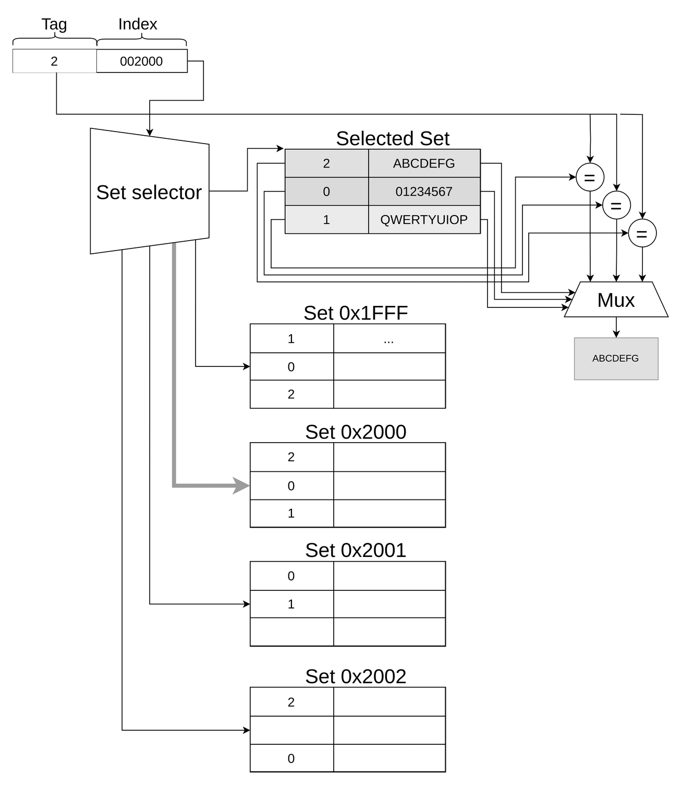

[缓存行与局部性](./microarch-01-cache.md#locality-block)说明了为什么一次只读 4 字节，缓存里却可能多出一整行。接下来要解释两个紧挨着的问题。一条加载怎样在缓存里找到所需字节？找不到时，新行能够放在哪里，要移出哪一行？以下从一次普通的 RISC-V 加载出发，用同一组地址走完查找和替换。

[[toc]]

## 从一条加载得到缓存地址 {#cache-address}

设 `a1 = 0x2bc0`。执行以下指令，加载单元先将基址与指令中的立即数相加，得到 `0x2bc8`。题设已完成地址翻译，物理地址也为 `0x2bc8`，且访问允许。该指令读取从这个地址开始的四个字节。

```asm
lw a0, 8(a1)
```

下面采用一个 32 KiB、8 路组相联、每行 64 字节的数据缓存。容量指数据阵列可以保存的字节数，标记和替换状态另占空间。它共有 `32768 ÷ 64 = 512` 行，每组 8 行，因此有 64 组。**组**是地址查找的范围，**路**是组内可存放一行的一个位置。组号由地址决定。同一个块在该组中可以占据任意一路。

设物理地址为 $a$。用 64 除地址，整数商是**块号**，余数是**行内偏移**。对块号再除以组数，余数选组，整数商作标记。按低位选组的模型中，64 字节行占 6 位偏移，64 组占接下来的 6 位。

<div role="region" aria-label="地址的组号、标记和偏移" style="max-width:100%; overflow-x:auto">

| 字段 | 用 `0x2bc8` 计算 | 本次取值 |
| --- | --- | --- |
| 行内偏移 `a[5:0]` | `0x2bc8` 对 64 取余 | `0x08` |
| 组号 `a[11:6]` | 块号 `0xaf` 对 64 取余 | `0x2f` |
| 标记 `a[12]` 及以上 | 块号 `0xaf` 除以 64 的整数商 | `0x2` |

</div>

手算时也可以把地址拆开看。块起点 `0x2bc0` 加偏移 8 得 `0x2bc8`，所以四字节覆盖行内偏移 8 至 11。组号与标记可以反向拼回块地址。第 `0x2f` 组标记为 2 的有效行对应块号 `2 × 64 + 47 = 175`，乘行长得到块起点 `0x2bc0`。缓存移出旧行时，也需要知道旧行对应的地址。若该行因写入而变脏，相同的重建过程可以为[写回](./microarch-01e-cache-stores.md#store-trace)提供块地址。

固定数据容量和行长时，路数增加，组数就会减少，组号所占的位数也随之改变。每组只有一路是直接映射，只剩一组是全相联。这些位域结论针对本文的简单索引。有些具体实现会哈希索引或对不同路采用不同映射，届时仍可沿着选位置、匹配标记、选择数据来分析。

## 从标记比较到加载结果 {#cache-lookup}

图 1 展示选组、比较和数据选择的连线。从顶部的 `Index` 跟到 `Set selector`，可看出一次查询只选一个组。再跟顶部的 `Tag`，它被送到所选组各路的等号比较器。右边 `Mux` 是多路选择器，用比较结果选出对应的数据。图中示意三路，地址和路数另取；本节的 `0x2f` 组按同样的结构选出八个候选位置。

<figure class="lesson-figure" style="max-width: 560px">
<a href="/microarch/set-associative-cache.png"></a>
<figcaption>图 1　组选择、标记比较与数据选择。图中组号为 0x2000，所选组有三路。点击查看大图。</figcaption>
</figure>

图中画出了标记和数据。完整的命中判定还要读每路的**有效位**。复位后或一条行失效后，存储单元可能仍留着旧标记和字节。有效位为 0 时，比较器即使发现标记相等，也要屏蔽这一路的结果。本例查询前，第 `0x2f` 组有如下状态。

<div role="region" aria-label="所选缓存组的各路状态" style="max-width:100%; overflow-x:auto">

| 路 | 有效位 | 存储的标记 | 偏移 8 至 11 的数据 | 与请求的关系 |
| --- | ---: | --- | --- | --- |
| 0 | 1 | `0x3` | `04 03 02 01` | 标记不同 |
| 1 | 0 | `0x2` | 旧字节 | 标记相等，有效位关闭 |
| 2 | 1 | `0x2` | `78 56 34 12` | 命中 |
| 3 至 7 | 0 | — | — | 无有效行 |

</div>

对每一路，**有效且标记相等**才产生该路的命中信号。任一路的命中信号为 1，就有缓存命中；在正常维护的这个模型中，同一块在同级缓存里只有一条有效记录。因此本次只有路 2 被选中。数据选择逻辑再用偏移 8 取出四个字节，按小端顺序拼成 `0x12345678`。若在 RV64 上运行这条 `lw`，该值的第 31 位为 0，符号扩展后仍为 `0x0000000012345678`。

上面是逻辑数据通路。一种实现可以并行读取多路数据和标记，等标签比较完再选数据。也可以先读标记，等知道命中路后才读该路的数据，从而减少无用的阵列读取。两者的时序和能耗可能不同，对同一组有效位和标记给出的命中结果相同。如果没有一路命中，控制逻辑生成块请求。等待时怎样记录其他加载，由后面的 [MSHR 一节](./microarch-01a-mshr.md)展开。这里先假设每次填充都在下一次加载前完成。

## 组满之后，该换掉哪一行 {#cache-replacement}

为了手算替换，接下来保留 64 组和 64 字节行，把每组缩成两路。数据容量随之变为 8 KiB，组号和偏移的算法都可沿用。把刚才的地址记为 A，再选两个地址 B 和 C。它们每隔 `0x1000`，增加 64 个块，恰好绕组号一圈。

<div role="region" aria-label="A、B、C 的组号与标记" style="max-width:100%; overflow-x:auto">

| 加载 | 字节地址 | 块起点 | 组号 | 标记 |
| --- | --- | --- | --- | --- |
| A | `0x2bc8` | `0x2bc0` | `0x2f` | 2 |
| B | `0x3bc8` | `0x3bc0` | `0x2f` | 3 |
| C | `0x4bc8` | `0x4bc0` | `0x2f` | 4 |

</div>

从空缓存按 A、B、A、C、B 读取。头两个未命中各用一条空路。第四次访问是首次读取 C，此时组里已有两个有效块，必须腾出一个位置。要从其中选出牺牲行，标签阵列以外还要留一份**替换状态**。

- **LRU**（Least Recently Used，最近最少用）比较各路最后一次使用的先后。命中和填充都会让对应路成为最近使用。
- **FIFO**（First In, First Out，先进先出）比较各路装入的先后。命中时装入顺序维持原样。

<div role="region" aria-label="LRU 与 FIFO 的逐次访问结果" style="max-width:100%; overflow-x:auto">

| 访问 | LRU 结果 | LRU 事后顺序，左侧为最近使用 | FIFO 结果 | FIFO 事后顺序，左侧先入 |
| --- | --- | --- | --- | --- |
| A | 未命中 | A | 未命中 | A |
| B | 未命中 | B、A | 未命中 | A、B |
| A | 命中 | A、B | 命中 | A、B |
| C | 未命中，换出 B | C、A | 未命中，换出 A | B、C |
| B | 未命中，换出 A | B、C | 命中 | B、C |

</div>

第三次读 A 时，行仍在原来的路上，两边也都返回相同的字节。变化藏在替换状态里。第四次 C 到达才体现出结果差异。对于两路，精确 LRU 可以用组内一个位指出较久未用的路，任一路被访问后，指针指向它的另一路。对于更多路，需要表示更丰富的先后关系。gem5 v24.1.0.3 的 LRU 为每个候选保存最后一次使用的模拟时间，命中与插入都更新时间，替换时从候选中取最早的一项。这展示了一种可以直接查阅的实现，模拟时间戳不代表芯片采用相同的编码。

### 四路时可以用树近似顺序

以四路树形伪 LRU（Tree-PLRU）为例。根位指向左边两路或右边两路；左右两个子节点再各用一位选其中一路。要找牺牲行，就沿两层指针走到某个叶子。访问过一路后，把从根到该路的各节点指针拨向另一侧，降低刚才一路被立即选中的机会。

设四路均有效，依次接触路 0、1、2、3，再访问 0、1、2。最后访问路 2 时，根指向左半组。左半组最近一次访问的是路 1，所以左子节点指向路 0。树最终选路 0。按真实访问顺序算，最久未被访问的是路 3。这正是“近似”的含义。树状态给出一个牺牲位置，只用 3 位，无法保存四路的一切先后关系。空路是否由外层先处理，以及状态在哪一拍更新，要回到具体实现。

## 用 C 跟踪每路的字段 {#cache-model}

下面的 C11 程序从空缓存开始，依次读取 A、B、A、C、B。读请求只有在完成填充后才进入下一轮。后端有三个 64 字节块，每块在偏移 8 至 11 放入表中的四字节值。用同一串地址分别运行 LRU 和 FIFO，两次运行都从空缓存开始。

保存为 `cache_read.c`，用 `gcc -std=c11 -O2 -Wall -Wextra cache_read.c -o cache_read` 编译，再运行 `./cache_read`。Windows 上运行 `./cache_read.exe`。

~~~c
#include <inttypes.h>
#include <stdbool.h>
#include <stdint.h>
#include <stdio.h>
#include <stdlib.h>
#include <string.h>

enum { LINE_BYTES = 64, SET_COUNT = 64, WAY_COUNT = 2 };

typedef struct {
    bool valid;
    unsigned tag, last_use, inserted;
    uint8_t data[LINE_BYTES];
} Line;

typedef struct {
    unsigned base;
    uint8_t data[LINE_BYTES];
} MemoryBlock;

static const MemoryBlock memory[] = {
    {0x2bc0, {[8] = 0x78, 0x56, 0x34, 0x12}},
    {0x3bc0, {[8] = 0x04, 0x03, 0x02, 0x01}},
    {0x4bc0, {[8] = 0x0d, 0x0c, 0x0b, 0x0a}}
};

static const uint8_t *fetch(unsigned base)
{
    for (size_t i = 0; i < sizeof memory / sizeof memory[0]; ++i) {
        if (memory[i].base == base)
            return memory[i].data;
    }
    fprintf(stderr, "Unknown block 0x%x\n", base);
    exit(EXIT_FAILURE);
}

static uint32_t read_le32(const uint8_t *data)
{
    return (uint32_t)data[0] | (uint32_t)data[1] << 8 |
           (uint32_t)data[2] << 16 | (uint32_t)data[3] << 24;
}

static void read_word(Line cache[SET_COUNT][WAY_COUNT], bool lru,
                      unsigned address, unsigned time)
{
    unsigned block = address / LINE_BYTES;
    unsigned offset = address % LINE_BYTES;
    unsigned set = block % SET_COUNT;
    unsigned tag = block / SET_COUNT;
    Line *ways = cache[set];

    unsigned way = 0;
    while (way < WAY_COUNT && !(ways[way].valid && ways[way].tag == tag))
        ++way;
    bool hit = way < WAY_COUNT;
    bool evict = false;
    unsigned old_base = 0;
    if (!hit) {
        way = 0;
        while (way < WAY_COUNT && ways[way].valid)
            ++way;

        if (way == WAY_COUNT) {
            unsigned age0 = lru ? ways[0].last_use : ways[0].inserted;
            unsigned age1 = lru ? ways[1].last_use : ways[1].inserted;
            way = age0 <= age1 ? 0 : 1;
            old_base = (ways[way].tag * SET_COUNT + set) * LINE_BYTES;
            evict = true;
        }

        memcpy(ways[way].data, fetch(block * LINE_BYTES), LINE_BYTES);
        ways[way].tag = tag;
        ways[way].valid = true;
        ways[way].inserted = time;
    }
    ways[way].last_use = time;

    uint32_t value = read_le32(&ways[way].data[offset]);
    printf("0x%04x  way=%u  data=%08" PRIx32 "  ", address, way, value);
    if (evict)
        printf("evict 0x%04x\n", old_base);
    else
        puts(hit ? "hit" : "fill");
}

int main(void)
{
    const unsigned addresses[] = {0x2bc8, 0x3bc8, 0x2bc8, 0x4bc8, 0x3bc8};
    for (unsigned policy = 0; policy < 2; ++policy) {
        bool lru = policy == 0;
        Line cache[SET_COUNT][WAY_COUNT] = {0};
        puts(lru ? "LRU" : "FIFO");
        for (unsigned i = 0; i < sizeof addresses / sizeof addresses[0]; ++i)
            read_word(cache, lru, addresses[i], i + 1);
    }
}
~~~

```text
LRU
0x2bc8  way=0  data=12345678  fill
0x3bc8  way=1  data=01020304  fill
0x2bc8  way=0  data=12345678  hit
0x4bc8  way=1  data=0a0b0c0d  evict 0x3bc0
0x3bc8  way=0  data=01020304  evict 0x2bc0
FIFO
0x2bc8  way=0  data=12345678  fill
0x3bc8  way=1  data=01020304  fill
0x2bc8  way=0  data=12345678  hit
0x4bc8  way=0  data=0a0b0c0d  evict 0x2bc0
0x3bc8  way=1  data=01020304  hit
```

`read_word` 先把字节地址拆成组号、标记和偏移，再检查该组两路的有效位和标记。第三次访问 A 命中路 0，使 `last_use` 从 1 变为 3，`inserted` 仍是 1。第四次取 C 要选牺牲行。LRU 比的是最后访问时间 3 和 2，换出路 1 的 B。FIFO 比的是装入时间 1 和 2，换出路 0 的 A。输出中的 `evict` 地址由旧标记和组号重新拼出，表示被移出的整条行。填充从后端复制完整的 64 字节，最后由 `read_le32` 在偏移 8 处拼出读取结果。

::: details 练习｜把第三次访问换成 B
只把地址序列的第三项从 `0x2bc8` 改为 `0x3bc8`。第四次取 C 时，两种策略分别移出哪条行？最后一次读 B 会发生什么？

前两次访问以后，A 的装入和最近使用时间都是 1，B 的都是 2。第三次改读 B 后，B 的最近使用时间变成 3，装入时间仍是 2。两种策略都在第四次移出 A，最后读 B 都命中路 1。
:::

## 怎样判断一次未命中属于哪一类 {#cache-miss-types}

“缓存组满了”说明的是局部状态。要区分容量与映射的影响，可以把同一串需求读请求再交给一个总行数相同的全相联 LRU。以下分类以空缓存开始，无预取、无一致性失效，并用 LRU 对照。

<div role="region" aria-label="三类未命中的判断方法" style="max-width:100%; overflow-x:auto">

| 类别 | 判断方法 |
| --- | --- |
| 首次访问未命中 | 访问此前从未出现过的块 |
| 冲突未命中 | 块以前出现过，组相联缓存未命中，但同容量全相联模型命中 |
| 容量未命中 | 块以前出现过，同容量全相联模型仍未命中 |

</div>

例题中第四次读取 C 是首次访问。第五次读取 B 在两路 LRU 中未命中，而同为 8 KiB 的全相联缓存有 128 个位置，足以同时留住三个块，因而最后的 B 属于冲突未命中。容量未命中可用等容量的另一条轨迹构造。依次访问 129 个互异的块，再访问其中第一个；即使完全自由放置，128 行的全相联缓存也已移出第一个块。下一课将把相同的对照方法用到[矩阵遍历](./microarch-01d-cache-traversal.md)上。

::: details 练习｜路数减半，哪一位变成组号
保持最初的 32 KiB 容量与 64 字节行，把相联度从 8 路降为 4 路。重新计算 `0x2bc8` 和 `0x1bc8` 的组号与标记。

总行数仍是 512，组数增加到 128，原先最低的一位标记变成组号的最高位。`0x2bc8` 的块号为 `0xaf`，新组号仍为 `0x2f`，新标记为 1。`0x1bc8` 的块号为 `0x6f`，原组号为 `0x2f`、标记为 1，新组号为 `0x6f`、标记为 0。
:::

## 参考文献

- [MIT 6.004 的缓存工作表](https://ocw.mit.edu/courses/6-004-computation-structures-spring-2017/e3780374f88b6201126fccda717635f7_caches_worksheet.pdf)
- [RISC-V 非特权指令集的加载和存储](https://docs.riscv.org/reference/isa/unpriv/rv32.html#load-and-store-instructions)
- [gem5 组索引的说明](https://www.gem5.org/documentation/general_docs/memory_system/indexing_policies/)
- [gem5 v24.1.0.3 的 LRU 源码](https://raw.githubusercontent.com/gem5/gem5/v24.1.0.3/src/mem/cache/replacement_policies/lru_rp.cc)
- [gem5 对 FIFO 和 Tree-PLRU 等替换策略的说明](https://www.gem5.org/documentation/general_docs/memory_system/replacement_policies/)
- 图 1 由 Chop0 绘制，本页版本改为灰度、白底，缩放尺寸并加留白，同样使用 CC BY-SA 4.0。[原图](https://commons.wikimedia.org/wiki/File:Set-associative_cache.png) · [许可文本](https://creativecommons.org/licenses/by-sa/4.0/)

<nav class="article-nav" aria-label="系列文章导航">

[<span class="article-nav-text"><small>上一篇</small><strong>缓存行与局部性</strong></span>](./microarch-01-cache.md){.article-nav-card .article-nav-prev rel=prev}

[<span class="article-nav-text"><small>下一篇</small><strong>矩阵按行读和按列读的缓存开销</strong></span>](./microarch-01d-cache-traversal.md){.article-nav-card .article-nav-next rel=next}

</nav>
