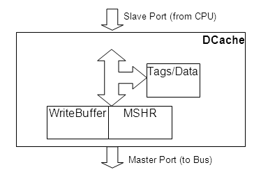

一条存储指令只改四个字节，缓存却可能先取回一整行，过一段时间又把一整行送往下一级。要追踪这两次传输，先看本级怎样合并新旧字节，再看缓存行离开数据阵列以后，谁保留最新值。

本文沿用[组相联缓存](./microarch-01b-cache-mapping.md#cache-address)的低位索引，行长 64 字节、64 组、每组两路，采用精确 LRU。例题只有一个核心。设所用虚拟地址和对应物理地址数值相同，请求已通过页权限检查，字节序为小端。先推演写分配与写回，再改变策略。涉及具体实现时，以 gem5 v24.1.0.3 的经典一致性缓存为对照。

[[toc]]

## 存储从哪里进入缓存 {#store-structure}

核心侧传来存储地址、数据和大小，标记与权限的检查决定数据阵列能否接下这笔存储。图 1 中，下端连接互连。MSHR 发出的缺失或权限请求，与写缓冲送出的写数据共用下行接口。

<figure class="lesson-figure" style="max-width: 374px">
<a href="/microarch/gem5-classic-cache.png"></a>
<figcaption>图 1　沿 Tags/Data 到 WriteBuffer，再到下端的互连接口看写回路径。</figcaption>
</figure>

这里从存储请求交到缓存开始。处理器后端的**存储队列**要处理地址与数据何时就绪、存储何时能提交，并可将尚未写入缓存的值转发给同核的后续加载。缓存内的**写回缓冲**在另一个接口，接手的是准备向下一级移交的数据，例如被替换的脏行。[存储队列和加载转发](./microarch-03d-load-store.md)一课会再看核心内部的部分。

## 缓存没有这一行时怎样写 {#store-allocation}

设 `a0 = 0x1000`、`t0 = 9`、`t1 = 12`。以下两条 `sw` 分别把源寄存器的低 32 位写到基址加立即数得到的地址。设下一级中 A 行的范围为 `0x1000` 至 `0x103f`，其中连续三个字的初值为 5、11、17。

```asm
sw t0, 32(a0)
sw t1, 36(a0)
```

| 行内偏移 | 下一级原有字节 | 第一条写入后，本级字节 | 第二条写入后，本级字节 |
| --- | --- | --- | --- |
| `0x20` 至 `0x23` | `05 00 00 00` | `09 00 00 00` | `09 00 00 00` |
| `0x24` 至 `0x27` | `0b 00 00 00` | `0b 00 00 00` | `0c 00 00 00` |
| `0x28` 至 `0x2b` | `11 00 00 00` | `11 00 00 00` | `11 00 00 00` |

两条指令都访问起点为 `0x1000` 的块。请求范围由行内偏移和 4 字节长度决定。若用 64 位掩码表示该行的字节写使能，第一条打开第 32 至 35 位，第二条打开第 36 至 39 位。其他字节的使能为零，所以表中的第三个字仍是 17。

### 写分配与不写分配

初始 L1 没有 A。采用**写分配**（write allocate）时，缓存记录这笔缺失事务，等待旧数据和所需的一致性写权。两条指令都是局部写入，未被覆盖的字节要保留。本题下级按整行返回，所以第一条存储要先取得 A 的 64 字节，再把四个新字节合入。第二条存储到达时，A 已经有效且可写，直接在本级更新。

在 gem5 经典缓存的常规路径中，没有有效副本且需要写权时，`Cache::createMissPacket` 可以构造整行 `ReadExReq`，取得数据和可写副本。若已经有有效数据但缺写权，可以用 `UpgradeReq` 申请许可，原有数据仍可使用。如果请求覆盖整行且实现识别出这一点，还能走省去读取旧内容的路径。本例的四字节写入仍保留传统的整行填充。

采用**不写分配**（no write allocate）时，未命中的存储交给下一级处理，本级不保留该行。若下一级支持四字节更新，就在那里应用本次存储的范围。随后第一次从本级读 A，仍会因没有本地副本而未命中。

## 脏位决定替换时怎样处理数据 {#store-dirty-bit}

**写直达**（write-through）会将本级更新也交给下一级，可以通过缓冲排队。**写回**（write-back）允许更新暂时只留在本级，用脏状态记录还需转交的修改。选择写入时是否分配，与选择何时传播更新，是缓存的两项决策。

| 行状态 | 对本例有什么影响 |
| --- | --- |
| 有效位 | 说明当前位置能否作为缓存副本，即使标记和数据阵列里仍留着旧内容 |
| 可读、可写状态 | 有效且标记匹配的行仍要具备该次访问所需的权限 |
| 脏位或等价状态 | 指出修改责任仍在本级。替换时要把数据及相应责任移交给后续路径 |

写回模式下，第一条 `sw` 写入后，A 已经是脏行，下一级仍是 5。第二条 `sw` 更新同一行的数据，脏状态保持为真。直到缓存需要回收这一行，两次修改才被放进同一个写回包。一位脏标记只说明整行有待转交的内容，无法指出是哪几个字节被改过。若接口按整行传输，两次四字节写入最后也会发出 64 字节的写回。

假设两次 `sw` 之间又读取 `0x1020`，并且 A 仍有效、可读。第一次存储已将该字改为 9，所以这次本级加载读到 9；它不需要等待下一级原来的 5 更新。第二次存储改的是偏移 `0x24` 处的另一个字，不会覆盖偏移 `0x20` 的 9。稍后生成的整行写回包同时包含这两个新值和其余未修改字节。

如果第二次存储也写 `0x1020`，值为 12，在两次写入均已完成且中间没有其他修改的题设下，本级随后读取到 12，写回包在该字位置也携带 12。脏位从第一次写后一直保持置位，并不记录中间曾经出现过 9。需要恢复写入历史时，单靠最终缓存行和一位脏状态不足以推断写入次数或先后顺序。

## 两次写入后，哪一行被换掉 {#store-trace}

令 B、C 的起点为 `0x2000`、`0x3000`。三个起点相隔 4096 字节，即 64 行，恰好绕组索引一圈，均落在第 0 组。读请求在下一次访问前完成填充。写回包可以在填充后继续等下行接口。下表采用写分配和写回，最近访问的行写在左边。

| 本次操作 | 组内状态 | 下一级中 A 的两个待改字 | 此次接口动作 |
| --- | --- | --- | --- |
| 读 B | B（干净） | 5、11 | 取回 B |
| `sw t0, 32(a0)` | A（脏）、B（干净） | 5、11 | 取回 A，写入 9 |
| `sw t1, 36(a0)` | A（脏）、B（干净） | 5、11 | 本级写入 12 |
| 再读 B | B（干净）、A（脏） | 5、11 | 本级命中，B 更新使用顺序 |
| 读 C 并完成填充 | C（干净）、B（干净） | 5、11 | 取回 C，替换 A，将 A 的整行暂存进写回缓冲 |
| 下一级处理 A 的写回 | C（干净）、B（干净） | 9、12 | 发送并处理一次 A 的整行写回 |

第五步后，A 已离开数据阵列，下一级仍存旧数据。新值 9、12 和没改过的 17 都在等待发送的副本中。写回的起始地址由被替换行的标记与第 0 组反求，得到块起点 `0x1000`。`0x1020` 只标识第一次存储覆盖的字，写回要覆盖整行。

### 被替换的行怎样重新组成写回地址 {#writeback-address}

本题有 64 字节行和 64 组。地址低 6 位是行内偏移，再向上的 6 位是组号，其余高位是标记。填入 C 时，缓存选中的是第 0 组里保存 A 的路。该路的标记为 `0x1`，组号为 `0x00`。重建旧行的起始地址，要把这两个字段放回原位，行内偏移填零。

| 字段 | 数值 | 放回地址中的结果 |
| --- | --- | --- |
| A 的标记 | `0x1` | `0x1 << 12 = 0x1000` |
| 组号 | `0x00` | `0x00 << 6 = 0x0000` |
| 行内偏移 | `0x00` | 写回从行首开始 |

三部分按位或得到 `0x1000`。写回包携带这一地址和从 A 复制出的 64 字节，包含偏移 `0x20`、`0x24` 处的新值。新填入的 C 有相同组号，但标记是 `0x3`。若误用 C 的标记重建写回地址，就会把 A 的数据送到 `0x3000`。因此回收原路之前，缓存必须用旧行的标记、组号和数据构造或保存写回记录。

::: details 练习｜换出同组的 B

若被换出的是块 B，起点为 `0x2000`，组号仍为 0，它的标记和重建后的写回地址分别是多少？

标记是 `0x2`，按 `(标记 << 12) | (组号 << 6)` 得到 `0x2000`。还要看 B 是否带有需要移交的数据，才能决定是否需要脏行写回。
:::

只计数据，三次填充共向上 192 字节，A 的写回向下 64 字节，未包含地址、许可和协议控制。若换成写直达并保留写分配，仍有三次填充。假设下一级支持四字节更新且写缓冲不合并，两次存储共向下送 8 字节。若写直达又取消写分配，B 和 C 才触发本级行填充，向上共 128 字节。同一行写很多次时，写回可以把反复改写的字节合到一次整行传输。实际比较要同时给出传输粒度和统计截止位置。

## 脏行移出数据阵列以后存在哪里 {#write-back-buffer}

为了让原来的路能放 C，缓存要为 A 另留一份待写回的数据。若下级端口暂未接受发送，记录仍须保留，等待接口允许重试。

| 写回记录的内容 | 用主例核对 |
| --- | --- |
| 地址与范围 | 起点 `0x1000`，长度 64 字节 |
| 命令与状态 | 表示需要转交脏数据，并携带相应的一致性或地址空间属性 |
| 数据 | 保存被替换时的整行，包括新的 9、12 和原有的 17 |
| 调度状态 | 何时可申请端口、它与其他请求的顺序，以及下级是否已经接受 |

gem5 的 `BaseCache::writebackBlk` 从缓存块重建地址，构造 `WritebackDirty` 并把整行数据复制到包中。`Cache::doWritebacks` 将适用的包放进写缓冲。`WriteQueueEntry` 保存对齐地址、大小、最早可发时间、顺序以及指向包的记录。端口接受发送后，这一级就可以按协议移交责任。这是相邻两级的交接，后面还有几层以及何时到达主存，取决于系统的布置。

**如果此时又读 A。** 新的 A 读取若绕过等待中的写回，可能从下一级取回旧的 5。gem5 的 `getNextQueueEntry` 在 MSHR 和写缓冲之间作调度，并核对两边是否有同块冲突。它准备发缺失请求时，若有同块的待发写回，可以先服务写回。也有设计会从缓冲直接提供新数据。下面的模型采用等待写回后重试的规则。

**如果写缓冲已满。** 即使 [MSHR](./microarch-01a-mshr.md#mshr-entry) 还有位置跟踪 C 的未完成请求，另外被选中的脏行也必须有地方保存数据，才能安全回收原路。实现可为在途填充预留写回位置，或延后接受新的请求，等写缓冲腾出空间。对照[缺失表项的容量限制](./microarch-01a-mshr.md#mshr-limits)，可以定位这次等待是发生在取行一侧，还是移交脏行的一侧。

### 写回被拒绝后，同一行的读取要等到哪一步 {#write-back-retry}

沿用脏行 A。它从 `0x1000` 开始，偏移 `0x20`、`0x24` 和 `0x28` 处的值是 9、12、17。下一级在偏移 `0x24` 处仍保存旧值 11。A 离开本级数据阵列后，线程立即加载 `0x1024`。此地址虽然不等于写回包的起点，但向下对齐到 64 字节后，两个请求都对应块 `0x1000`。例题只讨论普通缓存内存，无其他核心同时访问 A。假定下一级在接收写回后按同块顺序处理后到的取行请求。

| 周期 | 发生的事 | 本级仍在跟踪什么 |
| ---: | --- | --- |
| 10 | C 填入，被换出的 A 进入写缓冲 | 写缓冲保留 A 的整行新数据 |
| 11 | 对 `0x1024` 的加载未命中 | MSHR 记录块 `0x1000` 和等待读取的字节 |
| 12 | 端口仲裁发现同块待发写回，先尝试发送 A；下一级拒绝 | 写回包仍留在本级，加载还不能取下一级的旧副本 |
| 16 | 下一级通知可以重试，并接收再次发送的写回 | 本级移交 A 的数据，下一级负责后续同块访问的正确顺序 |
| 17 | 本级发出缺失读 | MSHR 继续保留加载，直到整行返回 |
| 23 | 整行返回 | 加载取到偏移 `0x24` 处的新值 12 |

第 12 周期已经选中了写回，但端口拒绝意味着数据还没有交给下一级。第 16 周期交接成功，也只表示相邻两级完成了责任转移。即使写回还未到主存，第 17 周期的读取也可以由持有最新数据的下一级处理。gem5 的仲裁在准备选择缺失项时查找冲突的写回。表中的周期、独立端口尝试与下一级处理时刻均为题设。

::: details 练习｜只改变读取的行内偏移

把读取改成 `0x1028`。它还能在第 12 周期绕过 A 的写回吗？最终读到什么？

两个请求还是匹配块 `0x1000`，因此仍需等待同块写回交接。回包后选取偏移 `0x28` 处的字节，读到 17。即使这些字节这次没有被改过，调度检查仍以同一个块为单位。

:::

### 写缓冲报满时，已经在途的填充怎么办 {#write-back-reserve}

gem5 v24.1.0.3 的经典缓存有两个不同的容量数字。`write_buffers` 是写队列对上游施加阻塞的阈值，实际队列还多分配了 `mshrs` 个备用项。原因是缓存接受缺失并分配 MSHR 时，尚未为这次缺失逐笔占用一个写项。将来数据回来，缓存可能要先把一条脏行移出，才能使用它原先占的路。

沿用 C 填充时换出脏行 A 的例子。设 `write_buffers = 2`，`mshrs = 2`，因此一共有四个可分配的队列项，普通阻塞阈值仍是两项。题设中，C 的下行请求已经发出，随后两条与 A 无关的写回 X、Y 占到了阈值。此后下级端口暂时忙，X 和 Y 都还在本级队列中。

<div role="region" tabindex="0" aria-label="写回阈值与备用项的使用" style="max-width:100%; overflow-x:auto">

| 事件 | 写队列占用 | 写队列的满状态 | C 与 A 怎样处理 |
| --- | ---: | --- | --- |
| X、Y 都在等待发送 | 2／4 | 满，新上游请求受阻 | C 的填充仍在途 |
| C 回包，需要换出 A | 3／4 | 仍满 | C 填入原来的路，A 的整行写回包进入备用空间 |
| 下级接受一条旧写回 | 2／4 | 仍满 | 释放了一项，尚未降到阈值以下 |
| 下级再接受一条写回 | 1／4 | 写队列的阻塞解除 | 若无其他阻塞原因，上游可收到重试通知 |

</div>

表中的“满”是上游流量控制的判断。第 2 行依然可以分配备用项，缓存把 A 的最新数据保存在包里，等待下级接收。这个设计给已经接收的请求留下完成所需的空间。备用项属于整个写队列，某笔 MSHR 并没有预先绑定某个写回槽。期间 X、Y、A 的实际发送先后还要看队列就绪时间和同块冲突。

::: details 练习｜如果 A 是干净行

假设这次换出干净行 A 时，按配置无需向下级发送任何包。C 回来以后还会占用备用项吗？下级至少要接受几条旧写回，写队列才解除阻塞？

C 填入时没有新包进写队列，占用仍为 2。下一条旧写回被下级接收后，占用降到 1，写队列就解除自己的阻塞。
:::

::: details 练习｜C 已返回，上游为什么还收不到重试通知
仍用上表的容量配置。假定两项 MSHR 原来都在使用，上游有一笔普通读取 N 因缓存端口阻塞而需要重试。C 返回后无需再发权限请求，另一项 MSHR 保持占用，期间没有新请求插入。

| 处理完成的事件 | MSHR 占用 | 写队列占用 | 端口仍受哪个条件限制 |
| --- | ---: | ---: | --- |
| C 返回以前 | 2／2 | 2／4 | MSHR 已满，写队列达到阈值 |
| C 完成填充并交付数据，脏行 A 的写回已入队 | 1／2 | 3／4 | 写队列仍达阈值 |
| 下级接受一条写回 | 1／2 | 2／4 | 写队列仍达阈值 |
| 下级再接受一条写回 | 1／2 | 1／4 | 两个阻塞条件都已解除，可以安排重试通知 |

在这个 gem5 版本中，释放 C 的 MSHR 只清除一种阻塞原因。已有请求可以收到数据，上游端口仍可能拒绝新请求。等最后一个阻塞原因清除后，端口才为待重试的 N 安排通知。收到通知表示 N 可以重新提交，N 要重新查标记和权限，再决定是否分配表项。对照 [MSHR 一课的重试例题](./microarch-01a-mshr.md#mshr-capacity-trace)，两种容量检查应分别跟踪。
:::

## 用同一组地址核对三种写策略 {#store-model}

下面的 C11 模型保存第 0 组的两路，以及一个可移交整行的写回槽。`way[0]` 是最近使用的一路，`way[1]` 是较久未用的一路。为便于复算，模型把直达写入和已接受的写回立即记入下一级。这里只计算传输的数据字节，不计命令和地址。

保存为 `cache_write.c`，用 `gcc -std=c11 -O2 -Wall -Wextra cache_write.c -o cache_write` 编译并运行。

```c
#include <assert.h>
#include <stdbool.h>
#include <inttypes.h>
#include <stdint.h>
#include <stdio.h>
#include <string.h>

enum { LINE = 64 };
enum { A, B, C, BLOCKS };
enum Policy { WRITE_BACK, WRITE_THROUGH, BYPASS_ON_MISS };
enum Result { READY, WAIT_SAME_BLOCK, WAIT_BUFFER_SPACE };

struct Line {
    bool valid;
    bool dirty;
    unsigned block;
    uint8_t bytes[LINE];
};

struct Cache {
    struct Line way[2];
    struct Line writeback;
    uint8_t lower[BLOCKS][LINE];
    unsigned up_bytes;
    unsigned down_bytes;
    enum Policy policy;
};

static uint32_t word(const uint8_t bytes[], unsigned offset)
{
    uint32_t result = 0;
    for (unsigned i = 0; i < 4; ++i)
        result |= (uint32_t)bytes[offset + i] << (8 * i);
    return result;
}

static void put_word(uint8_t bytes[], unsigned offset, uint32_t value)
{
    for (unsigned i = 0; i < 4; ++i)
        bytes[offset + i] = (uint8_t)(value >> (8 * i));
}

static int find(const struct Cache *cache, unsigned block)
{
    for (int i = 0; i < 2; ++i)
        if (cache->way[i].valid && cache->way[i].block == block)
            return i;
    return -1;
}

static enum Result get_line(struct Cache *cache, unsigned block)
{
    int hit = find(cache, block);
    if (hit == 0)
        return READY;
    if (hit == 1) {
        struct Line recent = cache->way[0];
        cache->way[0] = cache->way[1];
        cache->way[1] = recent;
        return READY;
    }
    if (cache->writeback.valid && cache->writeback.block == block)
        return WAIT_SAME_BLOCK;

    struct Line *victim = &cache->way[1];
    if (victim->valid && victim->dirty) {
        if (cache->writeback.valid)
            return WAIT_BUFFER_SPACE;
        cache->writeback = *victim;
    }

    cache->way[1] = cache->way[0];
    cache->way[0] = (struct Line){ .valid = true, .block = block };
    memcpy(cache->way[0].bytes, cache->lower[block], LINE);
    cache->up_bytes += LINE;
    return READY;
}

static enum Result store_word(struct Cache *cache, unsigned block,
                              unsigned offset, uint32_t value)
{
    if (cache->policy != BYPASS_ON_MISS || find(cache, block) >= 0) {
        enum Result result = get_line(cache, block);
        if (result != READY)
            return result;
        put_word(cache->way[0].bytes, offset, value);
        if (cache->policy == WRITE_BACK) {
            cache->way[0].dirty = true;
            return READY;
        }
    }
    put_word(cache->lower[block], offset, value);
    cache->down_bytes += 4;
    return READY;
}

static void send_writeback(struct Cache *cache)
{
    assert(cache->writeback.valid);
    memcpy(cache->lower[cache->writeback.block],
           cache->writeback.bytes, LINE);
    cache->down_bytes += LINE;
    cache->writeback.valid = false;
}

static void require(enum Result actual, enum Result expected)
{
    assert(actual == expected);
    (void)actual;
    (void)expected;
}

static struct Cache run(enum Policy policy, bool touch_b)
{
    struct Cache cache = { .policy = policy };
    put_word(cache.lower[A], 0x20, 5);
    put_word(cache.lower[A], 0x24, 11);
    put_word(cache.lower[A], 0x28, 17);

    require(get_line(&cache, B), READY);
    require(store_word(&cache, A, 0x20, 9), READY);
    require(store_word(&cache, A, 0x24, 12), READY);
    if (touch_b)
        require(get_line(&cache, B), READY);
    require(get_line(&cache, C), READY);
    return cache;
}

static void print_pair(const char *label, const uint8_t bytes[])
{
    printf("%s (%" PRIu32 ", %" PRIu32 ")\n",
           label, word(bytes, 0x20), word(bytes, 0x24));
}

int main(void)
{
    struct Cache wb = run(WRITE_BACK, true);
    struct Cache wt = run(WRITE_THROUGH, true);
    struct Cache bypass = run(BYPASS_ON_MISS, true);
    struct Cache skip_b = run(WRITE_BACK, false);

    print_pair("lower before send", wb.lower[A]);
    print_pair("writeback slot", wb.writeback.bytes);
    require(get_line(&wb, A), WAIT_SAME_BLOCK);
    send_writeback(&wb);
    print_pair("lower after send", wb.lower[A]);

    printf("write allocate, write back: %u %u\n", wb.up_bytes, wb.down_bytes);
    printf("write allocate, write through: %u %u\n", wt.up_bytes, wt.down_bytes);
    printf("no write allocate, write through: %u %u\n",
           bypass.up_bytes, bypass.down_bytes);
    printf("skip second B, bytes down: %u\n", skip_b.down_bytes);

    require(get_line(&wb, A), READY);
    assert(word(wb.way[0].bytes, 0x20) == 9);
    return 0;
}
```

```text
lower before send (5, 11)
writeback slot (9, 12)
lower after send (9, 12)
write allocate, write back: 192 64
write allocate, write through: 192 8
no write allocate, write through: 128 8
skip second B, bytes down: 0
```

程序用 A、B、C 的数组下标表示正文中的三块对齐地址，`0x20` 与 `0x24` 仍是实际行内偏移。填入 C 时，`get_line` 先按结构体复制旧脏行，再用 C 的数据占用缓存位置。因此 A 的缓存位置已经丢失，写回槽中仍有旧地址和完整的 64 字节。写回被接收前，读 A 返回 `WAIT_SAME_BLOCK`，也没有增加传输计数。写回被接收后，程序先输出原例的流量，再重试读取 A，确认读到 9。最后这笔重试产生的额外取行没有计入表中的 192 字节。

::: details 练习｜少读一次 B，写回次数会变吗
看程序里的 `run(WRITE_BACK, false)`。它只去掉第二次读 B。C 会替换谁？到 C 填充结束为止，向下送了多少字节？

第二次存储后，A 是最近用过的行。C 替换更久未用的 B。B 干净，写回槽为空，观察窗口内的下行数据为零。A 仍然脏，其两个字在本级是 9、12，下一级仍是 5、11。只有统计期覆盖 A 将来的移交，才要计入那次写回。
:::

[下一篇](./microarch-01f-coherence.md)把同一个值放进双核系统，说明另一核如何取得 9，以及下一级暂时保存 5 时系统怎样保证正确的读取结果。

## 参考文献

- [gem5 v24.1.0.3 写队列的备用项配置](https://github.com/gem5/gem5/blob/v24.1.0.3/src/mem/cache/base.cc#L75-L117)
- [gem5 v24.1.0.3 队列的实际容量与满状态判断](https://github.com/gem5/gem5/blob/v24.1.0.3/src/mem/cache/queue.hh#L122-L141)
- [RISC-V 非特权规范中的加载与存储指令](https://docs.riscv.org/reference/isa/v20260120/unpriv/rv32.html#load-and-store-instructions)
- [MIT 6.004 缓存与写入策略讲义](https://ocw.mit.edu/courses/6-004-computation-structures-spring-2017/pages/c14/c14s1/)
- 图 1 来自 Djordje Kovacevi 的 gem5 内存系统文档，本站版本转为灰度、补白底与边距。[原文与原图](https://www.gem5.org/documentation/general_docs/memory_system/gem5_memory_system/#data-cache-object) · [原站 MIT 许可](/microarch/gem5-website-license.txt)
- [gem5 v24.1.0.3 对局部写入、升级及整行写的请求选择](https://github.com/gem5/gem5/blob/b9da2bfe1e21f6efa2730edd4e80e58c5d965458/src/mem/cache/cache.cc#L492-L566)
- [gem5 的写回包构造与数据复制](https://github.com/gem5/gem5/blob/b9da2bfe1e21f6efa2730edd4e80e58c5d965458/src/mem/cache/base.cc#L1710-L1756)
- [gem5 写回队列的表项字段](https://github.com/gem5/gem5/blob/b9da2bfe1e21f6efa2730edd4e80e58c5d965458/src/mem/cache/write_queue_entry.cc#L83-L109)
- [gem5 对写缓冲和 MSHR 的仲裁](https://github.com/gem5/gem5/blob/b9da2bfe1e21f6efa2730edd4e80e58c5d965458/src/mem/cache/base.cc#L859-L906)

<nav class="article-nav" aria-label="系列文章导航">

[<span class="article-nav-text"><small>上一篇</small><strong>缓存未命中后如何合并请求</strong></span>](./microarch-01a-mshr.md){.article-nav-card .article-nav-prev rel=prev}

[<span class="article-nav-text"><small>下一篇</small><strong>缓存一致性：两个核怎样读到最新值</strong></span>](./microarch-01f-coherence.md){.article-nav-card .article-nav-next rel=next}

</nav>
