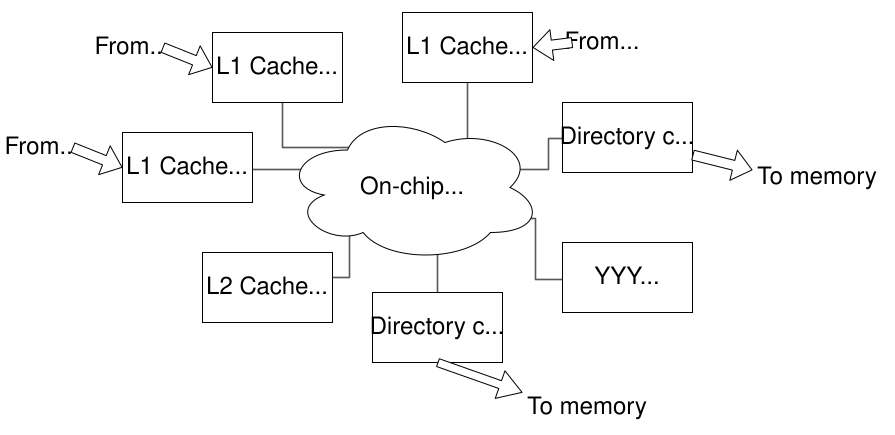

[上一篇的写回例题](./microarch-01e-cache-stores.md#store-trace)中，核 0 把地址 `0x1020` 的整数从 5 改成 9。新值留在 L1，下一级可以暂时保留 5。现在增加一个核 1，先让两个 L1 都读到 5，再由核 0 写入 9。核 0 什么时候能写？核 1 之后的读应当到哪里找数据？这两个问题把缓存一致性的权限和数据路径连了起来。

以下追踪一条 64 字节的物理行 A，起点为 `0x1000`，被修改的字在行内偏移 `0x20`。两核各有私有 L1，片上共享 L2 保存目录信息。先用便于手算的 MESI 模型讲完主例，再对照 gem5 v24.1.0.3 的 Ruby `MESI_Two_Level`。文中的交接顺序属于例题题设。

[[toc]]

## 为什么多个核心需要缓存一致性 {#coherence-problem}

先只看一个内存字。初始值为 5，核 0 和核 1 都读过它，因此两个私有 L1 中各有一份 5。核 0 把这个字写成 9 后，核 1 若仍直接使用自己的副本，就会读回旧值 5。问题不是主存有没有及时更新，而是处理器必须确保每次读都能找到当前应当使用的版本。

一致性协议为每条缓存行安排读写权限，并在权限变化时通知可能持有副本的核心。核 0 获得独占写权以前，核 1 的副本必须失效，或者由协议把更新传播给它。写权限到手以后，核 0 才能让新值 9 成为该行新的有效版本。下一次核 1 读这条行时，一致性系统必须让它得到 9，而不能继续从旧副本取 5。

协议按**物理缓存行**工作。在本例中，`0x1020` 和 `0x1008` 去掉低 6 位后，行基址都是 `0x1000`。两个核即使各自写不同的 4 字节整数，也都要取得 A 的写权。这正是[伪共享](./microarch-01g-false-sharing.md#sharing-layout)发生的条件之一。

本课采用写失效协议，可以用两条规则检查每一次交接。第一，写权限只能交给一个核，其他核持有的可读副本须先失效。第二，交接必须保存上一轮写入结束时的数据。只有第一条仍会出错。假如核 0 写完 9 并交还写权，目录却从保存着 5 的 L2 直接给核 1 回包，系统虽一直只有一个写者，核 1 仍会得到错误的值。此时应从目录记录的核 0 取得最新数据。下一级可以暂时保留旧值，因为它的状态会阻止控制器直接用这份旧数据应答。

对同一地址，缓存一致性协议还要为写入建立所有核心都能接受的先后顺序。它不负责规定不同地址之间所有加载、存储应以什么顺序对软件可见；跨地址的顺序属于处理器内存模型和程序同步的范围。本文末尾会用一个发布数据的例子区分这两件事。

## 谁来找到其他副本：广播与目录 {#coherence-organizations}

一致性协议必须知道失效消息应送到哪里。较小的多核系统可以采用**侦听式协议**：核心把 `GetM` 或 `Invalidate` 请求广播到共享总线上，每个缓存控制器都检查本地标签，持有目标行的控制器按协议降级或失效并回应。广播使每个缓存都能观察到同一请求顺序，结构直接；核心和请求增多后，总线广播会占用更多带宽，也限制可扩展性。

**目录式协议**为每条行保存“可能的共享者”以及当前所有者等信息。物理行地址决定请求发到哪个目录控制器。以四核、完整位向量为例，约定第 0 位代表核 0，`0101₂` 就表示核 0 和核 2 可能有副本。核 0 请求写权限时，控制器从集合中去掉请求者，剩下 `0100₂`，所以只需向核 2 发失效。若该行已有独占持有者，目录还可以把取数请求转发给它。完整位向量的每条记录随核数增大，占用的元数据也随之增长。下面追踪的 Ruby 实现用 `Sharers` 和 `Exclusive` 分别表示这两种信息。

图 1 中的 Ruby `MESI_Two_Level` 是目录式组织的一个可查实现。两个 L1 分别保存数据与稳定/过渡状态；负责 A 的 L2 行表项保存数据和目录字段；片上互连传送请求、数据、失效及确认。状态机控制器根据收到的消息和当前状态选择转移。事务缓冲项（TBE）则暂存尚未完成的交接，例如请求者、待交付数据和还差多少确认。缓存数据、目录信息、控制状态和网络消息是四种不同对象，读代码时不应把它们都叫作“缓存状态”。

## 谁保存数据，谁知道该找哪个核 {#mesi-structure}

图 1 是 gem5 Bootcamp 的 Ruby 控制器组织示意。上层的 L1 控制器分别接各核心，中间的片上互连传输请求、数据和确认消息，下层的 L2 与目录控制器为请求选择数据路径。图概括 Ruby 可连接的控制器类型。本例只使用其中两个 L1 和负责行 A 的 L2。选定的 `MESI_Two_Level` 把片上的共享者和独占持有者信息放在 L2 行表项中。图上的 `Directory controller` 还承担到主存一侧的接口，请求行 A 时先看负责它的 L2。

<figure class="lesson-figure">
<a href="/microarch/gem5-ruby-controllers.svg"></a>
<figcaption>图 1　Ruby 控制器与片上互连。对本例追踪两个 L1 和管理行 A 的 L2 即可。点击查看大图。</figcaption>
</figure>

一条行会涉及三处状态。L1 的标记、数据和 MESI 状态决定核心是否能本地读写。L2 行表项包含数据和目录元数据，决定共享者可能在哪些 L1，以及当前的独占持有者是谁。另有在途记录保存一次未完成交接所需的请求者、数据和剩余确认等信息。等确认的计数与缓存行的数据分开保存，写权才能与消息的实际到达顺序相符。

<div role="region" aria-label="缓存一致性控制器使用的字段" style="max-width:100%; overflow-x:auto">

| 要查的字段 | Ruby 对照 | 本例用它回答什么 |
| --- | --- | --- |
| 本地数据和权限 | L1 的 `DataBlk`、`CacheState` | 核 0 的 L1 有 5，还要申请写权吗 |
| 共享者集合 | L2 的 `Sharers` | 核 0 写前，哪里可能还有只读副本 |
| 独占持有者 | L2 的 `Exclusive` | L2 数据可能过期时，读请求要转给谁 |
| 有待处理的确认 | L1 过渡表项 TBE 的 `pendingAcks` | 核 0 的升级还缺什么，何时能完成 |

</div>

## 有一份副本，未必已经能写 {#mesi-states}

MESI 的四个字母表示私有缓存行在事务收尾后的稳定状态。读权限、写权限和下一级是否已经持有最新数据，可以从状态一起判断。

<div role="region" aria-label="MESI 稳定状态和读写权限" style="max-width:100%; overflow-x:auto">

| 状态 | 本地能做什么 | 其他副本与下一级 |
| --- | --- | --- |
| I，Invalid | 不能用本地这行完成读写 | 要向一致性系统取得副本或权限 |
| S，Shared | 可读，写之前要升级 | 其他 L1 可能也有可读副本 |
| E，Exclusive | 可读，能在本地写并转成 M | 本 L1 独占，数据还未被改过 |
| M，Modified | 可读写 | 本 L1 独占，且负责在需要时提供最新数据 |

</div>

例如核 0 已经有 S 行，写 `0x1020` 时标记会匹配，偏移也正确，但还缺一致性写权。它已经持有行中的其余字节，可以申请升级而无需重取整行。若处于 I，局部写入通常既要申请写权，也要取得未被该笔存储覆盖的字节。[写分配一节](./microarch-01e-cache-stores.md#store-allocation)给出了同一地址的字节例子。

写入的过程遵循一个基本约束。同一条行可以有多个读者，获得独占写权之后，只保留一个可写的私有副本。其他核之前持有的只读副本必须被撤销，否则后续读取还会从旧数据命中。

## 从两个 5 到两个 9 {#mesi-trace}

题设给定操作次序，各次操作按表中的顺序完成。L2 开始已有 A 的数据，两个 L1 都处于 I。表中只把偏移 `0x20` 的字写出来，协议处理的仍是完整缓存行。

<div role="region" aria-label="两个核依次读写缓存行 A" style="max-width:100%; overflow-x:auto">

| 操作完成时 | 核 0 的 L1 | 核 1 的 L1 | L2 对 A 保存的值与目录 |
| --- | --- | --- | --- |
| 核 0 读 A | E，5 | I | 5，核 0 独占 |
| 核 1 读 A | S，5 | S，5 | 5，两个核可读 |
| 核 0 写入 9 | M，9 | I | 数据仍是 5，核 0 独占 |
| 核 1 再读 A | S，9 | S，9 | 更新为 9，两个核可读 |
| 核 1 写入 12 | I | M，12 | 数据仍是 9，核 1 独占 |

</div>

第一次只有核 0 读，L2 可以授予 E。这样如果核 0 立即写，便可直接转 M。主例的第二步先让核 1 读，核 0 降为 S。此后核 0 的第一次写要经过升级。

### 失效请求发出了，还要等什么 {#mesi-upgrade}

将第三行拆开。下表里的“剩余确认”表示核 0 尚需得到多少来自其他副本的确认，记法是教学抽象。

<div role="region" aria-label="写权限升级时的失效和确认顺序" style="max-width:100%; overflow-x:auto">

| 事件 | 核 1 的副本 | 核 0 的写入 | 剩余确认 |
| --- | --- | --- | ---: |
| 核 0 申请升级，目录找出核 1 | 仍可读 5 | 等待 | 1 |
| 核 1 收到失效，清除本地可用状态，回送确认 | I | 确认在路上，仍等待 | 1 |
| 核 0 收到最后一个确认，完成升级 | I | 写出 9，进入 M | 0 |

</div>

已发出失效消息，意味着核 1 将来会处理它。在消息真正到达核 1 之前，核 1 仍可能从本地读 5。核 0 等到确认，才知道旧副本已经撤销。两者都成立，就能让旧的 5 和新的 9 对应到不同的访问时段。

gem5 Ruby 中，L1 将 S 状态的存储转入 `SM`，发送 `UPGRADE`。L2 在 `SS` 接到该请求后向其他潜在共享者发失效，同时把需要的确认信息告知请求者，过渡到 `SS_MB`。请求者凑齐所需确认后可以完成写，并用独占 `UNBLOCK` 让 L2 结束这一轮。这也解释了为什么只读四个稳定状态会漏掉一段等待。真实实现的确认可能经不同消息到达，计数记法也比上表更细。

### 失效确认比目录回复先到怎么办 {#mesi-ack-arrival}

上表把应收确认数视为已知。实际升级时，核 0 的 L1 发出 `UPGRADE`，负责行 A 的 L2 才根据 `Sharers` 确定有几份副本要撤销。L2 发给核 0 的回复携带这个数量。各共享者收到 `INV` 后，则直接向核 0 回送失效确认。消息来自不同控制器，先到的可以是目录回复，也可以是另一个 L1 的确认。

在 gem5 Ruby 的这个协议中，核 0 的事务缓冲项 `pendingAcks` 初始为 0，每次从中减去消息的 `AckCount`。L2 把预期数量写成负数，其他 L1 的每条失效确认携带 `+1`。仍用两核主例。只有核 1 需要失效，所以 L2 的回复携带 `−1`。

<div role="region" tabindex="0" aria-label="两种消息到达顺序下的确认计数" style="max-width:100%; overflow-x:auto">

| 到达顺序 | 处理第一条消息后 | 第二条消息到来时的检查 |
| --- | --- | --- |
| L2 回复 → 核 1 的确认 | `0 − (−1) = 1`，还差一份确认 | `1 − 1 = 0`，进入 M，完成写入并发独占解除阻塞消息 |
| 核 1 的确认 → L2 回复 | `0 − 1 = −1`，先记下已经收到的一份确认 | `−1 − (−1) = 0`，执行相同的状态转移 |

</div>

负值记录的是已经收到、但还没有与目录给出的预期数量抵消的确认。L1 在处理这类消息时检查相减的结果，落到 0 就触发 `Ack_all`。申请刚发出时的初值虽也是 0，仍处在等待升级的 `SM` 状态，尚未发生这个事件。L2 同时在 `SS_MB` 等核 0 的独占解除阻塞消息。如果核 1 的副本已经失效、重新发出的 `GETS` 此时抵达 L2，L2 会让它等待。等升级收尾，目录才能按新的所有者继续处理这笔读。

::: details 练习｜再多一个共享者

令核 1、核 2 都持有旧副本。核 1 的确认先到，随后到达 L2 回复，最后才收到核 2 的确认。逐步算出何时能完成写入。

第一条把计数从 0 减到 `−1`。L2 回复携带 `−2`，相减得到 1，此时还差核 2。最后得到 `1 − 1 = 0`，这笔升级才完成。
:::

### 下一级仍是 5，第二个核怎样读到 9 {#mesi-owner}

核 1 已经没有有效副本，再读会发出 `GETS`，即申请可共享副本。L2 看到行 A 的独占持有者是核 0。在 Ruby `MESI_Two_Level` 的 `MT` 状态中，L2 不能把自己的数据直接当成最新值。它将请求转发给核 0，核 0 把 9 所在的完整数据送到请求者，并把最新数据交给 L2，自己的 L1 降为 S。

这次交接在 L2 所需的两个事件可以先后到达。收到所有者的数据，L2 才能把 5 换成 9。收到请求者的 `UNBLOCK`，它确认请求者已经拿到所需权限。Ruby 用 `MT_IIB` 表示两件事都在等，用 `MT_IB` 和 `MT_SB` 区分只剩哪一件。两件都到齐后回到 `SS`。片上 L2 更新成 9，主存什么时候也有 9，还要看 L2 的写回策略。

目录中的共享者记录可以是“可能仍持有”的集合。Ruby 允许私有 L1 的某些干净行静默逐出，因此目录里出现一个核，通常表示需要按协议处理它，不能反过来断言它下一次本地访问一定命中。

### 目录记着共享者，它却已经换出了这条行 {#mesi-stale-sharer}

设一个四核目录的共享者位向量为 `0101`，核 0 与核 2 都曾读过 A。现在核 2 的私有缓存把 A 作为干净行换出，并按题设静默完成，没有立刻修改目录。目录仍记录 `0101`，实际持有 A 的只有核 0。

接下来核 0 要写 A。目录按记录把请求者自身排除，向核 2 发送失效消息。核 2 查找后发现 A 已经不在本地，仍按本题协议回应确认。核 0 收到所需确认后，才完成写权限交接。多发送一次消息会增加开销，但目录没有漏掉可能持有副本的核。

| 阶段 | 目录记录 | 核 0 的 A | 核 2 的 A |
| --- | --- | --- | --- |
| 两核读完 | `0101` | S | S |
| 核 2 静默换出 | `0101` | S | I |
| 核 2 回复失效确认 | 仍按本轮事务处理 | 等待升级完成 | I |
| 升级完成 | 核 0 为独占持有者 | M | I |

这个四核时序是教学模型，具体消息和目录字段以协议实现为准。要理解目录记录为何允许比实际持有者更宽，可以比较相反情况。若核 2 实际仍有可读副本，目录却漏记了它，核 0 就可能在没有撤销该副本的情况下获得写权。目录协议必须防止这种遗漏，并处理在途请求造成的状态变化。

::: details 练习｜增加一个实际持有者

把题设改成核 0、核 1、核 2 都实际持有 A，目录记为 `0111`。核 0 请求写权限时，目录需要向哪些核处理失效？

排除请求者核 0 后，剩下 `0110`。核 1 和核 2 都是需要处理的对象。二者的确认到齐后，才可按本题规则完成升级。
:::

### 写缺失与两个写请求的先后 {#mesi-write-miss}

换一个请求顺序。核 0 和核 1 都持有 A 的 S 副本，核 2 尚未读过这条行。A 的 `0x1020` 仍是 5，行内另一个字 `0x1008` 是 3。核 0 先申请把 `0x1020` 写成 9，核 2 随后要把 `0x1008` 写成 7。假定负责 A 的 L2 先受理核 0 的请求，且核 2 的请求在第一轮失效尚未完成时到达。

<div role="region" aria-label="两个并发写请求的目录状态" style="max-width:100%; overflow-x:auto">

| L2 看到的事件 | 负责 A 的状态 | 数据和写权限怎样交接 |
| --- | --- | --- |
| 核 0 请求 `UPGRADE` | `SS → SS_MB` | 向核 1 发失效。核 0 已有整行，只申请写权限 |
| 核 2 请求 `GETX` | 仍为 `SS_MB` | 核 2 缺少整行，申请数据和写权限。L2 暂停这条请求 |
| 核 0 收齐确认并回送独占 `UNBLOCK` | `SS_MB → MT` | 核 0 已完成这次写入，L2 把核 0 记为独占持有者，再唤醒等候的请求 |
| L2 继续处理核 2 的 `GETX` | `MT → MT_MB` | L2 转发给核 0。核 0 交出包含新值 9 的整行，并撤销自己的副本 |
| 核 2 取得独占副本并回送独占 `UNBLOCK` | `MT_MB → MT` | 核 2 写入 7，成为新的独占持有者 |

</div>

最后，核 2 持有的行中，`0x1008` 为 7，`0x1020` 为 9。核 2 虽然只写 4 字节，仍需收到前一持有者交来的旧行，才能保留同一行中已经更新的其他字节。这也给出了区分 `UPGRADE` 和 `GETX` 的方法。前者在主例中只有权限缺失，后者缺少当前数据和权限。Ruby 在 `SS_MB` 中暂停的是**同一行**的其他请求。每条行的实际受理次序由运行时请求和控制器决定。

再把核 2 的目标也改成 `0x1020`，写入值仍为 7，并保持表中“核 0 写入完成后才将整行交给核 2”的题设顺序。核 0 先使该字从 5 变成 9，核 2 接收含 9 的整行后，再把同一个字改成 7。最终该字为 7，行内其他字节仍继承核 0 交出的版本。两个核获得写权限的先后，决定了这两次对同一位置写入在此例中的次序。

如果把题设改为核 2 先完成写入 7，随后核 0 再取得写权限并写入 9，最终该字便为 9。不能只根据两个请求由不同核心几乎同时发出，就断定哪一个值最终保留；还需要知道实际的权限交接以及写入完成次序。对于不同字的原例，则要确保第二位写者取得包含第一位写者修改的整行，才能同时保留 7 和 9。

### 脏行换出时，最新值交到哪里 {#mesi-dirty-eviction}

回到两核的主例。核 1 把 `0x1020` 写成 12 之后，核 1 的 L1 为 M，L2 数据仍是 9。如果核 1 现在需要把该行所在的路腾给另一条行，它必须把 12 所在的整行交出去。在所选 Ruby 实现中，L1 将换出的数据暂存在事务表项中，发送 `PUTX` 并等待写回确认。L2 收到当前持有者的 `PUTX` 后，把数据更新成 12，清除私有副本的记录并回复确认。若此后核 0 读 A 而数据仍在 L2，L2 就能直接给出 12。主存可在 L2 再次写回以前保留旧值。

也可以从共享层发起换出。在包含式组织中，共享层替换 A 时，还要处理私有缓存里的 A。若只剩干净副本，控制器可以发失效并等待确认；若有独占持有者，则还得判定是否要收回更新的数据。[共享缓存的替换例题](./microarch-06a-shared-cache.md#llc-back-invalidation)追踪了干净共享行的这条路径。

### MOESI 怎样处理多个核读取同一条脏行 {#moesi-owned}

把主例中核 0 写出的 9 交给核 1 读。前面的 MESI 实现在交出数据时更新 L2，两个 L1 随后都为 S。MOESI 多了一个 O（Owned）状态，可以让核 0 在交出数据后仍负责保管这份修改过的行。此时核 0 为 O，核 1 为 S，两核都读 9。共享层尚未收到新数据时，后续请求仍需找到核 0。核 0 若要再写，须先让核 1 的 S 副本失效；若要丢弃 O，则须移交脏数据的责任，具体由实现决定。这种安排省去了读共享发生时立刻更新共享层的数据传输。判断 O 的权限时要分清两件事：它负责提供最新数据，当前却只有读权限。

## 用 C 程序复算失效确认前后的值 {#mesi-model}

下面的 C 程序只保存行 A 中正在分析的 4 字节整数，以及两个 L1 的稳定状态。L2 保存共享层当前记录的值；升级结构保存请求者、新值和还未确认的失效对象。函数调用由主程序显式排列，所以读者可以在失效消息到达、确认尚未返回的中间状态停下来检查。程序没有模拟总线时序或真实处理器，只复算本节给定的协议状态转移。

把代码保存为 `mesi_line.c`，用 `gcc -std=c11 -O2 -Wall -Wextra mesi_line.c -o mesi_line` 编译，再运行 `./mesi_line`。

~~~c
#include <assert.h>
#include <stdbool.h>
#include <stdio.h>

enum { CORE_COUNT = 2 };

typedef struct {
    char state;
    bool valid;
    int value;
} CacheCopy;

typedef struct {
    bool active;
    unsigned requestor;
    int new_value;
    bool waiting_ack[CORE_COUNT];
} Upgrade;

typedef struct {
    int l2_value;
    CacheCopy l1[CORE_COUNT];
    Upgrade upgrade;
} CoherentLine;

static bool read_line(CoherentLine *line, unsigned core, int *value)
{
    CacheCopy *local = &line->l1[core];
    CacheCopy *peer = &line->l1[1u - core];

    if (local->valid) {
        *value = local->value;
        return true;
    }
    if (line->upgrade.active)
        return false;

    if (peer->valid && (peer->state == 'E' || peer->state == 'M')) {
        line->l2_value = peer->value;
        peer->state = 'S';
    }

    *local = (CacheCopy){
        .state = peer->valid ? 'S' : 'E',
        .valid = true,
        .value = line->l2_value
    };
    *value = local->value;
    return true;
}

static void start_store(CoherentLine *line, unsigned core, int new_value)
{
    CacheCopy *local = &line->l1[core];
    CacheCopy *peer = &line->l1[1u - core];

    assert(!line->upgrade.active);
    assert(local->valid);

    if (local->state == 'S' && peer->valid && peer->state == 'S') {
        line->upgrade = (Upgrade){
            .active = true,
            .requestor = core,
            .new_value = new_value,
            .waiting_ack = {false, false}
        };
        line->upgrade.waiting_ack[1u - core] = true;
        return;
    }

    assert(local->state == 'E' || local->state == 'M');
    local->state = 'M';
    local->value = new_value;
}

static void deliver_invalidation(CoherentLine *line, unsigned core)
{
    assert(line->upgrade.active);
    assert(line->upgrade.waiting_ack[core]);

    line->l1[core] = (CacheCopy){.state = 'I', .valid = false, .value = 0};
}

static void deliver_ack(CoherentLine *line, unsigned core)
{
    Upgrade *upgrade = &line->upgrade;

    assert(upgrade->active);
    assert(upgrade->waiting_ack[core]);
    assert(!line->l1[core].valid);

    upgrade->waiting_ack[core] = false;
    if (!upgrade->waiting_ack[0] && !upgrade->waiting_ack[1]) {
        line->l1[upgrade->requestor] = (CacheCopy){
            .state = 'M',
            .valid = true,
            .value = upgrade->new_value
        };
        upgrade->active = false;
    }
}

static void print_copy(const CacheCopy *copy)
{
    if (copy->valid)
        printf("%c/%d", copy->state, copy->value);
    else
        printf("I/-");
}

static void show(const CoherentLine *line, const char *event)
{
    printf("%s  ", event);
    print_copy(&line->l1[0]);
    printf("  ");
    print_copy(&line->l1[1]);
    printf("  L2=%d  ACK=[", line->l2_value);

    bool first = true;
    for (unsigned core = 0; core < CORE_COUNT; ++core) {
        if (line->upgrade.active && line->upgrade.waiting_ack[core]) {
            printf("%s%u", first ? "" : ",", core);
            first = false;
        }
    }
    puts("]");
}

int main(void)
{
    CoherentLine line = {
        .l2_value = 5,
        .l1 = {
            {.state = 'I', .valid = false, .value = 0},
            {.state = 'I', .valid = false, .value = 0}
        }
    };
    int value;

    if (!read_line(&line, 0, &value) || value != 5)
        return 1;
    show(&line, "R0");
    if (!read_line(&line, 1, &value) || value != 5)
        return 1;
    show(&line, "R1");

    start_store(&line, 0, 9);
    show(&line, "UPGRADE");
    if (!read_line(&line, 1, &value) || value != 5)
        return 1;
    deliver_invalidation(&line, 1);
    show(&line, "INV");
    if (read_line(&line, 1, &value))
        return 1;
    deliver_ack(&line, 1);
    show(&line, "ACK");

    if (!read_line(&line, 1, &value) || value != 9)
        return 1;
    show(&line, "R1=9");

    start_store(&line, 1, 12);
    deliver_invalidation(&line, 0);
    deliver_ack(&line, 0);
    show(&line, "W1=12");
    return 0;
}
~~~

预期输出：

~~~text
R0  E/5  I/-  L2=5  ACK=[]
R1  S/5  S/5  L2=5  ACK=[]
UPGRADE  S/5  S/5  L2=5  ACK=[1]
INV  S/5  I/-  L2=5  ACK=[1]
ACK  M/9  I/-  L2=5  ACK=[]
R1=9  S/9  S/9  L2=9  ACK=[]
W1=12  I/-  M/12  L2=9  ACK=[]
~~~

`main` 在失效前检查核 1 仍能读 5，失效后再检查它的读需要等待。确认到达核 0 以后，核 0 才把 9 写入独占行。核 1 随后读缺失的行，从持有者取得 9。模型把这次数据交接、L2 更新和两边转为 S 放在一次 `read_line` 调用里。最后核 1 按同样的升级步骤获得写权，输出 `W1=12`，与主例最后一行相符。

程序把消息交付顺序写在 `main` 里。它用 `false` 表示读缺失遇到在途升级，由调用方在确认后重试。增加第三个核的写缺失时，还需要为该核保存待处理的 `GETX`，等本轮交接完成后再取回整行。上面 L2 的 `SS_MB` 和 `MT_MB` 展示了 Ruby 如何记录这些等待。

::: details 练习｜核 1 从来没读过 5
从 `main` 的初始状态出发，核 0 先用 `read_line(&line, 0, &value)` 取得 5。跳过核 1 的初次读取，直接调用 `start_store(&line, 0, 9)`。有没有失效确认要等？核 1 此时来读会得到几？

核 0 先取得 E。它可以直接写并转为 M，`upgrade` 仍为空。后来核 1 读时，还是要从独占持有者取出 9。E 转 M 可以在本地完成。
:::

## 发布数据时还需要什么顺序 {#coherence-vs-consistency}

缓存一致性主要回答“同一份数据的多个缓存副本怎样保持可解释”，并为同一地址上的写入确定一致的顺序。内存顺序则回答“程序对不同地址的读写，其他核心可以按什么顺序观察”。一个核心先写数据，再写就绪标志；另一个核心读到标志，并不只靠两条缓存行各自正确，就能推出它也一定读到新数据。还需要符合语言和 ISA 规定的同步关系。

### 两个地址都一致，为什么还会读到两个旧值 {#coherence-store-buffering}

先用一个存储缓冲（store buffer）例子把两种规则分开。令 `x`、`y` 初始都为 0，分别放在不同缓存行，两个 hart 执行以下代码。`sw` 和 `lw` 都访问自然对齐的 32 位普通内存。

```asm
# 约定 s0 = &x，s1 = &y；x、y 初值均为 0。
# Hart 0                         # Hart 1
li   t0, 1                       li   t0, 1
sw   t0, 0(s0)                   sw   t0, 0(s1)
lw   t1, 0(s1)                   lw   t1, 0(s0)
# 观察 t1：Hart 0 得到 r0，Hart 1 得到 r1。
```

一种可能的结果是 `r0 = 0`、`r1 = 0`。要沿每个 hart 自己的请求状态理解它：Hart 0 的存储先执行，地址、数据和有效状态进入本地的存储队列，但还没有对 Hart 1 可见；随后对 `y` 的加载与这笔 `x` 存储地址不同，不能从它转发，于是可以先从缓存层次读到旧值 0。Hart 1 同理，暂存对 `y` 的写入，同时从 `x` 读到 0。等两笔存储之后都取得一致性写权并传播，`x`、`y` 最终各自变成 1。

这个结果没有让同一个地址出现相互矛盾的版本。对 `x` 而言，Hart 1 在新存储对它可见以前读到 0，之后新值 1 才传播；`y` 也一样。每个地址都可以有一致的写入次序。问题出在程序把 `x` 和 `y` 两个地址上的事件合起来解释：源码先写再读，两个 hart 却都在对方写入可见以前完成了读取。RVWMO 允许这种 store-buffering 结果，因为普通写后接不同地址的普通读，并不自动形成跨地址的全局先后关系。

对照同地址的情况。若 Hart 0 改成先写 `x`、紧接着读 `x`，本 hart 的加载可以从仍在存储队列里的较新写入转发 1，不必等它先写入缓存；其他 hart 此时仍可能读到旧值。存储队列因此同时服务两种需求：尽早把已提交的写向一致性系统发送，以及让本 hart 后续的重叠加载取得正确的最新字节。转发说明本地加载拿到哪个值，并不表示这笔写已经对其他 hart 全局可见。BOOM 的队列字段和字节掩码见[加载怎样从存储队列拿到数据](./microarch-03d-load-store.md#lsu-entries)。

### 加了栅栏以后，怎样证明某个结果不能出现 {#coherence-fence-order}

把四条访存指令分别记作 `Wx`（Hart 0 写 `x`）、`Ry`（Hart 0 读 `y`）、`Wy`（Hart 1 写 `y`）、`Rx`（Hart 1 读 `x`）。推导时用 `A < B` 表示 A 在 RVWMO 的**全局内存顺序**中排在 B 前面。这个顺序用于检验观察到的结果。和流水线时钟相比，它回答的是另一件事：能否找到一个访存次序，同时满足指令的顺序约束和各条加载读到的值。

初始写入都已完成，本题每个地址只有另一 hart 写入一次 1。因此，`Ry` 读到 0 要求 `Ry < Wy`，否则此前最近一次写 `y` 的就是 `Wy`，返回值应为 1。同理，`Rx` 读到 0 要求 `Rx < Wx`。两条读都只读对方写的地址，本地存储转发在这里没有候选。

两个 hart 都在 `sw` 与 `lw` 之间加入 `fence rw, rw` 后，各自的存储必须排在自己的加载前。第一个 `rw` 选择栅栏前的普通内存读写，第二个 `rw` 选择栅栏后的普通内存读写。在本例里，所需的关系只有写在读之前，因此两处换成 `fence w, r` 也能排除同一结果。

| 约束来自哪里 | 全局顺序必须满足 |
| --- | --- |
| Hart 0 的栅栏 | `Wx < Ry` |
| `Ry` 读到初值 0 | `Ry < Wy` |
| Hart 1 的栅栏 | `Wy < Rx` |
| `Rx` 读到初值 0 | `Rx < Wx` |

合起来得到 `Wx < Ry < Wy < Rx < Wx`。任何一条访存都不能排在自身前面，所以两个读数不可能同时为 0。这项保证也不要求脏行写回 DRAM。在缓存一致性系统里，新值可以由持有该行的缓存按协议提供。

::: details 练习｜只给 Hart 0 加栅栏

保留 `Wx < Ry`，去掉 `Wy < Rx`。试着给四个操作排个顺序，让两次读仍返回 0。

一种可行顺序是 `Rx < Wx < Ry < Wy`。Hart 1 读 `x` 时，`Wx` 还未排到。Hart 0 读 `y` 时，`Wy` 也还未排到。两次都可读到初值，而 Hart 0 的顺序约束仍成立。

:::

### 用 C 枚举可能的全局顺序 {#coherence-fence-model}

下面的程序逐一检查四个操作的 24 种排列。初值都是 0，每个写操作将对应变量置为 1。读操作记录执行到该位置时的值。分别改变两侧是否有栅栏，比较能得到的读数。程序实现的是上面四条指令的顺序推导，运行结果与宿主机器是否采用 RVWMO 无关。

~~~c
#include <stdbool.h>
#include <stdio.h>

enum operation { WX, RY, WY, RX, OP_COUNT };

static void enumerate(unsigned used, int x, int y, int r0, int r1,
                      bool fence0, bool fence1, unsigned counts[2][2])
{
    if (used == (1u << OP_COUNT) - 1u) {
        ++counts[r0][r1];
        return;
    }

    for (int op = 0; op < OP_COUNT; ++op) {
        unsigned bit = 1u << op;
        if (used & bit)
            continue;
        if (op == RY && fence0 && !(used & (1u << WX)))
            continue;
        if (op == RX && fence1 && !(used & (1u << WY)))
            continue;

        enumerate(used | bit, op == WX ? 1 : x, op == WY ? 1 : y,
                  op == RY ? y : r0, op == RX ? x : r1,
                  fence0, fence1, counts);
    }
}

int main(void)
{
    puts("fence0 fence1 | (0,0) (0,1) (1,0) (1,1)");
    for (int f0 = 0; f0 <= 1; ++f0) {
        for (int f1 = 0; f1 <= 1; ++f1) {
            unsigned counts[2][2] = {0};
            enumerate(0, 0, 0, -1, -1, f0 != 0, f1 != 0, counts);
            printf("%6d %6d | %5u %5u %5u %5u\n", f0, f1,
                   counts[0][0], counts[0][1], counts[1][0], counts[1][1]);
        }
    }
}
~~~

保存为 `fence_order.c`，用 `gcc -std=c11 -O2 -Wall -Wextra fence_order.c -o fence_order` 编译。运行后会得到以下表格。

~~~text
fence0 fence1 | (0,0) (0,1) (1,0) (1,1)
     0      0 |     6     6     6     6
     0      1 |     1     3     3     5
     1      0 |     1     3     3     5
     1      1 |     0     1     1     4
~~~

`used` 的每一位标记一种已经放入顺序的操作。有栅栏时，枚举只在相应写操作已经放入后才考虑读操作。以练习中的顺序为例，先选 `Rx`，得到 `r1 = 0`。随后选 `Wx`，便可以选 `Ry`，得到 `r0 = 0`。最后选 `Wy`，把这一排列计入 `counts[0][0]`。如果给 Hart 1 也加了栅栏，第一步就不能选 `Rx`。表里的数字是符合题设的排列数，不能用来估计实机上每种结果的频率。

### 生产者写完数据以后怎样发布 {#coherence-release-acquire}

换回生产者和消费者的例子。C11 提供 release/acquire 原子操作，让消费者读到发布标志时，也能取得此前写入的数据。生产者先写 `payload`，再以 release 方式写 `ready`。消费者只有在 acquire 加载读到这次发布的 `ready = 1` 后才读取 `payload`。

~~~c
#include <assert.h>
#include <pthread.h>
#include <stdatomic.h>
#include <stdio.h>

static atomic_int payload = 0;
static atomic_int ready = 0;

static void *producer(void *unused)
{
    (void)unused;
    atomic_store_explicit(&payload, 42, memory_order_relaxed);
    atomic_store_explicit(&ready, 1, memory_order_release);
    return NULL;
}

static void *consumer(void *unused)
{
    (void)unused;
    while (atomic_load_explicit(&ready, memory_order_acquire) == 0) {
    }
    int value = atomic_load_explicit(&payload, memory_order_relaxed);
    assert(value == 42);
    printf("payload=%d\n", value);
    return NULL;
}

int main(void)
{
    pthread_t writer, reader;
    if (pthread_create(&writer, NULL, producer, NULL) != 0)
        return 1;
    if (pthread_create(&reader, NULL, consumer, NULL) != 0)
        return 1;
    if (pthread_join(writer, NULL) != 0)
        return 1;
    if (pthread_join(reader, NULL) != 0)
        return 1;
    return 0;
}
~~~

保存为 `release_acquire.c`，可用 `gcc -std=c11 -O2 -Wall -Wextra -pthread release_acquire.c -o release_acquire` 编译。程序退出等待后应输出 `payload=42`。这个结论可以沿四个操作逐项推导。

1. 写 `payload = 42` 在同一线程内先于发布 `ready = 1`。
2. 消费者退出循环的那次加载读取了 release 写入的 1。该 release 与读到它的 acquire 建立同步关系。循环中读到 0 的那些加载没有建立这条关系。
3. 消费者在退出循环后才读取 `payload`。把两段线程内的先后和中间的同步关系接起来，得到写 `payload = 42` **先行发生**（happens-before）于消费者读 `payload`。
4. 按 C11 对同一原子对象的写读一致性要求，消费者必须读到该次写入或修改顺序中更晚的写入。题设没有后续写入，因此只能读到 42。两处 `payload` 操作用 relaxed 已经足够，连接它们的顺序来自 `ready`。

若把 `ready` 的两处操作也改成 relaxed，变量仍然是原子的，但上面的第 2 步失去同步关系。C11 此时允许读到 `ready = 1` 后仍读到 `payload = 0`。即使真机反复输出 42，也只能说明本次编译和运行没有观察到另一种结果。

因此，分析多核执行时要先问是哪一种问题：一条缓存行的旧副本何时失效，是一致性问题；先写 payload、再发布 ready 的顺序如何约束，是内存模型和同步问题。把两者混称为“缓存同步”，会让人误以为一个核心观察到某条行的新值，就必然观察到此前所有其他行上的新值。

## 一致性为什么与微架构安全有关 {#coherence-security}

一致性机制的首要职责是保持程序读写正确，但跨核交接会改变访问延迟和缓存状态。共享内存的 Flush+Reload 例子可以沿同一行理解：观察者先清除候选行；被观察代码随后读取该共享物理行；观察者再测量自己的加载。若这次加载明显更快，说明在测量前有活动使该行重新变得容易取得。缓存一致性让跨核共享的副本和失效能够正确交接，也让访问活动可能留下观察差异。一次快速命中只能支持“行处于某种较近状态”，不能单独证明是谁访问、何时访问，或访问时寄存器里的值是什么。

Prime+Probe 观察的是另一种现象。观察者先占用一组缓存位置，被观察代码访问同组地址后，观察者再检查自己的行是否被替换。它不要求双方持有同一个物理行；关键是组内容量与替换竞争，不应把它误写成一次 MESI 失效。伪共享则由不同字段落入同一行造成真实的写权限交接，通常体现为延迟和吞吐变化，也不自动等于数据内容泄漏。下一步可分别沿[观测方法](./microarch-04b-observation.md)和[共享缓存竞争](./microarch-06a-shared-cache.md)继续分析。

两个线程只写不同字段、却仍需要交接同一条行的情形，见[伪共享](./microarch-01g-false-sharing.md#sharing-layout)。

数据缓存一致性也参与页表项的读取。内核改写一条 PTE 后，各核仍须处理 TLB 中先前保存的翻译。具体过程见[跨核同步旧翻译](./microarch-02a-translation.md#sv39-shootdown)。

## 参考文献

- [Sorin、Hill、Wood 的《内存一致性与缓存一致性入门》，第 2 章的一致性规则、第 6 章的 MOESI 状态与第 8 章的目录协议](https://pages.cs.wisc.edu/~markhill/papers/primer2020_2nd_edition.pdf)
- [C11 草案 N1570：原子操作与内存顺序](https://www.open-std.org/jtc1/sc22/wg14/www/docs/n1570.pdf)
- [gem5 Ruby MESI Two Level 的结构、权限和过渡状态](https://www.gem5.org/documentation/general_docs/ruby/MESI_Two_Level/)
- 图 1 来自 gem5 Bootcamp 2024 的《Modeling Cache Coherence in gem5》，本站加了白底、边距及控制器与互连之间的连线。[原图](https://github.com/gem5bootcamp/2024/blob/3ea9b7e3598cd15e8c0ea688fa850249eab0fad5/slides/03-Developing-gem5-models/06-modeling-cache-coherence-imgs/ruby-inside.drawio.svg) · [CC BY 4.0 许可](https://creativecommons.org/licenses/by/4.0/)
- [RISC-V RVWMO 解释材料：存储缓冲转发与允许的 litmus 结果](https://docs.riscv.org/reference/isa/v20260120/unpriv/mm-eplan.html)
- [gem5 v24.1.0.3 的 L1 状态和事务表](https://github.com/gem5/gem5/blob/b9da2bfe1e21f6efa2730edd4e80e58c5d965458/src/mem/ruby/protocol/MESI_Two_Level-L1cache.sm)
- [gem5 v24.1.0.3 的 L2 目录字段和过渡状态](https://github.com/gem5/gem5/blob/b9da2bfe1e21f6efa2730edd4e80e58c5d965458/src/mem/ruby/protocol/MESI_Two_Level-L2cache.sm)
- [RISC-V 的 RVWMO 内存顺序模型](https://docs.riscv.org/reference/isa/unpriv/rvwmo.html)

<nav class="article-nav" aria-label="系列文章导航">

[<span class="article-nav-text"><small>上一篇</small><strong>写入缓存后，数据什么时候送到下一级</strong></span>](./microarch-01e-cache-stores.md){.article-nav-card .article-nav-prev rel=prev}

[<span class="article-nav-text"><small>下一篇</small><strong>两个线程改不同字段，为什么缓存行还会来回传</strong></span>](./microarch-01g-false-sharing.md){.article-nav-card .article-nav-next rel=next}

</nav>
