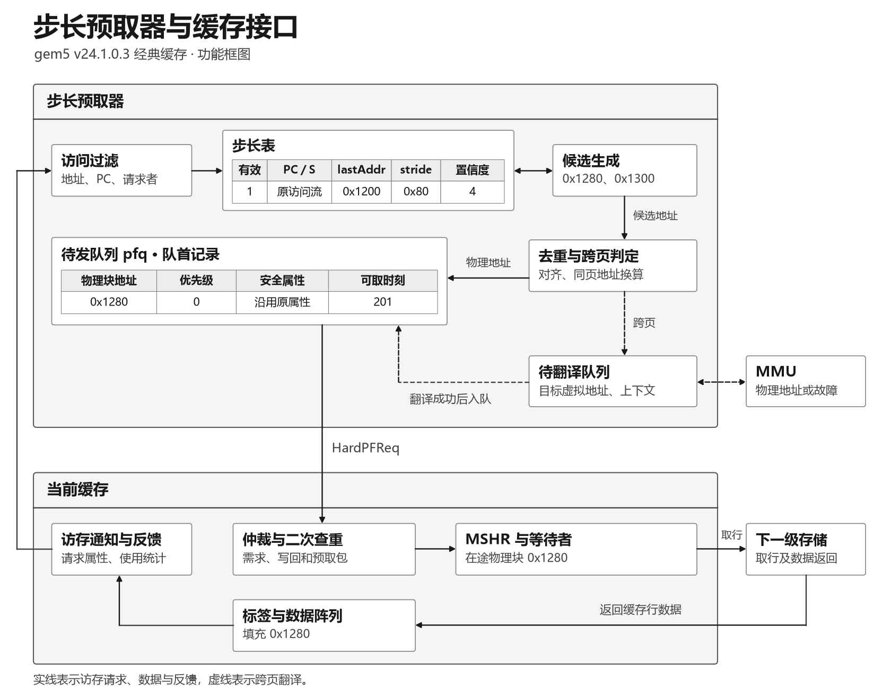

硬件预取的目的，是让一个将来才需要的访存请求尽早开始。如果当前循环会连续处理 128 字节大小的记录，某一条加载指令每次都读记录中相同的字段。处理器在观察几个地址后，可以尝试提前取下一条记录的缓存行。但猜出地址以后，还要决定地址能否转换、有没有重复请求、缓存能不能接收它，以及数据是在需求加载之前还是之后回来。理解预取器，要把这段请求的经历走完整。

本文以 gem5 v24.1.0.3 的 `StridePrefetcher` 和它连接的经典一致性缓存为主例。gem5 是时序模拟器，本文按这一版本的实现讲解。文中的周期数是教学题设。本文沿同一笔请求讲完预测、入队、仲裁、填充和效果记录。若还不熟悉块地址，先读[缓存的地址映射](./microarch-01b-cache-mapping.md)。读到并发、合并和返回时，可先用[缓存未命中与 MSHR](./microarch-01a-mshr.md#mshr-trace)把这三个概念接起来。

[[toc]]

## 预取器在缓存系统中的位置

在 gem5 经典缓存里，预取器挂在一层缓存旁边。它从本层接收访问事件，向同一层交还预取请求，再从缓存的命中和填充获得反馈。图上半部是预取器，下半部是当前缓存。MMU 和下一级存储各有自己的接口。

<figure class="lesson-figure">
  <a href="/microarch/stride-prefetcher-structure.png" aria-label="查看完整的预取器结构图">
    
  </a>
  <figcaption>图 1　从左下方的访存通知看起。上半部把 0x1200 变成 0x1280、0x1300 两个候选，再沿实线跟踪 0x1280 如何进入待发队列、交给缓存并得到响应。虚线表示有 MMU 时的跨页翻译路径。图按 gem5 v24.1.0.3 的功能接口绘制。</figcaption>
</figure>

**需求请求**来自正在执行访存操作的一方。普通加载需要真正返回请求的数据。**预取请求**由预测机制生成，主要作用是让内存系统提前准备数据。在本例中，步长算法输出的是候选地址。后面的模块决定是否将这个地址变成可发给缓存的请求。缓存取到请求以后，才决定要不要跟踪一笔新的未命中事务。

<div role="region" aria-label="预取器与缓存之间传递的信息" style="max-width:100%; overflow-x:auto">

| 环节 | 读入什么 | 保存或产出什么 |
| --- | --- | --- |
| 缓存事件与观察入口 | 请求包，命中或未命中的信息 | 用于训练的地址、PC、请求者、相关属性 |
| 步长预测 | 一次合格的观察 | 按流保存的最近地址、步长和置信度；可能产出几个地址候选 |
| 预取队列和翻译接口 | 地址候选、源请求上下文、缓存查询接口 | 等待翻译的候选，以及已有物理地址、等待发送资格的请求 |
| 缓存下行仲裁和 MSHR | 合格的预取请求，以及正常未命中和写回 | 启动或跟踪一次取行事务，并记录等待这份数据的请求 |
| 缓存应答和反馈 | 下级返回的数据、等待者、之后的缓存访问 | 更新缓存行，完成需求加载，记录及时使用或未使用的情况 |

</div>

**预取队列**中的候选还可以取消。**MSHR** 中的请求已经由缓存接手，可能在等端口，也可能已经在向下一级取数据。判断某次需求加载怎样得到数据，必须知道它到来时预取处于哪一步。

## 观察入口与请求者选表 {#prefetch-observe}

在这个模型中，预取器挂在某一级缓存上，通过命中和未命中事件接收请求。即使核心执行了同样的指令，在 L1 和 L2 上也可能看到不同序列。例如，连续读取已经在 L1 里的多个元素，L2 可能只看到了把整行取回来的那一次。**预取器学习的是它的观察点收到的事件序列**。分析一个循环时，要先说明预取器挂在哪一级，以及本级哪些请求会通知它。

本版的公共入口先排除一些请求，例如软件预取和缓存维护操作，再按配置决定采用哪些访问。配置涉及读写、数据与取指、可缓存性、命中类别，以及使用虚拟还是物理地址。步长预取器默认关闭对取指的训练，并会忽略缺少 PC 的事件。PC 是触发数据访问的指令地址，数据地址是这条指令本次读到的位置。一个循环可以每次执行同一条加载，PC 保持稳定，数据地址却一直向前走。

命中也有不同口径。默认参数 `prefetch_on_pf_hit` 允许预取标记命中触发观察；普通命中是否进入观察要看命中分支和相关参数。源码在命中时优先检查这一开关。计算某段轨迹时，应从实际到达步长算法的合格观察开始，以免把被过滤掉的访问算进训练次数。

## 步长表的字段与更新 {#prefetch-stride}

设循环体里有两条加载。一条依次读每个记录的状态字段，另一条通过描述符去读不同位置的数据。如果只把两条加载的地址混成一串，第一条自己的固定步长可能很难看出来。gem5 的步长预取器先选请求者对应的表，再以 PC 和 secure 属性组成的键查询。一张表由带标记的有限条目组成。本版默认每张表 64 项、4 路，组索引由 PC 混合后取得，替换策略可配置。关闭 `use_requestor_id` 时，请求者用同一张表。这里的请求者标识由模拟系统提供，在一个真实硬件里是否有类似标识，需看该设计。

选择器和比较逻辑用表项左侧的有效状态与标记认出访问流，右侧的三列是预测所用的状态。图中 PC／S 指 PC 和 secure 属性，替换状态由相联表的管理逻辑维护。

<div role="region" aria-label="步长表项的字段" style="max-width:100%; overflow-x:auto">

| 表项信息 | 保存的值 | 什么时候读取或修改 |
| --- | --- | --- |
| 有效状态与标记 | 本项是否可用，以及对应的 PC 标记和 secure 属性 | 查表时匹配，分配或替换时更新 |
| `lastAddr` | 上次有效观察的地址 | 用来求差值，之后改成这次的地址 |
| `stride` | 历史估计的带符号步长 | 与新差值比较，置信度降到阈值以下时可替换 |
| `confidence` | 有上下限的计数 | 步长匹配时增大，不匹配时减小，生成候选前再查阈值 |

</div>

带符号步长也能表达往低地址走的流。默认按缓存行对齐，行内不同字节归到同一个训练地址。若这次与上次仍在同一行，就直接返回。源码在提前返回前已登记表项访问，替换策略仍可能看到这次命中。

训练过程可以这样读：

1. 首次从空表查到该键缺失时，分配表项并记录最近地址。起始步长是 0，置信度取初始值。
2. 下次观察时，用本次地址减去最近地址。若距离与旧步长相同，就向上调整置信度；否则向下调整。
3. 若这次距离不同，且调整后的置信度已低于阈值，就用新距离替换旧步长。更新最近地址。
4. 置信度达到阈值，才按保存的步长产生候选。计数有限，上下都饱和。

这使得一次偶发远跳可以被视为噪声，而持续的新步长可以逐渐取代旧步长。假设置信度为 6，旧步长为 128，这次突然跳了 192。计数降到 5，仍高于 50% 的阈值，预测会继续使用旧步长。若原置信度只有 4，同一次跳变使计数降到 3，新步长则会替换旧值。本次因为置信度不足，仍不会生成候选。**改变步长和允许发出候选是两次不同的判断。**

### 手算一个从空表开始的例子

行长 64 字节，使用默认 3 位置信度计数，范围 0–7，初值 4，阈值 50%。一条加载的三次合格观察如下。表内用字节地址和字节步长。为了便于追踪后续请求，本例把 `degree` 设为 2，`distance` 设为 0。

<div role="region" aria-label="步长表训练轨迹" style="max-width:100%; overflow-x:auto">

| 本次地址 | 与上次之差 | 表项里的步长 | 处理后置信度 | 候选 |
| --- | --- | --- | --- | --- |
| `0x1100` | 无 | 0 | 4，分配时写入 | 无 |
| `0x1180` | `0x80` | `0x80`，改用新值 | 3，低于一半 | 无 |
| `0x1200` | `0x80` | `0x80` | 4，超过一半 | `0x1280`、`0x1300` |

</div>

若在第二、三次之间插入一次 `0x1188`，它属于 `0x1180` 这行，按默认块地址模式不会推进训练。第三次观察仍由 `0x1200` 与 `0x1180` 计算差值。若将 `distance` 改成 1，则在产出前先跳过一个步长。本例的首个候选移到 `0x1300`，第二个是 `0x1380`。因此，`distance` 决定从离当前多远的地方开始，`degree` 决定这一轮一共提出多少候选。

50% 阈值用 3 位计数器表示，就是计数至少为 4，因为 3/7 低于一半，4/7 超过一半。首次分配没有候选，第二次虽学到 `0x80`，置信度还不够，第三次才得到两个地址。接下来跟踪这两个地址怎样成为可以发给缓存的请求。

### 两个请求者执行同一条加载时怎样选表 {#prefetch-requestor-tables}

前例只有一路请求。现在设同一个缓存的预取器收到 A、B 两个请求者的访问。它们执行的是同一条加载，因此给出的 PC 相同，`secure` 属性也相同。A 沿前例向高地址读，B 向低地址读。所有访问均通过过滤，按表中次序到达。两路的置信度参数、行长、`degree` 和 `distance` 沿用前例。这里先计算预测器提出的地址，候选仍要经过下一节的队列处理。

gem5 把选表和查表分成两步。`use_requestor_id` 开启时，请求里的请求者编号先传给 `findTable`，第一次遇到该编号才建表。进入所选表后，再用 PC 和 `secure` 查找表项。A、B 即使查到各自表里相同的组号，也各有一份最近地址、步长和置信度。关闭开关后，两路请求的选表编号都变成 0。由于 PC 和 `secure` 也相同，两路访问将读写同一个表项。

| 到达顺序 | 各自有表时的差值与结果 | 共用表项时的差值与结果 |
| --- | --- | --- |
| A 读 `0x1100` | 分配 A 的表项，计数 4 | 分配共用表项，计数 4 |
| B 读 `0x1500` | 分配 B 的表项，计数 4 | 差 `+0x400`，计数 3 |
| A 读 `0x1180` | 差 `+0x80`，计数 3 | 差 `−0x380`，计数 2 |
| B 读 `0x1480` | 差 `−0x80`，计数 3 | 差 `+0x300`，计数 1 |
| A 读 `0x1200` | 差 `+0x80`，计数 4，提出 `0x1280`、`0x1300` | 差 `−0x280`，计数 0 |
| B 读 `0x1400` | 差 `−0x80`，计数 4，提出 `0x1380`、`0x1300` | 差 `+0x200`，计数仍为 0 |

以第三行为例，分表时 A 的上次地址仍是 `0x1100`。共用时，上次地址已经被 B 写成 `0x1500`，所以算出 `0x1180 − 0x1500 = −0x380`。共用表项从第二行起一直低于阈值，每次不匹配都会把刚算出的差值写成下一轮的步长，六次访问没有产出候选。这里的干扰发生在**同一个表项被两路访问共同更新**。组相联度再高，同一个匹配键也仍然表示同一个流。

分表以后，两路最后都提出了 `0x1300`。两份训练记录解决了差值串线的问题，但候选仍进入同一预取器的公共队列。如果地址经过对齐和必要的转换后仍指向同一条行，且第一个候选尚在队列中，队列的去重配置会决定第二项是否留下。因此，核对资源隔离时要分别查看预测表、候选队列与下游缓存。gem5 的请求者编号是模拟请求的字段，不能直接当成进程号或地址空间标识。

::: details 练习｜保留共用表，但修改 B 的 PC

关闭 `use_requestor_id`，只把 B 的 PC 改成一个不同的值。假定两项均能保留。A 的第三次观察会提出哪些地址？

A、B 进入同一张表，但查找时 PC 不同，各命中自己的项。A 仍从 `0x1180` 算到 `0x1200`，计数升到 4，提出 `0x1280`、`0x1300`。若两个键落在同一组，只有在可用的路不足并发生替换时，才可能因容量失去历史。

:::

### 访问方向反转后，步长表怎样重新学习 {#prefetch-reverse}

沿用前面的同一条加载和同一个表项。第三次观察结束时，最近地址为 `0x1200`，步长为 `+0x80`，置信度为 4。现在程序转而向低地址遍历，依次访问 `0x1180`、`0x1100`、`0x1080`。这些访问都通过观察过滤，且各自位于不同行。仍令 `degree = 2`、`distance = 0`。

| 本次地址 | 差值 | 与原步长比较后的动作 | 更新后的表项 | 候选地址 |
| --- | --- | --- | --- | --- |
| `0x1180` | `−0x80` | 不匹配，置信度从 4 降到 3，低于阈值后更换步长 | 最近地址 `0x1180`，步长 `−0x80`，置信度 3 | 无 |
| `0x1100` | `−0x80` | 匹配新步长，置信度升到 4 | 最近地址 `0x1100`，步长 `−0x80`，置信度 4 | `0x1080`、`0x1000` |
| `0x1080` | `−0x80` | 再次匹配，置信度升到 5 | 最近地址 `0x1080`，步长 `−0x80`，置信度 5 | `0x1000`、`0x0f80` |

第二行以当前地址 `0x1100` 加一倍、两倍的带符号步长，分别得到 `0x1080`、`0x1000`。第三行再次提出 `0x1000`，它能否进入队列取决于已有候选、缓存和 MSHR 的状态。如果第二行的 `0x1000` 仍在待发队列，后面的去重逻辑可以识别重复；步长表本身只负责计算地址。第三行的 `0x0f80` 已跨过 4 KiB 页边界，后续还要按下文的地址空间与 MMU 配置处理。

把这几次观察和队列放在同一条时间线上，还要考虑第三次观察自身是一笔需求访问。若第二行的 `0x1080` 尚在待发队列，第三行的需求访问命中该队列项，且请求确实触发了预取通知，那么启用 `queue_squash` 时，这项待发预取可以被移除。第二行的另一项 `0x1000` 不因本次对 `0x1080` 的需求而被移除。随后第三行又提出 `0x1000`，启用队列去重时便可以发现它已经等待发送。这里需要同时具备通知、取消和去重各自的条件，才能得到这个结果。

如果预取的 `0x1080` 在需求到来前已经被缓存接手，它不再是待发队列中的项。此时应转向缓存与 MSHR 的检查，判断数据已经填充还是仍在途。假如采用下一节的物理地址训练、4 KiB 页和未注册 MMU 的配置，第三行提出的 `0x0f80` 位于上一页，会在跨页检查处跳过。

::: details 练习｜反转前的置信度更高

把反转前的置信度从 4 改成 6，其余状态和第一次反向访问不变。第一次反向访问后表项是什么，会提出什么候选？

差值 `−0x80` 与旧步长不符，置信度降到 5，仍达到阈值，因此步长保持 `+0x80`。最近地址更新为 `0x1180`，这一轮仍产生 `0x1200` 和 `0x1280`。方向改变后，历史置信度越高，旧步长可能多保留几次观察。
:::

## 候选的地址检查与待发队列 {#prefetch-queue}

候选首先按缓存行对齐，同一行只需要取一次。预取队列可以检查同地址、同属性的待发项，避免候选重复积累。若启用了 `cache_snoop`，入队前还会问本级缓存和 MSHR 是否已有这块；缓存端实际取出预取包时也有检查，补上候选等待期间状态变化的情况。比如入队时 A 尚未被取走，等轮到发出时需求加载已经给 A 分配了 MSHR，此时再取一次没有意义。

接下来是地址翻译。本例先用 **4 KiB 页、按物理地址训练、无注册 MMU** 的简化配置。同页候选可直接使用物理块地址。若最近地址为 `0x1f80`，步长仍为 `0x80`，第一个候选就是 `0x2000`，已经进入下一页。无注册 MMU 的路径会在跨页检查处跳过它。

有 MMU 的配置还要分清训练发生在哪个地址空间。若按虚拟地址训练且候选仍在原页，页内偏移的变化可以应用到原物理地址。若候选跨页，下一虚拟页的物理页号未必连续，因此要准备一次翻译请求。该实现需要能够找到源请求的上下文。按物理地址训练而跨页时，源码也需要原请求附带虚拟地址才能构造待翻译的目标。需要翻译的候选在另一条队列中等待。翻译失败会丢弃，成功后才取得发包所用的物理地址，并可再做缓存及 MSHR 去重。

准备好物理地址的项进入待发队列，记录可取出的时间、包体、优先级和用于比较的地址信息。该版队列满时会移出最低优先级中最早排入的一项，再插入新项。步长算法输出的候选使用同一优先级，所以这类候选之间可以按入队先后理解移除顺序。若需求已到同一行，且它触发了预取观察，启用 `queue_squash` 的路径可把同一行的待发项从队列取消。这样留给真正需要这份数据的请求按需求路径处理。

### 跨过页边界以后，物理地址怎样改变 {#prefetch-cross-page}

把配置换成按虚拟地址训练，并注册 MMU。取[地址翻译一课](./microarch-02a-translation.md#sv39-walk)的两张相邻虚拟页，令 VPN `0x40403` 映到 PPN `0x123`，VPN `0x40404` 映到 PPN `0x565`。两页都允许本例的读访问，缓存行长仍为 64 字节。

同一条加载在 `0x40403e80`、`0x40403f00`、`0x40403f80` 上连续通过观察。第三次观察恢复到置信度 4，步长为 `0x80`，预测的第一个虚拟块是 `0x40404000`。原加载的物理地址是 `0x123f80`。如果继续在物理地址上加 `0x80`，会得到 `0x124000`。这个计算跨过了原物理页的末尾，而目标虚拟页映到的是物理页 `0x565`。

从队列的角度看，此时有目标虚拟地址和源访问的执行上下文，还没有可送给缓存的物理块地址。候选先进入待翻译队列，之后由 MMU 对 `0x40404000` 做读访问翻译。因为新页内偏移为 0，翻译返回 `0x565000`。队列据此构造以 `0x565000` 为地址的预取包，再交给待发队列。第二个候选 `0x40404080` 的页内偏移是 `0x80`，因此翻译后是 `0x565080`。如果目标页不允许读取，失败的候选不会进入待发队列，也不会为那条预取分配 MSHR。

#### 按物理地址训练时，跨页候选也可能等待翻译

保留上面的映射，把观察地址改为物理地址。最近三次可见的物理地址是 `0x123e80`、`0x123f00` 和 `0x123f80`。用原来的步长和距离，预测表给出第一个候选 `0x124000`。在 gem5 v24.1.0.3 的跨页路径里，这个数值暂时只用于计算位移 `0x124000 - 0x123f80 = 0x80`。队列从原访问保留的虚拟地址 `0x40403f80` 出发，加上同一位移，再用原访问的上下文为 `0x40404000` 建立读翻译请求。MMU 返回 `0x565000` 后，待发包才有了物理地址。

| 此时查看哪个对象 | 对象保存的地址 |
| --- | --- |
| 步长表最近一次观察 | `0x123f80` |
| 候选的预测信息 | `0x124000` |
| 随候选入队的翻译请求 | `0x40404000` |
| 翻译成功后生成的预取包 | `0x565000` |

若原请求没保留虚拟地址，队列在此处无法构造翻译请求，会丢弃这个跨页候选。若只把第三次观察提前到 `0x123f00`，并让前两次仍相隔 `0x80`，预测的第一个地址就是同页的 `0x123f80`。这条物理地址可直接用于后续查重和构造预取包，即使源请求没有虚拟地址。这两条路径的分界取决于候选是否越过当前页。

### 需求先于翻译回调时，谁取得这条行 {#prefetch-translation-race}

继续跟踪第一项 `0x40404000 → 0x565000`。设预取在第 200 周期提出这个候选，MMU 在第 220 周期才返回结果。另有一条普通加载也访问同一块。它的翻译已经完成，第 210 周期到达数据缓存。此时预取还在等物理地址，加载可以照常检查缓存和 MSHR。如果两处都找不到这块，缓存就按普通需求未命中的路径取得表项。

gem5 v24.1.0.3 把已构造预取包的待发队列记为 `pfq`，把等翻译的队列记为 `pfqMissingTranslation`。需求到来后，启用 `queue_squash` 的通知路径只扫描前一条队列。所以第 210 周期的需求不会通过这个扫描直接删掉正等翻译的项。到第 220 周期，翻译回调才拿着物理地址重新查看缓存。假定启用了 `cache_snoop`，并且双方都属于同一个安全域，可以分三种情况复算。

| 第 220 周期看到的 `0x565000` | 回调检查到什么 | 该候选接下来怎样处理 |
| --- | --- | --- |
| 需求已得到数据，行仍驻留 | 数据缓存中有该块 | 从待翻译队列移除，不创建预取包 |
| 需求已取得表项，数据还没回来 | MSHR 中已有该块的请求 | 从待翻译队列移除，由需求事务完成取行 |
| 数据缓存和 MSHR 都没有该块 | 这次检查未发现重复 | 创建物理地址为 `0x565000` 的预取包，再尝试加入待发队列 |

第三种情况下，若队列延迟设为 1 周期，新包的就绪时刻为 221。这个时间从翻译回调结束算起，端口实际取走它还要看后续仲裁。把 `cache_snoop` 关掉，回调将跳过表中的两项查重。下一节会跟踪缓存接手预取包时怎样再次检查驻留行和缺失事务。这样就能分清，同一块请求何时在翻译入口被保留，又何时在拥有物理地址后被判为重复。

::: details 练习｜提前一行的同页候选
改成用 `0x40403e00`、`0x40403e80`、`0x40403f00` 训练。第三次观察的第一个候选是否要再向 MMU 提交翻译？物理块地址是多少？

第一个候选为 `0x40403f80`，仍在原虚拟页内。原请求的物理地址是 `0x123f00`，加同一页内的偏移差 `0x80` 就得到 `0x123f80`。第二个候选 `0x40404000` 仍须走跨页翻译。两个候选来自同一个步长表项，在队列却走了不同路径。
:::

## 缓存仲裁、MSHR 与返回填充 {#prefetch-fill}

候选达到队列中“可取”的时间，只意味着可以参与发送。经典缓存先考虑已可服务的未命中和写回，再视阻塞状态与留给需求请求的 MSHR 资源决定是否取出硬件预取包。被取出的包会再次查本级缓存、MSHR 和写缓冲，以处理等待期间发生的变化。需要新事务的请求才分配 MSHR，参与向下的访存。下级返回有效数据后，缓存按填充策略更新相应行，再服务匹配的等待者。

继续跟踪图中的候选 `0x1280`。设第 200 周期得到候选，第 201 周期在待发队列可取。设下级给此类请求的服务时间固定为 90 周期，并忽略返回后到核心之间的其他延迟。下面是三个独立情形。假定普通读可以跟已在途的读事务合并，且预取如成功填充，在题目所讨论的时间内保留在本级。

<div role="region" aria-label="需求到达时的三种预取状态" style="max-width:100%; overflow-x:auto">

| 条件改变 | 请求到达时的状态 | 推导结果 |
| --- | --- | --- |
| 预取第 210 周期真正发出，需求第 325 周期到达 | 第 300 周期已返回并填充 | 需求在本级命中。此处发生的是缓存查找命中。 |
| 预取仍于第 210 周期发出，需求第 260 周期到达 | MSHR 已有同块事务，数据还在路上 | 需求加入等待者，约等 40 周期。无预取且可立即发需求时，约等 90 周期。 |
| 资源不足，预取仍在待发队列，需求第 208 周期到达并触发观察 | 还没有预取事务可以合并 | 同块待发预取可被取消，需求自行分配或等待 MSHR。 |

</div>

第三种情况也提示了两个不同的问题。若候选只是由于更早的可服务请求排在前面，需求可能很快取得资源。若所有 MSHR 及等待条件都已达到限制，需求也可能等待。所以下一级“服务 90 周期”描述的是发出后的代价，还要加上发出前可能发生的排队。回头看第二行，显示一次本级未命中，并不妨碍提前发出的事务减少一部分等待。

图中的 0x1280 在第 201 周期已经能取，但第 210 周期才真正向下发出。两者之间的 9 周期来自本例的本地资源与仲裁。返回时，缓存控制器需要用 MSHR 找到地址和等待者。可缓存的响应按策略填入数据阵列，再为已经等待的需求提供所需字节。如果需求在填充后到达，就从正常的标记与数据阵列走命中路径。

### MSHR 还有空项，为什么预取仍要等 {#prefetch-mshr-reserve}

把 `0x1280` 在队列中等待的 9 个周期具体化。gem5 经典缓存构造 MSHR 队列时，`mshrs` 决定队列容量，`demand_mshr_reserve` 给出需求预留参数。缓存侧用于选取预取包的 `canPrefetch()` 读取的是**已经分配的项数** `allocated`，其中包括已经发往下级、仍在等待返回的事务。它在所引版本中等价于下式。这里省掉的是 MSHR 队列构造时传入的零值溢出空间。

```cpp
allocated < mshrs - (demand_mshr_reserve + 1)
```

源码保留了额外的 `+1`；这个细节决定阈值刚好相等时是否能取包。设缓存有 8 项 MSHR，需求预留参数为 2。占用必须**小于 5**才允许取一个预取包。假定缓存没有其他阻塞，已有事务均已发出，当前也没有更优先的待发读请求或写回。候选 P 通过地址和重复检查，下级能立即接收。

| 周期 | 已分配的 MSHR | `0x1280` 所在位置 | 处理结果 |
| --- | ---: | --- | --- |
| 201 | 5 | 待发队列，已到可取时间 | `5 < 5` 不成立。缓存不取出 P，仍有三项给后续需求使用 |
| 210，其他事务完成 | 4 | 仍在待发队列 | `4 < 5` 成立。释放旧项后，缓存可安排一次发送 |
| 210，P 发出 | 5 | P 已分配自己的 MSHR | 占用重新升到 5。下一条预取还须等，但 P 已经在途 |
| 260，需求读 P | 5 | P 的 MSHR 中已有读事务 | 若允许同块合并，需求只加一个等待者，无需再分配一项 |

前两行的差别来自一次 MSHR 释放。候选在第 201 周期就已算好，预取算法没有重新训练。gem5 在释放 MSHR 后会重新判断是否有足够空间，再用当前周期边界和预取器的可取时间安排后续发送。例题假定重新仲裁和取包同在第 210 周期，实际发出时间还受端口和其他事务影响。

::: details 练习｜多留一个位置给需求

把 `demand_mshr_reserve` 改成 3。第 210 周期仍有一项完成，另有一项到第 230 周期才完成。其他条件不变，P 何时发出？第 260 周期的需求还要等多久？

允许取包的条件变成 `allocated < 4`。第 210 周期降到 4，仍不能取包。第 230 周期降到 3，P 才能发出。按 90 周期的下级服务时间，第 320 周期返回，需求合并后等 60 周期。原配置等 40 周期，多出的 20 周期来自本地准入，地址预测和下级服务时长都没变。
:::

### 把待发队列缩到两项

仍用 `0x1280` 和 `0x1300`。此时两项候选都已进待发队列，但尚未被缓存接手。再假设另一条已学到步长的加载产生 `0x1380`，它通过了地址检查和去重，和前两项优先级相同。容量设为两项时，入队过程按本版规则移除最早的 `0x1280`，队列留下 `0x1300` 和 `0x1380`。如果此后需求访问 `0x1280`，不能用这个已经被移除的候选缩短等待。把同一题改为 `0x1280` 已经离开队列并进入 MSHR，待发队列再满也不会使该在途事务消失。两种容量压力作用在请求的不同阶段。

## 用 C 复算候选、发出与需求到达 {#prefetch-model}

本例只保留图中的一个步长表项、两个等优先级的待发槽，以及跟踪 `0x1280` 的一笔 MSHR。输入是已经通过观察过滤的地址。模型使用物理地址、4 KiB 页、没有注册 MMU。函数调用给出仲裁和返回时机，因此输出是题设的计算结果。上文的跨页翻译路径、其他在途请求、实际缓存替换和反馈统计均由各自的部件管理。

保存为 `stride_demo.c`，用 `gcc -std=c11 -O2 -Wall -Wextra stride_demo.c -o stride_demo` 编译，再运行 `./stride_demo`。Windows 上可运行 `./stride_demo.exe`。

~~~c
#include <stdbool.h>
#include <stdio.h>
#include <stdlib.h>

enum { LINE = 64, PAGE = 4096, DEGREE = 2, CAPACITY = 2, SERVICE = 90 };

typedef struct {
    bool valid;
    int last_addr, stride, confidence;
} StrideEntry;

typedef struct {
    int line, ready;
} Request;

typedef struct {
    Request slots[CAPACITY];
    unsigned count;
} Queue;

typedef struct {
    bool valid;
    int line, fill;
} Mshr;

typedef struct {
    Mshr pending;
    bool filled;
    int filled_line;
} Cache;

static unsigned observe(StrideEntry *entry, int addr, int distance,
                        int candidates[DEGREE])
{
    int line = addr / LINE * LINE;
    if (!entry->valid) {
        *entry = (StrideEntry){true, line, 0, 4};
        return 0;
    }

    int delta = line - entry->last_addr;
    if (delta == 0)
        return 0;

    if (delta == entry->stride) {
        if (entry->confidence < 7)
            ++entry->confidence;
    } else {
        if (entry->confidence > 0)
            --entry->confidence;
        if (entry->confidence < 4)
            entry->stride = delta;
    }
    entry->last_addr = line;
    if (entry->confidence < 4)
        return 0;

    for (unsigned i = 0; i < DEGREE; ++i)
        candidates[i] = line + (distance + (int)i + 1) * entry->stride;
    return DEGREE;
}

static bool remove_line(Queue *queue, int line)
{
    for (unsigned i = 0; i < queue->count; ++i) {
        if (queue->slots[i].line != line)
            continue;
        for (unsigned j = i + 1; j < queue->count; ++j)
            queue->slots[j - 1] = queue->slots[j];
        --queue->count;
        return true;
    }
    return false;
}

static void enqueue(Queue *queue, int origin, int line, int cycle)
{
    if (origin / PAGE != line / PAGE)
        return;
    for (unsigned i = 0; i < queue->count; ++i) {
        if (queue->slots[i].line == line)
            return;
    }

    if (queue->count == CAPACITY)
        remove_line(queue, queue->slots[0].line);
    queue->slots[queue->count++] = (Request){line, cycle + 1};
}

static Mshr issue(Queue *queue, int cycle)
{
    if (!queue->count || queue->slots[0].ready > cycle)
        return (Mshr){0};
    int line = queue->slots[0].line;
    remove_line(queue, line);
    return (Mshr){true, line, cycle + SERVICE};
}

static void complete_if_due(Cache *cache, int cycle)
{
    if (cache->pending.valid && cycle >= cache->pending.fill) {
        cache->filled = true;
        cache->filled_line = cache->pending.line;
        cache->pending.valid = false;
    }
}

static void demand(const char *label, Queue queue, Cache cache,
                   int line, int cycle)
{
    complete_if_due(&cache, cycle);
    printf("%s c%d: ", label, cycle);
    if (cache.filled && cache.filled_line == line) {
        puts("cache hit");
    } else if (cache.pending.valid && cache.pending.line == line) {
        printf("merge, wait %d cycles\n", cache.pending.fill - cycle);
    } else if (remove_line(&queue, line)) {
        puts("cancel queued prefetch, demand miss");
    } else {
        puts("demand miss with no matching prefetch");
    }
}

int main(void)
{
    const int addresses[] = {0x1100, 0x1180, 0x1188, 0x1200};
    StrideEntry entry = {0};
    int candidates[DEGREE];
    unsigned count = 0;
    for (unsigned i = 0; i < sizeof addresses / sizeof addresses[0]; ++i) {
        count = observe(&entry, addresses[i], 0, candidates);
        printf("access %04x: last=%04x stride=%d confidence=%d",
               (unsigned)addresses[i], (unsigned)entry.last_addr,
               entry.stride, entry.confidence);
        for (unsigned j = 0; j < count; ++j)
            printf(" %04x", (unsigned)candidates[j]);
        putchar('\n');
    }
    if (count != DEGREE)
        return EXIT_FAILURE;

    Queue queued = {0};
    for (unsigned i = 0; i < count; ++i)
        enqueue(&queued, addresses[3], candidates[i], 200);
    Queue after_issue = queued;
    Mshr flight = issue(&after_issue, 210);
    if (!flight.valid)
        return EXIT_FAILURE;
    printf("issue c210: line=%04x fill=c%d\n", (unsigned)flight.line, flight.fill);

    Cache cache = {.pending = flight};
    demand("late demand", after_issue, cache, 0x1280, 325);
    demand("early demand", after_issue, cache, 0x1280, 260);
    demand("port busy", queued, (Cache){0}, 0x1280, 208);

    Queue full = queued;
    enqueue(&full, 0x1200, 0x1380, 202);
    printf("full queue: %04x %04x\n",
           (unsigned)full.slots[0].line, (unsigned)full.slots[1].line);

    Queue crossing = {0};
    enqueue(&crossing, 0x1f80, 0x2000, 200);
    printf("cross page without MMU: %u queued\n", crossing.count);
}
~~~

~~~text
access 1100: last=1100 stride=0 confidence=4
access 1180: last=1180 stride=128 confidence=3
access 1188: last=1180 stride=128 confidence=3
access 1200: last=1200 stride=128 confidence=4 1280 1300
issue c210: line=1280 fill=c300
late demand c325: cache hit
early demand c260: merge, wait 40 cycles
port busy c208: cancel queued prefetch, demand miss
full queue: 1300 1380
cross page without MMU: 0 queued
~~~

`observe` 的四行输出把同一行的 `0x1188` 与下一行观察区分开。候选在第 200 周期进队列，下一周期达到可取时间。主程序直到第 210 周期才调用 `issue`，模拟缓存此时才接手并启动事务。它走的仍是图 1 中 `0x1280` 的那条路径。每次调用 `demand` 都从独立的缓存和队列副本开始。`complete_if_due` 先处理需求到来前已完成的填充，更新缓存行并释放 MSHR。随后按缓存行、在途请求和待发队列的顺序查找 `0x1280`。第 208 周期的场景使用发出前的队列副本，因为这一场景里预取一直没有拿到端口。最后两行复算满队列和无 MMU 的跨页丢弃。

## 从填充和命中判断预取效果 {#prefetch-feedback}

步长表的置信度回答“最近观察是否符合旧步长”。即使预取发不出去，只要距离保持一致，置信度也可能升高。发出的请求到底有没有作用，需要查看实际的缓存行和需求请求。

在所选缓存实现中，如果响应完成了预取目标，而这次响应没有服务核心目标，已填充的块可以带预取标记。后来需求命中，可以据此记一次使用，并清除标记，避免把同一行的后续访问反复记为新收益。若带标记的块在未使用前失效，会计作未使用。在途合并是另一个事件：需求在返回前加入等待者，这次响应已服务核心，标记条件与“填完才被需求命中”不同。

公共队列还可以按使用效果给候选设预算。开启 `throttle_control_percentage` 时，先按参数留下一个候选数的下限，其余额度按已使用预取与已取出的预取包的比例给出。这个参数默认是 0，默认就不根据这个比例收紧候选额度。队列最终也只允许通过地址、去重及容量条件的请求。**置信度调的是对步长的信任，节流调的是可处理的候选数，缓存仲裁调的是现在有没有资源发。** 三者的输入不同。

### 测量时先决定计数的事件

假设无预取时测得 100 次需求未命中。启用预取后，80 个已发送请求里，50 个及时填充并在需求时命中，10 个通过在途合并服务需求，另外 20 个未被需求使用。若其他需求结果不变：

- 以「无预取时的需求未命中」为分母，转成本级命中的比例是 50/100。
- 如果把及时使用和迟到但成功合并都算作使用，以「已经发送的预取请求」为分母，使用比例是 60/80。
- 还有 10 次本级未命中虽然未被消除，却可能减少其等待时间。

这是本文明确约定的口径。gem5 源码的 `pfUseful`、`pfIssued` 和 `coverage` 有自己的定义；例如 `pfIssued` 在预取队列取包时计数，缓存随后还能丢弃重复包。它的 `pfLate` 是取出的预取撞到缓存、MSHR 或写缓冲的统计，和上表“需求到来时合并”的次数也有不同的事件边界。要比较两个结果，先写清楚双方从哪个接口读到分母、哪些情况进入分子。

把其中一个迟到请求单独展开。假定无预取时，需求在第 100 周期到达并立即发出，下级经过 80 周期在第 180 周期返回。开启预取后，同一行在第 60 周期发出，仍按 80 周期服务，预计第 140 周期返回；需求依然在第 100 周期到达并合并进这笔在途请求。在不计合并和响应额外开销的题设下，需求仍是本级未命中，但等待从 80 周期缩到 40 周期。

若预取更早发出，在第 90 周期完成填充，且该行一直保留到第 100 周期，需求才能作为本级命中取数。若预取虽在第 90 周期完成，却在第 95 周期被其他行替换，需求仍需另取；只凭预测地址正确无法确定最终收益。上述比较固定了下级服务时间和需求到达时刻，真实程序还可能因预取占用队列、带宽或改变前序依赖，使这些时刻也发生变化。

如果这次预取虽然正确，却先把随后会用到的另一条行挤出，会形成额外需求未命中。要归因于缓存污染，可以把带预取和不带预取的访问顺序放在一起比较，检查哪条行在两种条件下于何时被移出。同样，队列和端口的额外等待需要和缓存替换单独分析。

### 预取到正确的行，为什么未命中数没降 {#prefetch-pollution}

沿用候选 `P = 0x1280`。设缓存有 64 组，每组两路，每行 64 字节，低位选组。`A = 0x0280`、`B = 0x2280` 和 P 的组号都是 `0x0a`，它们要竞争同两路。起初该组已有 A 和 B，B 刚被使用，A 较久没被使用。假设采用精确 LRU，需求和预取填充都将新行记为最近使用。为了只分析替换，设每次未命中的需求在下一次访问前已经完成填充，期间没有其他请求碰到这一组。

两次需求的顺序固定为先读 A，再读 P。下面只改变 P 的预取回包在什么时候填入。方括号内从左到右按最久未使用到最近使用排列。

<div role="region" tabindex="0" aria-label="不同预取填充时机下的组内替换" style="max-width:100%; overflow-x:auto">

| 条件 | 读 A 前 | 读 A | 读 P | 两次需求未命中数 |
| --- | --- | --- | --- | ---: |
| 关闭预取 | `[A, B]` | 命中，变为 `[B, A]` | 未命中，替换 B，变为 `[A, P]` | 1 |
| 预取在读 A 前填入 | P 替换 A，变为 `[B, P]` | 未命中，替换 B，变为 `[P, A]` | 命中，变为 `[A, P]` | 1 |
| 预取在读 A 后、读 P 前填入 | `[A, B]` | 命中，变为 `[B, A]` | P 已替换 B，读取命中，组中为 `[A, P]` | 0 |

</div>

第二行中，P 的确被需求用到，也确实让读 P 转成命中。与此同时，预取填充抢走了原本留给读 A 的副本，多造成一次需求未命中。只看需求未命中总数，第一行和第二行都是 1。要定位原因，需要核对 P 填充时选中的受害行，以及后续对 A 的访问。第三行移动的是**填充时刻**。P 的地址和两个需求的顺序不变，读 A 先把 A 更新到最近使用的位置，随后 P 填入时换掉的就变成 B。

::: details 练习｜交换两条旧行的初始顺序

仍让 P 在读 A 前填入，只把初态从 `[A, B]` 改成 `[B, A]`。预取会挤掉谁？随后两次需求各走哪条路径？

P 填入时移出 B，组中为 `[A, P]`。读 A 命中并改为 `[P, A]`，读 P 也命中，最后回到 `[A, P]`。在这一段访问中，早填入没有制造额外的需求未命中。
:::

### 综合题｜一次提前填充会多传多少数据 {#prefetch-dirty-traffic}

仍用上一题的 A、B、P 和同一组的两条路。设 A 已被存储改过，本级缓存保有最新数据，B 是干净行。初态仍是 `[A, B]`，左边是最久未使用的一路。程序先读 A，再读 P。下级可以接收全部请求，写回整行，且在观测结束前所有已产生的写回都已发出。本题只数两级缓存之间的行数据，每行 64 字节，干净行换出无需传送行数据。

先自己算三种时序。关闭预取时，读 P 会换出谁？P 在读 A 之前就填入时，读 A 返回的是哪个版本，沿途会多搬几条行？如果预取已经发出，但是读 P 比回包先到，还会不会再向下发一次读？

::: details 推导与答案

<div role="region" tabindex="0" aria-label="三种预取时序的需求未命中与行数据流量" style="max-width:100%; overflow-x:auto">

| 时序 | 两笔需求的结果 | 向上返回的行数据 | 向下发出的行数据 |
| --- | --- | ---: | ---: |
| 关闭预取 | A 命中，P 未命中 | P，64 字节 | 0 |
| P 在读 A 之前填入 | A 未命中，P 命中 | P 和 A，共 128 字节 | A 的写回，64 字节 |
| 读 A 后，P 的预取发出。读 P 时回包仍在途 | A 命中，P 查标记未命中，与预取合并 | P，64 字节 | 0 |

</div>

第一种情况下，读 A 把 A 移到最近使用端，P 到达时换掉干净的 B。A 的最新数据仍留在本级。第二种情况下，P 提前换掉了最久未用的 A。A 的最新数据先交给写回路径。假定同块写回在重新向下取 A 前完成交接，下级才能把最新一行送回来；A 回来时换掉 B，P 仍留在原组。这种早填充让两级之间多传 128 字节，其中 64 字节是脏行下传，另 64 字节是重新取回 A。

第三种情况下，A 已经成为最近使用的行。P 的需求虽没有在数据阵列命中，仍可加入同块 MSHR，等已发出的事务返回。填入 P 时换掉 B。三种情况都只有一次需求查标记未命中，具体等的是新请求、写回后的重取，还是已经在途的回包，要沿时间线分别判断。同块写回与重取的先后可对照[缓存写入篇](./microarch-01e-cache-stores.md#write-back-buffer)，未命中如何共用返回可对照 [MSHR 例题](./microarch-01a-mshr.md#mshr-trace)。
:::

### 从地址提前量推到时间提前量

::: details 改变提前量与资源条件
还是每次前进 128 字节的记录流。假设观察到的需求平均每 20 周期推进一条记录，下级服务一条缓存行要 90 周期。对一条将来会用到的行，若预取在需求出现前 4 个步长真正发出，回来时需求等待了多久？提前 5 个步长又怎样？若第二种情况下另有 25 周期的队列等待，结论怎么变？

4 个步长给出 80 周期提前量，90 周期后返回，需求出现后还需等约 10 周期。5 个步长给出 100 周期提前量，数据理论上早到 10 周期。若将 5 个步长理解为「候选生成」的提前量，而出队又晚了 25 周期，真正的提前量只有 75 周期，需求出现后还需等约 15 周期。这里均假定未被替换、请求可以合并，并忽略本级其他延迟。

本例的「提前几步」是由时间线给出的实际提前量。配置中的 `distance` 控制第几个候选地址，能否达到同样的时间提前量仍取决于队列与访存服务。
:::

回到安全分析时，这一链条能解释一个常见误判。先发生的活动可能是需求加载，也可能是它带来的预取观察。看到另一行很早就命中，只说明它在测量发生时已经可用。要说明是谁请求了它、为什么被填充，需要能够排查预取的观察点、生成规则与返回时序。 可结合[计时和计数器一节](./microarch-04a-measurement.md)判断证据。

下一篇换到可综合的 Chipyard BAR-fetchers。[逐拍例题](./microarch-02d-prefetch-rtl.md#rtl-trace)用一个候选经历的两次缓存接收，说明同一项如何留在队列里等待重试。

## 参考文献

- [gem5 步长预测实现](https://github.com/gem5/gem5/blob/b9da2bfe1e21f6efa2730edd4e80e58c5d965458/src/mem/cache/prefetch/stride.cc)
- [Chipyard 预取器文档](https://chipyard.readthedocs.io/en/stable/generators/prefetchers/)
- [gem5 预取队列](https://github.com/gem5/gem5/blob/b9da2bfe1e21f6efa2730edd4e80e58c5d965458/src/mem/cache/prefetch/queued.cc)
- [gem5 v24.1.0.3 跨页时从源虚拟地址构造翻译请求](https://github.com/gem5/gem5/blob/v24.1.0.3/src/mem/cache/prefetch/queued.cc#L373-L451)
- [gem5 缓存下行仲裁与取包后的重复检查](https://github.com/gem5/gem5/blob/b9da2bfe1e21f6efa2730edd4e80e58c5d965458/src/mem/cache/base.cc#L838-L876)
- [gem5 MSHR 队列的预取准入条件](https://github.com/gem5/gem5/blob/b9da2bfe1e21f6efa2730edd4e80e58c5d965458/src/mem/cache/mshr_queue.hh#L142-L151) · [缓存队列初始化](https://github.com/gem5/gem5/blob/b9da2bfe1e21f6efa2730edd4e80e58c5d965458/src/mem/cache/base.cc#L75-L85) · [释放 MSHR 后重新安排发送](https://github.com/gem5/gem5/blob/b9da2bfe1e21f6efa2730edd4e80e58c5d965458/src/mem/cache/base.cc#L561-L576)
- [观察条件和请求转换](https://github.com/gem5/gem5/blob/b9da2bfe1e21f6efa2730edd4e80e58c5d965458/src/mem/cache/prefetch/base.cc#L167-L273)
- [步长与通知配置](https://github.com/gem5/gem5/blob/b9da2bfe1e21f6efa2730edd4e80e58c5d965458/src/mem/cache/prefetch/Prefetcher.py#L73-L220)
- [gem5 训练与产出逻辑](https://github.com/gem5/gem5/blob/b9da2bfe1e21f6efa2730edd4e80e58c5d965458/src/mem/cache/prefetch/stride.cc#L108-L181)
- [gem5 地址产出与参数](https://github.com/gem5/gem5/blob/b9da2bfe1e21f6efa2730edd4e80e58c5d965458/src/mem/cache/prefetch/Prefetcher.py#L174-L220)
- [gem5 跨页判定、翻译回调及入队](https://github.com/gem5/gem5/blob/b9da2bfe1e21f6efa2730edd4e80e58c5d965458/src/mem/cache/prefetch/queued.cc#L198-L233)
- [gem5 待发队列的需求删除与翻译回调的物理地址检查](https://github.com/gem5/gem5/blob/b9da2bfe1e21f6efa2730edd4e80e58c5d965458/src/mem/cache/prefetch/queued.cc#L159-L317)
- [gem5 去重、翻译请求和队列淘汰](https://github.com/gem5/gem5/blob/b9da2bfe1e21f6efa2730edd4e80e58c5d965458/src/mem/cache/prefetch/queued.cc#L376-L534)
- [经典缓存的目标完成路径](https://github.com/gem5/gem5/blob/b9da2bfe1e21f6efa2730edd4e80e58c5d965458/src/mem/cache/cache.cc)
- [gem5 满队列的处理](https://github.com/gem5/gem5/blob/b9da2bfe1e21f6efa2730edd4e80e58c5d965458/src/mem/cache/prefetch/queued.cc#L486-L530)
- [gem5 预取标记和清除](https://github.com/gem5/gem5/blob/b9da2bfe1e21f6efa2730edd4e80e58c5d965458/src/mem/cache/cache.cc#L900-L954)
- [gem5 命中和失效路径](https://github.com/gem5/gem5/blob/b9da2bfe1e21f6efa2730edd4e80e58c5d965458/src/mem/cache/base.cc)
- [gem5 候选额度和取包计数](https://github.com/gem5/gem5/blob/b9da2bfe1e21f6efa2730edd4e80e58c5d965458/src/mem/cache/prefetch/queued.cc#L141-L263)
- [gem5 统计公式及事件定义](https://github.com/gem5/gem5/blob/b9da2bfe1e21f6efa2730edd4e80e58c5d965458/src/mem/cache/prefetch/base.cc#L128-L165)

<nav class="article-nav" aria-label="系列文章导航">

[<span class="article-nav-text"><small>上一篇</small><strong>两个线程改不同字段，为什么缓存行还会来回传</strong></span>](./microarch-01g-false-sharing.md){.article-nav-card .article-nav-prev rel=prev}

[<span class="article-nav-text"><small>下一篇</small><strong>预取器和数据缓存怎样握手</strong></span>](./microarch-02d-prefetch-rtl.md){.article-nav-card .article-nav-next rel=next}

</nav>
