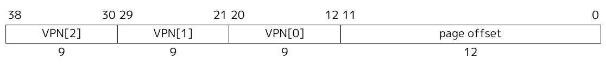
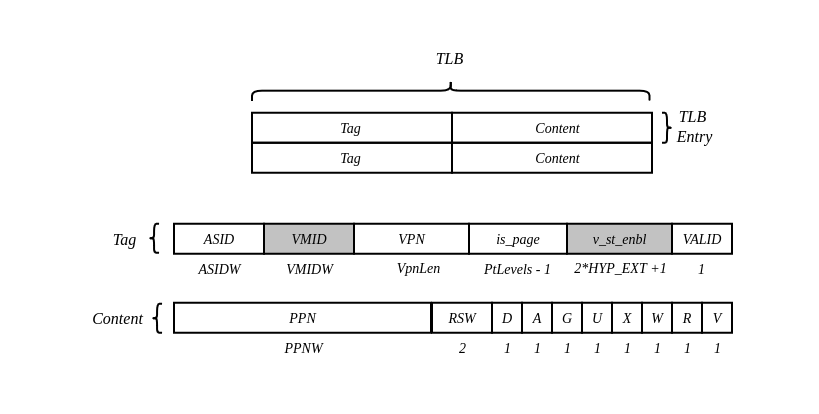

程序执行一条 RISC-V 的 `lw a0, 0(a1)`。令 `a1 = 0x404035e8`，这条指令要在当前地址空间中读四个字节。对程序可见的是这个虚拟地址。存储系统还需要目标物理地址和访问许可，才能决定从哪里取数据。下面使用 Sv39 把这一步算完，随后重复同一条加载，观察结果怎样被缓存，以及页表更新后怎样让新翻译生效。

例题为 RISC-V U 模式的单阶段翻译，数据按小端解释。地址、表项内容和读到的值由题设给定。字段和权限依据 RISC-V 特权规范 v20250508，硬件接口以公开的 CVA6 MMU 为例。先修知识是[缓存怎样用地址选组和行内字节](./microarch-01b-cache-mapping.md#cache-address)。

[[toc]]

## 加载单元向 MMU 交出什么 {#sv39-interface}

**MMU**（Memory Management Unit，内存管理单元）连接取指和访存路径。图 1 中，LSU（Load/Store Unit，加载与存储单元）送入虚拟地址、读取或写入的类型及特权状态。控制寄存器端提供根表的物理页号、地址空间标识及权限相关配置。数据侧的 MMU 结果包括是否命中 DTLB、翻译后的物理地址、有效状态和异常信息。读图时先沿左侧的 `lsu_vaddr_i`、`satp_ppn_i`，再找到右侧的 `lsu_paddr_o` 和 `lsu_exception_o`。

<figure class="lesson-figure" style="max-width: 797px">
<a href="/microarch/cva6-mmu-interface.png"></a>
<figcaption>图 1　CVA6 的 MMU 接口。左侧为输入，右侧为输出。点击查看大图。</figcaption>
</figure>

MMU 内部的 **TLB**（Translation Lookaside Buffer，翻译后备缓冲）保存已有的翻译。取指路径可查 ITLB，数据访问可查 DTLB，另可配置共享 TLB。需要重新查页表时，由 **PTW**（Page Table Walker，页表遍历器）根据根表和虚拟页号发出读表请求。在 CVA6 的设计文档中，PTW 的读取走数据缓存侧接口。一次原始加载由此可能带出额外的物理访存，用来读取页表项。它们与最后那笔程序数据的读取具有不同地址。

## 从 64 位虚拟地址拆出三个索引 {#sv39-address}

在 Sv39 中，普通页长 4 KiB，即 4096 字节。低 12 位决定页内偏移，另外三个 9 位字段是虚拟页号 **VPN** 的三段。64 位虚拟地址的位 63 至 39 必须与位 38 相同，否则不能按合法的 Sv39 地址继续翻译。这条加载地址的位 38 和更高位均为 0。

<figure class="lesson-figure">
<a href="/microarch/sv39-virtual-address.png"></a>
<figcaption>图 2　Sv39 虚拟地址字段。上排是位编号，下排是字段宽度。</figcaption>
</figure>

<div role="region" aria-label="Sv39 虚拟地址字段" style="max-width:100%; overflow-x:auto">

| 字段 | 位范围 | 对 `0x404035e8` 的值 |
| --- | --- | ---: |
| VPN[2] | 38–30 | 1 |
| VPN[1] | 29–21 | 2 |
| VPN[0] | 20–12 | 3 |
| 页内偏移 | 11–0 | `0x5e8` |

</div>

先取低 12 位得到 `0x5e8`。除去它，再从低到高每次取 9 位，依次得到 3、2、1。普通页映射只替换页号。哪怕新的物理页与原物理页相距很远，仍要在新页中取同一个偏移。

## 三级页表怎样给出物理页号 {#sv39-walk}

每级页表有 512 项，一项 **PTE**（Page Table Entry，页表项）占 8 字节，一整张表恰好占 4 KiB。当前表的物理基址加上该级索引乘 8，就是要读的表项地址。根表由监管者寄存器 `satp` 指定。在 RV64 的 Sv39 模式下，`MODE = 8`，`ASID` 用于区分地址空间，`PPN` 给出根表的物理页号。本例的 `ASID = 7`，根表 PPN 为 `0x90`，因而从 `0x90000` 开始。物理表项里再给出下一级的 PPN。有了这些物理地址，遍历就无需为自己读取的 PTE 递归做同一套虚拟翻译。

<div role="region" aria-label="三级页表的查表结果" style="max-width:100%; overflow-x:auto">

| 级别 | PTE 地址 | PTE 内容 | 查表结果 |
| --- | --- | --- | --- |
| 2 | `0x90008` | `0x25001` | 下一级 PPN `0x94` |
| 1 | `0x94010` | `0x26001` | 下一级 PPN `0x98` |
| 0 | `0x98018` | `0x48c53` | 叶子 PPN `0x123` |

</div>

根表基址是 `0x90000`，用索引 1 得到 `0x90000 + 1 × 8 = 0x90008`。第一项只置 V，下一级表的基址是 `0x94000`，用索引 2 得到 `0x94000 + 2 × 8 = 0x94010`。第二项也只置 V。末级表基址是 `0x98000`，用索引 3 得到 `0x98000 + 3 × 8 = 0x98018`。

结合位域读一项。PTE 的位 53 至 10 是 44 位 PPN，位 9 至 8 的 RSW 留给监管者软件。位 7 至 0 依次是 D、A、G、U、X、W、R、V。本例未启用使用高位保留字段的扩展，高位清零。V 为 0 或 R 为 0 而 W 为 1 时，本例按页错误处理。有效的项若 R 或 X 置位，就是给出映射的**叶子项**。R、W、X 都为 0 时，用 PPN 进入下一级。普通非叶子项的 U、A、D 位保留，软件应清零。若已到第 0 级却还是指针，遍历也会失败。

`0x98018` 是**存放叶子项的地址**。从此处读到 `0x48c53`，右移 10 位得到 `0x123`，低位 `0x53` 表示 V、R、U、A 均置位。页起点 `0x123000` 加上偏移 `0x5e8`，得到数据的物理地址 **`0x1235e8`**。若行长为 64 字节，[数据缓存](./microarch-01b-cache-mapping.md#cache-lookup)要找到的行起点是 `0x1235c0`，再读偏移 `0x28` 至 `0x2b`。题设给该位置的四字节为 `25 00 00 00`，加载得到 37。

## 哪些条件会使同一地址报错 {#sv39-permissions}

用同一个叶子试三种变化。第一种把加载改为存储，W 为 0，会产生 Store/AMO page fault。第二种只把 U 清零，U 模式的加载也会产生页错误，即使物理页号和值都没改。第三种保留页权限，却遇到物理内存保护（PMP）或物理地址区域属性（PMA）的拒绝，可能得到访问错误。读异常记录时，要分清是虚拟地址翻译的权限，还是物理访问本身不允许。若程序在一个可读页中只分配了长度较小的数组，页的 R、U 位仍覆盖整页，具体数组边界需要由程序处理。

A、D 分别表示已访问和已写。主例 A 已置位，读操作无需修改表项。若 A 为 0，或者写请求发现 D 为 0，体系结构允许按所采用的机制处理。使用 Svade 机制时会产生页错误，由软件处理。采用硬件更新机制时，处理器依规定更新 PTE。硬件更新方案允许 A 因投机访问而提前更新，即使该次访问最终没有成为架构上的访存。显式存储引起的 D 位更新必须是非投机的，并由本 hart 按程序顺序观察。因此看见 A 置位，不能倒推出某条加载一定已经退休。

### 先在中间一级遇到叶子

若 `0x94010` 里的项改成叶子，遍历在级别 1 结束，映射页长变为 2 MiB。VA 的 VPN[0] 与低 12 位一起构成 21 位页内偏移。本例的偏移是 `(3 << 12) + 0x5e8 = 0x35e8`。若物理基址取 `0x60000000`，结果就是 `0x600035e8`。此时 PPN 的低 9 位要为零。若改用 `0x60001000` 作为大页基址，表项虽然仍是叶子，却因未对齐而报页错误。根表本身也可放叶子，得到 1 GiB 的映射，需要保留原 VA 的低 30 位，物理基址相应按 1 GiB 对齐。

::: details 练习｜相邻两字节的物理地址一定相邻吗
设 `0x40403fff` 的虚拟页仍映到物理页 `0x123`，紧接着的 `0x40404000` 映到物理页 `0x565`。两个地址在物理侧分别是多少？

第一个为 `0x123fff`，第二个为 `0x565000`。虚拟地址刚跨页，物理页可能相距很远。[硬件预取](./microarch-02-prefetch.md#prefetch-queue)遇到虚拟候选跨页时，也要根据实现决定重新翻译还是丢弃候选。
:::

## TLB 命中后还要检查什么 {#sv39-tlb}

第二次访问同一个地址时，MMU 可以复用上一笔得到的翻译。图 3 展示了 CVA6 的一种实际 TLB 表项。`Tag` 一侧有 ASID、VPN、适用页级和表项有效位。`Content` 一侧有物理页号与 PTE 权限。图中的 VMID 和阶段使能字段还服务于虚拟化，本文只使用单阶段配置。TLB 自己的 `VALID` 控制该槽是否有效，内容里的 `V` 是从 PTE 得到的位。

<figure class="lesson-figure" style="max-width: 819px">
<a href="/microarch/cva6-tlb-entry.png"></a>
<figcaption>图 3　CVA6 的 TLB 表项。先从 Tag 一侧找匹配条件，再看 Content 返回什么。手机可点开看大图。</figcaption>
</figure>

对于主例的非全局 4 KiB 页，匹配键可写成 `(ASID 7, VPN 0x40403)`。命中时直接得到 PPN `0x123` 和权限字段。仍要检查这次操作是读还是写、当前特权模式是否允许，然后拼出物理地址。对 2 MiB 项，低 9 位 VPN 已成为页内偏移的一部分，比较时使用更高的页号前缀。全局标记 G 可以放在遍历路径上的项中，表示该翻译适用于所有地址空间。在支持 ASID 的实现中，普通项需要匹配 ASID，全局项按不同规则处理。

若同一个 hart 换到 ASID 8，地址依然是 `0x404035e8`，它可以有另一个根表并映到 `0x7775e8`。ASID 7 的表项不应用于它。另一方面，即使 DTLB 未命中，也可能由共享 TLB 或缓存的中间遍历结果提供帮助。**DTLB 未命中、完整读取三项 PTE、数据缓存未命中**分别涉及不同结构。读性能计数时，应确认计数的是哪一步。

## 改完页表，为什么还要同步翻译 {#sv39-fence}

设管理程序将 ASID 7 的末级项从 PPN `0x123` 改成 `0x567`，读权限保持不变。若之后完整遍历，会从 `0x98018` 得到新 PPN。但旧翻译可能仍在 TLB 或其他地址翻译缓存里。有了旧项的命中，本次访问不一定重新读取那份 PTE。不同实现和时机下，旧项也可能已经被换出。软件不能用“我已经写了页表”推断下一笔访问必然按新映射进行。

RISC-V 用 **SFENCE.VMA** 对本地硬件线程（hart）同步地址翻译和页表更新。它让本 hart 已可见的页表写入，和作用域内之后的隐式页表访问有规定的顺序，并处理相关的旧翻译。两项源寄存器的选择决定范围。

<div role="region" aria-label="SFENCE.VMA 的作用域" style="max-width:100%; overflow-x:auto">

| `rs1` | `rs2` | 最小规定作用域 |
| --- | --- | --- |
| `x0` | `x0` | 所有地址空间、各级页表与翻译 |
| `x0` | 持有 ASID 的非 `x0` 寄存器 | 此 ASID 的各级翻译，排除全局映射 |
| 持有页内虚拟地址的非 `x0` 寄存器 | `x0` | 所有地址空间内覆盖该地址的叶子映射 |
| 持有页内虚拟地址的非 `x0` 寄存器 | 持有 ASID 的非 `x0` 寄存器 | 此 ASID 中覆盖该地址的非全局叶子映射 |

</div>

“寄存器是 `x0`”和“某个非 `x0` 寄存器里数值为 0”含义不同。后者作为 `rs2` 时选择 ASID 0。具体实现允许清除比表中更多的项。修改非叶子指针时要考虑整棵子树，规范建议用 `rs1 = x0`。若路径上有全局标记，处理相关映射时要用包含全局项的范围。写 `satp` 本身没有自动清掉所有翻译的保证，回收 ASID 时也要把它与旧根表关联的翻译同步掉。

### 两个 hart 各自留有旧翻译 {#sv39-shootdown}

设 hart 0 和 hart 1 正在运行同一进程的两个线程。两边的地址空间都关联到根表 `0x90000`。为方便手算，两个 hart 都使用 ASID 7。RISC-V 的 ASID 由各 hart 本地解释，因此这里的 7 是题设。系统若给同一地址空间分配了不同的本地 ASID，远端处理就须使用当地的 ASID，或采用覆盖该翻译的更广范围。

两个线程已经各读过一次 `0x404035e8`。各自的 DTLB 都缓存了 VPN `0x40403` 到 PPN `0x123` 的记录，其中带有原来的读权限。现在内核要把这页换成 PPN `0x567`。设新页对应位置已准备好数据 52，旧页在同步结束以前仍保留数据 37。页表更新从物理地址 `0x98018` 开始，把叶子项从 `0x48c53` 改成 `0x159c53`。

这里有两个存放位置。数据缓存系统处理的是物理地址 `0x98018` 上的 PTE 字节，因此新的遍历可以读到 `0x159c53`。DTLB 里保存的是先前遍历得到的页号和权限，命中时无需再次读取 `0x98018`。即使数据缓存已通过[一致性协议](./microarch-01f-coherence.md#mesi-trace)交接了最新的 PTE，另一个 hart 仍可能命中旧翻译并把请求送到 `0x1235e8`。

### 从发布页表写入到等到远端确认

RISC-V 规范给出一种软件协调方式。发起 hart 先用数据栅栏安排页表写入向其他 hart 可见，再发核间中断（Inter-Processor Interrupt，IPI）。目标 hart 在中断处理路径执行自己的 `SFENCE.VMA`，完成后回报发起者。发起者本身也可能留着旧翻译，需要在本地同步。本例在 S 模式下可令 `t0 = 0x404035e8`、`t1 = 7`，再执行 `sfence.vma t0, t1`。两个操作数把范围限定为覆盖该地址的非全局叶子映射，以及本 hart 的 ASID 7。

<div role="region" aria-label="跨核翻译同步的事件顺序" style="max-width:100%; overflow-x:auto">

| 事件完成时 | hart 0 的翻译 | hart 1 的翻译 |
| --- | --- | --- |
| 两边先各读一次 | `0x123`，读到 37 | `0x123`，读到 37 |
| 新 PTE 已可见，hart 0 完成本地同步 | 旧项失效，重查读到 52 | 可命中 `0x123`，读到 37 |
| hart 1 执行当地的 `SFENCE.VMA` | 可使用 `0x567` | 旧项失效，重查读到 52 |
| 发起者收到远端完成通知 | 可使用 `0x567` | 可使用 `0x567` |

</div>

表中第二行的两个加载可以访问完全不同的物理行。低 12 位都是 `0x5e8`，但 hart 0 重新取得页号 `0x567`，访问 `0x5675e8`。hart 1 若命中旧项，仍访问 `0x1235e8`。表里保留旧项是规范允许的一种情况。具体机器也可能提前淘汰旧项。

完成通知用于划定旧映射的使用期。发出中断只说明发起者提出了请求。若旧页准备交还给分配器，内核须先保证所有有关 hart 都处理了旧翻译，并满足旧页的其他回收条件，例如已经解除额外引用。目标集合也与「此刻在哪些核运行」不同。以前运行过该地址空间的 hart 可能仍保留翻译。只要能保证某个 hart 没有相关旧项，或它在再次使用该地址空间前必定完成同步，系统就可免去一次立即通知。

::: details 练习｜把换页改成撤销映射
将叶子 PTE 改成 0，使 V 位清零。只完成 hart 0 的同步时，两边的加载分别如何结束？hart 1 完成当地的同步之后呢？

hart 0 再查 `0x98018` 时见到 V 为 0，产生加载页错误。在远端同步之前，hart 1 若保留旧翻译，仍可能读到 37。hart 1 同步后再查页表，也会产生加载页错误。原来物理页里的 37 是否还留在某一级数据缓存，不改变这个结果。
:::

## 用 C 复算本地同步与远端同步 {#sv39-program}

程序用 `PtEntry` 数组表示位于给定物理地址上的 PTE。两个 `Hart` 对象各有自己的 TLB。表项记录 ASID、虚拟页前缀、页大小和叶子 PTE。`walk` 逐项算出 PTE 的物理地址，并从数组取出内容。`covers` 比较表项有效位、ASID 和虚拟页前缀。在命中路径上，权限检查和物理地址拼接都使用缓存的叶子 PTE。给 `load_word` 同一个虚拟地址时，它先查所属 hart 的 TLB，再决定是否沿根表走三级。代码覆盖题设下的非全局 U 模式加载，时间表由 `main` 逐步安排。一次写入数组代表页表更新已经可见，`invalidate_leaf` 代表指定 hart 已完成相应范围的翻译同步。程序用顺序调用表达事件，省略数据栅栏、中断传递和完成通知的具体实现。

保存为 `sv39_walk.c`。用 `gcc -std=c11 -O2 -Wall -Wextra sv39_walk.c -o sv39_walk` 编译，再运行 `./sv39_walk`。在 Windows PowerShell 中运行 `.\sv39_walk.exe`。

```c
#include <inttypes.h>
#include <stdbool.h>
#include <stdint.h>
#include <stdio.h>
#include <stdlib.h>

enum {
    PTE_V = 1u << 0, PTE_R = 1u << 1, PTE_W = 1u << 2, PTE_X = 1u << 3,
    PTE_U = 1u << 4, PTE_G = 1u << 5, PTE_A = 1u << 6, PTE_D = 1u << 7,
    USER_READ = PTE_V | PTE_R | PTE_U | PTE_A,
    LEAF = 0x98018, TLB_SLOTS = 2
};
static const uint64_t VA = 0x404035e8;

typedef struct { uint64_t address, pte; } PtEntry;
typedef struct { unsigned asid; uint64_t root; } AddressSpace;
typedef struct {
    bool valid;
    unsigned asid, shift;
    uint64_t prefix, pte;
} TlbEntry;
typedef struct { TlbEntry tlb[TLB_SLOTS]; } Hart;

static PtEntry page_table[] = {
    {0x90008, (0x94u << 10) | PTE_V},
    {0x94010, (0x98u << 10) | PTE_V},
    {LEAF,    (0x123u << 10) | USER_READ},
    {0xa0008, (0xa4u << 10) | PTE_V},
    {0xa4010, (0xa8u << 10) | PTE_V},
    {0xa8018, (0x777u << 10) | USER_READ}
};

static uint64_t *pte_at(uint64_t physical_address)
{
    for (size_t i = 0; i < sizeof page_table / sizeof page_table[0]; ++i) {
        if (page_table[i].address == physical_address)
            return &page_table[i].pte;
    }
    return NULL;
}

static bool covers(TlbEntry entry, unsigned asid, uint64_t va)
{
    return entry.valid && entry.asid == asid && (va >> entry.shift) == entry.prefix;
}

static void invalidate_leaf(Hart *hart, unsigned asid, uint64_t va)
{
    for (unsigned i = 0; i < TLB_SLOTS; ++i) {
        if (covers(hart->tlb[i], asid, va))
            hart->tlb[i].valid = false;
    }
}

static const char *walk(AddressSpace space, uint64_t va, TlbEntry *leaf,
                        uint64_t visited[3], unsigned *count)
{
    uint64_t table = space.root;
    for (int level = 2; level >= 0; --level) {
        unsigned shift = 12 + 9 * (unsigned)level;
        uint64_t address = table + ((va >> shift) & 0x1ff) * 8;
        visited[(*count)++] = address;

        uint64_t *entry = pte_at(address);
        uint64_t pte = entry ? *entry : 0;
        if ((pte >> 54) || !(pte & PTE_V) || ((pte & PTE_W) && !(pte & PTE_R)))
            return "invalid PTE";
        if (pte & PTE_G)
            return "global mapping outside the model";

        table = (pte >> 10) << 12;
        if (pte & (PTE_R | PTE_X)) {
            if (table & ((UINT64_C(1) << shift) - 1))
                return "misaligned superpage";
            *leaf = (TlbEntry){true, space.asid, shift, va >> shift, pte};
            return NULL;
        }
        if (pte & (PTE_U | PTE_A | PTE_D))
            return "reserved bits in non-leaf PTE";
    }
    return "no leaf";
}

static int word_at(uint64_t pa)
{
    switch (pa) {
    case 0x1235e8: return 37;
    case 0x5675e8: return 52;
    case 0x7775e8: return 81;
    default:
        fputs("address outside the example\n", stderr);
        exit(EXIT_FAILURE);
    }
}

static void load_word(Hart *hart, unsigned id, AddressSpace space, uint64_t va)
{
    printf("h%u asid=%u ", id, space.asid);
    uint64_t sign_extension = UINT64_MAX >> 39;
    if ((va >> 39) != (((va >> 38) & 1) ? sign_extension : 0)) {
        puts("fault invalid virtual address");
        return;
    }

    TlbEntry entry = {0};
    TlbEntry *slot = &hart->tlb[0];
    for (unsigned i = 0; i < TLB_SLOTS; ++i) {
        if (covers(hart->tlb[i], space.asid, va)) {
            entry = hart->tlb[i];
            break;
        }
        if (!hart->tlb[i].valid)
            slot = &hart->tlb[i];
    }

    uint64_t visited[3];
    unsigned count = 0;
    const char *fault = entry.valid ? NULL : walk(space, va, &entry, visited, &count);
    if (!fault && (entry.pte & (PTE_R | PTE_U)) != (PTE_R | PTE_U))
        fault = "U read permission";
    if (!fault && !(entry.pte & PTE_A))
        fault = "A bit";
    if (fault) {
        printf("fault %s\n", fault);
        return;
    }

    if (count != 0)
        *slot = entry;
    uint64_t offset = va & ((UINT64_C(1) << entry.shift) - 1);
    uint64_t pa = ((entry.pte >> 10) << 12) | offset;
    printf("%s pa=0x%" PRIx64 " value=%d", count ? "walk" : "hit", pa, word_at(pa));
    for (unsigned i = 0; i < count; ++i)
        printf(" 0x%" PRIx64, visited[i]);
    putchar('\n');
}

int main(void)
{
    const AddressSpace a = {7, 0x90000}, b = {8, 0xa0000};
    Hart h0 = {0}, h1 = {0};
    uint64_t *target = pte_at(LEAF);
    if (!target)
        return EXIT_FAILURE;

    load_word(&h0, 0, a, VA);
    load_word(&h1, 1, a, VA);
    load_word(&h0, 0, b, VA);

    *target = (0x567u << 10) | USER_READ;
    invalidate_leaf(&h0, a.asid, VA);
    load_word(&h0, 0, a, VA);
    load_word(&h1, 1, a, VA);

    invalidate_leaf(&h1, a.asid, VA);
    load_word(&h1, 1, a, VA);
    load_word(&h0, 0, b, VA);

    *target &= ~(uint64_t)PTE_U;
    invalidate_leaf(&h0, a.asid, VA);
    load_word(&h0, 0, a, VA);
}
```

```text
h0 asid=7 walk pa=0x1235e8 value=37 0x90008 0x94010 0x98018
h1 asid=7 walk pa=0x1235e8 value=37 0x90008 0x94010 0x98018
h0 asid=8 walk pa=0x7775e8 value=81 0xa0008 0xa4010 0xa8018
h0 asid=7 walk pa=0x5675e8 value=52 0x90008 0x94010 0x98018
h1 asid=7 hit pa=0x1235e8 value=37
h1 asid=7 walk pa=0x5675e8 value=52 0x90008 0x94010 0x98018
h0 asid=8 hit pa=0x7775e8 value=81
h0 asid=7 fault U read permission
```

第四、五行对应表中只完成了本地同步的状态。hart 0 重新遍历，三个 PTE 的物理地址仍和开头一样，因为改动的是最后一项的**内容**。此时 hart 1 的 `covers` 仍能找到旧表项，直接使用里面的 PPN 和权限。第六行显示它同步后也走到新页。第七行的 ASID 8 命中是模型按指定范围失效的结果。最后两步只在 hart 0 重算撤销 U 权限后的加载，完成整次跨核权限变更时，仍须处理 hart 1 的翻译。

## 参考文献

- [RISC-V International 特权规范 v20250508，第 12.1.11、12.2.1、12.3.2、12.4 节](https://docs.riscv.org/reference/isa/v20250508/_attachments/riscv-privileged.pdf)
- 图 2 截取自该规范图 68，沿用原图的布局。[CC BY 4.0](https://creativecommons.org/licenses/by/4.0/)
- [OpenHW CVA6 的 MMU、TLB 以及 PTW 接口说明](https://docs.openhwgroup.org/projects/cva6-user-manual/03_cva6_design/MMU.html)
- 图 1 与图 3 来自 OpenHW CVA6 设计文档，本站补白底和留白并以灰度保存。[图与文档的源码版本](https://github.com/openhwfoundation/cva6/blob/742dc82a0c706e0a3bfb98b709fd3ee06d50d12a/docs/03_cva6_design/MMU.rst) · [对应源码库许可文本](/microarch/cva6-figure-license.txt)
- [Linux 的页表、TLB 和遍历缓存](https://docs.kernel.org/mm/page_tables.html)
- [Linux 内核对缓存与 TLB 同步接口的说明](https://docs.kernel.org/core-api/cachetlb.html)

<nav class="article-nav" aria-label="系列文章导航">

[<span class="article-nav-text"><small>上一篇</small><strong>预取器和数据缓存怎样握手</strong></span>](./microarch-02d-prefetch-rtl.md){.article-nav-card .article-nav-prev rel=prev}

[<span class="article-nav-text"><small>下一篇</small><strong>乱序执行怎样按程序顺序退休</strong></span>](./microarch-03-execution.md){.article-nav-card .article-nav-next rel=next}

</nav>
