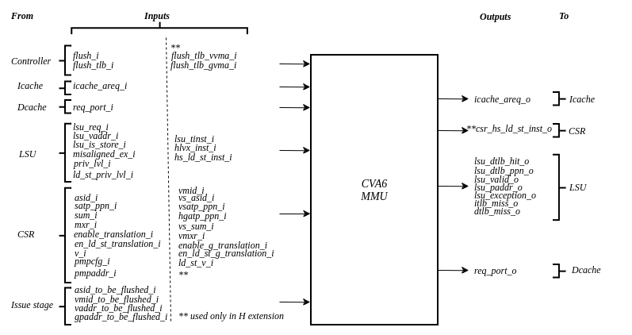

程序执行一条 RISC-V 的 `lw a0, 0(a1)`。令 `a1 = 0x404035e8`，这条指令要在当前地址空间中读四个字节。对程序可见的是这个虚拟地址。存储系统还需要目标物理地址和访问许可，才能决定从哪里取数据。下面使用 Sv39 把这一步算完，随后重复同一条加载，观察结果怎样被缓存，以及页表更新后怎样让新翻译生效。

例题为 RISC-V U 模式的单阶段翻译，数据按小端解释。地址、表项内容和读到的值由题设给定。字段和权限依据 RISC-V 特权规范 v20250508，硬件接口以公开的 CVA6 MMU 为例。先修知识是[缓存怎样用地址选组和行内字节](./microarch-01b-cache-mapping.md#cache-address)。

[[toc]]

## 加载单元向 MMU 交出什么 {#sv39-interface}

**MMU**（Memory Management Unit，内存管理单元）连接取指和访存路径。图 1 中，LSU（Load/Store Unit，加载与存储单元）送入虚拟地址、读取或写入的类型及特权状态。控制寄存器端提供根表的物理页号、地址空间标识及权限相关配置。数据侧的 MMU 结果包括是否命中 DTLB、翻译后的物理地址、有效状态和异常信息。读图时先沿左侧的 `lsu_vaddr_i`、`satp_ppn_i`，再找到右侧的 `lsu_paddr_o` 和 `lsu_exception_o`。

<figure class="lesson-figure" style="max-width: 797px">
<a href="/microarch/cva6-mmu-interface.png"></a>
<figcaption>图 1　CVA6 的 MMU 接口。左侧为输入，右侧为输出。点击查看大图。</figcaption>
</figure>

MMU 内部的 **TLB**（Translation Lookaside Buffer，翻译后备缓冲）保存已有的翻译。取指路径可查 ITLB，数据访问可查 DTLB，另可配置共享 TLB。需要重新查页表时，由 **PTW**（Page Table Walker，页表遍历器）根据根表和虚拟页号发出读表请求。在 CVA6 的设计文档中，PTW 的读取走数据缓存侧接口。一次原始加载由此可能带出额外的物理访存，用来读取页表项。它们与最后那笔程序数据的读取具有不同地址。

## 从 64 位虚拟地址拆出三个索引 {#sv39-address}

在 Sv39 中，普通页长 4 KiB，即 4096 字节。低 12 位决定页内偏移，另外三个 9 位字段是虚拟页号 **VPN** 的三段。64 位虚拟地址的位 63 至 39 必须与位 38 相同，否则不能按合法的 Sv39 地址继续翻译。这条加载地址的位 38 和更高位均为 0。

<figure class="lesson-figure">
<a href="/microarch/sv39-virtual-address.png"></a>
<figcaption>图 2　Sv39 虚拟地址字段。上排是位编号，下排是字段宽度。</figcaption>
</figure>

<div role="region" aria-label="Sv39 虚拟地址字段" style="max-width:100%; overflow-x:auto">

| 字段 | 位范围 | 对 `0x404035e8` 的值 |
| --- | --- | ---: |
| VPN[2] | 38–30 | 1 |
| VPN[1] | 29–21 | 2 |
| VPN[0] | 20–12 | 3 |
| 页内偏移 | 11–0 | `0x5e8` |

</div>

先取低 12 位得到 `0x5e8`。除去它，再从低到高每次取 9 位，依次得到 3、2、1。普通页映射只替换页号。哪怕新的物理页与原物理页相距很远，仍要在新页中取同一个偏移。

## 三级页表怎样给出物理页号 {#sv39-walk}

每级页表有 512 项，一项 **PTE**（Page Table Entry，页表项）占 8 字节，一整张表恰好占 4 KiB。当前表的物理基址加上该级索引乘 8，就是要读的表项地址。根表由监管者寄存器 `satp` 指定。在 RV64 的 Sv39 模式下，`MODE = 8`，`ASID` 用于区分地址空间，`PPN` 给出根表的物理页号。本例的 `ASID = 7`，根表 PPN 为 `0x90`，因而从 `0x90000` 开始。物理表项里再给出下一级的 PPN。有了这些物理地址，遍历就无需为自己读取的 PTE 递归做同一套虚拟翻译。

<div role="region" aria-label="三级页表的查表结果" style="max-width:100%; overflow-x:auto">

| 级别 | PTE 地址 | PTE 内容 | 查表结果 |
| --- | --- | --- | --- |
| 2 | `0x90008` | `0x25001` | 下一级 PPN `0x94` |
| 1 | `0x94010` | `0x26001` | 下一级 PPN `0x98` |
| 0 | `0x98018` | `0x48c53` | 叶子 PPN `0x123` |

</div>

根表基址是 `0x90000`，用索引 1 得到 `0x90000 + 1 × 8 = 0x90008`。第一项只置 V，下一级表的基址是 `0x94000`，用索引 2 得到 `0x94000 + 2 × 8 = 0x94010`。第二项也只置 V。末级表基址是 `0x98000`，用索引 3 得到 `0x98000 + 3 × 8 = 0x98018`。

结合位域读一项。PTE 的位 53 至 10 是 44 位 PPN，位 9 至 8 的 RSW 留给监管者软件。位 7 至 0 依次是 D、A、G、U、X、W、R、V。本例未启用使用高位保留字段的扩展，高位清零。V 为 0 或 R 为 0 而 W 为 1 时，本例按页错误处理。有效的项若 R 或 X 置位，就是给出映射的**叶子项**。R、W、X 都为 0 时，用 PPN 进入下一级。普通非叶子项的 U、A、D 位保留，软件应清零。若已到第 0 级却还是指针，遍历也会失败。

`0x98018` 是**存放叶子项的地址**。从此处读到 `0x48c53`，右移 10 位得到 `0x123`，低位 `0x53` 表示 V、R、U、A 均置位。页起点 `0x123000` 加上偏移 `0x5e8`，得到数据的物理地址 **`0x1235e8`**。若行长为 64 字节，[数据缓存](./microarch-01b-cache-mapping.md#cache-lookup)要找到的行起点是 `0x1235c0`，再读偏移 `0x28` 至 `0x2b`。题设给该位置的四字节为 `25 00 00 00`，加载得到 37。

## 哪些条件会使同一地址报错 {#sv39-permissions}

用同一个叶子试三种变化。第一种把加载改为存储，W 为 0，会产生 Store/AMO page fault。第二种只把 U 清零，U 模式的加载也会产生页错误，即使物理页号和值都没改。第三种保留页权限，却遇到物理内存保护（PMP）或物理地址区域属性（PMA）的拒绝，可能得到访问错误。读异常记录时，要分清是虚拟地址翻译的权限，还是物理访问本身不允许。若程序在一个可读页中只分配了长度较小的数组，页的 R、U 位仍覆盖整页，具体数组边界需要由程序处理。

解释 R、W、X 时，先要判断表项编码是否有效。Sv39 规定 `R=0、W=1` 的组合保留，不能把它当作一个普通的“只写页”。例如，将主例叶子的低三个位改为 `R=0、W=1、X=0`，即使 V 仍为 1，页表遍历也会因该组合报页错误。这个检查先于把表项用作可访问叶子；MXR 也不能把保留编码变成合法映射。

相反，`R=0、W=0、X=0` 在 V 有效且其他字段符合要求时表示指向下一级页表的非叶子项，不直接给原加载提供目标物理页。如果这样的项出现在最低级，遍历已无下一级可继续，原访问发生页错误。这里的页错误来自翻译规则；若读取该项的物理地址本身被 PMP 或 PMA 拒绝，则沿下面的访问错误路径判断。

### 页表项本身读不到，会报告哪一种异常 {#sv39-walk-access-fault}

沿用虚拟地址 `0x404035e8`。假定 TLB 中没有可用的翻译，页表遍历器也没有可用的中间结果，因此需要重新读取三项 PTE。第 2 级和第 1 级先后读出 `0x25001` 与 `0x26001`，最后尝试从物理地址 `0x98018` 读取叶子。此时核心还没有向 `0x1235e8` 发出这笔数据访问。

页表遍历器发出的 PTE 读取也是物理访问。物理内存属性（PMA）描述所在区域支持的访问，物理内存保护（PMP）可进一步限制对物理范围的访问。若检查阻止读取 `0x98018`，遍历在取得叶子之前就停止。若读取成功，但叶子无效或不允许原指令的访问，则在解释页表项时产生页错误。

| 原指令与题设 | 失败发生在哪里 | RISC-V 交付的异常 |
| --- | --- | --- |
| 加载，PMP 阻止读取叶子 PTE | 读取物理地址 `0x98018` | 加载访问错误，原因码 5 |
| 加载，PTE 可读，但其中的 V 为 0 | 检查已读回的叶子 | 加载页错误，原因码 13 |
| 存储，PMP 同样阻止读取叶子 PTE | 仍是一次对 `0x98018` 的隐式读取 | 存储访问错误，原因码 7 |
| 存储，PTE 可读，V 为 1 但 W 为 0 | 检查叶子的写权限 | 存储页错误，原因码 15 |

第三行的页表操作虽然是读，异常仍按触发遍历的原指令分类。系统收到的是这条存储指令的访问错误。若陷阱进入 S 模式，并且平台为该异常提供故障虚拟地址，`stval` 记录原指令访问的 `0x404035e8`。表中用于解释失败位置的物理 PTE 地址 `0x98018` 不会因此出现在 `stval` 中。[乱序执行一篇](./microarch-03-execution.md#ooo-oldest-exception)把这个寄存器同保存指令位置的 `sepc` 放在同一个例题里。

::: details 练习｜PTE 可读，但硬件不能写 A 位

使用由硬件更新 A、D 位的模式。叶子为 `0x48c13`，其中 A 为 0。假定原加载的页权限检查通过，PMP 允许读叶子，却禁止硬件写回新的 A 位。最终交付什么异常？

地址翻译需要先更新 A。写回 PTE 被拒绝，规范仍按原指令类型报告加载访问错误。若改为由软件处理 A、D 位的 Svade 模式，同一个 A 为 0 的叶子会先触发加载页错误。

:::

### 监管者怎样读取用户页 {#sv39-sum-mxr}

沿用虚拟地址 `0x404035e8` 和叶子 PTE `0x48c53`。用户程序可以在 U 模式执行 `lw a0, 0(a1)`，其中 `a1` 保存该虚拟地址。现在设操作系统在 S 模式下使用同一套页表执行同样的加载，例如在处理系统调用时复制一个用户提供的整数。PTE 里的 `R = 1` 已经允许读，但 `U = 1` 还要求按当前特权级判断能否访问用户页。

S 模式的状态寄存器 `sstatus` 提供两项控制。第 18 位 SUM 控制 S 模式的**加载与存储**能否通过用户页的 U 位检查。第 19 位 MXR 改变**数据加载**对 R、X 两位的解释。MXR 为 0 时加载需要 R；MXR 为 1 时，R 或 X 有一位满足即可。SUM 允许访问用户页以后，加载和存储仍需满足各自的页权限。取指需要 X，且 S 模式取指始终要求 U 为 0。

把主例的 R 清零、X 置一，得到 `0x48c59`。物理页号仍为 `0x123`，映射也仍属于用户页。下表假定指令和数据地址均按要求对齐，页表已同步，物理保护检查通过，各尝试独立进行。

| 叶子 PTE | 访问 | SUM | MXR | 该次访问的结果 |
| --- | --- | ---: | ---: | --- |
| `0x48c53`，R、U 置位 | S 模式执行 `lw` | 0 | 0 | 加载页错误，U 位检查未通过 |
| `0x48c53`，R、U 置位 | S 模式执行 `lw` | 1 | 0 | 允许，从 `0x1235e8` 取得 37 |
| `0x48c59`，X、U 置位 | S 模式执行 `lw` | 1 | 0 | 加载页错误，R 为 0 |
| `0x48c59`，X、U 置位 | S 模式执行 `lw` | 1 | 1 | 允许，X 满足数据加载的权限检查 |
| `0x48c59`，X、U 置位 | S 模式执行 `sw` | 1 | 1 | 存储页错误，W 为 0 |
| `0x48c59`，X、U 置位 | S 模式从该地址取指 | 1 | 1 | 指令页错误，S 模式不能从用户页取指 |
| `0x48c59`，X、U 置位 | U 模式从该地址取指 | 0 | 0 | 取指通过页权限检查 |

最后一行只判断能否取到指令字节。取到的字节是否为合法指令，要由后续译码判断。规范还要求 SUM 和 MXR 的更改立即影响后续访问，无需为这两位执行 `SFENCE.VMA`。所以即使前一次 S 模式加载已命中 TLB，随后清掉 SUM，再对同一个地址加载也要报告页错误。可以把 [TLB 表项](#sv39-tlb)里的 U、R、W、X 理解为映射提供的权限输入，当前特权级和状态寄存器提供本次访问的另一组输入。

::: details 练习｜只改变页的归属

将 `0x48c59` 的 U 位清零得到 `0x48c49`，其余 PTE 位保持不变。设 SUM 为 0、MXR 为 1，分别判断 S 模式加载、S 模式取指、U 模式取指。

S 模式加载通过，U 为 0 使用户页限制不适用，MXR 为 1 使 X 满足加载权限。S 模式取指也通过页权限检查，因 X 为 1 且 U 为 0。U 模式取指会报指令页错误，因为该映射已经不允许 U 模式访问。

:::

### 同一页的 A、D 位怎样变化 {#sv39-ad-bits}

A、D 分别表示已访问和已写。主例 A 已置位，读操作无需修改表项。若 A 为 0，或者写请求发现 D 为 0，体系结构允许按所采用的机制处理。使用 Svade 机制时会产生页错误，由软件处理。采用硬件更新机制时，处理器依规定更新 PTE。硬件更新方案允许 A 因投机访问而提前更新，即使该次访问最终没有成为架构上的访存。显式存储引起的 D 位更新必须是非投机的，并由本 hart 按程序顺序观察。因此看见 A 置位，不能倒推出某条加载一定已经退休。

沿用叶子 PTE 地址 `0x98018` 和物理页号 `0x123`，本题先按字节拆开权限位。A 是第 6 位，对应 `0x40`；D 是第 7 位，对应 `0x80`。题设的叶子为 U 模式可访问，并假定其他权限和物理访问检查都通过。

| 操作及叶子初值 | 已置位的低位字段 | 采用 Svade 时 | 采用硬件更新时 |
| --- | --- | --- | --- |
| U 模式读，`0x48c13` | V、R、U；A 为 0 | 产生加载页错误，软件处理后可重试 | 按规定更新 A，再继续处理访问 |
| U 模式读，`0x48c53` | V、R、U、A | 无需因 A 位报错 | 无需因 A 位修改 PTE |
| U 模式写，`0x48c57` | V、R、W、U、A；D 为 0 | 产生存储页错误，软件处理后可重试 | 按规定更新 D，再继续处理访问 |

第三行将 W 置位，因此低位从 `0x53` 变成 `0x57`。如果仍使用主例的 `0x48c53` 执行存储，W 为 0，访问先受写权限限制，不能把它当成仅由 D 为 0 导致的问题。硬件更新方案中，PTE 的更新遵循规范要求的原子性和检查规则，不能把表格简化成普通软件对旧值任意写回。

::: details 练习｜只清除 D 位

将可写叶子设为 `0x48cd7`，再清除 D 位。PTE 变成多少？U 模式读取是否因为 D 为 0 而需要更新 D？

`0x48cd7 & ~0x80 = 0x48c57`。读取检查 A，题设中 A 已置位，D 为 0 不要求这次读更新 D。后续存储则要按所用 A/D 机制处理 D 位。
:::

### 先在中间一级遇到叶子 {#sv39-superpage}

把 `0x94010` 里的指针改成叶子，取物理基址 `0x60000000`，低位权限仍用 `0x53`。新 PTE 是 `(0x60000 << 10) | 0x53 = 0x18000053`。遍历还是先读根表的 `0x90008`，但读到 `0x94010` 就停下。原来用来选末级 PTE 的 VPN[0]，现在与低 12 位一起构成 21 位页内偏移，所以结果是 `0x60000000 + 0x35e8 = 0x600035e8`。

对同一个虚拟地址 `0x404035e8`，只改变在哪一级放叶子，就能复算三种映射。表中的 PTE 读数指从根表开始的一次完整模型遍历。

<div role="region" tabindex="0" aria-label="三种页长的翻译结果" style="max-width:100%; overflow-x:auto">

| 叶子级别 | 页长 | 最后读取的 PTE 地址 | 保留的虚拟地址低位 | 物理结果 |
| ---: | --- | --- | --- | --- |
| 0 | 4 KiB | `0x98018` | 12 位，`0x5e8` | `0x1235e8` |
| 1 | 2 MiB | `0x94010` | 21 位，`0x35e8` | `0x600035e8` |
| 2 | 1 GiB | `0x90008` | 30 位，`0x4035e8` | `0x804035e8`，基址为 `0x80000000` |

</div>

第 1 级叶子的 PPN 低 9 位必须为零，第 2 级必须有低 18 位为零。它们正好对应从原虚拟地址拿回的 VPN 位。若第 1 级仍是叶子，但物理基址改为 `0x60001000`，PPN 低位就出现了 1，遍历在此报页错误。

::: details 练习｜相邻两字节的物理地址一定相邻吗
设 `0x40403fff` 的虚拟页仍映到物理页 `0x123`，紧接着的 `0x40404000` 映到物理页 `0x565`。两个地址在物理侧分别是多少？

第一个为 `0x123fff`，第二个为 `0x565000`。虚拟地址刚跨页，物理页可能相距很远。[硬件预取](./microarch-02-prefetch.md#prefetch-queue)遇到虚拟候选跨页时，也要根据实现决定重新翻译还是丢弃候选。
:::

## TLB 命中后还要检查什么 {#sv39-tlb}

第二次访问同一个地址时，MMU 可以复用上一笔得到的翻译。图 3 展示了 CVA6 的一种实际 TLB 表项。`Tag` 一侧有 ASID、VPN、适用页级和表项有效位。`Content` 一侧有物理页号与 PTE 权限。图中的 VMID 和阶段使能字段还服务于虚拟化，本文只使用单阶段配置。TLB 自己的 `VALID` 控制该槽是否有效，内容里的 `V` 是从 PTE 得到的位。

<figure class="lesson-figure" style="max-width: 819px">
<a href="/microarch/cva6-tlb-entry.png"></a>
<figcaption>图 3　CVA6 的 TLB 表项。先从 Tag 一侧找匹配条件，再看 Content 返回什么。手机可点开看大图。</figcaption>
</figure>

对于主例的非全局 4 KiB 页，匹配键可写成 `(ASID 7, VPN 0x40403)`。命中时直接得到 PPN `0x123` 和权限字段。仍要检查这次操作是读还是写、当前特权模式是否允许，然后拼出物理地址。对 2 MiB 项，低 9 位 VPN 已成为页内偏移的一部分，比较时使用更高的页号前缀。全局标记 G 可以放在遍历路径上的项中，表示该翻译适用于所有地址空间。在支持 ASID 的实现中，普通项需要匹配 ASID，全局项按不同规则处理。

沿用第 1 级叶子，TLB 项覆盖 `0x40400000` 至 `0x405fffff`。将地址换为 `0x405ff5e8` 时，它的低 21 位变成 `0x1ff5e8`，但页号前缀仍为 `0x202`。同一个 ASID 可以复用原项，并得到 `0x601ff5e8`。再换成 `0x406005e8`，页号前缀变成 `0x203`，必须查别的项或重新遍历。下面的 C 程序将该范围之外的 PTE 留空，因此最后一次会报告无效页表项。

若同一个 hart 换到 ASID 8，地址依然是 `0x404035e8`，它可以有另一个根表并映到 `0x7775e8`。ASID 7 的表项不应用于它。另一方面，即使 DTLB 未命中，也可能由共享 TLB 或缓存的中间遍历结果提供帮助。**DTLB 未命中、完整读取三项 PTE、数据缓存未命中**分别涉及不同结构。读性能计数时，应确认计数的是哪一步。

### TLB 未命中，也可能少读几级页表 {#sv39-walk-cache}

**页表遍历缓存**（page-walk cache，也常称 paging-structure cache）保存页表层级中间的信息，供之后的地址翻译复用。它与 TLB 保存的对象不同：TLB 命中可以直接给出最终物理页号和访问权限；遍历缓存保存的是到达下一级表所需的指针，以及实现可能一并保存的权限信息。命中中间项后，PTW 仍须继续处理没有被缓存的下层，最终得到叶子映射。它不是数据缓存，也不会因为命中就直接返回程序要读取的字节。

用本节的 Sv39 例题看地址前缀。`0x404035e8` 的索引依次为 VPN[2]=1、VPN[1]=2、VPN[0]=3；把地址改成 `0x40404000` 后，索引为 1、2、4。前两级相同，叶子索引不同：

<div role="region" tabindex="0" aria-label="相邻虚拟页的遍历路径" style="max-width:100%; overflow-x:auto">

| 虚拟地址 | 根表项 | 中间表项 | 叶子表项 | 结果 |
| --- | --- | --- | --- | --- |
| `0x404035e8` | `0x90008` | `0x94010` | `0x98018` | PPN `0x123`，物理地址 `0x1235e8` |
| `0x40404000` | `0x90008` | `0x94010` | `0x98020` | PPN `0x565`，物理地址 `0x565000` |

</div>

若两次访问都没有命中 TLB，且遍历时没有可用的中间结果，每次都要读取三项 PTE。假设第一次访问留下了前两级的中间结果，第二次遍历可直接沿缓存的表指针访问 `0x98020`，只读取一项 PTE。若只保留根表的中间结果，则第二次要读 `0x94010` 和 `0x98020` 两项。这里给出的是 Sv39 上的教学模型。遍历缓存的组织和容量取决于实现。

::: details 练习｜换一个中间级索引

第一笔仍访问 `0x404035e8`，并留下根表和中间表的遍历结果。第二笔改为 `0x406045e8`，仍未命中 TLB。假定新的中间表项指向 `0x99000`，对应的末级 PTE 允许读取并指向物理页 `0x566`。这次能复用哪一级结果？还要读取哪些 PTE？

新地址的三级索引依次是 1、3、4，页内偏移是 `0x5e8`。根表索引仍为 1，可以复用它给出的 `0x94000`。中间索引已从 2 改成 3，要在这张表读取 `0x94000 + 3 × 8 = 0x94018`。这项给出新末级表 `0x99000`，因此叶子地址是 `0x99000 + 4 × 8 = 0x99020`，最终物理地址是 `0x5665e8`。本次需要读取两项 PTE，这两笔读取各自还可以命中普通缓存。
:::

Intel 手册把一种实现称为 **paging-structure caches**，并说明处理器可以选择实现其中任意一些或不实现。以 PML4E cache 为例，手册描述其条目可保存下一级表的物理地址，以及从上层 PTE 合并而来的读写、用户访问和执行禁止权限。命中后，处理器可用这些缓存信息代替重新读取对应层级的页表项。因此，遍历缓存可能同时减少 PTE 读取，并为后续权限判断提供部分条件；权限仍须按完整翻译路径和这次访问类型判断。

页表项位于物理内存，PTW 为了读取它们也会经过实现提供的存储层次。即使某一级遍历缓存未命中，对应 PTE 仍可能在普通数据缓存中；反过来，页表遍历缓存命中也不代表目标数据在缓存中。一个“TLB miss”计数、一次完整页表遍历、若干次 PTE 读取和访问 DRAM，是不同层次的事件。安全测量若声称观察到了翻译缓存状态，需要说明具体计数器或时序方法能区分哪一层，以及共享和干扰条件。

页表更新也不能只考虑最终 TLB 项。硬件可能缓存由上层页表项导出的信息，若软件改变了页表层级或权限，应按该架构规定的同步操作处理这些派生状态。Intel 手册明确要求相关失效覆盖 TLB 与 paging-structure caches；RISC-V 的 `SFENCE.VMA` 则按规范规定的地址和 ASID 范围同步该 hart 的地址翻译。具体实现内部有哪些缓存，不能从指令名或某一次测量直接推断。

### 换成大页以后，哪些读取还要遍历 {#sv39-tlb-reach}

沿用从 `0x40400000` 开始的 2 MiB 范围。现在循环读取四个地址，依次为 `0x404035e8`、`0x404045e8`、`0x404055e8`、`0x404065e8`，再按相同顺序读第二轮。设这四处的访问权限一致。为了只比较页大小，两套映射让每个读地址都指向相同的物理位置。普通页方案使用多个 4 KiB 叶子，大页方案使用一个 2 MiB 叶子。

假设有一个从空状态开始的两项全相联 DTLB，满时替换最久未用的一项，无其他翻译缓存提供最终翻译。下表用 3、4、5、6 表示四个普通页的末级槽号，用 H 表示覆盖这四个地址的大页。方括号里的顺序从最久未用到最近使用。

<div role="region" tabindex="0" aria-label="两项 TLB 在普通页和大页下的替换" style="max-width:100%; overflow-x:auto">

| 访问 | 4 KiB 映射下的结果 | 2 MiB 映射下的结果 |
| --- | --- | --- |
| 第一轮的前两次，读槽 3、4 所在页 | 两次未命中，状态由 `[]` 到 `[3, 4]` | 首次未命中，填入 `[H]`，第二次命中 |
| 第一轮的后两次，读槽 5、6 所在页 | 两次未命中，先后换出 3、4，留下 `[5, 6]` | 两次都命中 H |
| 第二轮，仍按 3、4、5、6 读取 | 四次未命中，3 和 4 回来时先挤掉了 5 和 6 | 四次都命中 H |

</div>

普通页方案共启动八次遍历，大页方案只在第一次启动遍历。后七次读的页内偏移虽然不同，但都落在 H 对应的地址范围内。这里有两种独立的收益：大页叶子出现在更高一级，能让首次遍历少读一级；大页 TLB 项还覆盖了更多地址，能避免后续遍历。即使普通页方案的中间 PTE 被缓存，仍要跟踪哪些最终翻译已经被 TLB 换出。

两项普通页翻译同时可以覆盖 8 KiB，若两项都能存放 2 MiB 翻译，则可以覆盖 4 MiB。这种按条目可覆盖地址范围计算的容量通常称为 **TLB reach**。真实处理器可能对不同页大小使用不同的槽位或级别，比较时要按可用的条目数复算。这个例题只预测遍历次数。要解释总耗时，还得检查各次遍历是否串行、PTE 从哪里返回以及数据缓存的行为。

::: details 练习｜把 DTLB 扩成四项

访问顺序不动，仅把普通页方案的 DTLB 扩成四项。第二轮还要遍历几次？

第一轮四次未命中，刚好填满四项。第二轮四次都命中，因此两轮合计只启动四次遍历。比较大页的收益时，要先核对普通页的工作集是否真的装不进现有 TLB。
:::

## 改完页表，为什么还要同步翻译 {#sv39-fence}

设管理程序将 ASID 7 的末级项从 PPN `0x123` 改成 `0x567`，读权限保持不变。若之后完整遍历，会从 `0x98018` 得到新 PPN。但旧翻译可能仍在 TLB 或其他地址翻译缓存里。有了旧项的命中，本次访问不一定重新读取那份 PTE。不同实现和时机下，旧项也可能已经被换出。软件不能用“我已经写了页表”推断下一笔访问必然按新映射进行。

RISC-V 用 **SFENCE.VMA** 对本地硬件线程（hart）同步地址翻译和页表更新。它让本 hart 已可见的页表写入，和作用域内之后的隐式页表访问有规定的顺序，并处理相关的旧翻译。两项源寄存器的选择决定范围。

<div role="region" aria-label="SFENCE.VMA 的作用域" style="max-width:100%; overflow-x:auto">

| `rs1` | `rs2` | 最小规定作用域 |
| --- | --- | --- |
| `x0` | `x0` | 所有地址空间、各级页表与翻译 |
| `x0` | 持有 ASID 的非 `x0` 寄存器 | 此 ASID 的各级翻译，排除全局映射 |
| 持有页内虚拟地址的非 `x0` 寄存器 | `x0` | 所有地址空间内覆盖该地址的叶子映射 |
| 持有页内虚拟地址的非 `x0` 寄存器 | 持有 ASID 的非 `x0` 寄存器 | 此 ASID 中覆盖该地址的非全局叶子映射 |

</div>

“寄存器是 `x0`”和“某个非 `x0` 寄存器里数值为 0”含义不同。后者作为 `rs2` 时选择 ASID 0。具体实现允许清除比表中更多的项。修改非叶子指针时要考虑整棵子树，规范建议用 `rs1 = x0`。若路径上有全局标记，处理相关映射时要用包含全局项的范围。写 `satp` 本身没有自动清掉所有翻译的保证，回收 ASID 时也要把它与旧根表关联的翻译同步掉。

### ASID 交给另一套页表时，要清掉哪些翻译 {#sv39-asid-reuse}

ASID（Address Space Identifier，地址空间标识符）由系统软件分配。设 hart 0 先运行进程 A，`satp` 选择 ASID 7 和根表 `0x90000`。A 读过虚拟地址 `0x404035e8`，DTLB 留下键为 `(7, 0x40403)`、物理页号为 `0x123` 的记录。进程 B 的根表为 `0xa0000`，同一个虚拟页映射到物理页 `0x777`。两页都可读，页内偏移都是 `0x5e8`。

| B 运行前的操作 | B 查询的键 | 读取所用的物理地址 |
| --- | --- | --- |
| 装入 B 的根表，使用独立的 ASID 8 | `(8, 0x40403)` | A 的旧项不匹配，B 使用自己的翻译 `0x7775e8` |
| 装入 B 的根表，回收 ASID 7，尚未同步 | `(7, 0x40403)` | 若命中 A 的旧项则用 `0x1235e8`。若重新遍历则得到 `0x7775e8` |
| 装入 B 的根表并回收 ASID 7，再执行 `sfence.vma x0, t0`，其中 `t0 = 7` | `(7, 0x40403)` | 旧非全局翻译已同步，使用 `0x7775e8` |

在图 3 里，ASID 和 VPN 位于匹配一侧，物理页号和权限位于返回内容一侧。根表改动会改变重新遍历的起点。如果仍命中旧项，硬件可能继续使用其中的物理页号和权限。表中第二行是规范允许出现的情况，具体实现也可能已淘汰旧项。

回收编号会改变它代表的整个地址空间，因此这里用 `rs1 = x0` 覆盖该 ASID 的各级非全局翻译。规范也允许在 `satp` 当前使用另一个 ASID 时提前同步，条件是下次装入 ASID 7 时同时装入 B 的根表。这次同步作用于当前 hart。全局映射的范围见上表。

::: details 练习｜如果只同步刚读过的那一页

设 A 的相邻虚拟页 `0x40404` 也留有一条非全局翻译。回收 ASID 7 后，如果只同步虚拟地址 `0x404035e8`，再读 `0x404045e8` 时可能使用哪一套翻译？

同步只覆盖前一页 `0x40403`，后一个地址仍可能命中 A 为 `0x40404` 留下的表项。将第一个操作数改成寄存器 `x0`，两页便都在同步范围内。
:::

### 两个 hart 各自留有旧翻译 {#sv39-shootdown}

设 hart 0 和 hart 1 正在运行同一进程的两个线程。两边的地址空间都关联到根表 `0x90000`。为方便手算，两个 hart 都使用 ASID 7。RISC-V 的 ASID 由各 hart 本地解释，因此这里的 7 是题设。系统若给同一地址空间分配了不同的本地 ASID，远端处理就须使用当地的 ASID，或采用覆盖该翻译的更广范围。

两个线程已经各读过一次 `0x404035e8`。各自的 DTLB 都缓存了 VPN `0x40403` 到 PPN `0x123` 的记录，其中带有原来的读权限。现在内核要把这页换成 PPN `0x567`。设新页对应位置已准备好数据 52，旧页在同步结束以前仍保留数据 37。页表更新从物理地址 `0x98018` 开始，把叶子项从 `0x48c53` 改成 `0x159c53`。

这里有两个存放位置。数据缓存系统处理的是物理地址 `0x98018` 上的 PTE 字节，因此新的遍历可以读到 `0x159c53`。DTLB 里保存的是先前遍历得到的页号和权限，命中时无需再次读取 `0x98018`。即使数据缓存已通过[一致性协议](./microarch-01f-coherence.md#mesi-trace)交接了最新的 PTE，另一个 hart 仍可能命中旧翻译并把请求送到 `0x1235e8`。

### 从发布页表写入到等到远端确认

RISC-V 规范给出一种软件协调方式。发起 hart 先用数据栅栏安排页表写入向其他 hart 可见，再发核间中断（Inter-Processor Interrupt，IPI）。目标 hart 在中断处理路径执行自己的 `SFENCE.VMA`，完成后回报发起者。发起者本身也可能留着旧翻译，需要在本地同步。本例在 S 模式下可令 `t0 = 0x404035e8`、`t1 = 7`，再执行 `sfence.vma t0, t1`。两个操作数把范围限定为覆盖该地址的非全局叶子映射，以及本 hart 的 ASID 7。

<div role="region" aria-label="跨核翻译同步的事件顺序" style="max-width:100%; overflow-x:auto">

| 事件完成时 | hart 0 的翻译 | hart 1 的翻译 |
| --- | --- | --- |
| 两边先各读一次 | `0x123`，读到 37 | `0x123`，读到 37 |
| 新 PTE 已可见，hart 0 完成本地同步 | 旧项失效，重查读到 52 | 可命中 `0x123`，读到 37 |
| hart 1 执行当地的 `SFENCE.VMA` | 可使用 `0x567` | 旧项失效，重查读到 52 |
| 发起者收到远端完成通知 | 可使用 `0x567` | 可使用 `0x567` |

</div>

表中第二行的两个加载可以访问完全不同的物理行。低 12 位都是 `0x5e8`，但 hart 0 重新取得页号 `0x567`，访问 `0x5675e8`。hart 1 若命中旧项，仍访问 `0x1235e8`。表里保留旧项是规范允许的一种情况。具体机器也可能提前淘汰旧项。

完成通知用于划定旧映射的使用期。发出中断只说明发起者提出了请求。若旧页准备交还给分配器，内核须先保证所有有关 hart 都处理了旧翻译，并满足旧页的其他回收条件，例如已经解除额外引用。目标集合也与「此刻在哪些核运行」不同。以前运行过该地址空间的 hart 可能仍保留翻译。只要能保证某个 hart 没有相关旧项，或它在再次使用该地址空间前必定完成同步，系统就可免去一次立即通知。

::: details 练习｜把换页改成撤销映射
将叶子 PTE 改成 0，使 V 位清零。只完成 hart 0 的同步时，两边的加载分别如何结束？hart 1 完成当地的同步之后呢？

hart 0 再查 `0x98018` 时见到 V 为 0，产生加载页错误。在远端同步之前，hart 1 若保留旧翻译，仍可能读到 37。hart 1 同步后再查页表，也会产生加载页错误。原来物理页里的 37 是否还留在某一级数据缓存，不改变这个结果。
:::

### 把普通页合成大页时，要同步整棵子树 {#sv39-promote}

回到第 1 级的 `0x94010`。作为非叶子时，它指向一张有 512 个槽的末级表，整个分支覆盖从 `0x40400000` 开始的 2 MiB。假设旧布局中，`0x404035e8` 在槽 3，翻译为 `0x1235e8`。相邻普通页中的 `0x404045e8` 在槽 4，翻译为 `0x5655e8`。现在两页都要并入基址为 `0x60000000` 的大页。

若直接把父项改成大页叶子，后来的遍历可以得到新翻译，各 hart 却可能还保留原来的 4 KiB 翻译。RISC-V 特权规范以此为例，说明同一地址可能同时匹配不同大小的旧项和新项，软件不能依赖处理器总会选中其中一项。即使只对 `0x404035e8` 做一次单地址同步，4 KiB 的旧槽 4 也未必在该操作的范围内。改动的入口覆盖整个分支，因此这里用 `rs1 = x0`，在每个相关 hart 上按该地址空间同步。题设路径均非全局，可用装有当地 ASID 的非 `x0` 寄存器作为 `rs2`。

<div role="region" tabindex="0" aria-label="普通页合并为大页的同步步骤" style="max-width:100%; overflow-x:auto">

| 阶段 | `0x94010` 的内容 | 槽 3 与槽 4 的结果 |
| --- | --- | --- |
| 改动前 | 指向末级表 `0x98000` | 分别指向 `0x1235e8`、`0x5655e8` |
| 先清 V，再完成各 hart 的同步 | 无效 | 重新遍历在父项停止，访问会报页错误 |
| 写入大页叶子并完成新映射的同步 | 2 MiB 页的叶子 `0x18000053` | 分别指向 `0x600035e8`、`0x600045e8` |

</div>

表中假设新物理范围已经备好，页权限也满足合并条件。系统需协调正在访问这段地址的线程，因为清 V 与重建映射之间存在暂时无法翻译的窗口。安装新叶子后，本例再次同步，再允许依赖新映射的访存，以覆盖可能缓存过的无效表项。若还有软件引用下一级页表，也须满足相应的回收条件，才能把旧表页重用。

## 用 C 复算本地同步与远端同步 {#sv39-program}

程序用 `PtEntry` 数组表示位于给定物理地址上的 PTE。两个 `Hart` 对象各有自己的 TLB。表项记录 ASID、虚拟页前缀、页大小和叶子 PTE。`walk` 逐项算出 PTE 的物理地址，并从数组取出内容。`covers` 比较表项有效位、ASID 和虚拟页前缀。在命中路径上，权限检查和物理地址拼接都使用缓存的叶子 PTE。给 `load_word` 同一个虚拟地址时，它先查所属 hart 的 TLB，再决定是否沿根表走三级。代码覆盖题设下的非全局 U 模式加载，时间表由 `main` 逐步安排。一次写入数组代表页表更新已经可见，`invalidate_leaf` 代表指定 hart 已完成相应范围的翻译同步。程序用顺序调用表达事件，省略数据栅栏、中断传递和完成通知的具体实现。

保存为 `sv39_walk.c`。用 `gcc -std=c11 -O2 -Wall -Wextra sv39_walk.c -o sv39_walk` 编译，再运行 `./sv39_walk`。在 Windows PowerShell 中运行 `.\sv39_walk.exe`。

```c
#include <inttypes.h>
#include <stdbool.h>
#include <stdint.h>
#include <stdio.h>
#include <stdlib.h>

enum {
    PTE_V = 1u << 0, PTE_R = 1u << 1, PTE_W = 1u << 2, PTE_X = 1u << 3,
    PTE_U = 1u << 4, PTE_G = 1u << 5, PTE_A = 1u << 6, PTE_D = 1u << 7,
    USER_READ = PTE_V | PTE_R | PTE_U | PTE_A,
    LEAF = 0x98018, TLB_SLOTS = 2
};
static const uint64_t VA = 0x404035e8;

typedef struct { uint64_t address, pte; } PtEntry;
typedef struct { unsigned asid; uint64_t root; } AddressSpace;
typedef struct {
    bool valid;
    unsigned asid, shift;
    uint64_t prefix, pte;
} TlbEntry;
typedef struct { TlbEntry tlb[TLB_SLOTS]; } Hart;

static PtEntry page_table[] = {
    {0x90008, (0x94u << 10) | PTE_V},
    {0x94010, (0x98u << 10) | PTE_V},
    {LEAF,    (0x123u << 10) | USER_READ},
    {0x98020, (0x565u << 10) | USER_READ},
    {0xa0008, (0xa4u << 10) | PTE_V},
    {0xa4010, (0xa8u << 10) | PTE_V},
    {0xa8018, (0x777u << 10) | USER_READ}
};

static uint64_t *pte_at(uint64_t physical_address)
{
    for (size_t i = 0; i < sizeof page_table / sizeof page_table[0]; ++i) {
        if (page_table[i].address == physical_address)
            return &page_table[i].pte;
    }
    return NULL;
}

static bool covers(TlbEntry entry, unsigned asid, uint64_t va)
{
    return entry.valid && entry.asid == asid && (va >> entry.shift) == entry.prefix;
}

static void invalidate_leaf(Hart *hart, unsigned asid, uint64_t va)
{
    for (unsigned i = 0; i < TLB_SLOTS; ++i) {
        if (covers(hart->tlb[i], asid, va))
            hart->tlb[i].valid = false;
    }
}

static void invalidate_asid(Hart *hart, unsigned asid)
{
    for (unsigned i = 0; i < TLB_SLOTS; ++i) {
        if (hart->tlb[i].valid && hart->tlb[i].asid == asid)
            hart->tlb[i].valid = false;
    }
}

static const char *walk(AddressSpace space, uint64_t va, TlbEntry *leaf,
                        uint64_t visited[3], unsigned *count)
{
    uint64_t table = space.root;
    for (int level = 2; level >= 0; --level) {
        unsigned shift = 12 + 9 * (unsigned)level;
        uint64_t address = table + ((va >> shift) & 0x1ff) * 8;
        visited[(*count)++] = address;

        uint64_t *entry = pte_at(address);
        uint64_t pte = entry ? *entry : 0;
        if ((pte >> 54) || !(pte & PTE_V) || ((pte & PTE_W) && !(pte & PTE_R)))
            return "invalid PTE";
        if (pte & PTE_G)
            return "global mapping outside the model";

        table = (pte >> 10) << 12;
        if (pte & (PTE_R | PTE_X)) {
            if (table & ((UINT64_C(1) << shift) - 1))
                return "misaligned superpage";
            *leaf = (TlbEntry){true, space.asid, shift, va >> shift, pte};
            return NULL;
        }
        if (pte & (PTE_U | PTE_A | PTE_D))
            return "reserved bits in non-leaf PTE";
    }
    return "no leaf";
}

static int word_at(uint64_t pa)
{
    switch (pa) {
    case 0x1235e8: return 37;
    case 0x5675e8: return 52;
    case 0x7775e8: return 81;
    case 0x600035e8: return 37;
    case 0x5655e8:
    case 0x600045e8: return 61;
    case 0x601ff5e8: return 48;
    case 0x804035e8: return 37;
    default:
        fputs("address outside the example\n", stderr);
        exit(EXIT_FAILURE);
    }
}

static void load_word(Hart *hart, unsigned id, AddressSpace space, uint64_t va)
{
    printf("h%u asid=%u ", id, space.asid);
    uint64_t sign_extension = UINT64_MAX >> 39;
    if ((va >> 39) != (((va >> 38) & 1) ? sign_extension : 0)) {
        puts("fault invalid virtual address");
        return;
    }

    TlbEntry entry = {0};
    TlbEntry *slot = &hart->tlb[0];
    for (unsigned i = 0; i < TLB_SLOTS; ++i) {
        if (covers(hart->tlb[i], space.asid, va)) {
            entry = hart->tlb[i];
            break;
        }
        if (!hart->tlb[i].valid)
            slot = &hart->tlb[i];
    }

    uint64_t visited[3];
    unsigned count = 0;
    const char *fault = entry.valid ? NULL : walk(space, va, &entry, visited, &count);
    if (!fault && (entry.pte & (PTE_R | PTE_U)) != (PTE_R | PTE_U))
        fault = "U read permission";
    if (!fault && !(entry.pte & PTE_A))
        fault = "A bit";
    if (fault) {
        printf("fault %s\n", fault);
        return;
    }

    if (count != 0)
        *slot = entry;
    uint64_t offset = va & ((UINT64_C(1) << entry.shift) - 1);
    uint64_t pa = ((entry.pte >> 10) << 12) | offset;
    printf("%s pa=0x%" PRIx64 " value=%d", count ? "walk" : "hit", pa, word_at(pa));
    for (unsigned i = 0; i < count; ++i)
        printf(" 0x%" PRIx64, visited[i]);
    putchar('\n');
}

int main(void)
{
    const AddressSpace a = {7, 0x90000}, b = {8, 0xa0000};
    Hart h0 = {0}, h1 = {0};
    uint64_t *target = pte_at(LEAF);
    if (!target)
        return EXIT_FAILURE;

    load_word(&h0, 0, a, VA);
    load_word(&h1, 1, a, VA);
    load_word(&h0, 0, b, VA);

    *target = (0x567u << 10) | USER_READ;
    invalidate_leaf(&h0, a.asid, VA);
    load_word(&h0, 0, a, VA);
    load_word(&h1, 1, a, VA);

    invalidate_leaf(&h1, a.asid, VA);
    load_word(&h1, 1, a, VA);
    load_word(&h0, 0, b, VA);

    *target &= ~(uint64_t)PTE_U;
    invalidate_leaf(&h0, a.asid, VA);
    load_word(&h0, 0, a, VA);

    puts("reuse ASID 7 with a different root");
    Hart local = {0};
    *target = (UINT64_C(0x123) << 10) | USER_READ;
    const AddressSpace recycled = {a.asid, b.root};
    load_word(&local, 0, a, VA);
    load_word(&local, 0, b, VA);
    load_word(&local, 0, recycled, VA);
    invalidate_asid(&local, recycled.asid);
    load_word(&local, 0, recycled, VA);

    uint64_t *middle = pte_at(0x94010);
    uint64_t *root_leaf = pte_at(0x90008);
    if (!middle || !root_leaf)
        return EXIT_FAILURE;
    /* 先用空 TLB 分别比较三种页表布局。 */
    puts("2 MiB leaf");
    h0 = (Hart){0};
    *middle = (UINT64_C(0x60000) << 10) | USER_READ;
    load_word(&h0, 0, a, VA);
    load_word(&h0, 0, a, 0x405ff5e8);
    load_word(&h0, 0, a, 0x406005e8);

    puts("misaligned 2 MiB leaf");
    h0 = (Hart){0};
    *middle = (UINT64_C(0x60001) << 10) | USER_READ;
    load_word(&h0, 0, a, VA);

    puts("1 GiB leaf");
    h0 = (Hart){0};
    *root_leaf = (UINT64_C(0x80000) << 10) | USER_READ;
    load_word(&h0, 0, a, VA);

    puts("promote two cached 4 KiB mappings");
    h0 = h1 = (Hart){0};
    *root_leaf = (UINT64_C(0x94) << 10) | PTE_V;
    *middle = (UINT64_C(0x98) << 10) | PTE_V;
    *target = (UINT64_C(0x123) << 10) | USER_READ;
    const uint64_t neighbor = 0x404045e8;
    load_word(&h0, 0, a, VA);
    load_word(&h1, 1, a, neighbor);

    *middle = 0;
    invalidate_asid(&h0, a.asid);
    invalidate_asid(&h1, a.asid);
    load_word(&h0, 0, a, VA);
    load_word(&h1, 1, a, neighbor);

    *middle = (UINT64_C(0x60000) << 10) | USER_READ;
    invalidate_asid(&h0, a.asid);
    invalidate_asid(&h1, a.asid);
    load_word(&h0, 0, a, VA);
    load_word(&h1, 1, a, neighbor);
}
```

```text
h0 asid=7 walk pa=0x1235e8 value=37 0x90008 0x94010 0x98018
h1 asid=7 walk pa=0x1235e8 value=37 0x90008 0x94010 0x98018
h0 asid=8 walk pa=0x7775e8 value=81 0xa0008 0xa4010 0xa8018
h0 asid=7 walk pa=0x5675e8 value=52 0x90008 0x94010 0x98018
h1 asid=7 hit pa=0x1235e8 value=37
h1 asid=7 walk pa=0x5675e8 value=52 0x90008 0x94010 0x98018
h0 asid=8 hit pa=0x7775e8 value=81
h0 asid=7 fault U read permission
reuse ASID 7 with a different root
h0 asid=7 walk pa=0x1235e8 value=37 0x90008 0x94010 0x98018
h0 asid=8 walk pa=0x7775e8 value=81 0xa0008 0xa4010 0xa8018
h0 asid=7 hit pa=0x1235e8 value=37
h0 asid=7 walk pa=0x7775e8 value=81 0xa0008 0xa4010 0xa8018
2 MiB leaf
h0 asid=7 walk pa=0x600035e8 value=37 0x90008 0x94010
h0 asid=7 hit pa=0x601ff5e8 value=48
h0 asid=7 fault invalid PTE
misaligned 2 MiB leaf
h0 asid=7 fault misaligned superpage
1 GiB leaf
h0 asid=7 walk pa=0x804035e8 value=37 0x90008
promote two cached 4 KiB mappings
h0 asid=7 walk pa=0x1235e8 value=37 0x90008 0x94010 0x98018
h1 asid=7 walk pa=0x5655e8 value=61 0x90008 0x94010 0x98020
h0 asid=7 fault invalid PTE
h1 asid=7 fault invalid PTE
h0 asid=7 walk pa=0x600035e8 value=37 0x90008 0x94010
h1 asid=7 walk pa=0x600045e8 value=61 0x90008 0x94010
```

第四、五行对应表中只完成了本地同步的状态。hart 0 重新遍历，三个 PTE 的物理地址仍和开头一样，因为改动的是最后一项的**内容**。此时 hart 1 的 `covers` 仍能找到旧表项，直接使用里面的 PPN 和权限。第六行显示它同步后也走到新页。第七行的 ASID 8 命中是模型按指定范围失效的结果。撤销 U 权限的例子只在 hart 0 重算加载，完成整次跨核权限变更时，仍须处理 hart 1 的翻译。

合并大页的一组输出中，两次报错是为了检查清 V 后的中间状态。最后两次遍历的 PTE 地址完全相同，物理结果仍相差 4 KiB。差值来自大页偏移，原来的两条末级 PTE 已无需读取。模型的 TLB 只存成功的翻译，第二次同步仍保留在程序里，对应真实实现可能保存无效 PTE 的情形。

## 参考文献

- [RISC-V 特权规范，监管者内存管理栅栏与 ASID 回收](https://docs.riscv.org/reference/isa/priv/supervisor.html)

- [RISC-V International 特权规范 v20250508，第 12.1.11、12.2.1、12.3.2、12.4 节](https://docs.riscv.org/reference/isa/v20250508/_attachments/riscv-privileged.pdf)
- 图 2 截取自该规范图 68，沿用原图的布局。[CC BY 4.0](https://creativecommons.org/licenses/by/4.0/)
- [OpenHW CVA6 的 MMU、TLB 以及 PTW 接口说明](https://docs.openhwgroup.org/projects/cva6-user-manual/03_cva6_design/MMU.html)
- [Intel 64 与 IA-32 架构软件开发手册，第 3A 卷 §5.10.3：Paging-Structure Caches](https://cdrdv2-public.intel.com/835781/325462-sdm-vol-1-2abcd-3abcd-4.pdf)
- 图 1 与图 3 来自 OpenHW CVA6 设计文档，本站补白底和留白并以灰度保存。[图与文档的源码版本](https://github.com/openhwfoundation/cva6/blob/742dc82a0c706e0a3bfb98b709fd3ee06d50d12a/docs/03_cva6_design/MMU.rst) · [对应源码库许可文本](/microarch/cva6-figure-license.txt)
- [Linux 的页表、TLB 和遍历缓存](https://docs.kernel.org/mm/page_tables.html)
- [Linux 内核对缓存与 TLB 同步接口的说明](https://docs.kernel.org/core-api/cachetlb.html)

<nav class="article-nav" aria-label="系列文章导航">

[<span class="article-nav-text"><small>上一篇</small><strong>预取器和数据缓存怎样握手</strong></span>](./microarch-02d-prefetch-rtl.md){.article-nav-card .article-nav-prev rel=prev}

[<span class="article-nav-text"><small>下一篇</small><strong>乱序执行怎样按程序顺序退休</strong></span>](./microarch-03-execution.md){.article-nav-card .article-nav-next rel=next}

</nav>
