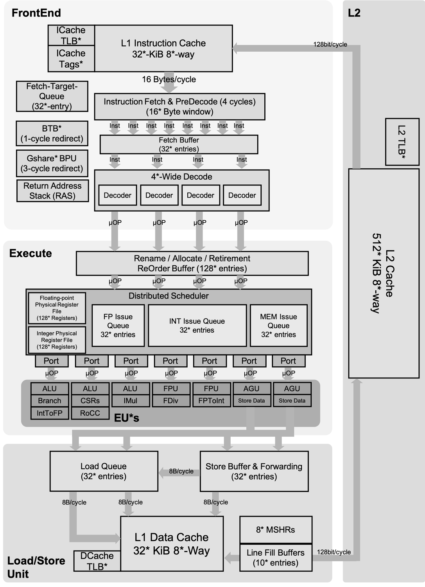
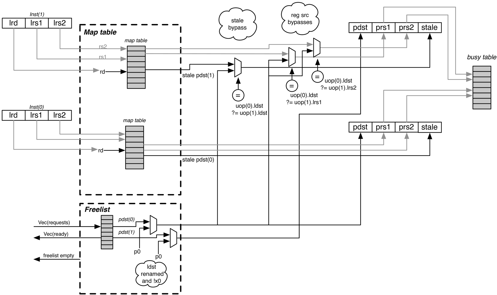

一条加载还在等数据，后面两条加法却已经算出了结果。其中第二条加法甚至用上了第一条刚算出的值。它们何时可以互相传递结果？又要等到什么时候，软件才能把结果当成已经发生的变化？下面用一段 RV64 代码，把这个过程从寄存器重命名走到退休和异常恢复。硬件以 BOOM 文档为参照，物理寄存器编号、时序和退休宽度由例题给定。

[[toc]]

## 从取指到后端，指令进入哪些部件 {#ooo-structure}

图 1 左侧自上而下是前端、执行后端和加载／存储单元。前端按程序计数器（PC）取指并译码。进入后端后，重命名逻辑把指令中的寄存器编号映射成物理寄存器编号。派发时，一份记录进入**重排序缓冲区**（Reorder Buffer，ROB），相应操作进入**发射队列**。发射队列根据操作数和端口是否就绪决定谁先执行，ROB 根据程序顺序决定谁能退休。

<figure class="lesson-figure" style="max-width: 540px">
<a href="/microarch/boom-pipeline-overview.png"></a>
<figcaption>图 1　BOOM 的一套流水线配置。先找中间的 ROB、整数发射队列和物理寄存器文件。点击查看大图。</figcaption>
</figure>

本例中，整数加法走整数发射端口。加载则经地址计算送入加载／存储单元，最后由内存路径返回数据。加法和加载都能向物理寄存器写回，并让 ROB 知道对应操作已经完成。图中的宽度和容量只是文档示例中的一套配置。

## 同一个 x5 为什么读出两个值 {#ooo-code}

设 `x10=0x20000`，该地址对齐且可读，连续八字节按小端表示 40。开始时 `x5=7`、`x7=2`、`x8=20`。另设 `x6=60`、`x9=90`，用于对照异常时恢复出的值。

```asm
ld   x5, 0(x10)    # I0
add  x6, x5, x7    # I1
addi x5, x8, 1     # I2
add  x9, x5, x7    # I3
```

按顺序语义，I1 使用 I0 给出的 40，得到 42。I3 使用 I2 写入的 21，得到 23。I0、I2 都写 `x5`，但要留下两个能分别供后面的指令读取的版本。I0 只依赖地址与内存，I2 只依赖 `x8` 与立即数 1。两者的数据没有联系。如果硬件只留下一个 `x5` 的物理位置，I2 提前写入会盖掉 I1 该读的值。

**架构寄存器**是指令编码中的名称。**物理寄存器文件**（Physical Register File，PRF）提供各版本实际存值的位置。每次写入分配一个物理版本，能够去掉写后写（WAW）和写后读（WAR）这类由名称复用造成的限制。I1 必须等 I0 提供 40，I3 必须等 I2 提供 21，这两项读后写（RAW）依赖仍要保留。

## 重命名时怎样分配并保存旧版本 {#ooo-rename}

图 2 左边的 `Map table` 用逻辑寄存器号查物理编号，`Freelist` 提供新的目的编号。在输出端，`prs1` 与 `prs2` 保存物理源，`pdst` 是这条操作的新目的寄存器，`stale` 是它取代的旧目的编号。右边的 `busy table` 查询物理源是否已就绪。图中还画出了同一拍重命名两条操作时的旁路。较年轻的操作若依赖较老的操作，可以及时取到本拍产生的新编号。

<figure class="lesson-figure">
<a href="/microarch/boom-rename-pipeline.png"></a>
<figcaption>图 2　BOOM 重命名阶段。位于右侧输出框中的编号，将随指令进入后端。点击查看大图。</figcaption>
</figure>

题设从 `x5→P5`、`x6→P6` 等初始映射开始，旧版本均已就绪。按程序顺序查看源编号，分配目的，再更新映射。依次取到的空闲位置是 P20、P21、P22、P23。

| 指令 | 保存的物理源 | 新物理目的 | 保存的旧目的 |
| --- | --- | --- | --- |
| I0 | P10 | P20 | P5 |
| I1 | P20、P7 | P21 | P6 |
| I2 | P8 | P22 | P20 |
| I3 | P22、P7 | P23 | P9 |

I2 改写当前映射 `x5→P22` 后，I3 会查到 P22。I1 已保存 P20，不会被这次改写影响。分配新位置时还要把它标为未就绪，即使物理槽中碰巧留有更早的值，也不能交给新的依赖者。发射队列中的输入就绪后，操作才有资格竞争合适的执行端口。

以 I2 为例，其旧目的 P20 也要随操作保存，但此时不能回收。P20 所代表的是 I0 写出的版本，I1 还要读取它，退休边界也可能停在 I0 之后。回收时机取决于顺序推进了多少。

## 加法先写回，为什么仍要等加载退休 {#ooo-retire}

**发射**决定哪条操作能进入执行单元。**写回**使该操作产生的值可以被内部依赖使用。**退休**（commit）则让指令的架构效果在程序顺序中生效。在 BOOM 这样的显式重命名设计中，结果在退休前后都可以存于同一个物理寄存器，硬件改变的是架构名称的已提交版本，并回收不再需要的旧位置。

图 3 中，派发从尾端增加记录，执行完成通知清除相应项的 `busy`，退休仍从最老的队头开始。ROB 按程序顺序记录有效位、完成状态、异常标志以及用于恢复或回收的重命名信息。BOOM 的文档示例还把一组相邻指令按行保存，共用部分 PC 信息，并单独跟踪已知最老异常的详细原因与地址。

<figure class="lesson-figure">
<a href="/microarch/boom-reorder-buffer.png"></a>
<figcaption>图 3　BOOM 重排序缓冲区。原图画的是双路组织，下面例题每拍最多退休一条。点击查看大图。</figcaption>
</figure>

题设中，第 2 周期 I0 已发出加载，但直到第 8 周期才取得 40。第 4 周期 I2 已通过整数执行单元算完。按时钟先后推演如下。例题规定写回当拍不退休。

| 周期 | 已经得到的内部结果 | ROB 队头与退休动作 |
| ---: | --- | --- |
| 2 | I0 的 P20 尚未就绪，I1 等 P20 | I0 等待，队头不动 |
| 4 | I2 写 P22=21，I3 的输入齐备 | 队头仍是 I0 |
| 6 | I3 写 P23=23 | 队头仍是 I0 |
| 8 | I0 写 P20=40，I1 的输入齐备 | I0 完成写回 |
| 9 | — | I0 退休，已提交的 `x5` 指向 P20，回收 P5 |
| 10 | I1 写 P21=42 | I1 完成写回 |
| 11 | — | I1 退休，`x6` 指向 P21，回收 P6 |
| 12 | — | I2 退休，`x5` 指向 P22，回收 P20 |
| 13 | — | I3 退休，`x9` 指向 P23，回收 P9 |

比较第 4 和第 9 周期。第 4 周期 I2 的新值已经存在，也能供 I3 使用。第 9 周期正式成为 `x5` 的却还是更老的 I0 产出的 40。第 12 周期 I2 退休时，I1 已经用过 P20 并完成退休，P20 才能回到空闲表。最终程序可见的 `x5`、`x6`、`x9` 分别为 21、42、23。

存储还有一个额外接口。BOOM 的 ROB 退休存储以后，通知加载／存储单元将对应队列项标为已提交，由后者在后续时机发向内存系统。看一次[完整的存储转发](./microarch-03d-load-store.md#lsu-forward)，可以分清队列内转发、退休和向缓存发送各发生在什么时刻。

## 把 I0 的正常返回换成页错误 {#ooo-recovery}

现在仍在第 4、6 周期得到 P22=21 和 P23=23，改为在第 8 周期知道 I0 发生[页权限错误](./microarch-02a-translation.md#sv39-permissions)。I0 没有合法的加载值，I1 仍不能使用 P20。当这个异常到达 ROB 的退休边界时，处理器按故障指令的 PC 和异常原因进入处理流程。I0 及更年轻的指令没有进入正式状态。因此异常边界上的 `x5=7`、`x6=60`、`x9=90`。若这段代码开始前已有更老指令退休，例如把 `x12` 置为 99，异常仍须保留它的效果。

BOOM 文档给出了两种恢复映射的选择。若有单独的**提交映射表**，可以恢复到那份映射。否则可以沿 ROB 从较年轻到较老，用每项的旧目的编号回滚。例如逆序撤销 I2 时先把 `x5` 指回 P20，再撤销 I0，才指回 P5。若顺序倒过来，最后会误留下故障指令建立的 P20。P22 中的 21 可以暂时还留在物理单元中。恢复后它已不再是软件可见的 `x5`，再分配时也必须重新等新的写回。

分支误预测的恢复边界在分支处。假设 I1 和 I2 之间还有一条分支，分支发现走错时 I0 仍在等待。此时要收回错误路径上分给 I2、I3 的 P22、P23，同时保留更老指令的 P20、P21 及其依赖关系。BOOM 的分支映射快照保存分支处的映射，分支分配记录标记它之后占用的位置。错猜时，恢复快照，并把需要归还的位置并回空闲表。前端分支历史还需单独恢复，见[分支预测的检查点](./microarch-03a-fetch-prediction.md#predict-recovery)。

安全讨论中，提前执行而最终未退休的操作可以属于**瞬态执行**。如果一个已被撤销的操作此前就发出了访存，是否完成了填充，或恢复后是否仍保留影响，要查相应实现与时序。ROB 的异常边界只给出架构保证。要判断受影响的硬件状态，还应结合[缓存未命中与填充](./microarch-01a-mshr.md#mshr-trace)的实际事件。比如，要解释后续读取变快，需要说明先前的请求确实导致了有效填充，而且该行仍能被之后的访问使用。

## 用程序复算两条时间线 {#ooo-model}

下面是一个 Python 教学模型。输入是四条指令、初始寄存器及写回时刻。重命名时按程序顺序保存源和旧目的。`complete` 检查物理源后计算结果，`retire` 只能处理队头。它省略端口仲裁和缓存周期，将题设中的写回时刻直接作为输入。保存为 `ooo_retire.py`，用 Python 3 运行。

```python
from dataclasses import dataclass

INITIAL = {5: 7, 6: 60, 7: 2, 8: 20, 9: 90, 10: 0x20000, 12: 99}
MEMORY = {0x20000: 40}


@dataclass
class Entry:
    index: int
    kind: str
    logical_dest: int
    sources: tuple
    immediate: int
    dest: int
    stale: int
    written: int = -1
    fault: bool = False


class Core:
    def __init__(self, dependent_i2):
        self.speculative = {reg: reg for reg in INITIAL}
        self.committed = self.speculative.copy()
        self.values = INITIAL.copy()
        self.ready = set(INITIAL)
        self.free = list(range(20, 24))
        self.rob = []
        self.events = []
        program = [
            ("ld", 5, (10,), 0),
            ("add", 6, (5, 7), 0),
            ("addi", 5, (5 if dependent_i2 else 8,), 1),
            ("add", 9, (5, 7), 0),
        ]
        for index, (kind, rd, sources, imm) in enumerate(program):
            physical = tuple(self.speculative[reg] for reg in sources)
            dest = self.free.pop(0)
            self.ready.discard(dest)
            stale = self.speculative[rd]
            self.speculative[rd] = dest
            self.rob.append(Entry(index, kind, rd, physical, imm, dest, stale))

    def complete(self, cycle, index, fault=False):
        entry = next(entry for entry in self.rob if entry.index == index)
        assert all(reg in self.ready for reg in entry.sources)
        entry.written = cycle
        entry.fault = fault
        if fault:
            self.events.append(f"{cycle} fault I{index}")
            return
        first = self.values[entry.sources[0]]
        if entry.kind == "ld":
            result = MEMORY[first + entry.immediate]
        elif entry.kind == "add":
            result = first + self.values[entry.sources[1]]
        else:
            result = first + entry.immediate
        self.values[entry.dest] = result
        self.ready.add(entry.dest)
        self.events.append(f"{cycle} WB I{index} P{entry.dest}={result}")

    def retire(self, cycle):
        head = self.rob[0]
        if not 0 <= head.written < cycle:
            return
        if head.fault:
            self.events.append(f"{cycle} trap I{head.index}")
            for entry in self.rob:
                self.ready.discard(entry.dest)
                self.free.append(entry.dest)
            self.rob.clear()
            self.speculative = self.committed.copy()
            return

        self.rob.pop(0)
        self.committed[head.logical_dest] = head.dest
        self.ready.discard(head.stale)
        self.free.append(head.stale)
        self.events.append(f"{cycle} retire I{head.index} free P{head.stale}")

    def architectural_values(self):
        return tuple(self.values[self.committed[x]] for x in (5, 6, 9, 12))


def simulate(load_fault=False, dependent_i2=False):
    core = Core(dependent_i2)
    schedule = {8: 0, 10: 1}
    schedule.update({9: 2, 11: 3} if dependent_i2 else {4: 2, 6: 3})
    for cycle in range(1, 14):
        core.retire(cycle)
        if not core.rob:
            break
        if cycle in schedule:
            index = schedule[cycle]
            core.complete(cycle, index, fault=load_fault and index == 0)
    return core


if __name__ == "__main__":
    for label, fault in (("normal", False), ("fault", True)):
        core = simulate(load_fault=fault)
        print(label)
        print(*core.events, sep="\n")
        print("x5 x6 x9 x12:", *core.architectural_values())
```

```text
normal
4 WB I2 P22=21
6 WB I3 P23=23
8 WB I0 P20=40
9 retire I0 free P5
10 WB I1 P21=42
11 retire I1 free P6
12 retire I2 free P20
13 retire I3 free P9
x5 x6 x9 x12: 21 42 23 99
fault
4 WB I2 P22=21
6 WB I3 P23=23
8 fault I0
9 trap I0
x5 x6 x9 x12: 7 60 90 99
```

两种运行都有 P22 和 P23 的写回。异常运行没有把这两个编号写进提交映射，因此架构值保留原样。代码在恢复后把所有尚未退休的新目的放回空闲表，P22 中留下的旧字节不会再被当作有效的新结果。

::: details 练习｜只把 I2 的源改成 x5
把 I2 改为 `addi x5, x5, 1`。现在它和 I3 为什么不能在 I0 返回前就算完？正常执行末尾各是多少？

I2 的旧源变为 P20，新目的仍是 P22。I3 等 P22，P22 又等 I0 写回 P20。I0 给出 40 后，I1 得 42，I2 写 41，I3 得 43。可在模块中调用 `simulate(dependent_i2=True).architectural_values()`，按 `x5`、`x6`、`x9`、`x12` 的顺序核对。
:::

## 参考文献

- [BOOM 流水线总体结构与阶段](https://docs.boom-core.org/en/latest/sections/intro-overview/boom-pipeline.html)
- [BOOM 重命名、忙表、空闲表和恢复](https://docs.boom-core.org/en/latest/sections/rename-stage.html)
- [BOOM 发射队列与唤醒机制](https://docs.boom-core.org/en/latest/sections/issue-units.html)
- [BOOM 的 ROB、提交和异常处理](https://docs.boom-core.org/en/latest/sections/reorder-buffer.html)
- 图 1、图 2 分别使用 BOOM 文档的图 3、图 15，本站处理了白底、灰度与尺寸。图 3 来自同一文档的图 16。[原图目录](https://github.com/riscv-boom/riscv-boom/tree/53cf7ac2fff66e1e658fca1d40b783e6c45704ba/docs/figures) · [BSD 3-Clause 许可](/microarch/boom-license.txt)

<nav class="article-nav" aria-label="系列文章导航">

[<span class="article-nav-text"><small>上一篇</small><strong>处理器怎样用页表和 TLB 翻译地址</strong></span>](./microarch-02a-translation.md){.article-nav-card .article-nav-prev rel=prev}

[<span class="article-nav-text"><small>下一篇</small><strong>加载怎样从存储队列拿到数据</strong></span>](./microarch-03d-load-store.md){.article-nav-card .article-nav-next rel=next}

</nav>
