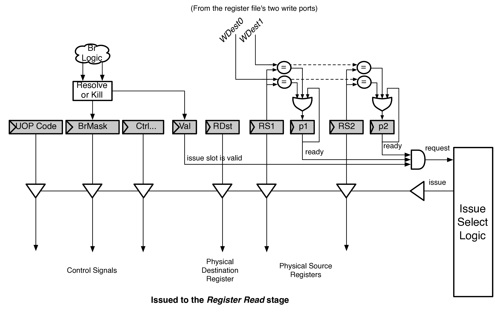
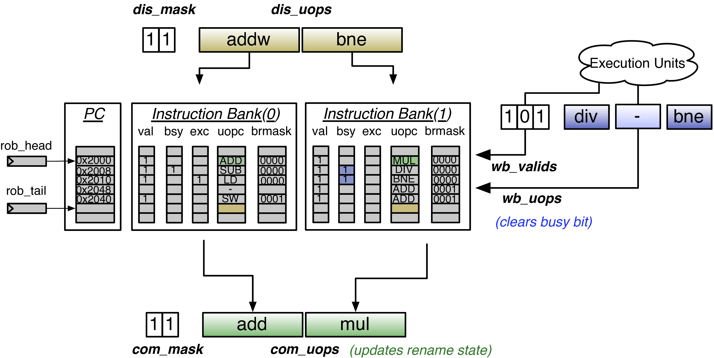

一条加载还在等数据，后面两条加法却已经算出了结果。其中第二条加法甚至用上了第一条刚算出的值。它们何时可以互相传递结果？又要等到什么时候，软件才能把结果当成已经发生的变化？下面用一段 RV64 代码，把这个过程从寄存器重命名走到退休和异常恢复。硬件以 BOOM 文档为参照，物理寄存器编号、时序和退休宽度由例题给定。

[[toc]]

## 从取指到后端，指令进入哪些部件 {#ooo-structure}

图 1 左侧自上而下是前端、执行后端和加载／存储单元。前端按程序计数器（PC）取指并译码。进入后端后，重命名逻辑把指令中的寄存器编号映射成物理寄存器编号。派发时，一份记录进入**重排序缓冲区**（Reorder Buffer，ROB），相应操作进入**发射队列**。发射队列根据操作数和端口是否就绪决定谁先执行，ROB 根据程序顺序决定谁能退休。

<figure class="lesson-figure" style="max-width: 540px">
<a href="/microarch/boom-pipeline-overview.png"></a>
<figcaption>图 1　BOOM 的一套流水线配置。先找中间的 ROB、整数发射队列和物理寄存器文件。点击查看大图。</figcaption>
</figure>

本例中，整数加法走整数发射端口。加载则经地址计算送入加载／存储单元，最后由内存路径返回数据。加法和加载都能向物理寄存器写回，并让 ROB 知道对应操作已经完成。图中的宽度和容量只是文档示例中的一套配置。

## 同一个 x5 为什么读出两个值 {#ooo-code}

设 `x10=0x20000`，该地址对齐且可读，连续八字节按小端表示 40。开始时 `x5=7`、`x7=2`、`x8=20`。另设 `x6=60`、`x9=90`，用于对照异常时恢复出的值。

```asm
ld   x5, 0(x10)    # I0
add  x6, x5, x7    # I1
addi x5, x8, 1     # I2
add  x9, x5, x7    # I3
```

按顺序语义，I1 使用 I0 给出的 40，得到 42。I3 使用 I2 写入的 21，得到 23。I0、I2 都写 `x5`，但要留下两个能分别供后面的指令读取的版本。I0 只依赖地址与内存，I2 只依赖 `x8` 与立即数 1。两者的数据没有联系。如果硬件只留下一个 `x5` 的物理位置，I2 提前写入会盖掉 I1 该读的值。

**架构寄存器**是指令编码中的名称。**物理寄存器文件**（Physical Register File，PRF）提供各版本实际存值的位置。每次写入分配一个物理版本，能够去掉写后写（WAW）和写后读（WAR）这类由名称复用造成的限制。I1 必须等 I0 提供 40，I3 必须等 I2 提供 21，这两项读后写（RAW）依赖仍要保留。

## 重命名时怎样分配并保存旧版本 {#ooo-rename}

图 2 左边的 `Map table` 用逻辑寄存器号查物理编号，`Freelist` 提供新的目的编号。在输出端，`prs1` 与 `prs2` 保存物理源，`pdst` 是这条操作的新目的寄存器，`stale` 是它取代的旧目的编号。右边的 `busy table` 查询物理源是否已就绪。图中还画出了同一拍重命名两条操作时的旁路。较年轻的操作若依赖较老的操作，可以及时取到本拍产生的新编号。

<figure class="lesson-figure">
<a href="/microarch/boom-rename-pipeline.png"></a>
<figcaption>图 2　BOOM 重命名阶段。位于右侧输出框中的编号，将随指令进入后端。点击查看大图。</figcaption>
</figure>

题设从 `x5→P5`、`x6→P6` 等初始映射开始，旧版本均已就绪。按程序顺序查看源编号，分配目的，再更新映射。依次取到的空闲位置是 P20、P21、P22、P23。

| 指令 | 保存的物理源 | 新物理目的 | 保存的旧目的 |
| --- | --- | --- | --- |
| I0 | P10 | P20 | P5 |
| I1 | P20、P7 | P21 | P6 |
| I2 | P8 | P22 | P20 |
| I3 | P22、P7 | P23 | P9 |

I2 改写当前映射 `x5→P22` 后，I3 会查到 P22。I1 已保存 P20，不会被这次改写影响。分配新位置时还要把它标为未就绪，即使物理槽中碰巧留有更早的值，也不能交给新的依赖者。发射队列中的输入就绪后，操作才有资格竞争合适的执行端口。

以 I2 为例，其旧目的 P20 也要随操作保存，但此时不能回收。P20 所代表的是 I0 写出的版本，I1 还要读取它，退休边界也可能停在 I0 之后。回收时机取决于顺序推进了多少。

### 发射队列怎样唤醒等数据的加法 {#ooo-issue-wakeup}

I1 和 I3 都是整数加法，分别等待物理寄存器 P20 和 P22。发射队列的槽保存物理源编号、各源的就绪位以及操作类型。槽有效且所需操作数就绪时，它才向选择器提出发射请求。选择器还要核对端口支持的操作和执行单元是否可接收。

<figure class="lesson-figure">
<a href="/microarch/boom-issue-slot.png" aria-label="放大 BOOM 发射槽结构图"></a>
<figcaption>BOOM 发射队列中的一个槽。可点击放大查看字段和连线。</figcaption>
</figure>

沿图追踪 I1。`RS1` 保存 P20，`RS2` 保存 P7，`RDst` 保存它要写入的 P21。加载结果还没回来时，`p1` 为零，`p2` 已就绪。I0 写回时，发射槽上的比较器把广播的目的编号 P20 和 `RS1` 匹配，更新 `p1`。此时槽可以提出 `request`，直到右侧选择器给出 `issue`，控制字段和物理编号才送往寄存器读取级。广播用于匹配的是编号，值 40 由寄存器文件的数据路径提供。

I3 的 P22 来自整数加法。BOOM 文档描述的快速唤醒可以在 I2 发射时通知依赖者，因为固定时延的 ALU 结果能经旁路送到下一条操作。加载的返回时刻则随访存而变，本例中的 I1 要等 I0 的写回通知。两条路径分别说明，操作数何时被标为可用，以及执行时怎样取到数值。后面的周期表只列写回和退休，省略发射选择与寄存器读取之间的级间时序。

::: details 练习｜两个加法同时就绪

假设某一拍开始时 I1、I3 都已就绪，都需要唯一的整数加法端口。该端口本拍只接受一条操作，选择规则优先较老的指令。两条指令分别要等什么？

I1 较老，本拍获得端口。I3 的两个源仍然就绪，留在队列继续申请。下一拍端口可用且没有更高优先级的请求时，I3 就能发射。这里无需再次等待 P22 写回。
:::

## 加法先写回，为什么仍要等加载退休 {#ooo-retire}

**发射**决定哪条操作能进入执行单元。**写回**使该操作产生的值可以被内部依赖使用。**退休**（commit）则让指令的架构效果在程序顺序中生效。在 BOOM 这样的显式重命名设计中，结果在退休前后都可以存于同一个物理寄存器，硬件改变的是架构名称的已提交版本，并回收不再需要的旧位置。

图 3 中，派发从尾端增加记录，执行完成通知清除相应项的 `busy`，退休仍从最老的队头开始。ROB 按程序顺序记录有效位、完成状态、异常标志以及用于恢复或回收的重命名信息。BOOM 的文档示例还把一组相邻指令按行保存，共用部分 PC 信息，并单独跟踪已知最老异常的详细原因与地址。

<figure class="lesson-figure">
<a href="/microarch/boom-reorder-buffer.png"></a>
<figcaption>图 3　BOOM 重排序缓冲区。原图画的是双路组织，下面例题每拍最多退休一条。点击查看大图。</figcaption>
</figure>

题设中，第 2 周期 I0 已发出加载，但直到第 8 周期才取得 40。第 4 周期 I2 已通过整数执行单元算完。按时钟先后推演如下。例题规定写回当拍不退休。

| 周期 | 已经得到的内部结果 | ROB 队头与退休动作 |
| ---: | --- | --- |
| 2 | I0 的 P20 尚未就绪，I1 等 P20 | I0 等待，队头不动 |
| 4 | I2 写 P22=21，I3 的输入齐备 | 队头仍是 I0 |
| 6 | I3 写 P23=23 | 队头仍是 I0 |
| 8 | I0 写 P20=40，I1 的输入齐备 | I0 完成写回 |
| 9 | — | I0 退休，已提交的 `x5` 指向 P20，回收 P5 |
| 10 | I1 写 P21=42 | I1 完成写回 |
| 11 | — | I1 退休，`x6` 指向 P21，回收 P6 |
| 12 | — | I2 退休，`x5` 指向 P22，回收 P20 |
| 13 | — | I3 退休，`x9` 指向 P23，回收 P9 |

比较第 4 和第 9 周期。第 4 周期 I2 的新值已经存在，也能供 I3 使用。第 9 周期正式成为 `x5` 的却还是更老的 I0 产出的 40。第 12 周期 I2 退休时，I1 已经用过 P20 并完成退休，P20 才能回到空闲表。最终程序可见的 `x5`、`x6`、`x9` 分别为 21、42、23。

存储还有一个额外接口。BOOM 的 ROB 退休存储以后，通知加载／存储单元将对应队列项标为已提交，由后者在后续时机发向内存系统。看一次[完整的存储转发](./microarch-03d-load-store.md#lsu-forward)，可以分清队列内转发、退休和向缓存发送各发生在什么时刻。

### 队头等待时，ROB 怎样逐渐占满 {#ooo-rob-full}

另设一个四项 ROB 的教学模型，每周期最多派发一条、退休一条。周期开始时先退休，再派发；完成通知从下一周期起才可用于退休。假设取指和其他资源均不受限，表中只跟踪 ROB。L 是最老的加载，A、B、C 是后续互不依赖的加法，D 是再后面等待派发的指令。

| 周期 | 队头的退休情况 | 当周期派发或完成 | 周期结束时从老到新的 ROB 内容 |
| --- | --- | --- | --- |
| 1 | 空 | 派发 L，加载等待数据 | L（等待） |
| 2 | L 未完成 | 派发 A | L、A |
| 3 | L 未完成 | A 完成，派发 B | L、A（完成）、B |
| 4 | L 未完成 | B 完成，派发 C | L、A（完成）、B（完成）、C |
| 5 | L 未完成 | C 完成；D 等待空位 | L、A（完成）、B（完成）、C（完成） |
| 6 | L 未完成 | L 的数据返回；D 仍等待 | L（完成）、A（完成）、B（完成）、C（完成） |
| 7 | L 退休 | 派发 D | A、B、C、D |

周期 5 时，后三条加法的执行结果可以已经写入各自的目的物理寄存器，但它们的记录仍占用 ROB。由于 L 没有完成，退休端不能越过它释放这些项；D 因而不能派发。周期 6 的完成通知在本题中下一周期才生效，故 D 要等到周期 7。真实核心可能按多条指令一组派发和退休，也可能受发射队列、物理寄存器或取指缓冲容量限制，具体停顿时刻需要按对应实现推导。

若 L 在周期 3 返回，周期 4 开始时它已完成，可以退休并腾出一项。此后 A、B、C 依次在队头完成退休，D 不必等到周期 7 才获得 ROB 空位。这个比较只改变加载返回时间，展示一条老指令的延迟怎样通过按序退休传到更年轻的指令。

### ROB 还有空位，为什么新指令仍进不去 {#ooo-prf-pressure}

回到 I0 至 I3，只把初始空闲物理寄存器减为三个：P20、P21、P22。假设 ROB 和发射队列都有足够空间。I0、I1、I2 依次分得三个位置。轮到 I3 时，它读取的 `x5` 已对应 P22，但还需要一个新的物理目的来保存 `x9`。只要空闲表仍为空，重命名就无法为 I3 准备完整的后端记录。

<div role="region" tabindex="0" aria-label="三项空闲物理寄存器下的分配和回收" style="max-width:100%; overflow-x:auto">

| 时点 | 空闲物理寄存器 | I3 为什么能或不能前进 |
| --- | --- | --- |
| I0 至 I2 重命名后 | 无 | I3 已能确定物理源 P22，还缺目的编号 |
| I2 写回 `P22 = 21` 后 | 无 | P22 变为就绪，I2 仍在等顺序退休，旧目的 P20 仍被占用 |
| I0 退休，回收 P5 后 | P5 | 等回收结果可用于分配，I3 就能以 P22 为源、P5 为新目的 |
| I3 取得 P5 后 | 无 | P5 为未就绪的新版本。I3 的旧目的 P9 要到 I3 退休时才回收 |

</div>

I0 回收的是它替换掉的 P5，它自己写出的 P20 仍是此时已经提交的 `x5`，而且 I1 还可能需要它。I3 借到 P5 后，硬件把它当成 `x9` 的新版本。原先残留在 P5 的 7 不参与这次计算，I3 执行后才把 23 写入 P5。缩小空闲表改变了进入后端的时机和物理编号，最后的程序结果仍是 `x5 = 21`、`x6 = 42`、`x9 = 23`。

BOOM 文档把空闲表描述成一组按物理编号排列的位，分配器为写寄存器的操作选可用项。退休送回该操作的旧物理目的，重命名路径再用已经可用的分配项接收后续操作。表中以“回收结果可用于分配”为界，实际设计可能还需要经过空闲表和重命名级间的寄存器。若最老加载迟迟不能退休，年轻指令即使已写回，也可能让前端先耗完物理寄存器。

::: details 练习｜把初始空闲寄存器再减一项

若开始时只剩 P20、P21，第一条受阻的是谁？I0 退休后，谁先取得 P5？

I0、I1 用完两个位置，I2 首先卡在重命名。I0 退休释放 P5 后，I2 先用 P5 写 `x5`。此后 I3 所要读取的 `x5` 对应 P5，仍需再等一个空闲的目的编号。I1 退休后释放 P6，便可以用它保存 I3 的结果。
:::

## 把 I0 的正常返回换成页错误 {#ooo-recovery}

现在仍在第 4、6 周期得到 P22=21 和 P23=23，改为在第 8 周期知道 I0 发生[页权限错误](./microarch-02a-translation.md#sv39-permissions)。I0 没有合法的加载值，I1 仍不能使用 P20。当这个异常到达 ROB 的退休边界时，处理器按故障指令的 PC 和异常原因进入处理流程。I0 及更年轻的指令没有进入正式状态。因此异常边界上的 `x5=7`、`x6=60`、`x9=90`。若这段代码开始前已有更老指令退休，例如把 `x12` 置为 99，异常仍须保留它的效果。

BOOM 文档给出了两种恢复映射的选择。若有单独的**提交映射表**，可以恢复到那份映射。否则可以沿 ROB 从较年轻到较老，用每项的旧目的编号回滚。例如逆序撤销 I2 时先把 `x5` 指回 P20，再撤销 I0，才指回 P5。若顺序倒过来，最后会误留下故障指令建立的 P20。P22 中的 21 可以暂时还留在物理单元中。恢复后它已不再是软件可见的 `x5`，再分配时也必须重新等新的写回。

### 用旧目的编号逐项回滚 {#ooo-map-rollback}

把正常例子的重命名表放在异常边界上复算。故障发生时，I0 至 I3 都已重命名，当前推测映射中 `x5→P22`、`x6→P21`、`x9→P23`。四项 ROB 记录依次保存的旧目的为 P5、P6、P20、P9。设异常发生前这四条指令均未退休，较老指令的映射已经包含在初始状态中。

| 回滚的 ROB 项 | 恢复的映射 | 回滚后与本例有关的映射 |
| --- | --- | --- |
| I3 | `x9→P9` | `x5→P22, x6→P21, x9→P9` |
| I2 | `x5→P20` | `x5→P20, x6→P21, x9→P9` |
| I1 | `x6→P6` | `x5→P20, x6→P6, x9→P9` |
| I0 | `x5→P5` | `x5→P5, x6→P6, x9→P9` |

I2 的旧目的 P20 是 I0 的新目的。先撤销 I2，`x5` 才回到 I0 建立的版本；再撤销 I0，才能回到进入这四条指令以前的 P5。回滚结束后，P20 至 P23 不再作为本例的当前映射，硬件还需依实现归还这些被撤销指令分配的位置。表中的映射恢复与物理寄存器数据是否立即擦除是两件事。

::: details 练习｜I0 已退休后再撤销年轻指令

改成 I0 已正常退休，提交的 `x5` 为 P20。之后需要撤销 I1、I2、I3，按逆序恢复映射时，`x5` 最后指向哪里？

先撤销 I3，再撤销 I2，`x5` 回到 P20。最后撤销 I1 只改变 `x6`。I0 已退休，其映射保留，结果为 `x5→P20`。
:::

分支误预测的恢复边界在分支处。假设 I1 和 I2 之间还有一条分支，分支发现走错时 I0 仍在等待。此时要收回错误路径上分给 I2、I3 的 P22、P23，同时保留更老指令的 P20、P21 及其依赖关系。BOOM 的分支映射快照保存分支处的映射，分支分配记录标记它之后占用的位置。错猜时，恢复快照，并把需要归还的位置并回空闲表。前端分支历史还需单独恢复，见[分支预测的检查点](./microarch-03a-fetch-prediction.md#predict-recovery)。

这里有一个容易漏掉的情况。假设分支建立快照时，P5 仍是 I0 的旧目的，空闲位为 0。分支尚未确定方向，I0 先退休并把 P5 归还。随后一条错误路径上的指令把 P5 分走，当前空闲位又变成 0。此时把快照与当前空闲表按位或，P5 仍是 0，尽管错误路径撤销后已经无人使用它。BOOM 用分支的分配位图记录快照建立以后发生的分配，因此这一位会被置为 1。

| 时刻 | 当前空闲表的 P5 位 | 分支分配位图的 P5 位 |
| --- | ---: | ---: |
| 建立分支快照，I0 尚未退休 | 0 | 0 |
| I0 退休，归还旧目的 P5 | 1 | 0 |
| 错误路径重新分配 P5 | 0 | 1 |
| 恢复时把分配位图并入空闲表 | 1 | 1（合并后丢弃该分支记录） |

这里单独让 I0 在分支解析前退休，用来说明资源回收的时间窗口。上一段的例子让 I0 仍在等待，用来说明分支快照仍要保留比该分支更老的推测结果。两种情况下，恢复都会保留已经退休的架构效果。

安全讨论中，提前执行而最终未退休的操作可以属于**瞬态执行**。如果一个已被撤销的操作此前就发出了访存，是否完成了填充，或恢复后是否仍保留影响，要查相应实现与时序。ROB 的异常边界只给出架构保证。要判断受影响的硬件状态，还应结合[缓存未命中与填充](./microarch-01a-mshr.md#mshr-trace)的实际事件。比如，要解释后续读取变快，需要说明先前的请求确实导致了有效填充，而且该行仍能被之后的访问使用。

### 两条加载都出错时，先报告哪一条 {#ooo-oldest-exception}

把主例的四条指令换成下面这组，仍使用 RV64。IM 是比两条加载都老的整数加法。设进入这段代码前 `x7=2`、`x5=7`、`x6=60`，`x10=0x20000`、`x11=0x41000`。两个加载地址都对齐，彼此没有数据依赖。题设让两笔访问都触发加载页错误，但第二笔先得到翻译结果。

~~~asm
0x1000  addi x7, x7, 1       # IM
0x1004  ld   x5, 0(x10)      # L0
0x1008  ld   x6, 0(x11)      # L1
~~~

按 BOOM 文档所述，每条 ROB 记录有自己的异常标志，而错误原因、故障虚拟地址等详细信息只需为**已知最老的异常指令**保留一份。考虑以下独立于主例的教学时序，每拍最多退休一条，完成通知在下一拍才能用于退休。

| 周期 | 后端事件 | 队头及详细异常记录 |
| ---: | --- | --- |
| 3 | L1 报告页错误 | IM 还在队头，详细记录指向 L1 |
| 4 | IM 写回 `x7` 的新物理版本 | IM 仍在队头，详细记录仍指向 L1 |
| 5 | IM 退休，`x7=3` 生效 | 队头推进到 L0，L0 还在等待 |
| 8 | L0 报告页错误 | L0 比 L1 老，详细记录改为 L0 的原因和地址 |
| 9 | 队头 L0 的异常被交付 | 清理 L0、L1，`x5` 和 `x6` 保持原值 |

第 3 周期发现 L1 的错误时，处理器仍须等待前面的指令。即使第 5 周期以后只剩两条加载，L1 也在 L0 后面。第 8 周期得知 L0 同样出错，才有足够信息判断程序应在哪条指令停下。异常交付时，架构状态恰好对应到 L0 执行之前，已经退休的加法有效，两条加载的目标寄存器都保留原值。

若这次异常从 U 模式交给 S 模式处理，`sepc=0x1004` 指向出错的 **指令**，`scause=13` 表示加载页错误。在为这类异常提供故障地址的平台上，`stval=0x20000`，它指向出错的 **数据访问**。进入处理程序的 PC 则由 `stvec` 决定。这三个地址各有用途。处理程序根据故障数据地址判断能否修复映射，决定重试时则使用 `sepc` 指向的指令。

::: details 练习｜较老的加载改为成功返回

若第 8 周期 L0 正常返回 40，并保留 L1 在第 3 周期报告的页错误，异常交付时三只寄存器分别是多少，`sepc` 又指向哪里？

IM 已退休，`x7=3`。L0 可以先退休，`x5=40` 生效。随后 L1 到达退休边界并交付异常，`x6` 仍为 60，`sepc=0x1008`。平台若提供故障数据地址，`stval` 此时为 `0x41000`。

:::

## 用程序复算两条时间线 {#ooo-model}

下面的 C11 程序直接使用前面四条指令的题设。它先根据逻辑寄存器映射建立四个 ROB 表项，再逐拍按给定时刻处理写回或异常。每拍先检查 ROB 队头，所以当拍写回的指令最早在下一拍退休。实际核心由执行单元报告完成时间，本例把这些时刻作为输入。

将程序保存为 `ooo_retire.c`，用 GCC 或 Clang 编译后直接运行。程序会依次复算正常返回、页错误和节末的依赖练习。

```bash
gcc -std=c11 -O2 -Wall -Wextra ooo_retire.c -o ooo_retire
./ooo_retire
```

```c
#include <assert.h>
#include <stdbool.h>
#include <stdio.h>
#include <string.h>

enum { LOGICAL = 32, PHYSICAL = 36, INSTRUCTIONS = 4 };
enum Operation { LOAD, ADD, ADD_IMMEDIATE };
enum State { BUSY, WRITTEN, FAULT };

struct Instruction {
    enum Operation operation;
    int logical_dest;
    int source1;
    int source2;  /* ADD 的第二个源，其余指令为 -1 */
    long immediate;
};

struct Entry {
    struct Instruction inst;
    int physical1;
    int physical2;
    int dest;
    int stale;
    enum State state;
};

struct Core {
    int rename[LOGICAL];
    int committed[LOGICAL];
    long value[PHYSICAL];
    bool ready[PHYSICAL];
    bool free[PHYSICAL];
    struct Entry rob[INSTRUCTIONS];
    int head;
};

static void release(struct Core *core, int physical)
{
    assert(!core->free[physical]);
    core->free[physical] = true;
    core->ready[physical] = false;
}

static int allocate(struct Core *core)
{
    for (int p = 1; p < PHYSICAL; ++p) {
        if (core->free[p]) {
            core->free[p] = false;
            core->ready[p] = false;
            return p;
        }
    }
    /* 题设固定预留四个物理寄存器。 */
    assert(false);
    return -1;
}

static void rename_program(struct Core *core, bool dependent_i2)
{
    const struct Instruction program[INSTRUCTIONS] = {
        { LOAD,          5, 10, -1, 0 },
        { ADD,           6,  5,  7, 0 },
        { ADD_IMMEDIATE, 5,  dependent_i2 ? 5 : 8, -1, 1 },
        { ADD,           9,  5,  7, 0 },
    };

    for (int i = 0; i < INSTRUCTIONS; ++i) {
        struct Instruction inst = program[i];
        struct Entry *entry = &core->rob[i];
        entry->inst = inst;
        entry->physical1 = core->rename[inst.source1];
        entry->physical2 = inst.source2 < 0 ? -1 : core->rename[inst.source2];
        entry->stale = core->rename[inst.logical_dest];
        entry->dest = allocate(core);
        entry->state = BUSY;
        core->rename[inst.logical_dest] = entry->dest;
    }
}

static void complete(struct Core *core, int cycle, int index, bool fault)
{
    struct Entry *entry = &core->rob[index];
    assert(entry->state == BUSY);
    assert(core->ready[entry->physical1]);
    assert(entry->physical2 < 0 || core->ready[entry->physical2]);

    long first = core->value[entry->physical1];
    long result;
    switch (entry->inst.operation) {
    case LOAD:
        assert(first + entry->inst.immediate == 0x20000);
        if (fault) {
            entry->state = FAULT;
            printf("%d fault I%d\n", cycle, index);
            return;
        }
        result = 40;
        break;
    case ADD:
        result = first + core->value[entry->physical2];
        break;
    case ADD_IMMEDIATE:
        result = first + entry->inst.immediate;
        break;
    default:
        assert(false);
        return;
    }
    core->value[entry->dest] = result;
    core->ready[entry->dest] = true;
    entry->state = WRITTEN;
    printf("%d WB I%d P%d=%ld\n", cycle, index, entry->dest, result);
}

static void retire(struct Core *core, int cycle)
{
    struct Entry *entry = &core->rob[core->head];
    if (entry->state == BUSY)
        return;

    if (entry->state == FAULT) {
        printf("%d trap I%d\n", cycle, core->head);
        for (int i = core->head; i < INSTRUCTIONS; ++i)
            release(core, core->rob[i].dest);
        memcpy(core->rename, core->committed, sizeof core->rename);
        core->head = INSTRUCTIONS;
        return;
    }

    core->committed[entry->inst.logical_dest] = entry->dest;
    release(core, entry->stale);
    printf("%d retire I%d free P%d\n", cycle, core->head, entry->stale);
    ++core->head;
}

static void simulate(const char *label, bool fault, bool dependent_i2)
{
    struct Core core = {0};
    const int available[INSTRUCTIONS] = {20, 21, 22, 23};
    for (int x = 0; x < LOGICAL; ++x) {
        int p = x < 20 ? x : x + 4;
        core.rename[x] = core.committed[x] = p;
        core.ready[p] = true;
    }
    for (int i = 0; i < INSTRUCTIONS; ++i)
        core.free[available[i]] = true;

    core.value[5] = 7;
    core.value[6] = 60;
    core.value[7] = 2;
    core.value[8] = 20;
    core.value[9] = 90;
    core.value[10] = 0x20000;
    core.value[12] = 99;
    rename_program(&core, dependent_i2);

    const int write_cycle[INSTRUCTIONS] = {
        8, 10, dependent_i2 ? 9 : 4, dependent_i2 ? 11 : 6,
    };
    puts(label);
    for (int cycle = 1; core.head < INSTRUCTIONS; ++cycle) {
        retire(&core, cycle);
        if (core.head == INSTRUCTIONS)
            break;
        for (int i = core.head; i < INSTRUCTIONS; ++i) {
            if (write_cycle[i] == cycle)
                complete(&core, cycle, i, fault && i == 0);
        }
    }
    printf("x5 x6 x9 x12: %ld %ld %ld %ld\n",
           core.value[core.committed[5]], core.value[core.committed[6]],
           core.value[core.committed[9]], core.value[core.committed[12]]);
}

int main(void)
{
    simulate("normal", false, false);
    simulate("fault", true, false);
    simulate("dependent I2", false, true);
    return 0;
}
```

`rename_program` 先读源，再改目的映射。若 I2 同时读写 `x5`，因此仍会把 P20 记为源、把 P22 记为目的。`complete` 检查的是物理寄存器的就绪位，它的正常完成路径只写物理值和就绪位。`retire` 才修改提交映射。正常退休回收该条指令替换掉的旧目的，异常清理回收尚未退休指令占用的新目的。最后一行输出通过提交映射取值，可以直接与异常处理入口应保留的状态对照。

```text
normal
4 WB I2 P22=21
6 WB I3 P23=23
8 WB I0 P20=40
9 retire I0 free P5
10 WB I1 P21=42
11 retire I1 free P6
12 retire I2 free P20
13 retire I3 free P9
x5 x6 x9 x12: 21 42 23 99
fault
4 WB I2 P22=21
6 WB I3 P23=23
8 fault I0
9 trap I0
x5 x6 x9 x12: 7 60 90 99
dependent I2
8 WB I0 P20=40
9 retire I0 free P5
9 WB I2 P22=41
10 WB I1 P21=42
11 retire I1 free P6
11 WB I3 P23=43
12 retire I2 free P20
13 retire I3 free P9
x5 x6 x9 x12: 41 42 43 99
```

两种运行都有 P22 和 P23 的写回。异常运行没有把这两个编号写进提交映射，因此架构值保留原样。代码在恢复后把所有尚未退休的新目的放回空闲表，P22 中留下的旧字节不会再被当作有效的新结果。

::: details 练习｜只把 I2 的源改成 x5
把 I2 改为 `addi x5, x5, 1`。现在它和 I3 为什么不能在 I0 返回前就算完？正常执行末尾各是多少？

I2 的旧源变为 P20，新目的仍是 P22。I3 等 P22，P22 又等 I0 写回 P20。I0 给出 40 后，I1 得 42，I2 写 41，I3 得 43。运行示例程序，在 `dependent I2` 一组中核对 `x5 x6 x9 x12: 41 42 43 99`。
:::

## 参考文献

- [BOOM 流水线总体结构与阶段](https://docs.boom-core.org/en/latest/sections/intro-overview/boom-pipeline.html)
- [BOOM 重命名、忙表、空闲表和恢复](https://docs.boom-core.org/en/latest/sections/rename-stage.html)
- [BOOM 发射队列与唤醒机制](https://docs.boom-core.org/en/latest/sections/issue-units.html)
- [BOOM 发射槽原图](https://github.com/riscv-boom/riscv-boom/blob/53cf7ac2fff66e1e658fca1d40b783e6c45704ba/docs/figures/issue_slot.png) · [BSD 3-Clause 许可](/microarch/boom-license.txt)
- [BOOM 的 ROB、提交和异常处理](https://docs.boom-core.org/en/latest/sections/reorder-buffer.html)
- [RISC-V 特权规范的 `stvec`、`sepc`、`scause` 和 `stval`](https://docs.riscv.org/reference/isa/priv/supervisor.html)
- 图 1、图 2 分别使用 BOOM 文档的图 3、图 15，本站处理了白底、灰度与尺寸。图 3 来自同一文档的图 16。[原图目录](https://github.com/riscv-boom/riscv-boom/tree/53cf7ac2fff66e1e658fca1d40b783e6c45704ba/docs/figures) · [BSD 3-Clause 许可](/microarch/boom-license.txt)

<nav class="article-nav" aria-label="系列文章导航">

[<span class="article-nav-text"><small>上一篇</small><strong>处理器怎样用页表和 TLB 翻译地址</strong></span>](./microarch-02a-translation.md){.article-nav-card .article-nav-prev rel=prev}

[<span class="article-nav-text"><small>下一篇</small><strong>加载怎样从存储队列拿到数据</strong></span>](./microarch-03d-load-store.md){.article-nav-card .article-nav-next rel=next}

</nav>
