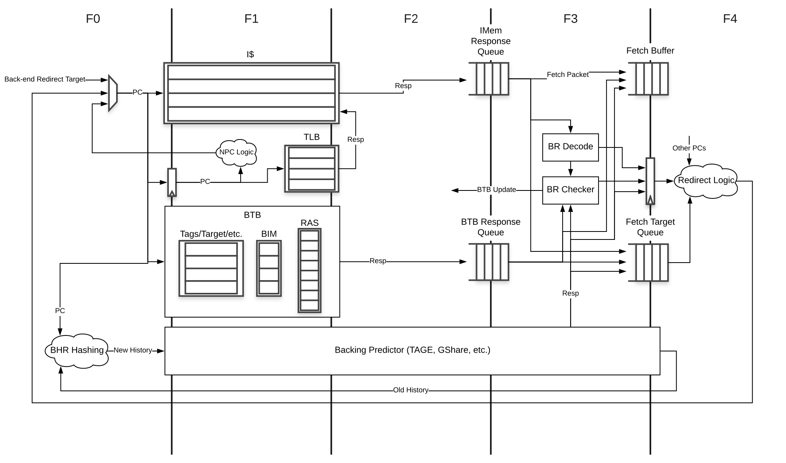
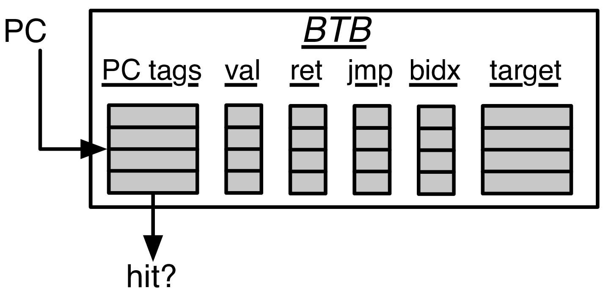

前端一次可以向指令缓存索取一组指令。当前这一组刚发出，下一组地址就要准备好。组内哪一条可能让程序改道？它会不会跳？目的地在哪里？前端要在不同的时刻回答这些问题，所以会用到好几种预测结构。

本篇以开源乱序 RISC-V 核 BOOM 文档中的前端为主。先跟踪一次从 `0x1000` 开始的取指，看快速预测器怎样找到组内的分支。接着沿同一条分支计算方向预测、历史更新和错误恢复。文中的地址、取指宽度、表容量和计数初值是例题题设。篇末另用 Intel 的公开资料说明路径历史怎样参与预测。阅读前宜先熟悉[指令执行与提交](./microarch-03-execution.md)。

[[toc]]

## 前端要决定哪一个地址 {#predict-fetch}

设每组四条指令，本例只用 4 字节指令。以下是入口 `start` 到下一组的完整局部程序，左列地址按题设排布，省略了从 `0x1014` 到目标组之间未用到的地址。把 `x10` 当作输入，令 `x12 = 0`，观察 `x11` 最后得到什么。

```text
0x1000  start:       addi x11, x0, 0
0x1004               beq  x10, x0, zero_case
0x1008               addi x11, x11, 1
0x100c               addi x11, x11, 2
0x1010               jal  x0, done
                     ...
0x1080  zero_case:   addi x11, x11, 4
0x1084               beq  x12, x0, done
0x1088               addi x11, x11, 8
0x108c               jal  x0, done
                     ...
0x10c0  done:        jalr x0, 0(x1)
```

若 `x10` 为 0，`0x1004` 的 `beq` 跳到 `0x1080`。`x11` 加 4 后，`0x1084` 的第二条 `beq` 因 `x12` 为 0 跳到返回指令，函数返回时 `x11` 为 4。若 `x10` 非零，`beq` 后顺序执行 `0x1008` 和 `0x100c`，函数返回时 `x11` 为 3。两条路径在 `0x10c0` 汇合。`0x1004` 的分支只有在比较 `x10` 和零之后，才能确定该次执行到哪一条。

这里有四个容易混淆的地址。

<div role="region" aria-label="取指组、分支地址、目标与顺序地址" style="max-width:100%; overflow-x:auto">

| 地址 | 本例的值 | 用途 |
| --- | --- | --- |
| 取指组地址（Fetch PC） | `0x1000` | 向指令缓存请求一组指令，也是快速预测器的查询输入 |
| 分支指令地址（Branch PC） | `0x1004` | 指出 `beq` 自己的位置，用来计算相对目标 |
| 分支跳转目标 | `0x1080` | 目标等于分支地址加编码的位移 `0x7c` |
| 顺序执行地址 | `0x1008`、`0x1010` | `0x1008` 是不跳时的下一条指令，`0x1010` 是本次取指之后的下一组 |

</div>

BOOM 文档中的快速预测器称为 **NLP**（Next-Line Predictor）。当前组地址送到指令缓存的同时，也可以查询 NLP。它由分支目标缓冲区 BTB、快速方向表 BIM 和返回地址栈 RAS 配合。另一方面，后备预测器 **BPD**（Backing Predictor）可以用更多的状态判断条件方向。BPD 给出一组方向位及有效信息，前端配合早期译码取得的指令类型和目标，有机会在后端确认前改掉快速预测。执行端最后用实际操作数判断方向和目标。

<figure class="lesson-figure">
<a href="/microarch/boom-front-end.svg"></a>
<figcaption>图 1　BOOM 官方取指前端框图，颜色调整为灰度。点击查看大图。</figcaption>
</figure>

读图时先找左端用于选择下一地址的多路选择器。取指地址并行送去查指令缓存和预测结构。图中的 `I$` 是指令缓存，左侧标成 BTB 的大框包含快速路径中的目标表、BIM 和 RAS，底部的 Backing Predictor 是后备方向预测器。图中 F0 至 F4 表示取指各级。指令字节返回后，BR Decode 识别分支及它的直接目标，BR Checker 结合较晚的方向预测核对取指路径，再由 Redirect Logic 决定是否改道。在例题里，它们处理的分别是 `0x1000` 这一组、组内的 `0x1004` 和跳转目标 `0x1080`。

## BTB 怎样定位组内的分支 {#predict-btb}

指令字节还没返回时，BTB（Branch Target Buffer，分支目标缓冲区）可以先给出这一组曾在哪里改道。按 BOOM 文档描述的快速预测结构，匹配使用当前组的 Fetch PC。组内分支的位置另有字段保存。对例题中的四条指令，从左到右编号 0 至 3，`0x1004` 对应位置 1。

<div role="region" aria-label="BTB 表项字段" style="max-width:100%; overflow-x:auto">

| 表项的功能字段 | 例题中的值 | 查到后怎样用 |
| --- | --- | --- |
| 有效位 | 有效 | 表项存在且可参与匹配 |
| 取指组标记 | 对应 `0x1000` | 用当前的取指组地址匹配 |
| 组内位置 | 1 | 若预测跳转，保留位置 0、1，屏蔽 2、3 |
| 控制转移类型 | 条件分支 | 由快速方向表决定是否使用目标 |
| 保存的目标 | `0x1080` | 条件分支预测跳转时成为下一组地址 |

</div>

<figure class="lesson-figure">
<a href="/microarch/boom-btb.png"></a>
<figcaption>图 2　BOOM 官方 BTB 表项图。PC tags 对应取指标记，val 为有效位，ret 与 jmp 区分控制转移类型，bidx 记录组内位置，target 保存目标。</figcaption>
</figure>

这里列的是逻辑字段。BOOM 文档还描述了集中存放标记和目标的高位地址，用引用这些高位的方式减少重复存储。单个表项只能表示一条组内控制流指令。若同一取指组里有两条分支，而且第一条经常有时跳转、有时让第二条接着执行，一条表项无法同时表示两个可能的改道点。支持更多候选还要增加存储、匹配和选择工作。

在主例中，若快速方向表给出 T（taken，跳转），前端把组内位置 2、3 屏蔽，下一组去 `0x1080`。若它给出 N（not taken，顺序执行），四条指令都保留，下一组取 `0x1010`。目标地址与掩码一起决定前端交付什么。即使目标猜中，把位置错报为 2 仍会把 `0x1008` 错误地留在本组。

### 表项何时更新

按文档所述，执行阶段的分支单元或取指阶段较晚的 BPD 使前端重定向去采取某次跳转时，BTB 会更新，没有对应记录时可以分配。读到记录、读到的地址正确、后来写表是三个时刻。把例题中的控制指令临时换成一次普通 `jalr`，假设它曾去 `0x1080`，这次实际寄存器值对应 `0x10c0`。即使 BTB 匹配成功，也可能先使用旧目标；执行单元得到真实地址后，才把取指改向 `0x10c0`。当 BTB 缺少记录，直接跳转的目标可从指令编码求出，而寄存器间接跳转还需要获得操作数。

## 方向表如何产生 T 或 N {#predict-pht}

BOOM 文档描述的 BIM（Bi-Modal Table）用于快速判断条件方向。BTB 命中且命中的类型为条件分支时，方向位才参与这次选择。如果表项表示无条件跳转，指令语义已经确定会改道。条件分支的方向表只需存少量状态，它要表达的是在这一项过去的实际结果中，哪种方向更常见。

### 一项方向状态怎样更新

常用的教学模型是两位饱和计数器。四个状态为 0、1、2、3。查询时读高位，0 和 1 预测 N，2 和 3 预测 T。反馈为 T 时加一，为 N 时减一，到端点后保持不变。各次查询都读当时的状态，训练时才写入经过确认的反馈。下表假设每次反馈在下次查询前已经写回。

<div role="region" aria-label="两位方向状态的更新" style="max-width:100%; overflow-x:auto">

| 循环尾部的实际方向 | T | T | T | N |
| --- | --- | --- | --- | --- |
| 查询读到的计数 | 2 | 3 | 3 | 3 |
| 预测方向 | T | T | T | T |
| 更新后的计数 | 3 | 3 | 3 | 2 |

</div>

前三次跳回循环体，末次退出。末次虽然猜错，状态从 3 降到 2，再遇到该分支仍预测 T。这能容纳常见方向中的一次反例。如果结果严格按 T、N 交替，且从状态 1 开始，第一次预测 N、实际 T，状态变 2。第二次预测 T、实际 N，状态回到 1。反复执行就会每次猜错。是否出过这种规律，要从输入序列和状态转移一起判断。

BOOM 文档还给出便于 SRAM 读写的实现。方向位和表示惯性的位可分开存放、按不同频率访问，弱态预测出错后可直接进入相反方向的强态。后面的手算统一用上述饱和加减，方便把查表、更新和恢复分开。

### PHT 存的是被查询到的方向状态

把一组方向状态排成表，再用 PC 和历史选出其中一项，就是本篇 gshare 例题里的 **PHT**（Pattern History Table，模式历史表）。它的表项是两位预测状态，索引逻辑在表外。从地址单独选择快速方向状态，和从地址、历史联合选择 PHT 表项，各有不同的查询输入。后者可以区分同一条分支在不同路径下的偏向。

## RAS 为函数返回提供目标 {#predict-ras}

同一个函数可能从多处被调用。它末尾的返回指令地址固定，但此次要回到哪一处，由最近尚未返回的调用决定。**RAS**（Return Address Stack，返回地址栈）按调用嵌套保存预测用的返回地址。BOOM 文档描述的快速预测器在识别返回时用栈顶给出目标，在取指阶段译码出所选控制转移是调用或返回后再压栈或弹栈。

这里的地址和指令都按 32 位指令长度举例。`jal x1, target` 跳往 `target`，同时把调用地址加 4 写入链接寄存器 `x1`。`jalr x0, 0(x1)` 返回时真实目标来自 `x1`，按 JALR 语义清除目标最低位。B 还要调用 C 时，B 需要按调用约定保存原来的 `x1`，例如保存到软件栈，返回前再恢复。预测栈由硬件维护，工作时机在取指，最终还是由实际指令操作数确认去哪里。

<div role="region" aria-label="函数调用和返回地址栈" style="max-width:100%; overflow-x:auto">

| 执行到哪里 | 例题中的前端栈状态，右侧为栈顶 | 目标 |
| --- | --- | --- |
| A 在 `0x2200` 调用 B | 压入 `0x2204`，得到 `[0x2204]` | 调用指令给出的 B 入口 |
| B 在 `0x3400` 调用 C | 压入 `0x3404`，得到 `[0x2204, 0x3404]` | 调用指令给出的 C 入口 |
| C 返回 | 读出 `0x3404`，弹出后剩 `[0x2204]` | 预测继续执行 B 的 `0x3404` |
| B 返回 | 读出 `0x2204`，弹出后为空 | 预测继续执行 A 的 `0x2204` |

</div>

如果 A 改在 `0x2600` 调用 B，C 仍回 `0x3404`，B 则回 `0x2604`。B 的返回指令地址没有变，预测目标变了。实际实现还需要栈顶指针和容量处理。以容量两项且满时覆盖最旧项的模型为例，若再压入 `0x4804`，最外层的 `0x2204` 就离开了预测栈，软件保存的返回地址依然可用于确认。错误路径上提前压入的返回地址也需要处理，若压栈曾经覆盖有效旧项，单独恢复栈顶指针无法找回被覆盖的数据。容量、溢出处理和恢复细节应按选定实现核对。

## GHR 怎样让同一条分支查到不同表项 {#predict-ghr}

设一条较早的分支先区分两种记录格式，较晚的公共代码再判断其中的可选字段。假如一种格式通常带这个字段，前一条分支的方向就能帮助预测后一条。只将后一条分支的所有执行汇入一个计数器，会把两类输入的结果混在一起。

**GHR**（Global History Register，全局历史寄存器）保存近期分支的方向。题设规定用三位，最老的位在左，最新的位在右。T 写入 1，N 写入 0。原值 `001` 加入 T 得到 `011`，再加入 N 得到 `110`，最高的旧位被移出。

现在用 BOOM 文档所介绍的 gshare 思路做一个独立的手算版。假设 `0x1004` 对应的地址预处理结果为 `101`，方向表有 8 项，每项含一个两位计数器，索引是三个地址位和三个历史位逐位异或。令表项 4 为 2，表项 1 为 1。

<div role="region" aria-label="当前历史如何改变方向表索引" style="max-width:100%; overflow-x:auto">

| 预测时的 GHR | 索引 | 读出的状态 | BPD 的方向 |
| --- | --- | ---: | --- |
| `001` | `101 XOR 001 = 100`，项 4 | 2 | T |
| `100` | `101 XOR 100 = 001`，项 1 | 1 | N |

</div>

改变历史，地址和表内容都保持原样，就已能改变预测。若两个不同的地址与历史组合得到同一索引，就发生了表项别名。实际结果相反时，两个组合会朝相反方向更新同一个计数器。扩大表、匹配标记、使用多种历史长度都可以改变这类冲突。BOOM 文档中的 TAGE 组织了多张用不同历史长度查询的表，命中项带标记和预测计数，还需记录是否值得保留该项。这里的 8 项和三位宽度只用于例题。

## 预测走错后怎样恢复 {#predict-recovery}

回到例题中的 `beq`，把它记作 B，令 `x10 = 1`。实际应按 N 走顺序路径。在这个时序里，NLP 先给出 T，稍后的 BPD 用历史 `001` 查到项 4，也给出 T。预测取指进入 `0x1080`。错误路径还有位于 `0x1084` 的第二条 `beq`，记作 C。假设前端已将它预测为 N，并把 0 加入历史。执行端现在才得到 B 的比较结果。

<div role="region" aria-label="分支误预测前后的历史" style="max-width:100%; overflow-x:auto">

| 时刻 | 前端的动作 | GHR |
| --- | --- | --- |
| B 查询前 | 保存可恢复的较早状态，从这份历史查询 | `001` |
| B 预测为 T | 取指选择 `0x1080`，把预测方向加入历史 | `011` |
| C 预测为 N | 在当前预测路径的历史上加入 0 | `110` |
| 执行端确认 B 为 N | 撤销年轻错误路径，从 `0x1008` 继续，恢复 `001` 后加入 B 的实际方向 | `010` |

</div>

恢复目标是 `0x1008`，也就是分支后的第一条顺序指令，它在原组内。用哪一个对齐的地址重新向指令缓存发请求、如何屏蔽更早的字节，由前端实现决定。直接在 `110` 后写入 B 的真实 N 会得到 `100`，等于保留了不应参与以后预测的路径影响。

这里有三份容易混在一起的状态。**FTQ**（Fetch Target Queue，取指目标队列）的每项对应一次取指，保留当时的 PC 信息与预测元数据，可用于提交时训练原来的表项。**分支快照**用于误预测发生后及时找回历史，与重命名阶段的分支检查点并行保存。BOOM 文档还描述了一份**提交历史副本**，供流水线整体清空回到已提交的边界时使用。历史、重命名和程序计数器需要恢复到相容的控制流位置。下面用固定版本源码核对这些信息怎样传回前端。

### FTQ 中哪些字段参与恢复 {#predict-ftq}

跟到 BOOM v3 的一个固定源码版本，可以看到一笔取指在 FTQ 里分开保存取指 PC、全局历史、预测器元数据和组内控制流信息。后端微操作携带 `ftq_idx`，因此 B 确认自己猜错时，核心能用这个索引找到 B 所在的旧取指组。它用组的 PC、B 在组内的位置和实际结果算出新的取指地址，再用保存的历史构造重定向所需的状态。FTQ 的入队指针移回重定向项的下一槽，随后取回的新组可以覆盖被撤销的年轻项。

回到这道题，B 在 `0x1004`，实际走顺序路径，下一条指令是 `0x1008`。恢复所需的历史来自 B 的那一组，预测路径末端的 `110` 已经混入 C 的结果。BOOM v3 按取指组和 bank 处理这笔更新。如果实际未跳转且重新取指仍在相同的取指 bank，源码可以暂用原历史，并标记本组已经遇到未跳转分支，等后续更新处理。本文的三位表把这些操作压成一次 `001 → 010`，用来复算哪些方向应当留在历史里。

方向表的训练还有自己的输入。B 查询时索引为 `101 XOR 001 = 100`，选中项 4。更正后若拿当时已经变成 `010` 的历史重算，则得到 `101 XOR 010 = 111`，会选中项 7。BOOM v3 的 FTQ 发出预测更新时会带回保存的历史和元数据。教学程序用保存的索引表示同一件事，即把反馈送回产生原预测的那项。

BOOM 文档还介绍用已提交的历史副本，应对异常等整条流水线清空的设计。本文引用的 BOOM v3 源码在 ROB 发起全局清空时会初始化新的全局方向历史。两种写法处理的是同一类恢复需求，具体保留的状态取决于实现。在这道题中，B 的方向错误走的是局部重定向路径。

### 用 C 复算取指、历史和训练 {#predict-model}

程序将 B 的取指组标记 `0x1000`、组内位置 1 和目标 `0x1080` 固定为已知的 BTB 表项。方向表采用上文的 8 项 gshare 模型，例题给定 NLP 先预测 T。程序从后备预测返回结果开始计算，此时两级预测在主路径上都指向跳转。这样可以把后备方向、组内保留位、纠错后的下一 PC 和提交训练都放在同一份输出里。程序只演算题设中的控制流，抽象了预测级之间的等待和覆盖关系。

将代码保存为 `branch_history.c`，用 `gcc -std=c11 -O2 -Wall -Wextra branch_history.c -o branch_history` 编译，再运行 `./branch_history`。Windows 上可运行 `./branch_history.exe`。

~~~c
#include <stdbool.h>
#include <stdio.h>

enum { HISTORY_MASK = 7, PHT_SIZE = 8, GROUP_SIZE = 4 };

typedef struct {
    unsigned branch_pc, position, target;
} BtbEntry;

typedef struct {
    unsigned saved_history, index;
    bool taken;
} Prediction;

static unsigned append(unsigned history, bool taken)
{
    return ((history << 1) | (unsigned)taken) & HISTORY_MASK;
}

static Prediction predict(const unsigned pht[PHT_SIZE], unsigned pc_bits,
                          unsigned history)
{
    unsigned index = pc_bits ^ history;
    return (Prediction){history, index, pht[index] >= 2};
}

static void train(unsigned pht[PHT_SIZE], Prediction p, bool actual)
{
    unsigned *counter = &pht[p.index];
    if (actual && *counter < 3)
        ++*counter;
    if (!actual && *counter > 0)
        --*counter;
}

static void show_history(const char *label, unsigned h)
{
    printf("%s: %u%u%u\n", label, (h >> 2) & 1u, (h >> 1) & 1u, h & 1u);
}

static void run(bool actual_b)
{
    const unsigned fetch_pc = 0x1000, pc_bits = 5;
    const BtbEntry b = {0x1004, 1, 0x1080};
    unsigned pht[PHT_SIZE] = {1, 1, 1, 1, 2, 1, 1, 1};

    Prediction p = predict(pht, pc_bits, 1);
    Prediction other = predict(pht, pc_bits, 4);
    unsigned keep = p.taken ? (1u << (b.position + 1)) - 1u :
                              (1u << GROUP_SIZE) - 1u;
    unsigned predicted_next = p.taken ? b.target : fetch_pc + 16u;
    unsigned after_b = append(p.saved_history, p.taken);
    unsigned after_c = append(after_b, false);

    printf("B actual=%c\n", actual_b ? 'T' : 'N');
    printf("PHT[%u]=%u -> %c, alternative PHT[%u]=%u -> %c\n",
           p.index, pht[p.index], p.taken ? 'T' : 'N',
           other.index, pht[other.index], other.taken ? 'T' : 'N');
    printf("group=0x%x keep=0x%x next=0x%x\n", fetch_pc, keep, predicted_next);
    show_history("after B prediction", after_b);
    show_history("after C prediction", after_c);

    if (p.taken != actual_b) {
        unsigned actual_next = actual_b ? b.target : b.branch_pc + 4u;
        unsigned recovered = append(p.saved_history, actual_b);
        printf("redirect=0x%x, discard C\n", actual_next);
        show_history("recover at B", recovered);
        printf("wrong new index if training uses live GHR: %u\n",
               pc_bits ^ recovered);
    } else {
        show_history("B correct, retain C prediction", after_c);
        show_history("if C later resolves to T", append(after_b, true));
    }

    train(pht, p, actual_b);
    printf("commit B: PHT[%u]=%u, PHT[7]=%u\n", p.index, pht[p.index], pht[7]);
}

int main(void)
{
    run(false);
    puts("");
    run(true);
}
~~~

~~~text
B actual=N
PHT[4]=2 -> T, alternative PHT[1]=1 -> N
group=0x1000 keep=0x3 next=0x1080
after B prediction: 011
after C prediction: 110
redirect=0x1008, discard C
recover at B: 010
wrong new index if training uses live GHR: 7
commit B: PHT[4]=1, PHT[7]=1

B actual=T
PHT[4]=2 -> T, alternative PHT[1]=1 -> N
group=0x1000 keep=0x3 next=0x1080
after B prediction: 011
after C prediction: 110
B correct, retain C prediction: 110
if C later resolves to T: 111
commit B: PHT[4]=3, PHT[7]=1
~~~

掩码 `0x3` 的低两位为 1，所以这次取指组只保留位置 0、1。第一次运行以 B 的实际 N 恢复，C 被丢弃，项 4 在 B 提交后降为 1。第二次运行只改 B 的真实结果。B 猜对以后，C 仍在正确的程序路径上，C 的预测可以暂时保留。如果随后 C 被确认实际为 T，就从 C 之前的 `011` 恢复并补入 1，得到 `111`。两次运行都保存了 B 原来选中的项 4。项 7 一直未写入。

## PHR 为什么还关心分支经过哪里 {#predict-phr}

两条路径也可能产生相同的方向串。设解析器的数字路径和文本路径最后都到达位于 `0x1200` 的公共条件分支，下表只列参与例题历史的两次事件。

<div role="region" aria-label="两条路径的分支方向" style="max-width:100%; overflow-x:auto">

| 到达公共分支之前 | 上上条分支 | 上一条分支 | 最近两位方向 |
| --- | --- | --- | --- |
| 数字路径 | `0x1004`，T | `0x1010`，N | `10` |
| 文本路径 | `0x1024`，T | `0x1038`，N | `10` |

</div>

如果预测只用当前 PC 与这两位，输入完全相同。有些设计还让历史记录路径上的部分地址信息。以一个四位摘要模型为例，把每条分支地址右移两位、取低四位为签名。每次将旧摘要左移一位，与新签名异或后保留四位。起始状态取零。

<div role="region" aria-label="路径摘要的计算" style="max-width:100%; overflow-x:auto">

| 路径 | 两次的签名 | 第一次之后 | 第二次之后 |
| --- | --- | --- | --- |
| 数字路径 | `0x1`、`0x4` | `0x1` | `0x2 XOR 0x4 = 0x6` |
| 文本路径 | `0x9`、`0xe` | `0x9` | `(0x12 XOR 0xe) AND 0xf = 0xc` |

</div>

到达 `0x1200` 时，两个摘要可以导致不同的查表结果。压缩也会留下冲突。例如把数字路径的第一条分支从 `0x1004` 换到 `0x1044`，它的签名仍为 `0x1`，最终摘要仍是 `0x6`。这是题设公式的性质。公开的 Pathfinder 研究以 **PHR**（Path History Register，路径历史寄存器）描述所测 Intel 处理器上参与条件分支方向预测的路径历史。实际使用哪些事件、地址位和更新规则，应按该研究及具体处理器核对。

## BHB 怎样影响间接跳转目标 {#predict-bhb}

Intel 的公开安全文档用 **BHB**（Branch History Buffer，分支历史缓冲区）指称记录近期分支历史、帮助预测的内部状态，并明确指出它可能影响间接分支预测器选择哪条记录。为看清这份历史起什么作用，继续用解析器作为例子。假设数字路径和文本路径汇合后，都会执行 `0x1180` 的一条间接跳转，真正的目标要到寄存器操作数就绪时才能确定。

先把目标预测器拆成三种不同的对象。第一种是 **BHB 状态**：它压缩近期控制流，给预测器提供“这条分支是沿哪类路径到达的”这一上下文。第二种是**选择逻辑**：把当前间接分支的源地址和 BHB 上下文组合起来，计算要查的索引或标记。第三种是**目标表项**：保存某个分支上下文对应的候选目标。BHB 提供查表条件，本身不保存 `0x2400` 这样的目标地址；BTB 或相关间接目标预测结构才保存候选目标。

| 对象 | 读入什么 | 保存或计算什么 | 交给下一步什么 |
| --- | --- | --- | --- |
| BHB | 前面发生的分支及其路径信息 | 有限宽度的历史状态或摘要 | 当前路径上下文 |
| 选择逻辑 | 当前分支 PC、BHB 上下文 | 形成查找标记；具体索引组织由实现决定 | 要查找的目标表项 |
| BTB／间接目标表 | 索引、标记及预测器模式信息 | 已有分支上下文对应的目标 | 候选下一 PC |
| 分支执行单元 | 间接分支指令和真实寄存器操作数 | 实际计算出的目标 | 正确取指地址；必要时触发重定向 |

这里的表是逻辑分工，不代表 Intel 对外公布了这些电路的物理边界或端口。Barberis 等人的 BHI 论文用 `F1` 表示历史更新函数，并用 `F2` 表示由当前分支源地址和历史上下文计算 BTB 标记。论文没有据此给出一个适用于所有处理器的 BTB 索引函数；索引、组相联度和具体查找电路都应按实现分别确认。这个抽象模型说明了“历史怎样参与选记录”，不应误读成所有处理器都按同一函数实现。

论文还总结了较早 Intel 处理器的逆向分析结果：BHB 可以表现为移位寄存器；某次已采取分支的源、目标地址经折叠后，与当前历史的一部分异或，写成下一份历史。示意式可以写作：

```text
BHB_next = F1(BHB_old, branch_source, branch_target)
tag      = F2(indirect_branch_PC, BHB_next)
lookup   = BTB 查找逻辑依实现选择候选表项，并比较 tag
target   = 匹配表项保存的候选目标
```

地址折叠会丢掉信息，所以两段不同路径可能得到相同摘要；反过来，两段方向结果相同的路径也可能因分支地址不同而得到不同摘要。论文明确指出跟踪多少个分支、如何折叠地址取决于微架构。Intel 的安全文档确认 BHB 会记录近期分支历史并影响间接预测器选项，但没有公布通用的位布局、容量或哈希电路。不要把上述较早处理器的逆向模型套成全部 Intel 型号的电路图。

这也解释了为什么软件清除序列会因处理器而异。序列要覆盖预测器实际保留的那段历史；Intel 分别给出适用于不同处理器范围的短、长序列，并要求虚拟机监控器考虑迁移后可能运行在另一类处理器上。公开资料能确定适用范围和接口，却不足以让读者从序列长度反推出一个通用的 BHB 位数。

<div role="region" aria-label="分支历史与间接目标" style="max-width:100%; overflow-x:auto">

| 当前间接跳转地址 | 先前路径留下的历史 | 选中的目标记录 | 预测目标 |
| --- | --- | --- | --- |
| `0x1180` | `H数` | 数字处理项 | `0x2400` |
| `0x1180` | `H文` | 文本处理项 | `0x2800` |

</div>

表中两次预测都用同一个跳转地址，也面对同样的两份已有记录。历史为选择提供条件，选中的目标记录给出地址。若第二行的真实寄存器值指向 `0x2800`，预测正确。如果真实值指向 `0x2400`，就需要重定向。与前文的 gshare 相比，输入中同样可以有历史，但这里查到的是**间接目标**，gshare 表给出的是**条件方向**。

读表时不要把 `H数` 和 `H文` 当作某个 Intel 型号的真实寄存器值。它们代表两种路径摘要。为了把“摘要影响查表”算得具体一些，可以额外设一个纯教学用的小模型：索引取 `((PC >> 2) XOR H) AND 3`，标记取 `H AND 3`。假定 `PC = 0x1180`，则 `PC >> 2` 的低两位为 `00`；数字路径的 `H` 低两位设为 `01`，文本路径设为 `10`。数字路径查索引 1、标记 1，文本路径查索引 2、标记 2。若表项 1 保存 `0x2400`、表项 2 保存 `0x2800`，同一条间接跳转就会因上下文不同而先给出不同目标。实际 BHB 的折叠规则和表组织不等于这个四项模型；这个计算只展示地址与历史共同参与选择的逻辑。

这张表是功能模型。Intel 的公开说明能确认历史会参与间接目标选择，未公布通用的 BHB 位布局和查表电路。PHR 与 BHB 来自不同资料的讨论，分别有已经核实的预测用途。仅凭名称无法判断具体型号内部有几份历史状态、字段是否共用，或预测表的哪部分物理上与 BTB 合在一起。

### 目标项与选择依据的隔离 {#predict-isolation}

假设题设的两条目标记录都属于预测模式乙。限制条件规定，甲的记录不能进入乙的候选范围。如果选择逻辑还读得到含有甲分支记录的历史，两种历史仍可能分别选到乙自己的两个目标。于是一次防护评估至少要核对两处边界。第一处是**哪些记录允许被选**，第二处是**选择用的历史来自哪里**。

Intel 对使用 eIBRS（增强间接分支受限推测）或在切换后使用 IBRS 的情形，分别描述了预测项隔离与 BHB 历史可见范围。文档指出，在其讨论的多款处理器上，应用相应控制后仍可能存在跨预测模式使用的历史。某个预测结果是否进一步造成可观察影响，需要另外核对[侧信道所需的观察条件](./microarch-04b-observation.md)。

到了操作系统的层面，可以用[一次 Linux 进程切换](./microarch-04c-variants.md#variant-switch)看到系统何时发出预测屏障，以及它和特权模式的历史限制分别在哪个边界生效。

::: details 练习｜同一个目标，两种预测错误
第一种情况，`0x1004` 确实应当跳到 `0x1080`，预测器也给出了这个目标，但把组内位置报为 2。第二种情况，一条间接跳转的组内位置预测正确，前端先取了 `0x1080`，执行端却计算出 `0x10c0`。分别指出哪一份信息错了，以及需用什么来源确认。

第一种是组内位置错，前端会多保留 `0x1008`。译码或执行端可以根据实际控制流指令的位置纠正组内掩码。第二种是目标错。后端根据源寄存器和指令立即数确认真实目标。仅凭一次改道地址，还无法确认早先的预测目标来自哪张表或是否用过历史。
:::

## 参考文献

- [图 1 原图与 BOOM 前端概览](https://docs.boom-core.org/en/latest/sections/branch-prediction/index.html)
- [图 1 和图 2 的许可文本](/microarch/boom-license.txt)（The Regents of the University of California，BSD 3-Clause）
- [BOOM 快速预测器与 BTB、BIM、RAS](https://docs.boom-core.org/en/latest/sections/branch-prediction/nl-predictor.html)
- [BOOM 后备预测器、FTQ、两位状态表与 GShare](https://docs.boom-core.org/en/latest/sections/branch-prediction/backing-predictor.html)
- [BOOM v3 固定版本的 FTQ，取指状态、预测更新和重定向](https://github.com/riscv-boom/riscv-boom/blob/53cf7ac2fff66e1e658fca1d40b783e6c45704ba/src/main/scala/v3/ifu/fetch-target-queue.scala)
- [BOOM v3 固定版本的核心，分支重定向与 ROB 整体清空](https://github.com/riscv-boom/riscv-boom/blob/53cf7ac2fff66e1e658fca1d40b783e6c45704ba/src/main/scala/v3/exu/core.scala)
- [RISC-V 非特权指令集中的控制转移与返回预测提示](https://docs.riscv.org/reference/isa/unpriv/rv32.html#control-transfer-instructions)
- [Pathfinder 作者论文](https://cseweb.ucsd.edu/~tullsen/Pathfinder_asplos24.pdf)
- [Intel 对 Pathfinder 和 PHR 的说明](https://www.intel.com/content/www/us/en/developer/articles/news/more-information-pathfinder.html)
- [Barberis 等人的 BHI 论文：间接目标预测的 BHB、BTB 与历史上下文模型](https://www.usenix.org/system/files/sec22-barberis.pdf)
- [Intel 关于分支历史和 BHB 的行为说明](https://www.intel.com/content/www/us/en/developer/articles/technical/software-security-guidance/technical-documentation/branch-history-injection.html#branch-history-and-the-branch-history-buffer-bhb)

<nav class="article-nav" aria-label="系列文章导航">

[<span class="article-nav-text"><small>上一篇</small><strong>加载怎样从存储队列拿到数据</strong></span>](./microarch-03d-load-store.md){.article-nav-card .article-nav-prev rel=prev}

[<span class="article-nav-text"><small>下一篇</small><strong>用计时和计数器分析访存</strong></span>](./microarch-04a-measurement.md){.article-nav-card .article-nav-next rel=next}

</nav>
