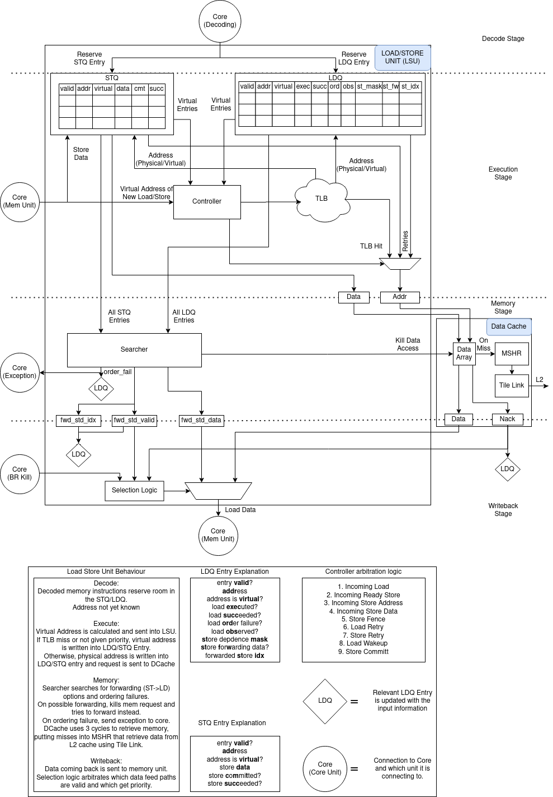

程序先向地址 `0x1000` 写入 9，接着从同一位置读回。如果这笔写入还留在核心里，L1 缓存中存的仍是 5，后面的读怎样取得 9？答案取决于两个操作所访问的字节，以及较早的写入在队列里已经准备到哪一步。本文以 BOOM v3 的加载／存储单元为例，从队列项一直追踪到寄存器写回和顺序恢复。例题按小端字节序，地址翻译成功，给出的周期用于标记事件先后。

[[toc]]

## 加载与存储单元的结构 {#lsu-structure}

加载／存储单元（Load/Store Unit，LSU）一端接执行流水线，另一端接数据缓存。加载和存储进入执行后端时，先在相应队列里留位置。等基址寄存器就绪，执行单元计算有效地址并送入 LSU。TLB 提供[地址翻译](./microarch-02a-translation.md)所需的信息，LSU 才能用物理地址比较两条访问是否指向同一处。存储的源数据由另一个寄存器提供，可以独立到达。

<figure class="lesson-figure">
<a href="/microarch/boom-lsu.png" aria-label="放大查看 BOOM 官方加载与存储单元图"></a>
<figcaption>图 1　BOOM 官方 LSU 框图。上方两张表保存未完成的访存操作。沿左侧转发数据和右侧缓存数据两条线，可以找到底部的写回选择器。点击查看原图。</figcaption>
</figure>

图 1 上方，`STQ` 是存储队列（Store Queue），`LDQ` 是加载队列（Load Queue）。左侧比较逻辑 `Searcher` 从两类队列读取地址和状态。它既可以在加载时搜索在先的存储，也可以在存储地址得到翻译后，检查在后的加载是否已经沿错误的依赖关系执行。图右的 `Data Cache` 是另一条取数路径。缓存命中时，数据阵列直接返回数据。未命中时，由缓存的 [MSHR](./microarch-01a-mshr.md) 跟踪缺失的缓存行。转发的数据和缓存返回的数据最终都接到图底部的选择器。

### 队列项里存着什么 {#lsu-entries}

图中用 `addr`、`data` 等短标签指示字段。下面列出本节会用到的 BOOM v3 状态。

<div role="region" aria-label="LDQ 和 STQ 的字段" style="max-width:100%; overflow-x:auto">

| 位置 | 字段或状态 | 在什么情况下改变 |
| --- | --- | --- |
| STQ | 表项有效、`addr.valid`、`addr_is_virtual` | 分配时先占用表项。计算出虚拟地址后可暂存，翻译成功后才能用物理地址做最终比较 |
| STQ | `data.valid`、`data` | 存储的源寄存器值送达后置有效，地址和数据可以分开就绪 |
| STQ | `committed`、`succeeded` | ROB 退休存储时标记已提交，收到缓存完成确认后再标记已完成 |
| LDQ | `addr`、`addr_is_virtual`、`st_dep_mask` | 记录加载的地址与翻译状态。掩码的每一位对应一个可能依赖的较老 STQ 项 |
| LDQ | `executed`、`succeeded` | 分别记录向内存侧执行的进度和是否已经取值成功。请求被拒绝可以使加载重新进入等待 |
| LDQ | `forward_std_val`、`forward_stq_idx`、`order_fail` | 保留转发来源的索引和顺序检查结果，供后续检查 |

</div>

`st_dep_mask` 表示哪些较老存储仍需要考虑。某一位为 1 时，队列项可能连地址都没有。真正是否依赖，还要等地址和访问大小参与比较。相应的存储项完成、退出队列后，它对应的掩码位会清除。

## 一次完整的存储转发 {#lsu-forward}

假设一个 RV64 线程修改自己的计数值。`x10` 和 `x13` 都指向 `0x1000`，该位置八字节对齐、可缓存，翻译和权限检查都能通过。题设令虚拟地址和物理地址数值相同，后面用物理地址判断重叠。L1 初始保存 5，`x11` 保存准备写入的新值 9。

```asm
sd   x11, 0(x10)    # S：向 0x1000 写入 8 字节
ld   x12, 0(x13)    # L：从 0x1000 读取 8 字节
addi x14, x12, 1    # I：使用 L 的结果
```

`sd` 需要两份输入。`x10 + 0` 给出地址，`x11` 给出数据。如果 `x11` 先就绪，存储的数据操作就先填 `STQ.data`，其地址子操作仍可留在发射窗口。若两个操作数都已就绪，BOOM 可以用一次发射把地址和数据一起送进 LSU。`ld` 只用基址计算地址，取回的数据再写入为 `x12` 分配的物理寄存器。

<div role="region" aria-label="一次存储转发的事件顺序" style="max-width:100%; overflow-x:auto">

| 示例周期 | 队列和流水线中的动作 | 这时能确定的结果 |
| --- | --- | --- |
| 4 | S 的数据送到 STQ，`data.valid` 置位 | 队列里已有 9，尚不知要写到哪里 |
| 6 | S 的地址生成并完成翻译 | 可以确定 S 覆盖的物理字节，S 尚未退休 |
| 8 | L 的地址到达比较逻辑，命中 S 的全部八字节 | 取消 L 对 L1 的尝试，从 S 转发 9 |
| 9 | I 消费 L 已写回的值 | I 在内部算出 10 |
| 12 | S 到达 ROB 队头并退休 | STQ 项标为已提交，可以按顺序向缓存发送 |
| 14 | 本例假定缓存接下 S 的写入 | L1 中该位置更新为 9 |

</div>

这些周期是题设。第 8 周期的关键在于，缓存仍保留 5 时，转发已经能让同一线程的 L 得到 9。STQ 项的提交标志决定何时允许这笔写入向缓存发送。其他核心何时能观察到写入，还要看[一致性协议](./microarch-01f-coherence.md)和架构内存模型。

如果只把 S 的数据就绪时间从第 4 周期挪到第 10 周期，第 8 周期仍能确定地址重叠。L 因为拿不到 9 而等待，之后重试。如果改的是 `x13`，让 L 读取 `0x1008`，S 写到 `0x1007` 为止，两次访问可以落在同一条缓存行上，却没有共享字节。此时 L 可以继续走缓存取数路径。

## 怎样判断字节重叠和转发来源 {#lsu-overlap}

比较地址需要回答两件事。访问范围有没有重叠？存储覆盖了加载需要的全部字节吗？BOOM v3 对本节这类普通对齐访问先比较物理地址所属的八字节单元，再由地址低位和访问大小生成字节掩码。掩码第 0 位对应这个单元的最低地址。设读掩码为 `R`、写掩码为 `W`，那么 `R & W != 0` 表示重叠，`R & W == R` 表示全覆盖。

以小端存储 `0x1122334455667788` 为例。地址 `0x1000` 开始的八个字节依次为 `88 77 66 55 44 33 22 11`。`lwu` 从 `0x1004` 取四字节并零扩展。因此，即使两条指令的起始地址不同，`sd` 的 `0xff` 仍完整覆盖 `lwu` 的 `0xf0`，可以转发 `0x11223344`。若存储改为从 `0x1004` 开始写两字节的 `sh`，写掩码为 `0x30`，只能覆盖读掩码 `0xf0` 的一部分。此时 BOOM v3 的这条转发路径会阻止加载继续取缓存旧值，等重试条件成立后再取数。这里讨论的是单项转发，整个加载最终仍要得到每个字节应有的值。

在例题的 S 之前再插入一条往 `0x1000` 写 7 的存储 `S0`，会有两个匹配项。BOOM v3 先根据程序顺序选出在 L 之前最接近 L 的匹配项 S，再确认它能否转发。即使 `S0` 的 7 早已备好，只要 S 覆盖同一个位置，L 就必须等 S 的 9。若先用就绪与否筛选来源，就会绕过程序中那次实际应生效的写入。

### 较新的存储只覆盖加载的一部分 {#lsu-partial}

现在让 S0 向 `0x1000` 开始的八个字节写入 `0x1122334455667788`，随后 S 向 `0x1004` 写入半字 `0xabcd`。加载 L 仍从 `0x1004` 读取四字节。地址均已翻译，存储数据也已就绪。按小端字节序，四个字节分别应取自以下位置。

| 字节地址 | S0 写入 | S 写入 | 程序顺序要求的最终字节 |
| --- | --- | --- | --- |
| `0x1004` | `44` | `cd` | `cd` |
| `0x1005` | `33` | `ab` | `ab` |
| `0x1006` | `22` | 不覆盖 | `22` |
| `0x1007` | `11` | 不覆盖 | `11` |

L 的读掩码为 `0xf0`，S0 的写掩码为 `0xff`，S 的写掩码为 `0x30`。S 是较新的重叠存储，覆盖了 L 的前两个字节，却没有覆盖后两个字节。最终四字节按低地址到高地址排列为 `cd ab 22 11`，零扩展后的值是 `0x1122abcd`。

字节来源确定后，还要按加载指令解释结果。若 L 是 RV64 的 `lwu`，上述四字节组成的 `0x1122abcd` 零扩展到 64 位，结果为 `0x000000001122abcd`。若改成 `lw`，它对 32 位结果作符号扩展；由于最高位为 0，结果恰好相同。再将 S0 的数据改为 `0x9122334455667788`，S 保持不变，四字节变成 `cd ab 22 91`。这次 `lwu` 得到 `0x000000009122abcd`，`lw` 则得到 `0xffffffff9122abcd`。存储队列的字节覆盖关系没有变化，区别出现在组装四字节之后的扩展规则。

在本篇对照的 BOOM v3 单项转发路径里，选择器先选较新的重叠项 S，再发现它不能覆盖完整加载。L 不能直接从 S0 转发完整的旧值，也不能只拿 S 的两个字节当作完整结果。加载暂时等待，直到较老存储按顺序写入缓存、冲突解除后再重试。不同设计也可以提供更复杂的字节合并路径，具体仍由实现决定。

::: details 练习｜让新存储覆盖后两个字节

将 S 改为向 `0x1006` 写半字 `0xabcd`，其余条件不变。最终加载值是多少？

S0 仍提供 `0x1004`、`0x1005` 的 `44 33`，S 提供 `0x1006`、`0x1007` 的 `cd ab`。按小端解释得到 `0xabcd3344`。S 的掩码是 `0xc0`，仍只覆盖 L 的一部分。
:::

### 两个虚拟地址可能指向同一笔存储 {#lsu-address-alias}

[页表翻译的双页例子](./microarch-02a-translation.md#sv39-promote)中，虚拟页 `0x40403`、`0x40404` 分别指向物理页 `0x123`、`0x565`。用这两页做一次存储转发练习。设同一线程先执行 `sd`，向 `0x404035e8` 写入 `0x1122334455667788`，随后执行 `lwu`，读取 `0x404045ec`。两次访问的权限检查均通过，都访问普通可缓存内存。存储的数据已进 STQ，尚未写入 L1。设两个物理页原来在偏移 `0x5ec` 处的四字节都表示 5。

执行 `lwu` 时，LSU 从 DTLB 得到读地址，拿它去比较依赖掩码所指向的较老 STQ 项。把两个虚拟页改为共享同一物理页，汇编和寄存器值都保持原样。分别计算两种映射下的比较结果。

<div role="region" tabindex="0" aria-label="两种页表映射下的存储转发结果" style="max-width:100%; overflow-x:auto">

| 两个虚拟页的映射 | `sd` 的物理地址 | `lwu` 的物理地址 | 比较结果与取值来源 |
| --- | --- | --- | --- |
| `0x40403 → 0x123`，`0x40404 → 0x565` | `0x1235e8` | `0x5655ec` | 八字节单元不同。从缓存读 5 |
| 两页都映到 `0x123` | `0x1235e8` | `0x1235ec` | 八字节单元同为 `0x1235e8`。`0xff & 0xf0` 全覆盖读掩码，从 STQ 转发 `0x11223344` |

</div>

第二行是**虚拟地址别名**。加载和存储的虚拟页号不同，翻译后却访问同一个物理单元。取高四字节是因为 `0x5ec` 比 `0x5e8` 大 4，小端序把高四字节放在这个偏移。若只比较页内偏移，两行都会得到相同的掩码关系。BOOM v3 先比较已翻译的物理地址所属单元，再用掩码判断是否重叠和能否转发。

若 `sd` 的 DTLB 查询未命中，STQ 可以先保存有效虚拟地址，此时 `addr_is_virtual` 为真，转发比较会跳过这一项。后续翻译成功，LSU 把物理地址写回 STQ。若较年轻的加载已经取到 5，第二行会触发下一节所讲的顺序检查和重执行，第一行则不会因为这笔存储而重执行。队列要同时记录「已经有地址」和「地址已经完成翻译」，两者决定的动作不同。

::: details 练习｜同一物理页里，哪些字节还能转发？

沿用第二行的共享映射，把 `sd` 换为仍从 `0x404035e8` 开始的 `sw`，`lwu` 保持原地址。两个访问落在哪个物理单元，加载应从哪里取数？

两个访问仍落在 `0x1235e8` 开始的单元。`sw` 只写低四字节，掩码为 `0x0f`，与读掩码 `0xf0` 无交集。加载可以走缓存路径，返回原来的 5。
:::

### 环形队列怎样比较先后 {#lsu-age}

设 STQ 只有 8 个槽，分配尾指针从槽 7 绕回槽 0。先分配给 `S0` 槽 7，再分配给 `S` 槽 0。之后分配 L 时，两个槽都仍有效，L 的依赖掩码包含第 7 位和第 0 位。此时下一笔存储会分到槽 1。L 记下这个分界，就能按队列顺序判断槽 0 比槽 7 更新。只比较槽号大小会选错。

对每个相关槽，比较逻辑分别记录「有字节重叠」和「可覆盖整次加载」。年龄选择器以第一组结果为输入。本例两个槽都重叠，所以选择槽 0。若槽 0 只有部分覆盖，或者写回阶段发现 `data.valid` 还没置位，L 留在 LDQ 等待。槽 7 的全覆盖或数据就绪都不会改变这次选择。当已知的冲突阻止缓存提供结果时，LSU 通过 `s1_kill` 取消先前发出的缓存请求。

::: details 练习｜同一个地址，加载能从后面的存储取值吗
沿用八槽的例子。现在程序顺序是 S0、S、L、S2，S0 和 S 仍分别在槽 7 和槽 0，S2 在 L 之后分到槽 1。三个存储都覆盖 `0x1000` 起的八个字节，数据分别为 7、9、11。假定检查时三个槽都有效，地址和数据也都就绪。

L 的在先存储集合在分配时已经确定，包含槽 7 和槽 0。槽 1 虽能完全覆盖这次加载，也不进入候选集合，因为 S2 在程序顺序上位于 L 后面。随后比较两项重叠的在先存储，槽 0 较新，L 转发得到 9。若把 L 放在 S2 后面，分界移到槽 2，三个槽都可参与比较，此时才选槽 1 的 11。筛选在先存储与从中选出最新来源，是两个先后进行的判断。
:::

## 存储地址迟到，加载怎样重试 {#lsu-replay}

回到第一段汇编，只把 S 的地址延后。第 8 周期，STQ 中已有 9，但 `addr.valid` 尚未置位。L 的依赖掩码仍包括 S。由于这时没有可比较的物理地址，S 暂时不会进入地址匹配结果，L 可以先尝试访问 L1。

<div role="region" aria-label="一次顺序失败的事件顺序" style="max-width:100%; overflow-x:auto">

| 示例时刻 | LDQ 中的 L | 队列或流水线的动作 |
| --- | --- | --- |
| 第 8 周期 | 地址 `0x1000` 已就绪 | 发出读请求 |
| 第 9 周期 | 从 L1 得到 5 | L 写回，I 随后可能算出 6 |
| 第 11 周期 | 原来源为缓存 | S 的地址到达，反查 LDQ 并报告顺序失败 |
| L 到达退休位置 | ROB 记着顺序失败 | 从 L 的 PC 重新取指 |
| 重新执行后 | L 得到 9 | I 重新算出 10 |

</div>

第 11 周期，比较方向反了过来。S 的物理地址进入搜索器，逐项检查在后的加载。对本例的 L，硬件检查 LDQ 项是否有效、地址是否已经翻译、加载是否已有执行记录，以及 `st_dep_mask` 是否仍包含 S。两个物理地址落在同一八字节单元，读写掩码相交，才继续判断取值来源。

如果 L 从缓存读到 5，S 此前没有写进缓存，所以这次加载越过了同址写入。即使 L 从更早的 `S0` 转发了 7，判断也一样。LDQ 的 `forward_std_val` 标记是否从队列转发，`forward_stq_idx` 记录转发来源。若来源是 S 或在 S 之后的另一笔存储，这次检查通过，因为 L 没有跳过 S 而使用更早的值。硬件查看的是来源和程序顺序，数值恰好相同也无需拿来做比较。

::: details 练习｜较老的地址迟到，但它的值已被覆盖

把程序顺序改成 `S0 → S → L`。三条指令都访问从 `0x1000` 开始的同一个八字节单元，两个存储均覆盖全部八字节。S0 要写 7，地址还没算出。S 要写 9，地址与数据都已就绪，因此 L 先从 S 转发了 9。之后 S0 的地址到达。这次反查会让 L 重做吗？

S0 和 L 确实重叠，L 的依赖掩码也仍包含 S0。但 LDQ 保存的转发来源是程序顺序中更新的 S。即使 L 等到 S0 的地址就绪才执行，S 的写入也会覆盖 S0 的所有字节，所以这次检查通过。另一方面，若只交换两条存储在程序中的位置，仍让写 7 的地址迟到，则写 7 变成 L 之前最近的一次写入。此时 L 先拿到的 9 就来自更早的存储，必须重新取值。

:::

### 等待重发和从 ROB 恢复 {#lsu-retry-vs-refetch}

缓存若返回 `nack`，即这次尝试没有交付数据，LSU 会清除该加载的 `executed`，让原 LDQ 项等调度机会重新发送。如果较老的存储已确定重叠，但暂时无法转发，L 同样可以留在队列等条件就绪。这两种情况下，例题中的加载还没有拿到能交给加法指令使用的结果。

顺序失败时，L 已经走过取数路径，I 也可能使用了错误输入。BOOM v3 将失败写入 `order_fail`，把失败加载作为内部顺序异常报给 ROB。到达退休位置时，ROB 阻止 L 退休并要求从它的 PC 重新取指。该内部事件无需进入操作系统的异常处理程序。较老的 S 可以先退休。重执行时，如果它仍在 STQ，L 从队列取到 9。如果写入已经完成，L 也可从缓存取得 9。I 第一次算出的 6 随未退休结果一并丢弃，重新执行后得到 10。[乱序执行一课](./microarch-03-execution.md#ooo-retire)介绍了写回和退休两个时点。

### 存储已经退休，缓存拒绝后怎样重发 {#lsu-store-nack}

前面从加载的角度区分了在队列里重试和重新取指。对于已退休的普通存储，BOOM v3 也需要区分三个时点：ROB 允许它向缓存写入、请求通过接口交给缓存流水线、缓存确认这次访问成功。STQ 中的 `committed` 和 `succeeded` 分别记录第一件和最后一件事。地址和数据都保存在队列项里，供缓存访问或收到 `nack` 后重发使用。

沿用写 `0x1000` 的 S，再接一条写 `0x1080` 的 T。假设教学用 STQ 有 8 个槽，S 占槽 7，T 占槽 0，程序中 S 更早。此时的 `stq_head` 指向最老未清除项，即槽 7。`stq_commit_head` 指向下一项等 ROB 提交的存储。`stq_execute_head` 则指向下一项准备向缓存发请求的存储。题设让各事件分开出现，忽略仲裁间隔，表中列出每一步**之后**的状态。

| 事件 | `stq_head` | `stq_commit_head` | `stq_execute_head` |
| --- | ---: | ---: | ---: |
| S、T 均已进入 STQ，尚未退休 | 7 | 7 | 7 |
| ROB 依次退休 S、T，两项的 `committed` 置位 | 7 | 1 | 7 |
| 缓存接口接下 S 的第一次请求 | 7 | 1 | 0 |
| 缓存流水线随后对 S 回 `nack` | 7 | 1 | 7 |
| 缓存接口接下 S 的重发，随后报告访问成功 | 7 | 1 | 0 |
| 队首看到 S 已提交且成功，清除槽 7 | 0 | 1 | 0 |

第一次握手后，发送指针已经越过 S。`nack` 携带 S 的槽号，LSU 以 `stq_head` 为环形顺序的起点，发现槽 7 比当前的槽 0 更老，于是把发送指针退回 7。此时两个 `committed` 位都保持不变，S 用槽 7 里的地址和数据重发。缓存的成功响应使 S 的 `succeeded` 置位，允许随后释放队首。这个过程不需要 ROB 再退休一次 S，也不意味着其他核心在响应这一拍就一定能读到 9。后者还要沿缓存一致性路径判断。

::: details 练习｜缓存接口第一拍连请求都没接下

将第三行改成缓存接口 `ready = 0`，其余前提不变。发送指针会如何变化，还需要等待 `nack` 才能把指针退回去吗？

没有发生握手，发送指针仍为 7。之后仍从槽 7 选择 S，只在下次握手成功时才推进到槽 0。`nack` 用于处理已经进入缓存流水线、随后却没能成功的那一次尝试。本题没有发生那次尝试。
:::

### 为什么要给较老的存储让出一次端口 {#lsu-wakeup-priority}

沿用前面的部分覆盖例子。L 要从 `0x1004` 读四个字节，较新的存储 S 只改了开头两个字节。设更老的全宽存储已经写入缓存，S 也已退休且可以发送，但仍占着 STQ 的队首。为这次读取准备最终值，只差把 S 的两个字节写进缓存。

在 BOOM v3 的单路 LSU 中，已在 LDQ 里等待的加载可以获准再次发起缓存访问，这条调度路径叫 `load_wakeup`。已退休的存储从 STQ 发向缓存使用另一条调度路径，源码称它为 `store_commit`。两者需要同一个数据缓存端口。常规仲裁先尝试 `load_wakeup`。如果刚刚唤醒的加载每次都抢到端口，却又因部分覆盖而不能取数，它就在阻挡自己所等待的那笔写入。

| 时刻 | 发生的事 | 该例中等待什么 |
| --- | --- | --- |
| 某拍仲裁 | L 的唤醒先取得端口，已经可以发送的 S 留在 STQ | 缓存还没有 S 改写的两个字节 |
| L 做地址和掩码比较 | 发现部分覆盖，没有可用的队列转发 | 取消这次缓存尝试 |
| 冲突结果进入下一拍 | `block_load_wakeup` 暂停这类加载唤醒 | 给 S 一次竞争端口的机会 |
| S 写入完成，且不再作为冲突项 | L 可重试从缓存读取 | 最终四个字节来自更新后的缓存行 |

这里假定没有优先级更高的事件占用端口，缓存也能接收 S。暂停唤醒只改变仲裁资格，不能保证那一拍就写完。这个实现另外用一个计数器跟踪可发送却未获选的存储。若计数达到 15，也会暂停加载唤醒。两个规则都位于 `memWidth == 1` 的分支。源码说明双路配置的这两类操作使用不同流水线，因此这里的单路让行规则不能原样套用到双路配置。

### 两条加载读同一个字，为什么也要互相检查 {#lsu-load-load-order}

前面由本核的存储反查加载队列。现在把本核程序换成两条没有数据依赖的加载。两条指令最终都读物理地址 `0x1000` 的同一个对齐四字节值，初值为 5。本核不写这个位置，另一个核可以把它改成 9。

~~~asm
lw x12, 0(x5)   # L0，程序中较老，x5 较晚就绪
lw x13, 0(x6)   # L1，程序中较新，x6 已经就绪
~~~

假定 L1 先从一级数据缓存读到 5。随后另一个核取得该行的写权限，原副本失效，并把字写成 9。等 L0 的基址就绪，它再去读，就可能得到 9。若保留这两个结果，软件将看到程序中第一条加载读 9、第二条加载读 5。在题设只有这一次外部写入，且本核没有对同一字节的中间存储时，RVWMO 要求来自不同写入的两条重叠加载保持程序顺序，因此不能交付这组结果。

BOOM v3 为每个加载队列项保留 `observed` 位。下面的题设让缓存对这条行的释放通知在两次地址搜索之间被 LSU 处理。通知按**整条缓存行**匹配并标记队列项。之后 L0 找到重叠加载时，则检查**八字节单元与字节掩码**，还要判断程序先后及执行状态。

| 时刻 | 查找输入 | L1 的 LDQ 项和后续动作 |
| --- | --- | --- |
| 1 | L1 的地址先就绪，L0 的地址尚不可比较 | L1 执行并取到 5，尚未退休，`observed=0` |
| 2 | LSU 收到来自缓存的匹配行释放通知 | L1 的 `observed` 置为 1 |
| 3 | L0 的物理地址就绪，开始搜索 LDQ | 找到已执行、地址重叠且更年轻的 L1，记录 L1 的 `order_fail` |
| 4 | L0 取得 9，并先于 L1 退休 | L1 到退休位置后触发内部恢复，重新取指 |
| 5 | L1 重新执行，期间没有其他写入 | L1 重新读取 9，最终 `x12=9`、`x13=9` |

这次检查不需要比较寄存器里的 5 和 9。释放通知只提供保守线索，说明这一行的状态可能在两笔加载之间发生了变化。程序先后、字节重叠和加载执行状态一起决定是否要重来。若较新的加载开始搜索时，较老加载的匹配地址已经在 LDQ 里、但该项还没有执行，代码还有另一条处理路径，会取消较新的尝试，等较老加载先取得进展。

::: details 练习｜同一行，不同四字节

仅把 L0 的物理地址改成 `0x1004`，L1 仍读 `0x1000`。两次访问都是四字节。假定缓存仍发来同一条行的释放通知，这两笔加载会因为上表的检查而重来吗？

不会。释放通知仍可能将 L1 标为 `observed`，因为缓存行未变。但 L0 读八字节单元的高四字节，掩码为 `0xf0`。L1 读低四字节，掩码为 `0x0f`，两者相与为零，加载间的字节重叠条件不成立。

:::

## 用 C 复算转发和恢复 {#lsu-model}

下面是一个 C11 教学模型。用两个八字节值表示已经在 L1 的数据，地址 `0x1000` 对应 5，`0x1008` 对应 13。存储数组按程序顺序排列，每项另带真实比较时会用到的槽号、地址就绪和数据就绪状态。例题只处理一个八字节单元内的普通对齐访问。程序用数组下标表示先后次序，模拟 LDQ 查找和迟到地址检查，省略端口仲裁、TLB、缓存延迟及 ROB 的实际恢复电路。

把代码存为 `lsu_model.c`，用 `gcc -std=c11 -O2 -Wall -Wextra lsu_model.c -o lsu_model` 编译，再运行 `./lsu_model`。Windows 上可运行 `./lsu_model.exe`。

~~~c
#include <inttypes.h>
#include <stdbool.h>
#include <stdint.h>
#include <stdio.h>

typedef struct {
    unsigned offset, bytes;
} Access;

typedef struct {
    unsigned slot;
    Access access;
    uint64_t value;
    bool address_ready, data_ready;
} Store;

typedef enum { CACHE, STQ, WAIT } Source;

typedef struct {
    Source source;
    size_t index;
    uint64_t value;
} LoadResult;

static unsigned byte_mask(Access access)
{
    return ((1u << access.bytes) - 1u) << (access.offset % 8u);
}

static unsigned shared_bytes(Access a, Access b)
{
    if (a.offset / 8u != b.offset / 8u)
        return 0;
    return byte_mask(a) & byte_mask(b);
}

static uint64_t extract(uint64_t word, unsigned byte, unsigned count)
{
    uint64_t shifted = word >> (8u * byte);
    if (count == 8)
        return shifted;
    return shifted & ((UINT64_C(1) << (8u * count)) - 1u);
}

static LoadResult load(const uint64_t cache[2], const Store stores[],
                       size_t count, unsigned deps, Access read)
{
    while (count != 0) {
        size_t i = --count;
        const Store *s = &stores[i];
        if (!(deps & (1u << s->slot)) || !s->address_ready)
            continue;
        unsigned overlap = shared_bytes(s->access, read);
        if (overlap == 0)
            continue;
        if (overlap != byte_mask(read) || !s->data_ready)
            return (LoadResult){.source = WAIT, .index = i};
        unsigned byte = read.offset - s->access.offset;
        return (LoadResult){STQ, i, extract(s->value, byte, read.bytes)};
    }
    unsigned byte = read.offset % 8u;
    uint64_t value = extract(cache[read.offset / 8u], byte, read.bytes);
    return (LoadResult){.source = CACHE, .value = value};
}

static bool order_failed(const Store stores[], size_t resolved,
                         unsigned deps, Access read, LoadResult prior)
{
    const Store *s = &stores[resolved];
    if (!(deps & (1u << s->slot)) || !s->address_ready ||
        shared_bytes(s->access, read) == 0)
        return false;
    return prior.source == CACHE || (prior.source == STQ && prior.index < resolved);
}

static void show(const char *event, const Store stores[], LoadResult result)
{
    printf("%s: ", event);
    if (result.source != CACHE)
        printf("STQ[%u] ", stores[result.index].slot);
    if (result.source == WAIT)
        puts("wait");
    else
        printf("%s 0x%" PRIx64 "\n", result.source == STQ ? "forward" : "cache",
               result.value);
}

int main(void)
{
    const uint64_t cache[] = {5, 13};
    const Access low = {0, 8}, high = {4, 4}, next = {8, 8};
    const unsigned both = (1u << 7) | (1u << 0);
    Store stores[] = {
        {7, {0, 8}, 7, true, true},
        {0, {0, 8}, 9, true, true}
    };

    show("wrap", stores, load(cache, stores, 2, both, low));
    stores[1].data_ready = false;
    show("late data", stores, load(cache, stores, 2, both, low));
    stores[1].data_ready = true;
    show("adjacent", stores, load(cache, stores, 2, both, next));

    stores[0].value = UINT64_C(0x1122334455667788);
    show("high half", stores, load(cache, stores, 1, both, high));
    stores[1].access = (Access){4, 2};
    stores[1].value = 0xabcd;
    show("partial", stores, load(cache, stores, 2, both, high));

    stores[0].value = 7;
    stores[1] = (Store){0, {0, 8}, 9, false, true};
    const unsigned only_s = 1u << 0;
    LoadResult from_cache = load(cache, stores, 2, only_s, low);
    LoadResult from_older = load(cache, stores, 2, both, low);
    show("before address", stores, from_cache);
    show("with older store", stores, from_older);

    stores[1].address_ready = true;
    bool cache_failed = order_failed(stores, 1, only_s, low, from_cache);
    bool older_failed = order_failed(stores, 1, both, low, from_older);
    printf("order failure: cache=%d older=%d\n", cache_failed, older_failed);
    if (!cache_failed || !older_failed)
        return 1;

    LoadResult retried = load(cache, stores, 2, only_s, low);
    show("after refetch", stores, retried);
    printf("dependent add: %" PRIu64 " -> %" PRIu64 "\n",
           from_cache.value + 1, retried.value + 1);
}
~~~

~~~text
wrap: STQ[0] forward 0x9
late data: STQ[0] wait
adjacent: cache 0xd
high half: STQ[7] forward 0x11223344
partial: STQ[0] wait
before address: cache 0x5
with older store: STQ[7] forward 0x7
order failure: cache=1 older=1
after refetch: STQ[0] forward 0x9
dependent add: 6 -> 10
~~~

前五行检查地址、字节掩码和程序顺序。`wrap` 先从较新的数组元素开始，选中槽 0。`late data` 选中同一项，但要等待。跑到 `partial` 时，槽 0 的写掩码变成 `0x30`，对四字节读取只覆盖一部分。若两笔存储依次写入缓存，读取位置的四个字节应是 `cd ab 22 11`，即 `0x1122abcd`。

后五行先用 `only_s` 模拟原例，再用 `both` 加入更早的 `S0`。S 的地址未知时，两次加载分别取到 5 和 7。S 补齐地址后，两次都需要恢复，因为原来源都早于应当生效的 S。程序在重取指后选择了「S 仍在 STQ」这条路径，所以 `ld` 转发 9，之后的加法得到 10。

::: details 练习：把加载位置移到原存储的后一半

回到完整转发的时间线，把 S 的数据换为 `0x1122334455667788`，把 L 改成从 `0x1004` 开始的 `lwu`。第 8 周期应从哪里取数？把 S 改成从 `0x1000` 开始的四字节 `sw`，其余保持不变，再判定一次。

第一次，读掩码是 `0xf0`，写掩码为 `0xff`，应从 S 取其高四字节，即 `0x11223344`。第二次，`sw` 的写掩码变成 `0x0f`，与 `0xf0` 没有交集，L 走缓存路径。两种访问都在同一个八字节单元里，区别由字节掩码给出。
:::

## 参考文献

- [BOOM 加载／存储单元，图 24 和队列工作说明](https://docs.boom-core.org/en/latest/sections/load-store-unit.html)
- [图 1 原文件，BOOM 项目固定版本](https://github.com/riscv-boom/riscv-boom/blob/53cf7ac2fff66e1e658fca1d40b783e6c45704ba/docs/figures/lsu.png) · [BSD 3-Clause 许可](/microarch/boom-license.txt)
- [BOOM v3 LSU 源码，字节掩码、转发与顺序检查](https://github.com/riscv-boom/riscv-boom/blob/53cf7ac2fff66e1e658fca1d40b783e6c45704ba/src/main/scala/v3/lsu/lsu.scala#L938)
- [BOOM v3 的环形队列转发来源选择](https://github.com/riscv-boom/riscv-boom/blob/53cf7ac2fff66e1e658fca1d40b783e6c45704ba/src/main/scala/v3/lsu/lsu.scala#L1530)
- [BOOM v3 LSU 对释放通知和重叠加载的检查](https://github.com/riscv-boom/riscv-boom/blob/53cf7ac2fff66e1e658fca1d40b783e6c45704ba/src/main/scala/v3/lsu/lsu.scala#L971-L1036)
- [RISC-V RVWMO 的保留程序顺序与重叠地址规则](https://docs.riscv.org/reference/isa/unpriv/rvwmo.html)
- [BOOM v3 单路 LSU 的冲突让行与存储等待计数](https://github.com/riscv-boom/riscv-boom/blob/53cf7ac2fff66e1e658fca1d40b783e6c45704ba/src/main/scala/v3/lsu/lsu.scala#L1086-L1106)
- [BOOM v3 存储请求的握手与指针推进](https://github.com/riscv-boom/riscv-boom/blob/53cf7ac2fff66e1e658fca1d40b783e6c45704ba/src/main/scala/v3/lsu/lsu.scala#L787-L800) · [缓存拒绝与响应](https://github.com/riscv-boom/riscv-boom/blob/53cf7ac2fff66e1e658fca1d40b783e6c45704ba/src/main/scala/v3/lsu/lsu.scala#L1291-L1340) · [STQ 提交与清除](https://github.com/riscv-boom/riscv-boom/blob/53cf7ac2fff66e1e658fca1d40b783e6c45704ba/src/main/scala/v3/lsu/lsu.scala#L1456-L1524)
- [BOOM v3 ROB 源码，内部异常与重取指](https://github.com/riscv-boom/riscv-boom/blob/53cf7ac2fff66e1e658fca1d40b783e6c45704ba/src/main/scala/v3/exu/rob.scala#L515)
- [BOOM ROB 文档，退休与流水线恢复](https://docs.boom-core.org/en/latest/sections/reorder-buffer.html)
- [RISC-V RVWMO 说明，加载值与存储转发](https://docs.riscv.org/reference/isa/v20260120/unpriv/mm-eplan.html#loadvalueaxiom)

<nav class="article-nav" aria-label="系列文章导航">

[<span class="article-nav-text"><small>上一篇</small><strong>乱序执行怎样按程序顺序退休</strong></span>](./microarch-03-execution.md){.article-nav-card .article-nav-prev rel=prev}

[<span class="article-nav-text"><small>下一篇</small><strong>分支预测器怎样决定下一次取指</strong></span>](./microarch-03a-fetch-prediction.md){.article-nav-card .article-nav-next rel=next}

</nav>
