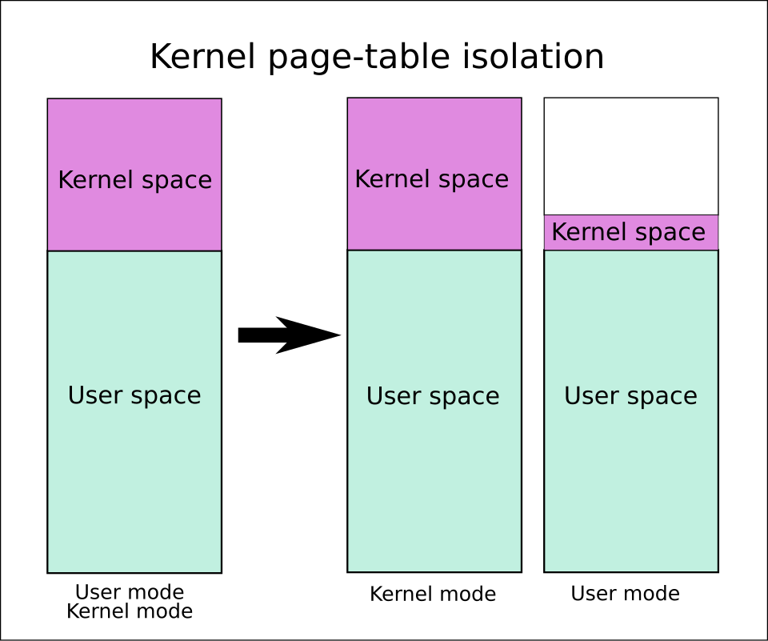

用户程序用 `read()` 从文件读取数据，系统调用指令把执行交给内核。若用户态的页表只保留了少量内核映射，处理器要从哪里取到入口代码？内核开始处理之后，为什么还能向同一个进程的用户缓冲区复制数据？

这两个问题可以沿一次页表切换一起回答。本文以开启页表隔离的 Linux v6.12 x86-64 正常系统调用为例。先修是[页表翻译与访问权限](./microarch-02a-translation.md#sv39-permissions)。那一节用 RISC-V 说明通用过程，这一节的寄存器、指令和入口规则采用 x86。

[[toc]]

## 两个页表根分别保留哪些映射 {#pti-roots}

传统设计可以让同一份顶级页表同时包含用户地址和内核地址。内核页通过页表权限限制为特权态可用。[Meltdown 一节](./microarch-04e-meltdown.md#meltdown-pti)讨论的经典情况中，目标页已有有效翻译，架构上的读取仍因权限检查被拒绝。页表隔离（Page Table Isolation，PTI）进一步缩小在用户运行期间参与翻译的内核地址范围。

图 1 左边展示一套映射。右边并排展示启用 PTI 后的两套视图。中间的内核视图保留完整内核映射及该进程的用户地址。最右边的用户视图保留该进程的用户地址，以及少量进入、退出内核所需的映射。图中带颜色的区域表示页表所覆盖的**虚拟地址范围**，不代表分配了两份用户数据。

<figure class="lesson-figure" style="max-width: 620px">

<figcaption>图 1　页表隔离前后的映射范围。最右边缩小的是用户视图中的内核映射范围。点击可查看原图。</figcaption>
</figure>

将图中的区域缩小成三个示意页。U 是当前进程的普通用户页，E 是内核入口用的代码页，K 是一个普通的内核数据页。

| 虚拟页 | 用户视图 | 内核视图 |
| --- | --- | --- |
| U，用户页 | 有映射，按用户页自己的权限访问 | 有同一份数据的映射。Linux PTI 把此视图的用户部分限制为不可执行 |
| E，系统调用入口 | 有映射，只供特权态使用 | 有映射，只供特权态使用 |
| K，普通内核数据 | 无映射 | 有映射，只供特权态使用 |

这是权限和存在性两个条件。系统在用户模式时，E 有翻译却受特权级限制，K 在当前视图根本没有翻译。访问 E 与访问 K 都会被拒绝，页错误原因却不同。真实内核的少量公共映射还涉及进入和离开时需要的每 CPU 结构，表中用 E 代表入口代码。

Linux 为一个用户地址空间维护顶级页目录（PGD）的两份根。用户部分的顶级项可分别指向同一组下级表，页表项和对应物理页由两份视图共用。这样改动一个普通用户页时，下级页表项无需双份维护。内核还会在新增用户顶级项时同步另一份根。内核视图保留用户数据映射，是因为诸如 `copy_to_user()` 的内核操作需要在合适的权限控制下访问这些数据。

## 一次系统调用里，权限级和 CR3 怎样改变 {#pti-entry}

x86-64 的 `CR3` 指定当前页表根。在支持且启用 PCID 时，`CR3` 还携带当前翻译上下文的标识。一次普通的 64 位 `SYSCALL` 将控制流转到内核入口并改变当前特权级，但页表根仍然是调用前使用的那份。`SYSCALL` 也不会把栈指针自动换成普通内核栈。入口代码必须在这个短暂的组合下工作，即特权态已经开始使用、用户视图仍然有效。

以下沿 Linux v6.12 的 `entry_SYSCALL_64` 和可使用 `SYSRETQ` 的返回路径走一遍。慢速返回和中断入口各有其他处理，下面只取这条路径。

| 时刻 | 当前权限级 | 当前页表视图 | 这一步发生什么 |
| --- | --- | --- | --- |
| 调用前 | 用户态 | 用户 | 用户代码执行 `SYSCALL` |
| 刚进入入口 | 内核态 | 用户 | 入口代码可取指，暂存原用户栈指针 |
| 入口代码切换 `CR3` | 内核态 | 内核 | 得到完整内核映射，切到普通内核栈，运行内核处理 |
| 开始返回 | 内核态 | 内核 | 把最后所需的状态迁到入口和出口都能使用的栈 |
| 出口代码切换 `CR3` | 内核态 | 用户 | 从公共出口区域完成返回前操作 |
| `SYSRETQ` 返回后 | 用户态 | 用户 | 回到用户指令流 |

入口在 `swapgs` 后把用户 `RSP` 保存到本 CPU 的任务状态段（TSS）的 `sp2` 字段。这里 `sp2` 用作临时存储。接下来，`SWITCH_TO_KERNEL_CR3` 可以借用 `RSP` 作为寄存器暂存新 CR3，因为原用户栈指针已经保存。在 CR3 写完之后，代码才从 `pcpu_hot` 读取普通内核栈顶，随后把用户栈指针、标志和返回地址等保存到 `pt_regs`。

快速返回时，内核把最后需要恢复的用户 `RDI` 与 `RSP` 放到本 CPU 的过渡栈上。这个栈的入口来自 TSS 的 `sp0`。然后执行 `SWITCH_TO_USER_CR3_STACK`，切回用户视图后仍能从过渡栈取出那两个值。最后由 `SYSRETQ` 根据先前恢复的 `RCX`、`R11` 回到用户地址与标志状态。中途使用的出口代码和过渡栈必须在用户视图也有特权映射，普通内核数据页则不需要。

## 切了页表，旧的翻译怎样处理 {#pti-tlb}

页表是翻译的依据，TLB 则缓存翻译结果。若每次进出系统调用都丢掉许多已有翻译，返回以后要额外做页表遍历。支持 PCID 的系统可以给用户视图和内核视图不同的翻译标识。这样一次切换选择相应的记录，已有记录在满足条件时还能保留。两个视图里的 U 最终指向同一物理页，也仍然可以有不同的权限属性和 TLB 上下文。

| 条件 | Linux v6.12 的这条返回路径怎样处理 |
| --- | --- |
| 支持 PCID，用户视图对应的翻译仍有效 | 切到用户页表根与对应的 PCID。可以使用不失效已有翻译的写入方式 |
| 支持 PCID，内核记录用户 PCID 需要失效 | 返回时先处理这个标记，切换时使相关旧翻译失效 |
| 未使用 PCID | 沿普通页表根切换路径，非全局翻译不能像带标识的有效记录那样保留 |

这里的关键在于“仍有效”的条件。更新页表后，原先缓存的翻译必须按相应范围失效。Linux 会给用户 PCID 记录待处理状态，并在真正切回用户页表时检查。对于仅在内核视图有映射的内核页，PTI 也限制使用可跨上下文保留的全局页属性。这样切换时查到的翻译与当前视图的映射范围保持一致。

### 手算进入与返回时写入 CR3 的值 {#pti-cr3-values}

设当前进程的内核页表根位于物理地址 `0x00234000`，用户页表根在相邻的 `0x00235000`。这两个 4 KiB 页按 8 KiB 对齐的页对安排，因此可以用地址的第 12 位选择。例题采用普通 64 位分页，省略其他可能占用 CR3 位的扩展。

Linux 在当前 CPU 给这个进程分配了软件 ASID 2。内核使用的硬件 PCID 为 `2 + 1 = 3`，用户 PCID 再置位第 11 位，得到 `0x803`。页表根决定 TLB 未命中后从哪里遍历，PCID 则参与非全局翻译的识别。启用 PCID 时，写入操作数的第 63 位可以表示保留目标上下文的翻译，其本身不会成为随后读回的 CR3 状态。

| 什么时候写 | 根与 PCID | 写入操作数 |
| --- | --- | --- |
| 进入内核，使用原进程内核视图 | `0x00234000` 与 `0x003` | `0x8000000000234003` |
| 返回，用户 PCID 无待处理失效 | `0x00235000` 与 `0x803` | `0x8000000000235803` |
| 返回，用户 PCID 有待处理失效 | `0x00235000` 与 `0x803` | `0x0000000000235803` |

前两行都在写入时置位第 63 位。第三行使用同一个用户页表根和同一个 PCID，但第 63 位为 0，处理器会按这次 CR3 写入的规则失效目标 PCID 的非全局翻译。这个路径先检查并清除当前逻辑 CPU 的待失效标志。源码用当前内核 PCID 的低 11 位选择 `user_pcid_flush_mask` 中的一位，本例查的是第 3 位，实际失效对应的是用户 PCID `0x803`。

待处理标志也说明了失效的时机。以 Linux v6.12 在内核视图下失效一个用户地址的路径为例，本地内核 PCID 可以直接失效该地址。有 `INVPCID` 且已启用 PCID 时，内核也可用它失效对应用户 PCID 的该地址。否则，内核先记下用户 PCID 的待失效标志，到返回时再处理。以下教学模型采用后一种情况，只模拟当前逻辑 CPU。涉及其他 CPU 的任务迁移或页表更新，还要处理相应的跨核同步。可对照[地址翻译一课的旧翻译例题](./microarch-02a-translation.md#sv39-shootdown)。

## 用 C 复算入口和返回前的翻译 {#pti-model}

模型保存两套根、各自一项 U 页的非全局 TLB 记录，以及共享的 U 页框。先运行一遍用户取指、系统调用进入和返回，并在几个边界查同一页的权限。随后模拟内核更改 U 的映射，再观察待失效标志如何改变返回时的写入值。代码只计算当前 CPU 的页表和标记状态，省略真实页表遍历、缓存替换和其他权限机制。

保存为 `pti_views.c`，用 `gcc -std=c11 -O2 -Wall -Wextra pti_views.c -o pti_views` 编译，再运行 `./pti_views`。Windows 上可运行 `./pti_views.exe`。

~~~c
#include <inttypes.h>
#include <stdbool.h>
#include <stdint.h>
#include <stdio.h>

typedef enum { KERNEL, USER } View;
typedef enum { U, E, K } Page;

typedef struct {
    uint64_t frame;
    bool user_allowed, executable;
} Entry;

typedef struct {
    View view;
    uint64_t shared_u;
    Entry cached_u[2];
    bool user_flush;
} State;

static uint64_t cr3_operand(View target, bool retain)
{
    const uint64_t kernel_root = UINT64_C(0x234000);
    const unsigned kernel_pcid = 3;
    uint64_t root = kernel_root | (target == USER ? UINT64_C(0x1000) : 0);
    unsigned pcid = kernel_pcid | (target == USER ? 0x800u : 0);
    uint64_t retain_bit = retain ? UINT64_C(1) << 63 : 0;
    return root | pcid | retain_bit;
}

static void switch_root(State *s, View view)
{
    bool retain = view == KERNEL || !s->user_flush;
    printf("write %s CR3: 0x%016" PRIx64 "\n",
           view == USER ? "user" : "kernel", cr3_operand(view, retain));
    if (!retain) {
        s->cached_u[USER] = (Entry){0};
        s->user_flush = false;
    }
    s->view = view;
}

static void access(State *s, const char *label, Page page, bool at_cpl3, bool fetch)
{
    Entry entry;
    switch (page) {
    case U: entry = (Entry){s->shared_u, true, s->view == USER}; break;
    case E: entry = (Entry){0x300000, false, true}; break;
    case K: entry = (Entry){s->view == KERNEL ? 0x310000u : 0, false, false}; break;
    default: return;
    }

    const char *source = "mapped";
    if (page == U) {
        Entry *cached = &s->cached_u[s->view];
        if (cached->frame) {
            entry = *cached;
            source = "TLB hit";
        } else {
            *cached = entry;
            source = "walk";
        }
    }

    printf("%s: ", label);
    if (!entry.frame) {
        puts("unmapped");
        return;
    }
    if ((at_cpl3 && !entry.user_allowed) || (fetch && !entry.executable)) {
        puts("permission");
        return;
    }
    printf("%s 0x%06" PRIx64 "\n", source, entry.frame);
}

int main(void)
{
    State s = {.view = USER, .shared_u = 0x120000};
    access(&s, "user U before syscall", U, true, true);
    access(&s, "user attempts E", E, true, true);
    access(&s, "entry E at CPL0", E, false, true);
    access(&s, "K before switch", K, false, false);
    switch_root(&s, KERNEL);
    access(&s, "K after switch", K, false, false);
    access(&s, "kernel reads U", U, false, false);
    access(&s, "if CPL3 on kernel root", U, true, true);

    switch_root(&s, USER);
    access(&s, "exit E at CPL0", E, false, true);
    access(&s, "user U after syscall", U, true, true);

    switch_root(&s, KERNEL);
    s.shared_u = 0x121000;
    s.cached_u[KERNEL] = (Entry){0};
    s.user_flush = true;
    access(&s, "kernel reads new U", U, false, false);
    switch_root(&s, USER);
    access(&s, "user fetches new U", U, true, true);
}
~~~

~~~text
user U before syscall: walk 0x120000
user attempts E: permission
entry E at CPL0: mapped 0x300000
K before switch: unmapped
write kernel CR3: 0x8000000000234003
K after switch: mapped 0x310000
kernel reads U: walk 0x120000
if CPL3 on kernel root: permission
write user CR3: 0x8000000000235803
exit E at CPL0: mapped 0x300000
user U after syscall: TLB hit 0x120000
write kernel CR3: 0x8000000000234003
kernel reads new U: walk 0x121000
write user CR3: 0x0000000000235803
user fetches new U: walk 0x121000
~~~

前三种查询分别展示用户代码能取指、用户态访问入口会被拒绝，以及已经切换到 CPL0 的入口能取指。`K before switch` 是一次假设查询，显示特权级升高之后，旧页表里仍缺少 K。`if CPL3 on kernel root` 也是假设查询，用来核对内核根的用户部分不可执行。正常路径第一次返回时，用户视图里的 U 仍可命中原来的 TLB 记录。第二次运行到内核视图后，程序先改共享页框，再清除内核视图下这个页的旧条目，最后用 `user_flush` 表示用户 PCID 还有待处理失效。再次切回用户视图时，清掉的是用户 PCID 的旧记录，接下来的取指重新翻译到 `0x121000`。

## 页表隔离改变了哪一步 {#pti-boundary}

保护作用可以回到 K 这一个页来检查。启用 PTI 后，正常用户视图中缺少 K 的映射，用户态翻译无法沿这份页表得到 K 的物理页。入口仍需保留少量映射，进程之间的间接分支预测等状态也各有自己的处理规则。要判断别的机制，需重新确定它所使用的状态和边界。

::: details 练习：用户页的映射更新了

内核把用户页 U 原先指向的 `frame-u` 更换成 `frame-new`。此前用户 PCID 已缓存旧翻译，内核视图的用户部分也曾查到这个页。为什么更新下级页表项一次仍然不够？再回到用户态时，处理器应从哪个物理页取指？

下级页表项是共用的，改动一次即可让两个视图的下次遍历看到新页号。已有的 TLB 条目各自可能保留旧翻译，仍需按相关视图与处理器的失效规则处理。返回用户态且相关旧翻译已经失效后，重新翻译 U 才会得到 `frame-new`。
:::

## 参考文献

- [Linux v6.12 的 x86 页表隔离文档，两套页表及 PCID 处理](https://docs.kernel.org/6.12/arch/x86/pti.html)
- [Linux v6.12 的 64 位系统调用入口与快速返回代码](https://github.com/torvalds/linux/blob/v6.12/arch/x86/entry/entry_64.S#L87)
- [Linux v6.12 的 CR3 切换宏](https://github.com/torvalds/linux/blob/v6.12/arch/x86/entry/calling.h#L163)
- [Linux v6.12 的 PCID 编号与用户翻译失效路径](https://github.com/torvalds/linux/blob/v6.12/arch/x86/mm/tlb.c)
- [Intel 软件开发者手册，SYSCALL、SYSRET、分页与 PCID](https://www.intel.com/content/www/us/en/developer/articles/technical/intel-sdm.html)
- [Phoenix7777 绘制、Wdwd 修整的页表隔离原图](https://commons.wikimedia.org/wiki/File:Kernel_page-table_isolation.svg) · [CC BY-SA 4.0 许可](https://creativecommons.org/licenses/by-sa/4.0/) · 本文使用原图的 PNG 版本，正文以灰度显示，配图沿用同一许可。

<nav class="article-nav" aria-label="系列文章导航">

[<small>上一篇</small><strong>Meltdown 中的越权加载如何影响后续指令</strong>](./microarch-04e-meltdown.md){.article-nav-card .article-nav-prev rel=prev}

[<small>下一篇</small><strong>Spectre 变体中的分支与访存推测</strong>](./microarch-04c-variants.md){.article-nav-card .article-nav-next rel=next}

</nav>
