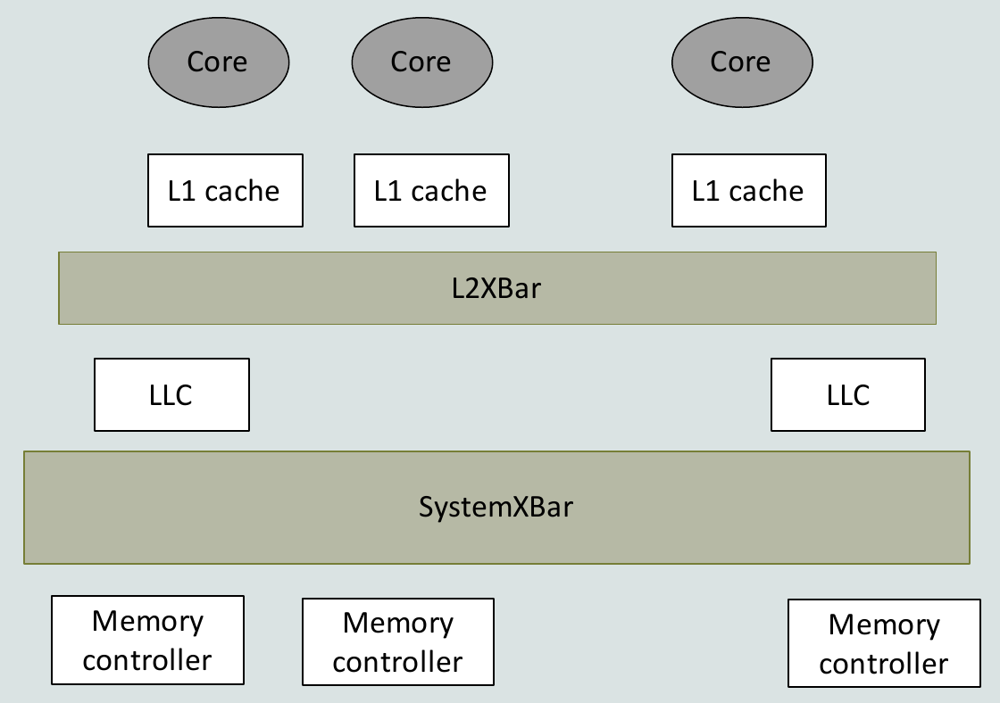

两个核心各读自己的数组，物理地址没有重叠。B 读完以后，A 的三条数据中，有两条已经被换出末级缓存（Last-Level Cache，LLC）。A 再次读取这三条数据，会有两次还是三次未命中？如果 A 的私有缓存里还有副本，答案又会怎样？

这两道题要沿同一条路径顺次判断。先看两个核心是否共用 LLC，再由地址算出它们是否竞争同一个组，最后检查核心重新加载时能从哪一级取得数据。先修知识是[地址如何选组](./microarch-01b-cache-mapping.md#cache-address)和[组内替换](./microarch-01b-cache-mapping.md#cache-replacement)。

[[toc]]

## 两条访问路径在哪一级汇合 {#llc-domain}

图 1 是 gem5 课程给出的缓存层次示例。各核心先访问自己的 L1，走到互连之后才进入下方的末级缓存。图中画了两个 LLC 块。共享缓存可以有多块存储结构，实际请求按照系统的地址和路由规则被送往相应位置。图示用于说明共享接口所在的位置，后面的题目会直接指定共用一个 LLC 实例。

<figure class="lesson-figure" style="max-width: 550px">

<figcaption>图 1　从各自的 L1 到可能共用的 LLC。上半部是核心侧，下半部经系统互连接向内存控制器。</figcaption>
</figure>

题目比图中多设一级私有 L2。A、B 各有 L1 和 L2，二者的请求经过私有层后汇合到同一个共享 LLC。若 A 在私有 L2 找到了数据，正常的读访问已能返回。分析 LLC 替换时，先从完整访问序列中过滤出实际到了 LLC 的请求。

真实平台上要怎样确认这个汇合点？以 Linux 的缓存接口为例，从 `/sys/devices/system/cpu/` 进入选定的 `cpuN`，在其 `cache/indexK` 目录中读取 `level` 和 `type`，找出目标级别与类型。接着读 `id` 和 `shared_cpu_list`。`indexK` 是该 CPU 的缓存信息目录编号。缓存实例 ID 应在同一级别与类型下比较。下面是一组用于读配置的示意值。

| 逻辑 CPU | 目标级别和类型 | 实例 ID | 可共用这个实例的 CPU |
| --- | --- | ---: | --- |
| 0 | L3，Unified | 0 | 0–3 |
| 2 | L3，Unified | 0 | 0–3 |
| 4 | L3，Unified | 1 | 4–7 |

A 在 CPU 0、B 在 CPU 2 时，可用同一个 LLC 实例解释两者的分配。若 B 移到 CPU 4，B 的新分配使用另一个实例。这个变化能解除两者对同一 LLC 组的争用，但共享的内存节点、互连等仍要另查。若真实处理器在一个 LLC 实例内还有多个分片，也要确认访问是否竞争相同分片上的组。下文使用单片的教学模型，避免让具体平台的路由规则混入例题。

## 六个不同的块怎样争四路 {#llc-set}

设模型的 LLC 有 4 组，每组 4 路，行长为 64 字节。地址均为题设中的物理地址，块号对 4 取余选组。选择同一个组才会争这一组的四个位置。分配时先用空路，组满后换掉最久未用的行，即精确 LRU。

| 工作负载 | 块的名称 | 各块的首地址 | 组号 |
| --- | --- | --- | --- |
| A | A0、A1、A2 | `0x2000`、`0x2100`、`0x2200` | 均为 0 |
| B | B0、B1、B2 | `0x2300`、`0x2400`、`0x2500` | 均为 0 |

例如，`0x2200 / 64 = 0x88`，再对 4 取余得到 0。六条行的块号各不相同，组号却相同。整个 LLC 有 16 个行位置，其他组可以有空位，而这六个块在题设中只能使用组 0 的四路。后面只数实际到达这个 LLC 的读请求，并假定每次填充在下一次读之前完成。

A 先把 A0、A1、A2 读进 LLC。现在让 B 依次读 B0、B1、B2，然后 A 再按原顺序读一次。表中顺序从最久未用排到最近使用。

| 请求 | 结果 | 被换出的块 | 组 0 的状态 |
| --- | --- | --- | --- |
| A 完成第一轮 | 三块已填入 | 无 | A0、A1、A2 |
| B0 | 未命中 | 无，有空路 | A0、A1、A2、B0 |
| B1 | 未命中 | A0 | A1、A2、B0、B1 |
| B2 | 未命中 | A1 | A2、B0、B1、B2 |
| A0 | 未命中 | A2 | B0、B1、B2、A0 |
| A1 | 未命中 | B0 | B1、B2、A0、A1 |
| A2 | 未命中 | B1 | B2、A0、A1、A2 |

B 停止读取时，A2 仍在 LLC。A 先重读 A0 并把它填进 LLC，这一步又挤掉了 A2。于是 B 直接换出了 A 的两块，A 自己的后续填充使第三个块也未命中。用[复用距离](./microarch-01-cache.md#locality-reuse)可以重算这一点。在 A2 的两次访问之间，组 0 先后用了 B0、B1、B2、A0、A1，已经超过了四路能保留的范围。

现在只改 B 的布局，将三个首地址都增加 `0x40`。每个块号加 1，B 就转到组 1。A 不用改动顺序，下一轮三个请求都可在组 0 命中。布局保持同组时，还可以用[CAT 的四路例题](./microarch-06c-cat.md#cat-ways)重算限制填充位置后的结果。这里两个核心访问的是不同物理块。若两个字段实际落在同一物理块，且存在写入，则还需分析一致性和[伪共享](./microarch-01g-false-sharing.md#sharing-layout)。

## LLC 换出一行，私有缓存会怎样 {#llc-inclusion}

回到原布局，把此前略去的私有 L2 加回来。A 第一轮结束后，假定三条干净的数据同时在私有 L2 和 LLC，L1 的细节省略。随后 A 暂停，B 仍然读 B0、B1、B2。这时要看内存层次有没有以下约束。

- **包含式 LLC。** 私有层保留的块必须在 LLC 里也有对应缓存块。LLC 替换 A0 时，控制器要找到私有层的副本，把撤销这些副本作为本次替换的一部分。
- **非包含式 LLC。** 私有缓存可以持有当前未驻留在 LLC 的块。如果实现允许保留，B 换出 LLC 的 A0 后，A 的 L2 仍可命中。更改共享状态或写入相同块时仍需遵守一致性规则。

| 阶段 | 保持包含关系 | 允许私有层继续保留干净副本 |
| --- | --- | --- |
| B 读完三块 | LLC 去掉 A0、A1，A 的 L2 也失去这两块 | LLC 去掉 A0、A1，A 的 L2 保留三块 |
| A 再读 A0 | L2 未命中，LLC 未命中。填充 A0 换出 A2，使其 L2 副本失效 | 在 L2 命中 |
| A 继续读 A1、A2 | 两笔都到 LLC，均未命中 | 两笔均在 L2 命中 |
| A 第二轮到达 LLC 的次数 | 3 | 0 |

表里右列是针对干净只读副本的教学条件。真实非包含式处理器还可能有独立的目录资源和其他替换约束。Intel 对第一代 Xeon Scalable 的技术说明明确指出，在它的非包含式 LLC 中，某块不在 LLC 无法据此判断它也不在私有缓存。读测量结果时，需要分别核实私有层命中、LLC 请求和下级流量。

### 为什么读 B1 会让另一个核的 A0 失效 {#llc-back-invalidation}

B 读 `0x2400`（B1）时，组 0 没有空路，LRU 选中 `0x2000`（A0）。一致性控制器此时查询的是**被换出块 A0 的记录**。记录指向先前读过 A0 的私有缓存，因此控制器向它发送 A0 的失效消息。B 的加载从头到尾请求的都是 B1。比较[为写入而撤销同一行副本](./microarch-01f-coherence.md#mesi-upgrade)的过程，可以看到两种失效各有触发条件。写升级由同一物理行的写请求触发，包含式缓存的这种失效由组内替换触发，即使引发替换的访问只是一次读。

gem5 v24.1.0.3 的 Ruby `MESI_Two_Level` 用私有 L1 和共享 L2 实现了这一过程。假定 A0 是共享层中处于 `SS` 的干净行。L2 为这次换出建立事务记录，按 `Sharers` 给潜在持有者发送失效，并释放数据阵列中的表项。此后 A0 仍有一项在途状态 `I_I`，用来收取失效确认。收齐后才继续下游的替换收尾。**数据阵列的槽位可以先释放，A0 这笔事务还在等待确认。** 这个实现有助于理解前表中 A0 为什么会消失在私有缓存中。前表用的是私有 L2 与共享 LLC，层级名称随系统而变。

### 用代码复算请求最后在哪一级取数

这段 C 程序用 `private_copy[core][block]` 记录每个核手里有哪些块，用 `llc` 保存每组的块号，最久未使用的块排在最前。`read_block` 先查私有缓存，命中时直接返回，LLC 的顺序保持原样。到达 LLC 后，命中就把该块移到队尾，需要替换就从队首移走一块。在包含式模型里，移除队首还会清除对应的私有副本。这里把发失效到收齐确认合并成一步，两种情况都只模拟干净行，不计在途延迟。

将代码保存为 `llc_model.c`，用 `gcc -std=c11 -O2 -Wall -Wextra llc_model.c -o llc_model` 编译，再运行 `./llc_model`。

~~~c
#include <assert.h>
#include <stdbool.h>
#include <stdio.h>
#include <string.h>

enum { LINE_BYTES = 64, SETS = 4, WAYS = 4, BLOCKS = 256 };
enum Core { A, B, CORES };
enum Source { PRIVATE_L2, LLC, LOWER, SOURCES };

struct CacheSet {
    unsigned blocks[WAYS];
    unsigned used;
};

struct Cache {
    bool inclusive;
    bool private_copy[CORES][BLOCKS];
    struct CacheSet llc[SETS];
};

static enum Source read_block(struct Cache *cache, enum Core core, unsigned address)
{
    const unsigned block = address / LINE_BYTES;
    assert(block < BLOCKS);
    if (cache->private_copy[core][block])
        return PRIVATE_L2;

    struct CacheSet *set = &cache->llc[block % SETS];
    unsigned index = 0;
    while (index < set->used && set->blocks[index] != block)
        ++index;

    const enum Source source = index < set->used ? LLC : LOWER;
    if (source == LOWER && set->used == WAYS) {
        index = 0;
        if (cache->inclusive) {
            const unsigned victim = set->blocks[0];
            for (unsigned other = 0; other < CORES; ++other)
                cache->private_copy[other][victim] = false;
        }
    }

    if (index == set->used) {
        set->blocks[set->used++] = block;
    } else {
        for (; index + 1 < set->used; ++index)
            set->blocks[index] = set->blocks[index + 1];
        set->blocks[index] = block;
    }
    cache->private_copy[core][block] = true;
    return source;
}

static void replay(const char *label, const unsigned *b, unsigned count,
                   bool keep_private, bool inclusive)
{
    const unsigned a[] = {0x2000, 0x2100, 0x2200};
    struct Cache cache = {.inclusive = inclusive};
    unsigned hits[SOURCES] = {0};

    for (unsigned i = 0; i < 3; ++i)
        read_block(&cache, A, a[i]);
    if (!keep_private)
        memset(cache.private_copy[A], 0, sizeof cache.private_copy[A]);
    for (unsigned i = 0; i < count; ++i)
        read_block(&cache, B, b[i]);
    for (unsigned i = 0; i < 3; ++i)
        ++hits[read_block(&cache, A, a[i])];

    printf("%s: L2=%u LLC requests=%u LLC hits=%u lower=%u\n", label,
           hits[PRIVATE_L2], hits[LLC] + hits[LOWER], hits[LLC], hits[LOWER]);
}

int main(void)
{
    const unsigned same[] = {0x2300, 0x2400, 0x2500};
    const unsigned separate[] = {0x2340, 0x2440, 0x2540};
    const unsigned repeat[] = {0x2300, 0x2300, 0x2300};

    replay("same set", same, 3, false, false);
    replay("different sets", separate, 3, false, false);
    replay("inclusive", same, 3, true, true);
    replay("retain private", same, 3, true, false);
    replay("repeat B0", repeat, 3, false, false);
    replay("only B0 and B1", same, 2, true, true);
}
~~~

~~~text
same set: L2=0 LLC requests=3 LLC hits=0 lower=3
different sets: L2=0 LLC requests=3 LLC hits=3 lower=0
inclusive: L2=0 LLC requests=3 LLC hits=0 lower=3
retain private: L2=3 LLC requests=0 LLC hits=0 lower=0
repeat B0: L2=0 LLC requests=3 LLC hits=3 lower=0
only B0 and B1: L2=0 LLC requests=3 LLC hits=0 lower=3
~~~

前两行用 `keep_private=false` 清空 A 的私有副本，复算前面的 LLC 组表。第三、四行都保留 A 第一轮取得的副本，两者的区别在于共享层替换时是否清除私有副本。第四行虽然有 `LLC requests=0`，A 仍执行了三次读取，全部在私有 L2 命中。`lower` 计的是要交给 LLC 以下层级的请求，模型只算到这一步。

## 从请求数和未命中数读出变化 {#llc-evidence}

复查真实程序时，先固定工作量和执行位置，再比较各级事件。假如 A 单独运行和混合运行都执行了同样的加载，但到达 LLC 的请求数不同，应先看私有层的命中和副本状态。若到达 LLC 的请求数相同，混合运行的 LLC 未命中更多，则可沿同组替换的解释继续查。若未命中数也相同，仍可能是这些请求去了[共用的内存控制器](./microarch-06b-memory-queue.md#memory-controller)，等了更久。各类硬件计数的实际定义和范围可对照[用计时和计数器分析访存](./microarch-04a-measurement.md#pmu-path)。

::: details 练习：B 反复读同一个块

仍在 A 已经读过 A0、A1、A2 后运行 B。保持 B 的请求和 A 落在同一组，把 B 的序列改成只反复读取 B0。若 A 的下一轮全部到达 LLC，会有几次未命中？

零次。B0 第一次填进空路。再次读取 B0 可以在已有副本命中，无须为新块另找位置。程序的 `repeat B0` 一行报告 A 的三次请求都命中 LLC。

再把条件改成包含式 LLC，且 A 的私有副本一开始都在，B 只各读一次 B0、B1。B1 换出 A0 后，A1、A2 都还在私有层。A 重新填入 A0 时换出 A1，重新填入 A1 时又换出 A2。因此 B 直接换出一块，A 最终仍出现三次 LLC 未命中。
:::

## 参考文献

- [Marjan Fariborz，gem5 Bootcamp《Cache Systems》第 14 页](https://gem5bootcamp.github.io/gem5-bootcamp-env/assets/slides/using-gem5-04-gem5-caches-tutorial.pdf#page=14) · [CC BY 4.0 许可](https://github.com/gem5bootcamp/gem5-bootcamp-env/blob/51590ae00b0e451c9b6a8854addbb94128ab4cac/LICENSE) · 本文复用已裁出的图并以灰度显示。
- [Intel 第一代 Xeon Scalable 技术综述，缓存层次与数据放置](https://www.intel.com/content/www/us/en/developer/articles/technical/intel-xeon-processor-scalable-family-technical-overview.html)
- [Sorin、Hill、Wood，缓存一致性教材，包含式 LLC 与失效请求](https://pages.cs.wisc.edu/~markhill/papers/primer2020_2nd_edition.pdf)
- [gem5 v24.1.0.3 Ruby 的 L2 换出与失效确认状态机](https://github.com/gem5/gem5/blob/b9da2bfe1e21f6efa2730edd4e80e58c5d965458/src/mem/ruby/protocol/MESI_Two_Level-L2cache.sm)
- [Linux v6.12 resctrl 文档中的缓存实例 ID](https://docs.kernel.org/6.12/arch/x86/resctrl.html#cache-ids)
- [Linux 内核的缓存 sysfs 接口定义](https://github.com/torvalds/linux/blob/v6.12/Documentation/ABI/testing/sysfs-devices-system-cpu)

<nav class="article-nav" aria-label="系列文章导航">

[<small>上一篇</small><strong>时间差何时算作侧信道证据</strong>](./microarch-04b-observation.md){.article-nav-card .article-nav-prev rel=prev}

[<small>下一篇</small><strong>未命中次数相同，为什么内存等待更长</strong>](./microarch-06b-memory-queue.md){.article-nav-card .article-nav-next rel=next}

</nav>
