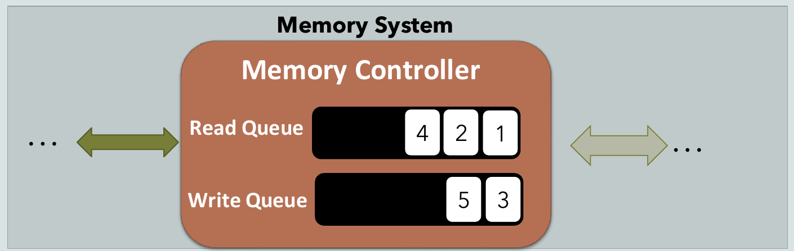

[上一节的同组例题](./microarch-06a-shared-cache.md#llc-set)中，另一个工作负载通过替换使原本命中的读取变成未命中。现在给 A 两笔已经确定会穿过 LLC 的读取。无论 B 是否同时运行，A 都只有这两笔未命中，读出的数据也相同。把它们往下追到共享的内存服务接口，会看到另一种变慢的原因。

[[toc]]

## 把一次等待拆成排队和服务

请求离开缓存后，还会经过互连、控制器和内存接口。某些接口每个周期能接收或发送的工作有限，控制器要保存未完成请求并决定先做哪一笔。等待可以发生在请求已进队列、尚未获得服务的阶段，也可以发生在服务开始以后。区分这两段，需要给每笔请求记三个时刻。

| 记号 | 本节中的含义 |
| --- | --- |
| 到达 | 请求进入共享等待队列 |
| 开始 | 获得本节模型中的服务位置 |
| 完成 | 本笔服务结束，数据可返回 |

完成减到达是这段路径上的响应时间，也等于到达到开始的排队时间加上开始到完成的服务时间。这里从共享端口的入口开始计时，尚未纳入核心、缓存和互连的其他阶段。

## 按到达顺序算一个满载区间

假设只有一个服务位置，请求按先来先服务，任何一笔开始后都占四个周期。队列容量足够，已经开始的一笔不能被插队打断。时间从 0 开始，记 `[3, 7)` 为从 3 开始到 7 完成。

A 的两笔请求分别在周期 3 和 10 到达。可把它们理解为已知地址的独立读取，两次到达由题设固定。单独运行时，它们在 `[3, 7)` 和 `[10, 14)` 完成服务，响应时间各为 4。

加上 B。B 有三笔请求在周期 0、1、2 到达，按 FIFO 放在 A 的第一笔之前。

| 请求 | 到达 | 获得服务的区间 | 排队时间 | 响应时间 |
| --- | ---: | --- | ---: | ---: |
| B0 | 0 | `[0, 4)` | 0 | 4 |
| B1 | 1 | `[4, 8)` | 3 | 7 |
| B2 | 2 | `[8, 12)` | 6 | 10 |
| A0 | 3 | `[12, 16)` | 9 | 13 |
| A1 | 10 | `[16, 20)` | 6 | 10 |

周期 3 时，B0 正在服务，B1 和 B2 在等待，A0 排在它们之后。周期 10 时，B2 正在服务，A0 又排在 A1 之前。A 发出的仍是两笔请求，每笔占用服务位置的时间也都是 4。A 的第一笔响应延长了 9 周期，第二笔延长了 6 周期，都来自到达后的排队。

把两笔响应时长相加，独占时是 8，共享时是 23。这是两个请求等待时间的和。若问题是从第一笔到达到最后一笔完成的程序窗口，则应算 `14 - 3 = 11` 与 `20 - 3 = 17`。第一笔还未返回时，第二笔已经到达，两段等待有所重叠。由两个时间口径得出的差值不同。

## 从控制器端口走到 DRAM {#memory-controller}

图 1 取自 gem5 Bootcamp。控制器在中央，读队列和写队列各自保存已经接受的请求。把图左侧的省略号接回前一课的 LLC 和互连，把右侧接到 DRAM 接口。左侧决定一笔请求能否进来，右侧决定它何时能发出命令。两边都可能使请求等待。

<figure class="lesson-figure">

<figcaption>图 1　从 gem5 Bootcamp 讲义第 10 页裁出的内存控制器原图。数字用于区分排队请求，正文以 A0、A1、B0、B1 标记例题中的请求。</figcaption>
</figure>

下表沿 gem5 v24.1.0.3 的普通单通道 `MemCtrl` 说明接口。**突发传输**（burst）是一次列读或列写在数据总线上连续传送的一组数据。上层送来一个包，控制器可能要拆成多个突发粒度的条目。例如突发大小为 64 字节时，起始地址在突发边界上的 64 字节请求只需要一个条目，同样长度的请求若从边界后 32 字节开始，就跨了两个突发。

| 位置 | 保存的状态 | 如何推进请求 |
| --- | --- | --- |
| 控制器输入端 | 上层包的地址、大小和读写类型 | 计算需要的条目数，检查对应队列是否有空位 |
| 读队列与写队列 | 内部 `MemPacket`，含源请求、进入时间、地址、大小及译出的 rank、bank、row | 按读写方向、优先级及内存状态挑选，读请求也可能由覆盖它的待写条目满足 |
| DRAM 接口 | 每个存储体当前打开的行，允许读、写、激活及预充电的最早时刻 | 把请求排成行命令和列命令，并给出数据可用时间 |
| 返回队列 | 已调度读突发及其 `readyTime` | 数据就绪后处理返回。上层包拆成多个突发时，等各部分完成才回复 |

在选定实现中，读侧容量把等待调度的读项与已调度、仍在返回队列里的读项一起计入。例如读缓冲上限是 32 项，读队列占 29，返回队列占 2，再来一个需要两项的包就会被拒绝，因为 $29 + 2 + 2 > 32$。包仍留在上游，要等控制器腾出位置并通知重试。控制器内部从成功进入开始计算的延迟，不会包含这段入队以前的等待。[缓存的 MSHR](./microarch-01a-mshr.md#mshr-trace) 追踪的是更上游的缓存行事务，也可能因为该事务不能前进而占用更久。

### 一个 64 字节读包怎样分成两项 {#memory-read-retry}

沿用 64 字节突发大小。上游现在送来一个从物理地址 `0x1650` 开始的 64 字节读包。它距当前突发边界 `0x1640` 有 16 字节。余下的 48 字节落在当前突发中，另 16 字节落在下一个突发中。控制器按下面两个范围处理，区间右端不包含在请求里。

| 读项 | 要读的字节范围 | 所在的突发块 |
| --- | --- | --- |
| 第一项，48 字节 | `[0x1650, 0x1680)` | `0x1640` |
| 第二项，16 字节 | `[0x1680, 0x1690)` | `0x1680` |

一次读包的入队检查按需要的两项一起做。接着用同一个 32 项读缓冲例子。假定这个读包没有可由待写项满足的部分，且期间没有其他新请求进来。

| 事件 | 等待调度 | 等待返回 | 两项能否同时进入 |
| --- | ---: | ---: | --- |
| 上游第一次送来读包 | 29 | 2 | 否，共需要 33 项 |
| 一条旧读项被调度 | 28 | 3 | 否，共需要 33 项 |
| 一条旧读项的数据就绪并处理返回 | 28 | 2 | 可以，共需要 32 项 |

第二行只把一条旧读从读队列移到了返回队列，因此并未腾出读缓冲容量。第三行才移除一项。这个版本的 `MemCtrl` 在处理读返回后通知等待的上游重试。通知表示可以再试一次，实际接收仍要重新核对该包需要的条目数。本例重试成功后，读队列从 28 项增到 30 项，返回队列仍有 2 项。

拆包后，两个读项分别参加调度。它们关联到原来的系统读包，并共用一份分段计数。假设两部分数据分别在第 20 和第 25 周期就绪，第一部分先把已完成数增加到 1。第 25 周期收到另一部分后，已完成数才等于 2，控制器得以安排原包的响应。上游实际看到响应的时刻还会受控制器配置的响应延迟和返回路径影响。

## 打开的一行为什么会改变服务顺序 {#memory-row}

一个内存通道有一组命令与数据通路。通道内可有多个 **rank**，每个 rank 是一起响应命令的一组器件。**bank**（存储体）是 rank 内可分别打开行的单位。**row**（行）指定存储体内一整行，列地址再从该行中选出要传输的部分。同一个 bank 的**行缓冲**保留当前激活的一行。存储体能否直接访问目标列，要看请求中的 row 和当前打开的行是否相同。

| 目标 bank 的状态 | 访问目标列之前需要做什么 |
| --- | --- |
| 打开的就是目标行 | 等列命令与共享总线允许，发 `RD` |
| 当前没有打开的行 | 发 `ACT` 激活目标行，等到行到列的最小间隔满足，再发 `RD` |
| 打开了另一行 | 先用 `PRE` 关闭旧行，再发 `ACT` 打开新行，最后发 `RD` |

列命令可发的时刻还会受先前命令、总线方向切换和刷新影响。例如 bank 里虽然打开了目标行，它仍可能要等列命令的最早允许时间，不能立即跟上当前可用的总线时隙。另一个 bank 的激活则可能提前完成，准备时间与正在传输的数据重叠。

gem5 默认的 `frfcfs` 会检查这些条件。在选定的读写队列和优先级内，源码遍历候选，优先找能接上目标时隙的行命中。如果暂时没有这样的命中，也会判断某些 bank 的 `PRE`／`ACT` 能否提前完成，以及哪一项最早能推进。选择策略比较的是具体时刻和资源，不能从“行命中”三个字直接推出总会先服务。下面先去掉这些额外变量，只保留后到的行命中可以先发这一条规则。

### 从物理地址算出行，再排请求

仍让 A 有两笔已经越过 LLC 的读请求，B 也提交两笔读请求。为便于手算，题设只用一个通道、一个 rank，地址低 6 位是 64 字节突发内偏移，接着 2 位选列，再用 1 位选 bank，高位选 row。这是下表使用的地址映射。实际 gem5 的映射由 `addr_mapping` 及通道、行缓冲等参数共同决定。

| 请求 | 到达时刻 | 物理地址 | bank | row | 列 |
| --- | ---: | --- | ---: | ---: | ---: |
| A0 | 0 | `0x1600` | 0 | 11 | 0 |
| A1 | 1 | `0x1640` | 0 | 11 | 1 |
| B0 | 2 | `0x1400` | 0 | 10 | 0 |
| B1 | 3 | `0x1440` | 0 | 10 | 1 |

以 `0x1640` 为例，`0x1640 >> 6 = 0x59`。`0x59` 的最低两位是 1，下一位是 0，剩余位是 `0xb`，因此地址落在 bank 0、row 11、列 1。A0、A1 是不同的 64 字节块，却可以共用同一个已打开的 DRAM 行。

假设先前的工作使 bank 0 保留着 row 10，端口在第 4 周期才开始从这批请求选取。所有请求只读、同优先级，每笔都占一个串行服务位置直到完成。若目标行已经打开，从选中到数据可用花 2 周期。行冲突时另加 `PRE` 的 2 周期和 `ACT` 到列命令的 3 周期，总共 7 周期。处理完成后保留最后打开的一行。这组数值只用来复算调度影响。

| 规则 | 第 4 周期先选谁 | 其余完成顺序 | A0、A1 完成时刻 | 最后一笔完成 |
| --- | --- | --- | --- | ---: |
| FIFO | A0，先关闭 row 10，再打开 row 11 | A1、B0、B1 | 11、13 | 22 |
| 行命中优先，同类先到先选 | B0，直接读 row 10 的列 | B1、A0、A1 | 15、17 | 17 |

第一行先支付一次换行成本。A0 从 4 到 11，A1 沿用 row 11，于 13 完成。B0 得重新打开 row 10，于 20 完成，B1 再用 2 周期。第二行的 B0、B1 在 6、8 完成，随后只切换一次行，A0、A1 因此到 15、17 才完成。两条规则下 A 都有两次 LLC 未命中，而且读出同样的数据。行命中优先使整批提前 5 周期结束，A 的两笔却各晚了 4 周期。若只报告整批完成时间，就看不出 A 的等待增加。

### 用 C 复算调度、列读与数据就绪 {#memory-model}

这个 C11 教学模型沿用同一张地址表。程序先按题设切分 `0x1650` 的读包，复算读缓冲容量，再用一个串行服务位置调度 A0、A1、B0、B1。行冲突时从选中到列读前要多等 5 周期，即 `PRE` 后两周期发 `ACT`，再等三周期发 `RD`。数据就绪比 `RD` 晚两周期。每个请求完成后才调度下一项，这是本题规则。实际控制器可以重叠不同请求的命令和数据传输。

保存为 `memory_queue.c`，用 `gcc -std=c11 -O2 -Wall -Wextra memory_queue.c -o memory_queue` 编译，再运行 `./memory_queue`。Windows 上运行 `./memory_queue.exe`。

~~~c
#include <stdbool.h>
#include <stdio.h>
#include <stdlib.h>

enum { BURST_BYTES = 64, READ_LIMIT = 32 };

typedef struct {
    unsigned bank, row, column;
} Location;

typedef struct {
    const char *name;
    unsigned arrival, address;
} Read;

static Location decode(unsigned address)
{
    unsigned burst = address / BURST_BYTES;
    return (Location){(burst >> 2) & 1u, burst >> 3, burst & 3u};
}

static unsigned split_read(unsigned address, unsigned size)
{
    unsigned count = 0;
    while (size != 0) {
        unsigned room = BURST_BYTES - address % BURST_BYTES;
        unsigned length = size < room ? size : room;
        printf("part %u: addr=0x%04x bytes=%u\n", ++count, address, length);
        address += length;
        size -= length;
    }
    return count;
}

static void admission(unsigned waiting, unsigned returning, unsigned needed)
{
    const char *result = waiting + returning + needed <= READ_LIMIT ?
                         "accept" : "retry later";
    printf("read=%u response=%u needed=%u: %s\n", waiting, returning,
           needed, result);
}

static void schedule(const Read reads[4], bool row_first)
{
    bool done[4] = {false};
    unsigned now = 4;
    unsigned open_row = 10;
    puts(row_first ? "Row hits first" : "FIFO");

    for (unsigned remaining = 4; remaining != 0; --remaining) {
        int chosen = -1;
        unsigned best_rank = 0;
        for (int i = 0; i < 4; ++i) {
            Location location = decode(reads[i].address);
            if (location.bank != 0 || reads[i].arrival > 4)
                exit(EXIT_FAILURE);
            if (done[i])
                continue;
            unsigned rank = row_first && location.row != open_row ? 1u : 0u;
            if (chosen < 0 || rank < best_rank ||
                (rank == best_rank && reads[i].arrival < reads[chosen].arrival)) {
                chosen = i;
                best_rank = rank;
            }
        }

        Location location = decode(reads[chosen].address);
        unsigned rd = now + (location.row == open_row ? 0u : 5u);
        open_row = location.row;
        unsigned ready = rd + 2;
        printf("%s col=%u select=%u RD=%u ready=%u\n",
               reads[chosen].name, location.column, now, rd, ready);
        done[chosen] = true;
        now = ready;
    }
}

int main(void)
{
    unsigned needed = split_read(0x1650, 64);
    admission(29, 2, needed);
    admission(28, 3, needed);
    admission(28, 2, needed);

    const Read reads[] = {
        {"A0", 0, 0x1600}, {"A1", 1, 0x1640},
        {"B0", 2, 0x1400}, {"B1", 3, 0x1440}
    };
    schedule(reads, false);
    schedule(reads, true);
}
~~~

~~~text
part 1: addr=0x1650 bytes=48
part 2: addr=0x1680 bytes=16
read=29 response=2 needed=2: retry later
read=28 response=3 needed=2: retry later
read=28 response=2 needed=2: accept
FIFO
A0 col=0 select=4 RD=9 ready=11
A1 col=1 select=11 RD=11 ready=13
B0 col=0 select=13 RD=18 ready=20
B1 col=1 select=20 RD=20 ready=22
Row hits first
B0 col=0 select=4 RD=4 ready=6
B1 col=1 select=6 RD=6 ready=8
A0 col=0 select=8 RD=13 ready=15
A1 col=1 select=15 RD=15 ready=17
~~~

`schedule` 每次在未完成的项中挑出一个请求。FIFO 只比较到达时刻。行命中优先先比较是否命中已打开的行，再用到达时刻打破并列。选中后，`rd` 反映准备行所耗的时间，`ready` 再加上列读之后的两周期。以 FIFO 的 A0 为例，它在第 4 周期选中，第 9 周期才发列读，第 11 周期数据就绪。若度量从入队到选中，A0 等了 4 周期。若量到列命令，同一请求则等了 9 周期。

::: details 练习：B 改读 A 所在的行

只把 B0、B1 的地址改为 `0x1680` 和 `0x16c0`，其余条件不变。四笔请求仍然访问不同的块，分别在 bank 0、row 11 的四列。一开始没有行命中，所以先选最早到达的 A0。A0 打开 row 11 后，其余三笔都命中当前行，再按到达顺序处理。四笔依次在 11、13、15、17 周期完成，两种调度在这个输入下给出相同结果。
:::

## 怎样分辨请求变多和请求变慢 {#memory-evidence}

同一个名称在不同对象下也可能有不同定义。`MemCtrl.readBursts` 计数控制器拆出的读项，包含由写队列满足的项。`DRAMInterface.readBursts` 计数实际在 DRAM 接口调度的读突发。以本节的 64 字节读包为例，接收时 `MemCtrl.readReqs` 增加 1，`MemCtrl.readBursts` 增加 2。若两个部分都需要读 DRAM，之后 `DRAMInterface.readBursts` 增加 2。改成其中一段被待写项完整覆盖，则实际读 DRAM 的只有另一段，后一个计数只增加 1。

`DRAMInterface.avgQLat` 从读项入队算到列命令，准备行所花的时间也在区间里。`avgMemAccLat` 从入队算到突发数据就绪。这两个平均数都按实际调度的 DRAM 读突发计算。代入题设里的 A0 和 A1，FIFO 下入队到列命令分别为 `9 - 0 = 9` 和 `11 - 1 = 10` 周期。行命中优先时分别为 `13 - 0 = 13` 和 `15 - 1 = 14` 周期。

前面的行调度例题还说明了另一点。两组请求都计入同一通道平均值时，较短的全局时间可能和 A 的较长等待同时出现。要说明 A 的响应变化，应按请求源追踪 A0、A1 的进入和完成时刻。在同一时间窗口里，再比较其未命中数、已接受的下级请求数和返回时间，才能判断差异出现在哪一级。

假设一个公开数组求和程序，单独运行和并行运行时，都观察到近似相同的 LLC 需求读未命中次数。但并行运行时平均内存读完成时长与批处理耗时都上升。这样的观察与服务竞争相符，仍要核对延迟是从哪一级开始计的，两组请求是否去了同一内存节点，以及调度和核心频率有没有变化。

再做一组独立对照。把并行负载从大量访存改为主要做寄存器运算，同时保持求和程序与比较的时间窗口。若求和程序的下级请求数近似相同，且额外等待随着下级流量消失，服务端竞争的解释更有支持。不同处理器能提供的队列深度、请求来源或时延事件不同，可结合[计时和计数器一节](./microarch-04a-measurement.md)选择计数口径。

::: details 练习：只让 B 发一笔请求
去掉 B1、B2，B0 的到达时刻不变，仍占用四个周期。重新计算 A 的两笔完成时刻和排队时间。

B0 在 `[0, 4)`。A0 到达时还需等一周期，随后在 `[4, 8)` 完成服务。A1 在 10 到达时接口已经空出，于 14 完成。排队时间分别为 1 和 0。B 的工作虽仍存在，第二笔 A 请求已经看不到它带来的排队。
:::

## 参考文献

- [Maryam Babaie，gem5 Bootcamp 课程讲义，第 10 页内存控制器框图](https://github.com/gem5bootcamp/gem5-bootcamp-env/blob/51590ae00b0e451c9b6a8854addbb94128ab4cac/assets/slides/extra-KVM-with-m5-and-Memory-System.pdf#page=10) · [CC BY 4.0 许可](https://github.com/gem5bootcamp/gem5-bootcamp-env/blob/51590ae00b0e451c9b6a8854addbb94128ab4cac/LICENSE) · 本文裁出原图并以灰度显示。
- [gem5 MemCtrl 实现，读取与写入队列及调度参数](https://github.com/gem5/gem5/blob/v24.1.0.3/src/mem/MemCtrl.py)
- [gem5 MemCtrl 调度与请求处理实现](https://github.com/gem5/gem5/blob/v24.1.0.3/src/mem/mem_ctrl.cc)
- [gem5 MemCtrl 的读项完成与重试通知](https://github.com/gem5/gem5/blob/v24.1.0.3/src/mem/mem_ctrl.cc#L451-L513)
- [gem5 MemPacket 的字段](https://github.com/gem5/gem5/blob/v24.1.0.3/src/mem/mem_ctrl.hh#L98)
- [gem5 DRAMInterface 的行状态、FR-FCFS 和突发统计](https://github.com/gem5/gem5/blob/v24.1.0.3/src/mem/dram_interface.cc#L60)
- [Intel 对内存带宽分配与监测的说明](https://www.intel.com/content/www/us/en/developer/articles/technical/introduction-to-memory-bandwidth-allocation.html)

<nav class="article-nav" aria-label="系列文章导航">

[<small>上一篇</small><strong>不同的数据为什么会在末级缓存里互相挤掉</strong>](./microarch-06a-shared-cache.md){.article-nav-card .article-nav-prev rel=prev}

[<small>下一篇</small><strong>划分末级缓存的路能隔离什么</strong>](./microarch-06c-cat.md){.article-nav-card .article-nav-next rel=next}

</nav>
