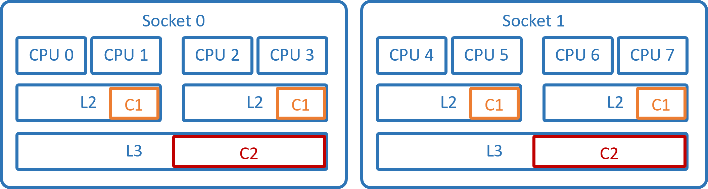

[共享缓存的同组例题](./microarch-06a-shared-cache.md#llc-set)里，A 原本能反复使用自己的三个块。B 加入后，它们却在同一组里轮流被换出。如果让 B 只能在第四路填入新块，A 还能留下几块？将 A 从全路组移到三路组之后，已经在第四路里的旧块又会怎样？两道题都用到 Intel CAT（Cache Allocation Technology，缓存分配技术），答案取决于掩码在哪个环节被查阅。

[[toc]]

## 任务所在组怎样影响一次缓存填充 {#cat-path}

一条加载到达末级缓存（LLC）时，[地址的组索引和标记](./microarch-01b-cache-mapping.md#cache-address)决定查找哪个组、是否已有所需块。若需要填入新块，还要从本组选一个位置。CAT 为这个选择加上限制。缓存可从请求所属的服务等级查到掩码，在掩码允许的位置中选空路或替换候选。

<div role="region" aria-label="CAT 涉及的寄存器和缓存结构" style="max-width:100%; overflow-x:auto">

| 结构 | 保存什么 | 什么时候使用 |
| --- | --- | --- |
| 服务等级（CLOS） | 任务请求所属的分配类别，用 CLOSID 编号 | 确定该按哪一份资源配置进行分配 |
| `IA32_PQR_ASSOC` | 当前逻辑 CPU 的 CLOSID 和资源监测编号 RMID | 在 Linux x86 的任务调度路径上按需更新 |
| L3 容量掩码（CBM） | 当前 L3 分配域中每个 CLOS 对应的可分配位置 | 请求需要新分配时，用 CLOSID 取得相应掩码 |
| 缓存组 | 各路的标记、有效状态、数据与替换状态 | 查找已有块。需要填充时，再在掩码允许的路中作选择 |

</div>

在支持 L3 CAT 的 Intel 处理器上，L3 掩码由 `IA32_L3_MASK_n` 这一组寄存器配置，下标 `n` 对应 CLOSID。Linux `resctrl` 把配置写成每个控制组的 `schemata`。因此要知道一次填充可以去哪里，需要同时知道请求的 CLOS 和请求所用的 L3 分配域。即使线程留在原来的控制组，迁移到另一个 L3 域也可能换用该组的另一份掩码。

### 掩码里的路怎样分布在各个组中 {#cat-sets}

先用一个简化的低位索引缓存说明掩码作用的位置。设某个缓存域内有 64 组，每组 4 路，每行 64 字节。容量掩码为 `0101` 时，第 0 位和第 2 位为 1。模型规定需要新填入的块，可以在其地址选中的组里使用路 0 或路 2。

| 物理地址 | 块号 | 块号对 64 取余 | 可以填入的位置 |
| --- | ---: | ---: | --- |
| `0x1000` | `0x40` | 0 | 第 0 组的路 0、2 |
| `0x1040` | `0x41` | 1 | 第 1 组的路 0、2 |
| `0x2000` | `0x80` | 0 | 第 0 组的路 0、2 |

第一、三笔地址映到同一组，会在这两路中竞争。中间地址映到另一组，可以同时占用第 1 组的一路。该掩码在每个组提供相同的路编号集合，并不挑出一段连续的物理地址。全域共有 `64 × 2 × 64 = 8192` 字节的可分配行位置。这个数字用于理解题设中的空间分布，具体 Intel 缓存的容量位映射、可用掩码和硬件组织应按对应处理器的报告核对。

::: details 练习｜同组放入三块

保持 `0101` 和精确 LRU，缓存从空开始。依次读 `0x1000`、`0x2000`、`0x3000`，每笔填充结束后再读下一笔。最后重新读 `0x1000`，会命中吗？

三个块的块号分别为 `0x40`、`0x80`、`0xc0`，都映到第 0 组。可用的两路先被前两块占满，第三块填入时换掉最久未使用的 `0x1000`。再次读取它会未命中。其他 63 组虽有可分配位置，不能接纳这三个块。
:::

把两个控制组的容量预算加在一起时，还要先检查掩码是否重叠。仍用 64 组、四路和 64 字节行，设 A 的掩码为 `0011`，B 的掩码为 `0110`。A 可使用路 0、1，B 可使用路 1、2。两者各有 8192 字节的可分配位置，但共同覆盖的只有路 0、1、2，合计 `64 × 3 × 64 = 12288` 字节。路 1 是重叠区域，不能把两个 8192 字节直接相加，当成互不竞争的容量。

举一个组内例子。A 的两个块 A0、A1 已分别在路 0、1。假设 B 的两次未命中依次把 B0 放入空的路 2，再从允许的路 1、2 中按 LRU 换入 B1。如果此时 A1 比 B0 久未使用，B1 会替换 A1；路 0 虽有 A0，也不在 B 的候选范围内。实际替换算法由处理器实现决定，这里用固定状态和 LRU 展示掩码重叠如何影响候选集合。

## 在同一组里复算独占与重叠 {#cat-ways}

沿用共享缓存一节的题设。A0、A1、A2、B0、B1、B2 是六个不同的物理块，恰好进入同一个四路组。进入本节时，A 已经按 A0、A1、A2 读过一轮，分别放在路 0、1、2，路 3 为空。本节都用精确 LRU。要填充时先从允许的路中找空位，允许的位置均已占满才替换其中最久未使用的一路。真实处理器的替换算法和填充条件需由其实现决定。

给 A 掩码 `0111`、B 掩码 `1000`。最右边是第 0 位，B 唯一能用的是路 3。B0 填入该路，B1 替掉 B0，B2 又替掉 B1。A 的三个旧块都保留，下一轮全命中。作为基线，如果双方都是 `1111`，B 可使用整个组，按上一节的顺序，A 下一轮三次都未命中。

只改一个条件，把 B 的掩码从 `1000` 改成 `1100`。此时 A 与 B 都能在路 2 填充，因为 `0111 & 1100 = 0100`。

<div role="region" aria-label="掩码重叠时四路的内容" style="max-width:100%; overflow-x:auto">

| LLC 请求 | 命中或替换 | 路 0、1、2、3 的内容 |
| --- | --- | --- |
| 初态 | A 已先读一轮 | A0、A1、A2、空 |
| B0 | 未命中，填入空路 3 | A0、A1、A2、B0 |
| B1 | 未命中，路 2 的 A2 比 B0 更早使用 | A0、A1、B1、B0 |
| B2 | 未命中，路 3 的 B0 比 B1 更早使用 | A0、A1、B1、B2 |
| A0、A1 | 两次命中，更新路 0、1 的使用时间 | A0、A1、B1、B2 |
| A2 | 未命中，在路 0、1、2 中替换 B1 | A0、A1、A2、B2 |

</div>

A 只丢了 A2，B 也丢了原本驻留于重叠路的 B1。控制组在这一位上共用的是填充位置。加大 B 的可分配范围可以减轻 B 的自身替换，却可能重新引入这一路上的相互替换。

### 换了掩码，旧块为什么还能命中 {#cat-resident}

另设初态。A 原来可用四路，A0 已在路 3。现在将 A 移到掩码为 `0111` 的组，B 仍只允许在路 3 填充。按 Linux `resctrl` 文档，换组改变后续分配，已有行无需立即驱逐。

1. A 首先读 A0。若旧块仍有效，这次在路 3 命中，不需要分配。
2. B 读一个尚未驻留的 B0。它只能填路 3，于是替换 A0。
3. A 再读 A0。现在查找未命中，必须重新填充，位置只从路 0、1、2 选择。

第 1 步与第 3 步使用的是同一份新掩码。结果不同，原因在于第 1 步已有有效块，而第 3 步需要为新块找位置。相同道理也适用于进程间共用的物理页。只要访问权限允许，另一个组的任务可以命中已存在的同一物理块。CAT 控制分配位置，读写权限仍由[地址翻译所用的权限检查](./microarch-02a-translation.md#sv39-permissions)等机制决定。

::: details 练习：A 独占三路以后，工作集也变大了

B 完全停下。A 沿用 `0111`，在同一个组循环读 A0、A1、A2、A3。第一轮结束后，下一轮能命中几次？

零次。A3 填充时挤掉最早的 A0。下一轮读 A0 时，它又会替换 A1，后续依次发生同样的替换。路 3 即使空着，也不在 A 的可选范围内。若 A 改回四路，四个块可以在第一轮后同时留下。
:::

## 从 Linux 的配置查到这次生效的掩码 {#cat-resctrl}

图 1 来自 Intel 的 ExCat 项目文档。每个外框是一个处理器插槽。图中 CPU 0、CPU 2 分属两个 L2，却共用下面的 L3。CPU 4 在另一个插槽，有另一份 L3 分配设置。原图的 C1、C2 是项目示例的两类设置，分别示意 L2、L3 划出的区域。图后例题中的 A、B 沿用本文的四路题设。

<figure class="lesson-figure">
<a href="/microarch/resctrl-cache-domains.png" aria-label="放大查看 Intel 缓存域原图"></a>
<figcaption>图 1　Intel ExCat 文档中的缓存域。先沿 CPU 0、CPU 2 向下找到同一份 L3，再与 CPU 4 所在的另一份 L3 对照。点击查看原图。</figcaption>
</figure>

假设有两个四路 L3 分配域，编号为 0 和 1，都允许单独分配一路。CPU 0、CPU 2 在域 0，CPU 4 在域 1。下面是题设机器上读到的三份 `schemata` 的内容，分号隔开同一资源的两个分配域。

```text
根组    L3:0=f;1=f
A 组    L3:0=7;1=f
B 组    L3:0=8;1=f
```

再假设线程 4101 在 A 组的 `tasks` 中，CPU 0 在 B 组的 `cpus_list` 中，CPU 2 未分配给其他组。Linux v6.12 对控制组的选择顺序是非根任务组、CPU 所属组、根组。把这个顺序和分配域一起应用，就能算出一笔填充使用哪份配置。

<div role="region" aria-label="任务与 CPU 的控制组选择" style="max-width:100%; overflow-x:auto">

| 运行情况 | 控制组 | 结果 |
| --- | --- | --- |
| 线程 4101 在 CPU 0 运行 | A，线程所属组优先 | 域 0 用 `7`，可在路 0、1、2 分配 |
| 根组线程在 CPU 0 运行 | B，采用 CPU 所属组 | 域 0 用 `8`，可在路 3 分配 |
| 根组线程在 CPU 2 运行 | 根组 | 域 0 用 `f`，可在任一路分配 |
| 线程 4101 迁移到 CPU 4 | 仍是 A | 域 1 用 `f`，可在任一路分配 |

</div>

### 从调度记录算到寄存器和掩码 {#cat-pqr}

给上表补上题设编号。根组的 CLOSID、RMID 都是 0，B 的编号为 CLOSID 1、RMID 9，A 的编号为 CLOSID 2、RMID 17。假定分配和监测均已启用，这些编号也在硬件允许的范围内。

在 Linux v6.12 的 `__resctrl_sched_in` 中，内核先取本逻辑 CPU 的 `default_closid` 和 `default_rmid`，再分别用任务的非零编号覆盖。计算出的编号与该 CPU 已记录的 `cur_closid`、`cur_rmid` 有任一个不同，才需更新 `IA32_PQR_ASSOC`。源码的 `wrmsr` 调用把 RMID 放在低 32 位的参数中，把 CLOSID 放在高 32 位的参数中。

<div role="region" aria-label="调度得到的关联寄存器和掩码" style="max-width:100%; overflow-x:auto">

| 本次运行 | CLOSID／RMID | `IA32_PQR_ASSOC` 的示意值 | LLC 填充掩码 |
| --- | --- | --- | --- |
| 根组线程在 CPU 0 | 1／9 | `00000001_00000009` | 域 0 的 B 掩码 `8` |
| 线程 4101 在 CPU 0 | 2／17 | `00000002_00000011` | 域 0 的 A 掩码 `7` |
| 同一线程迁到 CPU 4 | 2／17 | `00000002_00000011` | 域 1 的 A 掩码 `f` |
| 线程回到 CPU 0，并加入 A 下的监控组 | 2／23 | `00000002_00000017` | 域 0 的 A 掩码仍为 `7` |

</div>

表中的寄存器值用十六进制表示，下划线隔开高低两段。线程在 CPU 0 和 CPU 4 上运行时都用 CLOSID 2。两个逻辑 CPU 却使用不同的 L3 域，因此同一个下标从两份域配置中取到不同的掩码。监控组那一行只改变 RMID，下一次缺失时仍用原有的 A 掩码。是否真的发生寄存器写入，要再比较**目标逻辑 CPU**此前保存的那对编号。

所以这三份配置只能说明 A 和 B 在域 0 的新分配互不重叠。根组仍可填满四路，域 1 的 A 与 B 也仍有交集。读已有配置时，先确定任务在哪个 CPU 和缓存域上，再查看控制组与掩码，最后核对其他使用者。现场能读取的主要文件如下。

<div role="region" aria-label="可读取的 resctrl 文件" style="max-width:100%; overflow-x:auto">

| 文件 | 解读时要看什么 |
| --- | --- |
| `info/L3/cbm_mask`、`min_cbm_bits` | 全部可用位及最小置位约束，决定题中的单路掩码是否合法 |
| `tasks`、`cpus_list` | 组包含哪些任务或逻辑 CPU，和运行位置结合才能选出有效组 |
| `schemata` | 各缓存分配域的掩码。`L3:0=7` 中的 `0` 是域编号 |
| `info/L3/bit_usage`、`shareable_bits` | 检查其他使用组和可与设备共享的位 |
| `mon_data/mon_L3_00/llc_occupancy` | 适用配置下，该监控组在域 0 的当前占用快照 |

</div>

掩码连续性的限制随硬件而异。配置独占组时，`resctrl` 还会检查其他控制组的掩码。上面的根组覆盖域 0 的全部位置，即使 A 与 B 互不重叠，也不能直接把 A 标为独占组。需要确认各组和相关硬件使用者的配置，才能把两组例题推广到实际部署。

### 核对 A 能否独占，要逐域算交集 {#cat-exclusive}

仍用上面的四路机器。假设只启用 L3 CAT，不启用代码与数据分区，也没有其他控制组、设备共享位或伪锁定区域。先找出 A 允许分配的位置中，有哪些也允许根组或 B 分配。可以先把另外两组的掩码按位或，再与 A 的掩码按位与。结果中每个为 1 的位都是一处重叠。

| 配置 | 域 0 的 A／根组／B | 域 0 中 A 的重叠位 | 域 1 的 A／根组／B | 域 1 中 A 的重叠位 |
| --- | --- | --- | --- | --- |
| 原配置 | `7 / f / 8` | `7` | `f / f / f` | `f` |
| 只改域 0 的根组 | `7 / 8 / 8` | `0` | `f / f / f` | `f` |
| 两个域都作同样的划分 | `7 / 8 / 8` | `0` | `7 / 8 / 8` | `0` |

第二行里，`7 & (8 | 8) = 0`。A 在域 0 的路 0、1、2 已经避开另外两组，但域 1 的交集还是 `f`。Linux v6.12 在切到 `exclusive` 模式时逐个检查相应缓存资源的控制域，即使 A 眼下只在域 0 运行，域 1 的重叠也会使检查失败。第三行满足题设的 A 独占条件。根组和 B 仍共用路 3，所以只能从这张表得出 A 的独占结论。

::: details 练习｜根组、A、B 都要有自己的路

若每个域都要求三组掩码两两不重叠，A 还能保留三路吗？每组必须至少有一路。

四路中先给根组和 B 各留一路，A 最多保留两路。一组可行的配置是 A 用 `3`，根组用 `4`，B 用 `8`。再回到三个块依次读入同一组的例子，A 只有两路，下一轮按原顺序读三个块时全部未命中。分区消除了这三组之间对填充位置的争用，同时改变了 A 自己的替换结果。
:::

### 任务换组后，旧组的占用为什么还在 {#cat-rmid-occupancy}

CLOS 选择分配配置，RMID（Resource Monitoring ID，资源监测编号）用于汇总监测事件。把线程从一组迁到另一组以前，旧组可能已经积累了缓存占用。迁组后立刻查看两个组，旧组的占用可以暂时保留，新组则要等新的缓存行被计入。命中原先缓存的行并不会把旧占用自动转记到新监控组。对照[前面的旧行命中](#cat-resident)，第 1 步可以读到 A0，第 3 步才有一次使用新掩码的分配。

沿用前面路 3 上的 A0。令任务 A 原来属于监测组「甲」，改组以后属于「乙」，任务 B 则属于「丙」。三个组使用不同的 RMID。只跟踪这个四路组里的两个块，设每行 64 字节，其余路为空，所有访问都到达 LLC。表中数的是模型里的归属，实际 `llc_occupancy` 是整个监测域的快照。

| 操作 | 路 3 | 路 0 至 2 | 甲的占用 | 乙的占用 | 丙的占用 |
| --- | --- | --- | ---: | ---: | ---: |
| A 仍在甲组，已填入 A0 | A0，归甲 | 空 | 64 B | 0 B | 0 B |
| A 移到乙组，随即再次命中 A0 | A0，仍归甲 | 空 | 64 B | 0 B | 0 B |
| B 填入 B0，替换 A0 | B0，归丙 | 空 | 0 B | 0 B | 64 B |
| A 再访问 A0，在新掩码允许的位置填入 | B0，归丙 | A0，归乙 | 0 B | 64 B | 64 B |

第二行已经有一次乙组任务发出的成功读取，但乙的占用仍为 0。第四行看起来像 64 字节从甲转给了乙，实际发生的是旧块被移出，随后又分配了一份新块。若 B 在第三行根本没有访问，A 便可以继续命中甲组留下的 A0。分析换组后的计数时，先确定捕获到的是哪个缓存域、哪些 RMID，再查这段时间是否真的发生了替换与填充。

占用快照可以说明某一监控组在某一缓存域还保有多少数据。若要评价分区是否减少了相互替换，还需用固定工作量比较 LLC 请求和未命中，写明运行在哪个域、哪些组同时活动、何时开始计数。若两组已减少 LLC 替换，却仍共用 DRAM 控制器，未命中返回可能继续排队。[DRAM 行调度的例题](./microarch-06b-memory-queue.md#memory-row)给出了两次未命中数量相同而完成时刻不同的情形。

### 把两个域的流量读数换成带宽 {#cat-mbm}

若处理器提供内存带宽监测（Memory Bandwidth Monitoring，MBM），Linux `resctrl` 可以按监测组和 L3 域给出累计字节数。先在 `info/L3_MON/mon_features` 确认事件存在，再读组目录下 `mon_data/mon_L3_XX/mbm_total_bytes`。普通监测组给出本组读数，控制组的读数已经包含下面的监测组。若把父组和子组相加，会重复计算子组的流量。

沿用 A 从 CPU 0 迁往 CPU 4 的例子。CPU 0 在域 0，CPU 4 在域 1。题设中 A 只有这一个线程，同一个监测组始终记录它，两个域使用相同的事件配置。以两端各自的时间戳核对读取窗口，假设读取开销可忽略，两域观测到的都是同一段 200 ms。线程在中间迁移。下表以 MiB 展示累计字节数，实际文件用字节计数。

<div role="region" tabindex="0" aria-label="跨两个 L3 域计算内存带宽" style="max-width:100%; overflow-x:auto">

| 监测域 | 起始读数 | 结束读数 | 窗口内增量 | 按整个窗口算出的平均速率 |
| --- | ---: | ---: | ---: | ---: |
| 域 0 | 800 MiB | 880 MiB | 80 MiB | 400 MiB/s |
| 域 1 | 120 MiB | 160 MiB | 40 MiB | 200 MiB/s |

</div>

计算 A 在这段时间的总流量时，先做两次同域相减，再把两个增量加起来。A 共传输 120 MiB，除以 0.2 秒得到 600 MiB/s。结束时 A 已在域 1，但端点位置只说明线程当时在哪里。只读域 1 会漏掉迁移前的 80 MiB。表中的 400 和 200 MiB/s 都以完整窗口为分母。若想知道线程实际在每个域运行期间的速率，还需要记录它在该域运行了多久。

评估 CAT 时，可把这份带宽数据与同窗口的 LLC 未命中和完成时间一起读。LLC 掩码描述可填充的位置，MBM 描述该事件覆盖的流量，单次请求的排队时延还要从访存时序或其他测量取得。支持带宽事件配置（BMEC）的系统还要核对 `mbm_total_bytes_config` 等配置是否一致。Linux 文档说明，修改某域的设置会清空该域的相关计数器，下一次读取会报告 `Unavailable`。此时应等读数恢复，再取一个新的起点。

::: details 练习｜只读线程结束时所在的域

若用域 1 的 200 MiB/s 作为 A 的总速率，少算了多少？如果域 1 的 40 MiB 都记在 A 于该域运行的 50 ms 内，怎样计算这 50 ms 的平均速率？

按整个窗口少算了 400 MiB/s，也就是漏掉域 0 的 80 MiB。域 1 在 50 ms 内记录 40 MiB，按这段运行时间计算是 800 MiB/s。两个速率的分母分别是完整窗口和域内运行时间。
:::

## 用 C 连起生效配置与填充位置 {#cat-model}

程序复算两层决定。`route` 先由任务编号、CPU 默认编号和分配域得到掩码。`access` 再用掩码限制未命中可选的路。为突出这两层，模型只保存一个四路 LLC 组。块名代表已知进入该组的不同物理块。命中搜索查看所有有效路，替换用题设的精确 LRU。程序只计算寄存器字段和缓存状态，省略具体处理器的时序与跨域数据传输。

保存为 `cat_ways.c`，用 `gcc -std=c11 -O2 -Wall -Wextra cat_ways.c -o cat_ways` 编译，再运行 `./cat_ways`。Windows 上可运行 `./cat_ways.exe`。

~~~c
#include <inttypes.h>
#include <stdbool.h>
#include <stdint.h>
#include <stdio.h>
#include <stdlib.h>
#include <string.h>

enum { WAYS = 4, ROOT = 0, B = 1, A = 2 };

typedef struct { unsigned closid, rmid; } Assoc;
typedef struct { unsigned id, domain; Assoc defaults; } Cpu;
typedef struct { const char *name; unsigned last_use; } Line;

static const unsigned mask[3][2] = {
    [ROOT] = {0xf, 0xf},
    [B] = {0x8, 0xf},
    [A] = {0x7, 0xf}
};

static unsigned route(const char *name, Assoc task, Cpu cpu)
{
    unsigned closid = task.closid ? task.closid : cpu.defaults.closid;
    unsigned rmid = task.rmid ? task.rmid : cpu.defaults.rmid;
    uint64_t pqr = ((uint64_t)closid << 32) | rmid;
    unsigned cbm = mask[closid][cpu.domain];
    printf("%s CPU%u domain=%u pqr=%016" PRIx64 " mask=%x\n",
           name, cpu.id, cpu.domain, pqr, cbm);
    return cbm;
}

static bool access(Line group[WAYS], const char *name, unsigned cbm,
                   unsigned time, bool trace)
{
    for (unsigned way = 0; way < WAYS; ++way) {
        if (group[way].name && strcmp(group[way].name, name) == 0) {
            group[way].last_use = time;
            if (trace)
                printf("%s hit way=%u\n", name, way);
            return true;
        }
    }

    int chosen = -1;
    for (int way = 0; way < WAYS; ++way) {
        if ((cbm & (1u << way)) == 0)
            continue;
        if (!group[way].name) {
            chosen = way;
            break;
        }
        if (chosen < 0 || group[way].last_use < group[chosen].last_use)
            chosen = way;
    }
    if (chosen < 0)
        exit(EXIT_FAILURE);

    const char *old = group[chosen].name;
    if (trace)
        printf("%s miss way=%d evicts=%s\n", name, chosen, old ? old : "-");
    group[chosen] = (Line){name, time};
    return false;
}

static void compare(unsigned a_mask, unsigned b_mask)
{
    Line group[WAYS] = {{"A0", 1}, {"A1", 2}, {"A2", 3}, {0}};
    const char *a[] = {"A0", "A1", "A2"};
    const char *b[] = {"B0", "B1", "B2"};
    for (unsigned i = 0; i < 3; ++i)
        access(group, b[i], b_mask, 4 + i, false);
    unsigned hits = 0;
    for (unsigned i = 0; i < 3; ++i)
        hits += access(group, a[i], a_mask, 7 + i, false);
    printf("A=%x B=%x: A hits %u/3\n", a_mask, b_mask, hits);
}

static void bigger_set(unsigned cbm)
{
    Line group[WAYS] = {0};
    const char *blocks[] = {"A0", "A1", "A2", "A3"};
    unsigned hits = 0;
    for (unsigned i = 0; i < 8; ++i) {
        bool hit = access(group, blocks[i % 4], cbm, i + 1, false);
        if (i >= 4)
            hits += hit;
    }
    printf("four blocks, mask=%x: second lap %u/4\n", cbm, hits);
}

int main(void)
{
    const Cpu cpu0 = {0, 0, {B, 9}}, cpu4 = {4, 1, {ROOT, 0}};
    const Assoc task_a = {A, 17};
    unsigned b_mask = route("root", (Assoc){ROOT, 0}, cpu0);
    unsigned a_mask = route("A", task_a, cpu0);
    unsigned full_domain = route("A", task_a, cpu4);
    route("A monitored", (Assoc){A, 23}, cpu0);

    compare(full_domain, full_domain);
    compare(a_mask, b_mask);
    compare(a_mask, 0xc);

    Line moved[WAYS] = {[3] = {"A0", 1}};
    puts("after moving to mask 7");
    access(moved, "A0", a_mask, 2, true);
    access(moved, "B0", b_mask, 3, true);
    access(moved, "A0", a_mask, 4, true);

    bigger_set(a_mask);
    bigger_set(full_domain);
}
~~~

~~~text
root CPU0 domain=0 pqr=0000000100000009 mask=8
A CPU0 domain=0 pqr=0000000200000011 mask=7
A CPU4 domain=1 pqr=0000000200000011 mask=f
A monitored CPU0 domain=0 pqr=0000000200000017 mask=7
A=f B=f: A hits 0/3
A=7 B=8: A hits 3/3
A=7 B=c: A hits 2/3
after moving to mask 7
A0 hit way=3
B0 miss way=3 evicts=A0
A0 miss way=0 evicts=-
four blocks, mask=7: second lap 0/4
four blocks, mask=f: second lap 4/4
~~~

前三组命中计数都从同一个预热状态重新开始。换组试验另设 A0 已在路 3，第一次读 A0 正好证明命中查询仍能使用它。等 B0 换出它，第二次读 A0 才需要在 A 的新掩码许可范围内选路。最后两行复算篇中的四块练习，展示减少可用路也会影响任务自己的工作集。

## 参考文献

- [Intel CAT 的服务等级与缓存空间分配](https://www.intel.com/content/www/us/en/developer/articles/technical/introduction-to-cache-allocation-technology.html)
- [Intel RDT 架构规范，CLOS、RMID 和容量掩码](https://cdrdv2-public.intel.com/851356/356688-004-intel-rdt-architecture-spec.pdf)
- [Linux v6.12 resctrl 文档，分配规则、组切换和缓存占用](https://docs.kernel.org/6.12/arch/x86/resctrl.html#resource-allocation-rules)
- [Linux v6.12 resctrl 文档，MBM 事件与带宽计数配置](https://docs.kernel.org/6.12/arch/x86/resctrl.html#filesystem-interface)
- [Linux v6.12 x86 调度时更新 IA32_PQR_ASSOC 的源码](https://github.com/torvalds/linux/blob/v6.12/arch/x86/include/asm/resctrl.h#L95)
- [Linux v6.12 resctrl 独占模式的逐域检查](https://github.com/torvalds/linux/blob/v6.12/arch/x86/kernel/cpu/resctrl/rdtgroup.c#L1241-L1284)
- [Intel ExCat 缓存域原图](https://github.com/intel/Intel-ECI-ExCat-K8s/blob/fbd4a7a8d5d224dc5eff47cb0e8188c806671625/assets/resctrl_cacheID_config.png) · [Apache 2.0 许可](/microarch/intel-excat-license.txt) · 本文以灰度显示原图。

<nav class="article-nav" aria-label="系列文章导航">

[<span class="article-nav-text"><small>上一篇</small><strong>未命中次数相同，为什么内存等待更长</strong></span>](./microarch-06b-memory-queue.md){.article-nav-card .article-nav-prev rel=prev}

[<span class="article-nav-text"><small>下一篇</small><strong>同核多线程怎样安排任务</strong></span>](./microarch-06d-core-scheduling.md){.article-nav-card .article-nav-next rel=next}

</nav>
