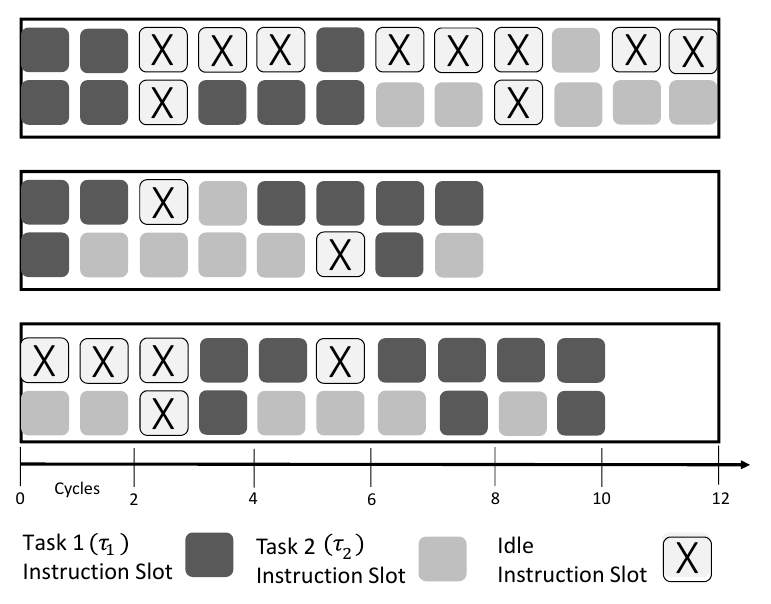

一个物理核心有两个逻辑 CPU。某一侧明明有可运行的任务，Linux 却让它空闲。这可能是核心调度作出的决定。要理解这个决定，先看两个逻辑 CPU 在硬件里共用什么，再沿内核的两个运行队列算一次任务选择。

[[toc]]

## 两个逻辑 CPU 共用哪些资源 {#smt-resources}

**同时多线程**（Simultaneous Multithreading，SMT）让一个物理核心容纳多个硬件线程。在支持 Intel Hyper-Threading 的核心上，操作系统可以把两个硬件线程视为两个逻辑 CPU。各自有独立的架构寄存器和控制状态，因此可以执行两条独立指令流。它们还会使用同一核心内的部分资源，例如执行单元、缓存和互连。具体哪些队列共享、分区或按线程分开，要看处理器实现。

<div role="region" aria-label="两个同核线程的硬件与软件状态" style="max-width:100%; overflow-x:auto">

| 要读的状态 | 在同核两个线程中怎样组织 |
| --- | --- |
| 架构状态 | 寄存器等状态分别对应各自的逻辑 CPU |
| 执行资源 | 指令来自不同硬件线程，可以竞争同一核心里的可用执行槽 |
| 缓存与传输 | 有些级别及通路是共用的，具体共享范围要由拓扑和型号确定 |
| 软件运行队列 | Linux 分别为逻辑 CPU 管理待运行任务。核心调度可以联合查看同一核心的队列 |

</div>

下面的原图把共享的执行槽画得很清楚。每列是一拍，每列两个方格代表同一核心在该拍可用的两个槽。深灰与浅灰方格分别由两个任务使用，× 表示没用上的槽。中间一幅启用了 SMT，某些列同时出现深、浅两种颜色。这说明两条指令流在同一拍使用了共用资源。图的下半部分还给出任务开始时间改变后的分配。

<figure class="lesson-figure" style="max-width: 520px">
<a href="/microarch/smt-issue-slots.png" aria-label="放大查看 SMT 执行槽原图"></a>
<figcaption>图 1　两个任务的执行槽使用示意。上方是顺序执行，中间是同时运行，下方改变了同时运行的开始时刻。</figcaption>
</figure>

当一个线程暂时没有足够的就绪指令，另一个线程可能利用剩余资源。反过来，两者若同时需要同一资源，也可能互相拖慢。要判断是否存在这种直接的同核争用，先确认拓扑。Linux 的 `core_cpus_list` 文件列出与指定 CPU 同属一个物理核心的逻辑 CPU。例如下列只读命令在本节题设机器上返回 `0,4`。

```bash
cat /sys/devices/system/cpu/cpu0/topology/core_cpus_list
```

这个例子里，CPU 0 与 CPU 4 是同核线程。另外两个逻辑 CPU 即使[共用同一个末级缓存](./microarch-06a-shared-cache.md#llc-domain)，也可能属于不同核心。判断缓存共享要查缓存域，判断同核执行要查核心拓扑。

## 内核用什么表示哪些任务可以同核 {#core-cookie}

Linux 的**核心调度**（core scheduling）在选任务时考虑 SMT 同核关系。`CONFIG_SCHED_CORE` 提供这项功能。启用并按信任关系编组后，调度器将同一 cookie 的任务视为可以一起使用一个核心。这里的 cookie 是内核用于比较的任务标签。

<div role="region" aria-label="核心调度的任务和队列字段" style="max-width:100%; overflow-x:auto">

| 调度状态 | 保存和使用的内容 |
| --- | --- |
| 任务的 `core_cookie` | 任务所在组的标签。相同值表示可以配对 |
| 每个逻辑 CPU 的运行队列 | 能在该逻辑 CPU 上候选的任务。联合选择需要查找非零 cookie 时使用本队列的索引 |
| 核心级的 `core_cookie` | 本轮由全核心最优先候选任务选定的标签 |
| 每个逻辑 CPU 的 `core_pick` | 本轮为该逻辑 CPU 选定的任务，可以是空闲任务 |
| `core_forceidle_count` | 本轮有就绪任务、但仍选中空闲任务的逻辑 CPU 数量 |
| `core_forceidle_occupation` | 启用调度统计且发生强制空闲时，保存本轮选中普通任务的逻辑 CPU 数量 |

</div>

系统启动时，任务默认 cookie 为 0。默认组中的任务彼此可配对。用户空间可以通过 `PR_SCHED_CORE` 接口查询、创建或按权限共享标签。新建的标签与默认组不同。拥有新标签的任务同核运行时仍要检查另一侧的标签。空闲任务在配对时作特殊处理，允许和任何组搭配。普通任务的 cookie 0 与这个特殊空闲规则含义不同。

## 算一次跨两个运行队列的选择 {#core-pick}

看 CPU 0 和 CPU 4 的题设。A0、A1 属于同一组，cookie 为 α。B0、B1 属于另一组，cookie 为 β。以下排名是题设已经给出的调度顺序，数字越大越优先。Linux 实际还会考虑调度类及其状态，这里直接从给定候选开始。

<div role="region" aria-label="题设任务的 cookie 和排名" style="max-width:100%; overflow-x:auto">

| 任务 | cookie | 调度排名 |
| --- | --- | ---: |
| A0 | α | 90 |
| A1 | α | 60 |
| B0 | β | 80 |
| B1 | β | 50 |

</div>

在 Linux v6.12 的核心联合选择路径中，先分别从两个运行队列选出本地优先任务，再从它们中确定全核心最优先的候选。它的 cookie 成为本轮约束。各逻辑 CPU 的本地首选若与本轮 cookie 匹配，就直接采用。本例的 cookie 都非零，遇到不匹配的首选时，内核可在本地运行队列的 core_tree 中按 cookie 再找一次。同一 cookie 下再按优先顺序选择。如果队列非空却找不到可配对的任务，最终选择空闲，这就叫**强制空闲**。

<div role="region" aria-label="两个逻辑 CPU 的调度区间" style="max-width:100%; overflow-x:auto">

| 时间区间 | CPU 0 就绪 | CPU 4 就绪 | 实际配对 | 哪一侧空闲 |
| --- | --- | --- | --- | --- |
| 0–2 ms | A0 | B0、A1 | A0 与 A1 | 无 |
| 2–5 ms | A0 | B0 | A0 与空闲 | CPU 4 强制空闲 |
| 5–7 ms | B1 | B0 | B1 与 B0 | 无 |
| 7–8 ms | 无 | B0 | 空闲与 B0 | CPU 0 自然空闲 |

</div>

第一段，两个本地首选是 A0 和 B0。全核心最优先的是 A0，所以 CPU 4 放下本地首选 B0，改用较低排名的 A1。第二段 A1 已经阻塞，CPU 4 明明还有 B0 可运行，却缺少能和 A0 搭配的任务。第三段换成 B0 决定本轮的 cookie，B1 正好能配对。最后一段 CPU 0 的队列已经空了，即使去掉配对约束，它也仍然会空闲。

在这 8 毫秒里，两个逻辑 CPU 合计提供 16 个逻辑 CPU·毫秒。其中 3 个属于强制空闲，1 个属于自然空闲，剩余 12 个在运行题设任务。这个加法统计的是调度时间。具体能执行多少指令，还取决于核心内的资源分配和两项工作的相互影响。

::: details 练习｜A1 在第一段开始前就已阻塞

将第一段 CPU 4 的队列改为只有 B0，其他区间全部保持原样。前 2 毫秒谁会运行？四段合起来的强制空闲时间是多少？

A0 的排名仍高于 B0，第一段继续由 α 决定配对。CPU 4 找不到同组任务，新增 2 个逻辑 CPU·毫秒的强制空闲。之后三段不变，合计由 3 增到 5。B0 的排名和可运行状态都没有变，变化的是可用的同组搭档。

:::

### 另一侧怎样接着使用这次选择 {#core-pick-handoff}

以第一段为例，设 CPU 0 先进入调度器。它选到 A0 后，也为 CPU 4 留下一个 `core_pick`，指向 A1。如果 CPU 4 目前还在运行别的任务，`resched_curr` 会请求它重新调度，必要时发核间中断。若 CPU 4 已在运行选中的任务，就可以清掉预选记录，继续运行。

CPU 4 进入调度器时，可以直接采用先前的 A1，但要核对三项记录。`core_task_seq` 是核心共享的编号，题目涉及的任务入队、出队等事件会推进编号，重新联合选取时也会推进。`core_pick_seq` 保存这轮联合选择用的编号。`core_sched_seq` 属于各自的运行队列，记录这一侧已经采用的编号。两份核心编号相等，当前侧没有采用过本轮结果，而且 `core_pick` 仍存在，才能复用。

设 CPU 0 选择后，`core_task_seq` 和 `core_pick_seq` 都是 41，而 CPU 4 的 `core_sched_seq` 还是 40。若 A1 仍可运行，CPU 4 可以用这份选择，把自己的编号更新为 41。若 A1 在它采用之前已从运行队列移除，`core_task_seq` 会推进到 42，旧的 `core_pick_seq` 还是 41。CPU 4 将跳过复用路径。按第二段题设的队列重新选，A0 仍决定 cookie，CPU 4 需要空闲。编号只用于判断保存的指针能否重用。下一轮到底选谁，仍从新的运行队列推导。

### 用 C 复算配对和强制空闲 {#core-model}

每个区间输入两份就绪队列，排名沿用上表。程序先挑出决定全核心 cookie 的任务，再从两侧各取排名最高的相容任务。空队列记自然空闲，非空队列若仍选中空闲则记强制空闲。最后用一组编号检查保存的 A1 能否复用。模型按固定区间记账，并省略 Linux 的调度类、负载均衡和实际切换耗时。

将代码保存为 `core_pick.c`，用 `gcc -std=c11 -O2 -Wall -Wextra core_pick.c -o core_pick` 编译，再运行 `./core_pick`。Windows 上可运行 `./core_pick.exe`。

~~~c
#include <stdbool.h>
#include <stdio.h>

enum { SIBLINGS = 2, ALPHA = 1, BETA = 2 };

typedef struct { const char *name; unsigned cookie, rank; } Task;
typedef struct { const Task *tasks[2]; unsigned count; } Queue;
typedef struct { unsigned begin, end; Queue queues[SIBLINGS]; } Window;

static const Task a0 = {"A0", ALPHA, 90}, a1 = {"A1", ALPHA, 60};
static const Task b0 = {"B0", BETA, 80}, b1 = {"B1", BETA, 50};

static const Task *local_best(const Queue *queue, bool match, unsigned cookie)
{
    const Task *best = NULL;
    for (unsigned i = 0; i < queue->count; ++i) {
        const Task *candidate = queue->tasks[i];
        if (match && candidate->cookie != cookie)
            continue;
        if (!best || candidate->rank > best->rank)
            best = candidate;
    }
    return best;
}

static const char *pick_name(const Task *pick, const Queue *queue)
{
    if (pick)
        return pick->name;
    return queue->count ? "forced idle" : "idle";
}

static unsigned run(bool a1_blocks_early, bool trace)
{
    Window windows[] = {
        {0, 2, {{{&a0}, 1}, {{&b0, &a1}, 2}}},
        {2, 5, {{{&a0}, 1}, {{&b0}, 1}}},
        {5, 7, {{{&b1}, 1}, {{&b0}, 1}}},
        {7, 8, {{{NULL}, 0}, {{&b0}, 1}}}
    };
    if (a1_blocks_early)
        windows[0].queues[1].count = 1;

    unsigned forced_ms = 0;
    for (unsigned i = 0; i < sizeof windows / sizeof windows[0]; ++i) {
        const Window *w = &windows[i];
        const Task *winner = NULL;
        for (unsigned cpu = 0; cpu < SIBLINGS; ++cpu) {
            const Task *p = local_best(&w->queues[cpu], false, 0);
            if (p && (!winner || p->rank > winner->rank))
                winner = p;
        }

        const Task *picks[SIBLINGS] = {0};
        if (winner) {
            for (unsigned cpu = 0; cpu < SIBLINGS; ++cpu)
                picks[cpu] = local_best(&w->queues[cpu], true, winner->cookie);
        }
        for (unsigned cpu = 0; cpu < SIBLINGS; ++cpu) {
            if (!picks[cpu] && w->queues[cpu].count)
                forced_ms += w->end - w->begin;
        }

        if (trace)
            printf("%u-%u ms: CPU0=%s, CPU4=%s\n", w->begin, w->end,
                   pick_name(picks[0], &w->queues[0]),
                   pick_name(picks[1], &w->queues[1]));
    }
    return forced_ms;
}

static bool reuse(const Task *saved, unsigned task_seq, unsigned pick_seq,
                  unsigned sched_seq)
{
    return saved && task_seq == pick_seq && pick_seq != sched_seq;
}

static unsigned charge_per_task_us(unsigned interval_us, unsigned forced,
                                   unsigned running)
{
    return interval_us * forced / running;
}

int main(void)
{
    unsigned main_case = run(false, true);
    printf("forced idle: %u logical CPU-ms\n", main_case);
    printf("reuse before dequeue: %s\n", reuse(&a1, 41, 41, 40) ? "yes" : "no");
    printf("reuse after dequeue: %s\n", reuse(&a1, 42, 41, 40) ? "yes" : "no");
    printf("A1 blocks early: %u logical CPU-ms\n", run(true, false));
    printf("SMT2, A0 force-idle charge: %u us\n",
           charge_per_task_us(3000, 1, 1));
    printf("SMT4, charge per selected task: %u us\n",
           charge_per_task_us(3000, 1, 2));
}
~~~

~~~text
0-2 ms: CPU0=A0, CPU4=A1
2-5 ms: CPU0=A0, CPU4=forced idle
5-7 ms: CPU0=B1, CPU4=B0
7-8 ms: CPU0=idle, CPU4=B0
forced idle: 3 logical CPU-ms
reuse before dequeue: yes
reuse after dequeue: no
A1 blocks early: 5 logical CPU-ms
SMT2, A0 force-idle charge: 3000 us
SMT4, charge per selected task: 1500 us
~~~

`local_best` 在每条队列里先按给定排名找本地首选，再按全核心首选任务的 cookie 做筛选。第 2 行的 CPU 4 和第 4 行的 CPU 0 都未执行普通任务，但只有 CPU 4 的队列里有未获运行资格的 B0。`A1 blocks early` 对应篇末练习，只把第一段的 A1 移出队列。

## 强制空闲时间记到哪个任务上 {#core-forceidle-accounting}

回到第 2 至第 5 毫秒。CPU 4 的 B0 有三毫秒没有获得运行资格。Linux v6.12 启用调度统计时，会把这段强制空闲归到本轮选中的普通任务 A0。调度器在联合挑选结束后记录起点、强制空闲的线程数和已选中普通任务的线程数。记账时用当前核心运行队列时钟减去上次起点，再将起点推进到当前时刻。

对每个被选中的普通任务，代码用「区间长度 × 强制空闲线程数 ÷ 选中普通任务的线程数」计算此次归账量。这个计算以纳秒进行整数除法，正文以微秒列出整除的教学数据。

| 区间内的选择 | 强制空闲线程数 | 选中普通任务的线程数 | 每个选中任务记入的时间 |
| --- | ---: | ---: | ---: |
| 主例的 3 毫秒，A0 运行，B0 所在侧强制空闲 | 1 | 1 | 3,000 μs，记到 A0 |
| 四线程核心上的 3 毫秒，两侧运行，一侧强制空闲，一侧队列为空 | 1 | 2 | 1,500 μs，记到两个选中任务中的每一个 |

第二行的空队列不增加强制空闲数。该区间全核心损失的可运行时间为 `3,000 × 1` 逻辑 CPU·微秒，由两个选中任务平分。Linux 依次检查各同核队列，优先使用仍保存在 `core_pick` 里的选择，否则取队列的当前任务，并跳过空闲任务。结果累加到所选任务的 `core_forceidle_sum`。读这个字段时，应再结合运行队列或调度轨迹回答「哪一个就绪任务没有得到运行机会」。单凭 A0 的字段，无法得知另一侧当时排队的是 B0 还是别的任务。

::: details 练习｜强制空闲一直存在，为什么还要分段记账
设一个四线程核心，调度统计已启用。前 2 ms 只有 A0 被选中运行，另外三侧都有可运行任务，但找不到与 A0 的 cookie 匹配的候选。第 2 ms 时，A1 被唤醒，在其中一侧加入 A0。接下来的 4 ms，两侧继续运行，剩下两侧仍因 cookie 不匹配而空闲。A0 和 A1 的强制空闲统计各增加多少？

第一段有三侧强制空闲，全部归到 A0，增量为 `2 × 3 ÷ 1 = 6 ms`。第二段有两侧强制空闲，A0 和 A1 各记 `4 × 2 ÷ 2 = 4 ms`。因此两项累计增量分别为 10 ms 和 4 ms。两项相加等于全核心损失的 14 个逻辑 CPU·毫秒。A0 的归账量超过观测窗口的 6 ms，因为前一段同时计入了三侧的强制空闲。

如果第二段一直空闲的两侧里有一侧队列已经变空，第二段的强制空闲数就从 2 降为 1，两项累计增量分别变为 8 ms 和 2 ms。从外面仍能看到两侧空闲，归账的差异来自运行队列里是否有任务因配对约束而被推迟。
:::

### 空出一侧后，吞吐会少一半吗 {#core-throughput}

选同一个物理核心，观察 3 ms。两个任务都持续就绪，频率固定为 2 GHz。每个任务都反复运行相同的工作，每完成一份工作需要退休 100 万条指令。先用一组教学数据对照核心调度允许配对和强制空闲时的结果。

<div role="region" tabindex="0" aria-label="同核配对与强制空闲下的吞吐计算" style="max-width:100%; overflow-x:auto">

| 区间内的状态 | 两个逻辑 CPU 的运行时间 | 退休指令数 | 全核心推进的工作量（按指令折算） |
| --- | --- | --- | ---: |
| 两任务可同核，各自 IPC 为 1.0 | 各运行 3 ms | 各退休 600 万条 | 12 份 |
| A 独跑，IPC 为 1.6，另一侧强制空闲 | A 运行 3 ms，B 无运行时间 | A 退休 960 万条，B 为 0 | 9.6 份的指令等效量 |

</div>

核心在这个窗口有 600 万周期。第一行的总退休量是 `600 万 × (1.0 + 1.0)`，第二行是 `600 万 × 1.6`。少了 3 个逻辑 CPU·毫秒，占两倍窗口长度的一半，而全核心的指令吞吐降低了 20%。与此同时，A 单独运行时可以在同样长的窗口内推进更多工作。若关注 B 的延迟，还要把它等待获得运行资格的时间算进去。实际报告应以程序完成量为准。仅以退休量近似工作量时，需要满足题设中每份工作的指令数一致等条件，9.6 份也含有尚未完成的部分。

进一步规定一个教学时序：A 从第 0 毫秒运行到第 3 毫秒后阻塞，B 从第 0 毫秒起一直可运行，且被选中后独占该核心直到完成一份工作。若 B 独跑时 IPC 也为 1.6，频率保持 2 GHz，那么退休 100 万条指令需要 `100 万 / (2 × 10^9 × 1.6) = 0.3125 ms`。忽略切换开销，B 在第 3 毫秒开始运行，第 3.3125 毫秒完成。它从就绪到完成经历 3.3125 毫秒，其中 3 毫秒是在运行队列等待，0.3125 毫秒是实际运行时间。

如果只从 B 开始运行时计时，得到的是 0.3125 毫秒，无法反映前面的等待。若 B 在这段期间本来就阻塞或尚未提交到运行队列，则这 3 毫秒不能直接记为它的就绪等待。真实系统的调度选择、优先级、迁移和上下文切换也会改变时刻，需要用任务状态与时间戳确认。

::: details 练习｜换一种资源争用更重的工作

保持独跑 IPC 为 1.6。如果两任务同核时各为 0.7 IPC，哪种安排在相同窗口里退休的指令更多？

配对时全核心共退休 `600 万 × 1.4 = 840 万` 条，独跑时为 960 万条。按全核心吞吐比较，独跑更高。与此同时，B 在该窗口没得到运行资格。若要评价整体服务，需要在更长窗口记录两项任务各自完成了多少工作。测量时可用[同区间的周期与退休指令计数](./microarch-04a-measurement.md#pmu-multiplex)核对 IPC。
:::

## 这项调度挡住的是哪一种共享 {#core-boundary}

核心调度直接改变的是任务的**同核并行关系**。一次切换后，各逻辑 CPU 还要落实本轮的选择。Linux 可能通过核间中断通知同核另一侧重新调度。文档还讨论了通知处理延迟和内核代码执行时的保护范围。例题的区间代表选定的调度结果，区间边界没有计入这些过渡耗时。

如果两个任务在同一逻辑 CPU 上先后运行，还需要分析先前状态能否影响下一段执行。比如[间接分支预测屏障](./microarch-04c-variants.md#variant-switch)对应执行顺序中的前后两段。如果它们位于不同核心但共用 LLC，仍需考虑[组内替换和分配范围](./microarch-06c-cat.md#cat-ways)。区分这三种情形，可以先写下两个任务的物理位置和时间关系，再找对应的控制。

### 同组任务进入内核时，另一侧在做什么 {#core-kernel-context}

沿用前面同核的 CPU 0、CPU 4，先让 A0 和 A1 以相同的 cookie α 配对运行。现在 A0 发起系统调用。此时应分别记录每一侧的**当前任务**和**正在执行的代码**。进入系统调用时，CPU 0 在 A0 的任务上下文中执行内核代码。仅仅进入内核不会自动把 CPU 4 切到 idle。

| 时刻 | CPU 0 | CPU 4 | 可得出的结论 |
| --- | --- | --- | --- |
| 两个任务刚选好 | A0，执行用户代码 | A1，执行用户代码 | 两个普通任务的 cookie 相容 |
| A0 进入系统调用，尚未阻塞或触发重新调度 | A0 的任务上下文，执行内核代码 | A1 仍可执行用户代码 | 先前的任务配对仍可维持，同核执行模式已经改变 |
| A0 因等待数据阻塞，CPU 0 进入调度器 | 重新挑选任务 | 可能继续现有任务，也可能收到重新调度通知 | 要按新的队列状态重新计算配对 |

Linux v6.12 文档把 IRQ、系统调用和 VMEXIT 列为这项调度的保护边界。内核可能因为这些事件开始执行，而另一侧仍运行此前选中的任务。前两行即使从头到尾采用同一个 cookie，仍可以出现一侧执行内核代码、另一侧执行用户代码。这与核间中断传递延迟是两个独立问题。中断延迟涉及新选择何时落实，而本例在第二行根本没有产生新的任务选择。

::: details 练习｜A1 也进入系统调用

若 A0 的系统调用还没结束，A1 也进入一段不会立即阻塞的系统调用，能否仅凭 cookie 相同就断定两段内核代码不会并行？

不能。两个逻辑 CPU 可以同时执行各自任务上下文中的内核代码，cookie 仍只说明调度器允许 A0 和 A1 作为任务配对。要判断更具体的保护范围，还需查这两个内核路径和所分析的硬件资源。

:::

### 同一个任务迁移后，观察范围怎样变化 {#core-migration}

设机器有两个双线程核心。CPU 0、1 属于核心 0，CPU 2、3 属于核心 1。四个逻辑 CPU 共用同一个 LLC。任务 A 和 B 有不同的非零 cookie，且都持续可运行。下面三次安排彼此独立。

| 安排 | 同核关系 | 需要检查的资源 |
| --- | --- | --- |
| A 在 CPU 0，B 在 CPU 1 | 同一物理核心 | 核心调度的 cookie 配对会限制两者同时运行 |
| A 在 CPU 0，B 迁到 CPU 2 | 不同物理核心 | 不再是同核配对。两者仍在题设的同一 LLC 域中 |
| A 先在 CPU 0 运行，B 随后在 CPU 0 运行 | 同一逻辑 CPU 的不同时间段 | 要分别考察切换前后的状态与相应保护措施 |

第二行中，B 的迁移改变了它和 A 是否共用核心内部资源。访问同一 LLC 时，如果两组地址落在同一个缓存分片和组，仍可能发生替换竞争。仅知道两者共用 LLC，还不足以算出是否同组，需要按[共享缓存的地址例题](./microarch-06a-shared-cache.md#llc-set)继续查地址和映射。

::: details 练习｜迁移到另一个 LLC 域

若 CPU 2 改为属于另一个 LLC 域，A 仍在 CPU 0，A 和 B 还会竞争同一个 LLC 组吗？

按照修改后的题设，它们的请求进入不同 LLC 域，不竞争同一个 LLC 实例里的组。是否仍共享内存控制器或互连，需要另外查该机器的拓扑。
:::

## 参考文献

- [Intel 第 12 代 Core 处理器数据手册，Hyper-Threading 的架构状态与共享资源](https://edc.intel.com/content/www/us/en/design/products/platforms/details/alder-lake-desktop/12th-generation-intel-core-processors-datasheet-volume-1-of-2/intel-hyper-threading-technology/)
- [Sims Hill Osborne、James H. Anderson，Simultaneous Multithreading and Hard Real Time: Can It Be Safe?，图 2](https://drops.dagstuhl.de/entities/document/10.4230/LIPIcs.ECRTS.2020.14) · [CC BY 3.0 许可](https://creativecommons.org/licenses/by/3.0/) · 本文裁出原图和图例。
- [Linux v6.12 核心调度文档，cookie、任务挑选与强制空闲](https://docs.kernel.org/6.12/admin-guide/hw-vuln/core-scheduling.html)
- [Linux v6.12 调度源码，同核逻辑 CPU 的联合选择](https://github.com/torvalds/linux/blob/v6.12/kernel/sched/core.c#L5778-L5834)
- [Linux v6.12 核心调度的强制空闲归账](https://github.com/torvalds/linux/blob/v6.12/kernel/sched/core_sched.c#L223-L270)
- [Linux v6.12 将归账时间累加到任务统计](https://github.com/torvalds/linux/blob/v6.12/kernel/sched/cputime.c#L216-L228)
- [Linux 的 CPU 拓扑接口定义](https://github.com/torvalds/linux/blob/v6.12/Documentation/ABI/testing/sysfs-devices-system-cpu)

<nav class="article-nav" aria-label="系列文章导航">

[<span class="article-nav-text"><small>上一篇</small><strong>划分末级缓存的路能隔离什么</strong></span>](./microarch-06c-cat.md){.article-nav-card .article-nav-prev rel=prev}

[<span class="article-nav-text"><small>下一篇</small><strong>DRAM 行被反复打开时，邻近数据为何会翻转</strong></span>](./microarch-07a-rowhammer.md){.article-nav-card .article-nav-next rel=next}

</nav>
