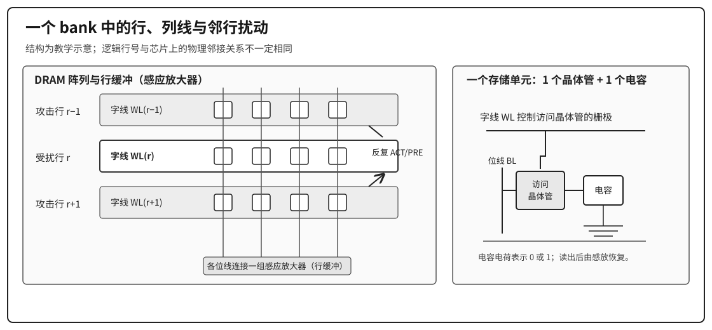

[内存控制器一节](./microarch-06b-memory-queue.md)已经把地址分到 bank 和 row，并沿 ACT、READ、PRE 算过访问延迟。这里继续看同一组命令，却换一个问题：反复打开一条 DRAM 行，为什么可能改坏没有被读取的另一行？这不是读数变慢的侧信道，而是内存单元发生了实际的数据错误。

[[toc]]

## 先看 DRAM 阵列里的行和单元

处理器的物理地址还要经过内存控制器的映射，才能选到通道、rank、bank、行和列。**Rank** 通常由多个 DRAM 芯片并排组成，共同提供一次访问所需的数据位宽。每个 bank 有自己的行缓冲；同一 bank 同一时刻只能保持一条打开的行，不同 bank 则可能并行工作。芯片内部还可能有子阵列和备用行，逻辑 bank、row 编号未必直接暴露物理排布。

图中把一个 bank 的三条物理相邻行画在一起。每个小格代表一个存储单元，横向字线（wordline，WL）控制同一行的访问晶体管，纵向位线（bitline，BL）把单元连接到感应放大器。实际 DRAM 阵列更大，行内的列、子阵列、备用行与地址重映射均被省略。

<figure class="lesson-figure">
<a href="/microarch/dram-row-disturbance.svg" aria-label="查看 DRAM 行与邻行扰动结构图"></a>
<figcaption>图 1　DRAM 行、列线和存储单元的教学示意。两个攻击行反复开关时，邻近单元的电荷可能更快流失；图中的逻辑行号不代表可直接用于系统程序的物理地址关系。</figcaption>
</figure>

常见 DRAM 单元由一个访问晶体管和一个电容构成。电容保存的电荷表示二进制状态，但电荷会随时间泄漏，所以 DRAM 必须周期性刷新。打开一行时，字线使这一行的访问晶体管导通，许多电容同时接到位线上。单元保存的电荷很小，感应放大器要判断位线上的微小电压差，并把判定结果放大到完整的 0 或 1。读出过程会扰动原来的电荷，因此感放还把恢复后的值写回单元；这一组感放也就是行缓冲。

## ACT、READ、PRE 改变的是不同状态 {#rowhammer-commands}

把一次 DRAM 访问拆成命令，可以看到哪些操作会反复拨动字线：

| 命令 | 控制器指定的对象 | 对 bank 中行状态的影响 |
| --- | --- | --- |
| `ACT`（Activate） | bank、row | 打开一行；字线拉高，行数据进入行缓冲 |
| `READ` / `WRITE` | bank、column | 从已打开行的行缓冲中读或写若干列 |
| `PRE`（Precharge） | bank | 关闭当前行，为下一次 ACT 做准备 |
| `REF`（Refresh） | rank 或指定刷新范围 | 在规定时间内恢复 DRAM 单元中的电荷 |

若行 41 已打开，随后连续读取它的列 0、列 8、列 16，通常可以由同一行缓冲满足：这是**行命中**。三个 READ 不等于三次 ACT，字线没有因每个列读都从头打开。要访问同一 bank 的另一行，控制器须先关闭当前行，再激活新行；自动预充电模式会把部分步骤合并进 READ/WRITE 命令，但物理上仍需完成关闭与重新打开。

| 访问序列 | 命令级过程 | 对同一行字线的打开次数 |
| --- | --- | ---: |
| 同一行读 100 个不同列 | `ACT(41) → READ(41, c0...c99) → PRE` | 1 |
| 两行交替读 100 次 | 重复 `ACT(41) → READ → PRE → ACT(43) → READ → PRE` | 每行约 100 |

第二种序列若行 42 在物理上位于行 41 和 43 之间，就形成经典的**双边扰动**：攻击者只访问两侧的 aggressor rows，中央 victim row 没有被直接读写，却可能出现位翻转。术语 *aggressor* 表示造成扰动的行，*victim* 表示承受扰动的行。行号相邻只是教学假设；现实中的地址哈希、bank 交错、备用行和子阵列组织可能改变映射，不能直接把虚拟地址加减一页当成物理邻行。

物理距离也不是所有已知扰动图样的固定边界。Half-Double 在特定 LPDDR4x 和 DDR4 设备上报告了这样的组合：对距离 victim 两行的单元施加大量激活，再对中间距离的一行施加少量激活，二者合起来使更远的 victim 发生错误。这说明防护若只刷新一条假定的直接相邻行，必须用实际内存与访问图样验证覆盖范围。

## 反复激活怎样演变成位翻转

DRAM 单元的电容很小，字线和相邻电路之间也不是完全隔离的。反复拉高、拉低攻击行的字线，会产生耦合干扰，使邻近行里部分单元的电荷损失加快。如果单元在下一次刷新之前越过感应放大器能够可靠判定的范围，感放可能把它识别为相反的位值，并将这个错误值写回。之后正常读取 victim row 时，软件就会读到被翻转的数据。

这里要区分实验结论和电路层解释。Kim 等人的实验确认了重复行激活能在商品 DRAM 中造成邻行扰动错误，并把字线反复切换与错误联系起来；论文也明确说明，若没有芯片级电路测量，无法断言具体耦合路径。因而教材可以说“重复激活导致扰动，电荷泄漏加速是有证据支持的解释”，不应把某一种微观电场模型写成所有 DRAM 的唯一机制。

刷新提供恢复电荷的机会，因此关键量不是机器运行以来的总访问数，而是受害单元得到恢复之前，相关行发生了多少次有效激活。这个数量常称为 hammer count。触发错误所需的激活数随芯片、行、数据图样、温度、刷新配置与访问时序变化；不能把某篇论文测得的阈值当成通用常数。

经典实验的数字应连同平台一起读。Kim 等人检查了 129 条 DDR3 内存模组（972 颗 DRAM 芯片），在其中 110 条模组（836 颗芯片）观察到扰动错误；论文在特定测试条件下报告的最小错误阈值约为 139,000 次行激活。这些样品和条件来自早期 DDR3 世代，能证明扰动现象真实存在，不能拿来预测现在任意 DDR4、DDR5 或 GDDR 设备的阈值。

## 用 C 模型区分列读和行激活 {#rowhammer-c-model}

下面的完整 C 程序是一个小型命令模型。它把一个 bank 简化成五行，令第 1 行和第 3 行夹着第 2 行；人为设定单个刷新观察窗口内的相邻激活总数达到 1000 就标记受扰行。第一种情形在同一行打开后读 1000 次；第二种情形在两条攻击行间反复关闭和重新打开。程序只模拟命令计数和教学阈值，不会访问真实 DRAM，也不模拟电路电荷。

```c
#include <stdbool.h>
#include <stdio.h>
#include <stdlib.h>

enum { ROWS = 5, LOW_AGGRESSOR = 1, VICTIM = 2, HIGH_AGGRESSOR = 3 };

struct bank {
    int open_row;
    unsigned activations[ROWS];
    bool flipped[ROWS];
    unsigned threshold;
};

static void check_disturbance(struct bank *b)
{
    for (unsigned row = 1; row + 1 < ROWS; ++row) {
        unsigned adjacent = b->activations[row - 1] + b->activations[row + 1];
        if (adjacent >= b->threshold)
            b->flipped[row] = true;
    }
}

static void activate(struct bank *b, unsigned row)
{
    if (row >= ROWS || b->open_row != -1) {
        fputs("invalid ACT: bank must be closed and row must exist\n", stderr);
        exit(EXIT_FAILURE);
    }
    b->open_row = (int)row;
    ++b->activations[row];
    check_disturbance(b);
}

static void read_column(struct bank *b, unsigned row)
{
    if (b->open_row != (int)row) {
        fputs("READ requires the requested row to be open\n", stderr);
        exit(EXIT_FAILURE);
    }
}

static void precharge(struct bank *b)
{
    if (b->open_row == -1) {
        fputs("invalid PRE: bank has no open row\n", stderr);
        exit(EXIT_FAILURE);
    }
    b->open_row = -1;
}

static unsigned total_activations(const struct bank *b)
{
    unsigned total = 0;
    for (unsigned row = 0; row < ROWS; ++row)
        total += b->activations[row];
    return total;
}

static void read_and_close(struct bank *b, unsigned row)
{
    activate(b, row);
    read_column(b, row);
    precharge(b);
}

int main(void)
{
    const unsigned threshold = 1000;
    struct bank same_row = {.open_row = -1, .threshold = threshold};
    struct bank alternating = {.open_row = -1, .threshold = threshold};

    activate(&same_row, LOW_AGGRESSOR);
    for (unsigned i = 0; i < threshold; ++i)
        read_column(&same_row, LOW_AGGRESSOR);
    precharge(&same_row);

    for (unsigned i = 0; i < threshold / 2; ++i) {
        read_and_close(&alternating, LOW_AGGRESSOR);
        read_and_close(&alternating, HIGH_AGGRESSOR);
    }

    printf("same row: ACTs=%u, victim flipped=%s\n",
           total_activations(&same_row),
           same_row.flipped[VICTIM] ? "yes" : "no");
    printf("alternating rows: ACTs=%u, victim flipped=%s\n",
           total_activations(&alternating),
           alternating.flipped[VICTIM] ? "yes" : "no");
    return 0;
}
```

编译后，第一种情形输出 1 次 ACT，victim 未翻转；第二种情形输出 1000 次 ACT，教学模型标记 victim 已翻转。代码的关键不是数字，而是 `read_column` 不增加激活计数，只有 `activate` 增加计数。真实 DRAM 没有一个由主机软件随意指定、对所有行都固定的 `threshold`；硬件还要受实际邻接关系、刷新、内部行修复和目标行刷新等因素影响。

## 从程序加载到 DRAM 命令还隔着缓存与控制器

CPU 执行一次加载，不会直接变成一次 DRAM ACT。若数据已在 L1、L2 或 LLC 中，DRAM 完全不必收到请求；若请求到达内存控制器，同一行缓冲里已有目标行时也可能只发 READ。要让软件访问产生足够多的 ACT/PRE，实验必须同时处理缓存驻留、物理地址到 bank/row 的映射、控制器调度和刷新时序。上一节的[DRAM 行调度例题](./microarch-06b-memory-queue.md#memory-row)说明了行命中怎样减少命令；这里的扰动恰好要求攻击访问最终能造成反复的行关闭与重新激活。

经典 Rowhammer 论文使用了 `X`、`Y` 两个地址交替加载，并在两次访问之间刷新对应缓存行，再用内存栅栏约束顺序。刷新缓存行的目的是避免后续加载一直由 CPU 缓存满足；它不等于直接发送 DRAM 的 PRE 命令，也不能保证某笔请求已经变成一次 ACT。实验还必须知道 `X`、`Y` 是否映射到同一 bank 的不同物理行，并确认控制器确实发出了预期命令。虚拟连续、物理连续、DRAM 行连续是三个不同概念。

这一链条也解释了 Rowhammer 的安全意义和边界。CPU 权限检查仍然阻止程序直接读取 victim page；错误来自物理存储状态发生变化，使某个受害位在之后的读取中变了值。若翻转位置恰好位于页表项、对象元数据或其他安全敏感数据，错误可能进一步破坏隔离。但“发生过位翻转”并不等于攻击者获得任意写入：可利用性还取决于翻转方向、位的位置、受害数据布局、错误是否可重复以及系统能否纠错或检测。

## 防护要对准激活次数、邻行和错误模式 {#rowhammer-mitigation}

| 防护 | 主要改变什么 | 能力边界 |
| --- | --- | --- |
| 缩短刷新间隔 | 缩短单元等待电荷恢复的窗口 | 增加刷新流量和功耗；需要覆盖最弱单元及高温等条件 |
| TRR（Target Row Refresh） | 识别高频激活行，并额外刷新可能受影响的邻行 | 商用实现可能使用采样或有限表项；不同内存的行为和覆盖范围不同 |
| ECC | 检测或纠正读出的错误位 | SECDED 通常面向单比特纠正、双比特检测；错误模式超出码的能力时不能提供保证 |
| PRAC（Per-Row Activation Counting） | 支持的 DDR5 器件按行记录激活次数；接近器件阈值时通过告警和主机配合触发缓解 | JESD79-5C 中为可选能力；依赖 DRAM、控制器和系统共同支持，不能推断所有 DDR5 模组都已启用 |

TRRespass 研究说明，有限的行追踪或采样式 TRR 可能被多侧行访问图样绕开；这不是说所有 TRR 都采用同一种表或必然可绕过，而是说明内部策略及测试条件要明确。PRAC 的目标更直接：按行保留激活计数，并在达到阈值附近让器件和内存控制器配合处理。Micron 的 DDR5 数据手册将 PRAC 列为 16 Gb 及以上器件的可选功能，支持状态由模式寄存器报告。标准里存在该接口，并不能证明某台机器的 DIMM 和控制器已经启用这套路径。

防护不能停留在“DDR5 更新，所以 Rowhammer 已解决”或“开了 ECC 就不会翻转”。Phoenix 研究在 15 条 SK Hynix DDR5 DIMM 上展示了可触发位翻转的刷新模式；结果只覆盖作者测试的模块和平台，但足以说明新一代内存与 TRR 仍需按具体行为验证。2026 年的 GPUThor 又在四款 NVIDIA Ampere GDDR6 工作站卡（RTX A4000、A4500、A5000、A6000）上报告了 ECC 开启时的多位错误。它不能证明所有 GPU 或所有 ECC 都可被同样方式突破，却说明内存类型、请求合并、内部刷新和纠错粒度必须一起分析。

因此，评估一项缓解措施时应问四个具体问题：它观察的是哪个粒度的激活？如何判定某行已接近风险阈值？会刷新哪一侧、哪些 bank 或 rank？错误超过单比特时，ECC 是否还能检测、纠正并报告？只有逐项回答，才能说明防护覆盖的是哪种攻击图样，以及仍留下哪些未验证的条件。

### ECC 怎样知道该翻回哪一位 {#rowhammer-ecc-codeword}

以 AMD 7 Series 内存控制器的可选 ECC 路径为例。写入时，控制器用数据计算校验位，两者一起送入 DRAM。读回时，校验逻辑对收到的数据和校验位重新计算，得到一组检查结果，称为**校验综合征**（syndrome）。纠错逻辑根据综合征定位可纠正的错误，修正交给上游的数据，同时输出错误状态。这个例子中使用的是 72 位数据接口。下面缩成八位码字，只为把校验和定位逐位算出来。

取四个数据位 `1、0、1、1`，依次放在第 3、5、6、7 位。第 1、2、4 位各负责一组偶校验，第 8 位负责整个码字的偶校验。第 1、2、4 位所检查的组，可以直接从位置编号的二进制表示算出。例如位置 5 写成 `101`，因此参加第 1、4 组检查。

| 校验位 | 检查哪些位置 | 编码时怎样求值 |
| --- | --- | --- |
| 1 | 1、3、5、7 | `1 XOR 0 XOR 1 = 0` |
| 2 | 2、3、6、7 | `1 XOR 1 XOR 1 = 1` |
| 4 | 4、5、6、7 | `0 XOR 1 XOR 1 = 0` |
| 8 | 1 至 8 | 前七位已有四个 1，所以填 0 |

按位置 1 到 8 写出码字是 `0 1 1 0 0 1 1 0`。读回时，把出错的分组编号加起来得到综合征，再用整字偶校验判断翻转总数是奇数还是偶数。以下分类只在最多两位同时出错的题设下使用。

| 综合征 | 整字偶校验 | 解码器的判断 |
| --- | --- | --- |
| 0 | 通过 | 未检测到错误 |
| 非零 | 失败 | 第 1 至 7 位中有一个错误，综合征给出位置 |
| 0 | 失败 | 第 8 位出错 |
| 非零 | 通过 | 检测到两位错误，不能定位一对唯一的位置 |

若只翻转第 5 位，第 1、4 组校验失败，综合征为 5，整字偶校验也失败，解码器翻回第 5 位即可恢复数据。若第 5、6 位一起翻转，第 4 组的两次变化相消，只有第 1、2 组失败，综合征变成 3。这个 3 仍像一个位置编号。整字校验此时通过，说明不能按「第 3 位单错」来修。扩展汉明码就是靠这道整字校验把两种情况分开。

**纠错以码字为单位。** 一条缓存行可能由多个独立保护的数据单元组成。若检测到两个错误位，要查它们属于同一个码字还是不同码字，才能判断是一次不可纠正错误，还是两次可以独立纠正的单比特错误。硬件修正返回的数据后，是否把正确码字写回 DRAM，又取决于控制器的写回或巡检机制。ECC 介入的是数据的读回与恢复，前面的刷新和行激活限制介入的是扰动发生前的窗口。

::: details 练习｜校验位自己出错

若只翻转第 8 位，前三组校验各是什么结果，数据位需要修改吗？

第 8 位没有参加前面三组校验，综合征仍为 0。它参加整字校验，因此整字校验失败。解码器能判定错误在第 8 位，四个数据位保持原值。

:::

## 参考文献

- [Kim 等，Flipping Bits in Memory Without Accessing Them: An Experimental Study of DRAM Disturbance Errors，ISCA 2014](https://istc-cc.cmu.edu/publications/papers/2014/kim-isca14.pdf)
- [Kogler 等，Half-Double: Hammering From the Next Row Over，USENIX Security 2022](https://www.usenix.org/conference/usenixsecurity22/presentation/kogler-half-double)
- [Frigo 等，TRRespass: Exploiting the Many Sides of Target Row Refresh，IEEE S&P 2020](https://doi.org/10.1109/sp40000.2020.00090)
- [Micron DDR5 SDRAM 数据手册，PRAC 可选功能及行激活计数说明](https://www.avnet.com/wcm/connect/dacdfea7-999f-4ee0-b514-6f9e0bf68c6d/ddr5-sdram-core.pdf?MOD=AJPERES)
- [Phoenix：DDR5 上的 Rowhammer 与自校准刷新同步，IEEE S&P 2026](https://comsec.ethz.ch/research/dram/phoenix/)
- [GPUThor：非均匀访问模式与 ECC 保护的 GPU，ACM CCS 2026](https://gputhor.com/)
- [AMD UG586，内存控制器的 ECC 编码、解码和错误状态](https://docs.amd.com/r/en-US/ug586_7Series_MIS/Error-Correcting-Code)
- [内存控制器怎样选择 DRAM 行与列命令](./microarch-06b-memory-queue.md#memory-row)
- [地址怎样映射到 DRAM 的 bank 和 row](./microarch-06b-memory-queue.md#memory-address-mapping)

<nav class="article-nav" aria-label="系列文章导航">

[<span class="article-nav-text"><small>上一篇</small><strong>同核多线程怎样安排任务</strong></span>](./microarch-06d-core-scheduling.md){.article-nav-card .article-nav-prev rel=prev}

[<span class="article-nav-text"><small>下一篇</small><strong>Spectre v1 中的边界检查为何会被越过</strong></span>](./microarch-04d-spectre-v1.md){.article-nav-card .article-nav-next rel=next}

</nav>
